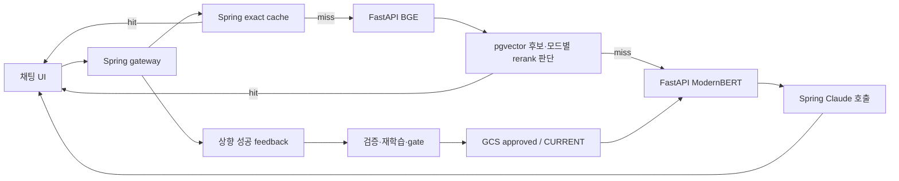

# 프로젝트 문서 시작점

기준일: 2026-09-23. **최신 ML 설계는 한 파일, 과거 설정은 한 파일**에서 관리한다. 이 문서는 프로젝트 개요와 협업 규칙을 겸한다. 기존 개요·팀 규칙·GitHub 설정·일정·MVP 문서는 여기에 필요한 내용을 흡수하고 Git 이력으로 보존했다.

## 무엇을 읽으면 되는가

| 목적 | 유일한 기준 문서 |
|---|---|
| 프로젝트 목적·서비스 흐름·협업 | 이 파일 |
| 데이터·전처리·학습 목표·표현/모델 비교·평가·재학습·캐시·실행 차이 | [ML 최종 실험 명세](ml/README.md) |
| 이전 설정이 왜 바뀌었는지·과거 결과·원문 복구 | [Deprecated settings](deprecated-settings.md) |
| ML 설치·CLI·코드 탐색 | [ML 실행 진입점](../ml/README.md) |
| Spring·React·DB 배포 절차 | [배포 안내](../infra/DEPLOY.md) |
| 실험 코드·실험별 상태·결과 위치 | [실험 목록](../experiments/REGISTRY.md) |
| 남은 라우터 실험의 최종 계획(RT-08·EV-10) | [라우터 최종 실험 계획서](ml/ROUTER_FINAL_EXPERIMENT_PLAN.md) |
| 기존 서비스·라우터 실측과 원본 결과 | [과거 평가 색인](../experiments/results/README.md) |
| Serving 설치·운영·GCS·Vertex 연결 | [Serving 실행 안내](../../LLM_Router-serving/README.md) |
| 현재 HTTP 요청·응답·오류·관측 계약 | [Serving API 계약](../../LLM_Router-serving/docs/api-contract.md) |
| API 예제와 구계약 fixture의 구분 | [Serving 예제 안내](../../LLM_Router-serving/docs/examples/README.md) |

두 저장소를 같은 상위 폴더에 checkout하면 상호 링크를 바로 열 수 있다. 프로젝트 상태와 결정 원장은 **memorize**, 팀 작업 추적은 GitHub, 실행 결과는 버전이 고정된 artifact가 담당한다. 문서의 설계 설명을 구현·배포 완료 증거로 읽지 않는다. 연구 실행 전 남은 작업은 [구현 차이 표](ml/README.md#implementation-gaps), 현재 serving 동작은 API 계약에서 확인한다.

## 연구 전제와 서비스 흐름

> 어떤 조건에서 임베딩 캐시와 에스컬레이션 피드백 학습을 결합한 라우팅 시스템이 더 나은 비용–품질 균형을 만드는가?

핵심은 임베딩 캐싱, 질문 기반 라우팅, 에스컬레이션 데이터에 의한 재학습이다. 특정 모델의 우승이나 일정 절감률을 전제하지 않는다. Claude는 서비스 호출 대상이며, 비교 실험은 RouterBench+xRouteBench의 공개 결과를 재사용한다. 새로운 Claude 응답·judge 결과를 대량 생성해 학습하지 않는다.

1. 캐시가 켜져 있으면 Spring gateway가 먼저 정규화한 질문의 exact cache를 조회한다. Hit이면 임베딩·분류·Claude 호출을 생략한다.
2. Exact miss이면 FastAPI의 BGE 임베딩으로 pgvector 후보를 검색하고 Spring의 rerank 모드와 재사용 조건에 따라 답변을 반환한다. 의미 유사성만으로 답변의 적합성을 보장하지 않는다.
3. Cache miss이면 FastAPI의 ModernBERT가 easy/medium/hard를 예측한다. Spring이 서비스의 Haiku/Sonnet/Opus에 연결하고 답변을 저장한다.
4. 사용자가 상향 요청 후 만족하면 관측 경로와 결과를 feedback으로 수집한다. 최종 성공 tier가 절대적인 최소 충분 tier라는 뜻은 아니다.
5. 유효 feedback을 검증·정규화해 재학습한다. Gate를 통과해 GCS에 게시된 package를 FastAPI가 검증 후 적재한다.



위 도식은 캐시가 켜진 경로다. 캐시를 끄면 조회·임베딩·저장을 건너뛴다. Spring의 [설정](../backend/src/main/resources/application.yml)은 `RERANK_MODE=enforce`가 기본이며, FastAPI의 reranker 모델 ID 미설정 시 비활성과는 별개다. Enforce의 일반 rerank 장애는 miss로 처리하지만, 후보에 채점할 질문 원문이 하나도 없으면 통과시키는 운영 호환 예외가 현재 코드에 있다. 연구 C3의 검증 조건과 이 예외를 구분한다. 이 설명은 코드 기준이며 현재 배포 설정을 확인했다는 뜻은 아니다.

| 구성 | 책임 |
|---|---|
| React UI | 질문·응답과 상향 요청의 사용자 경험 |
| Spring gateway | 대화·인증·응답 캐시·Claude 호출·feedback 수집 |
| FastAPI serving | 임베딩·난이도 분류·inline feedback 접수·pipeline 제출/상태·승인 모델 적재 |
| LLM_Router의 ML 코드 | 데이터·학습·평가·package·승격·게시 계약 |
| GCS / Vertex | 운영 feedback artifact 저장과 관리형 실행 |

초기학습과 비교는 Colab, 운영 ModernBERT feedback 재학습은 관리형 Vertex AI Pipelines 및 Custom Training을 사용한다. GKE나 자체 KFP control plane을 운영하는 구조가 아니다. 실제 모델 ID·자원·image digest·비용·확인 시각은 실행 manifest에 기록한다.

## 협업과 변경 규칙

- 작업은 목적과 하나의 산출물이 분명한 issue로 관리한다. Milestone, `area:*`, `priority:*`를 지정하고 큰 작업은 분할한다. `p0`는 차단 해결, `p1`은 현재 milestone, `p2`는 개선이다.
- [Delivery](https://github.com/orgs/HYUCapstoneProject/projects/2)는 구현·배포·문서, [Experiments](https://github.com/orgs/HYUCapstoneProject/projects/3)는 데이터·학습·평가를 추적한다. `Backlog → Ready → In Progress → Review → Done`, 막히면 `Blocked`에 이유와 필요한 도움을 적는다. 문서에 과거 issue 수나 진행 상태를 복제하지 않는다.
- `main`에 직접 push하지 않는다. 목적별 branch와 PR을 사용하고 최소 1명 리뷰 후 merge한다. Branch는 `feat/`, `fix/`, `docs/` 등 작업 유형으로 표현한다.
- 커밋 메시지 첫 줄은 아래 형식을 따른다. `[TYPE]`은 대문자, 요약은 한국어 한 줄이며 끝에 마침표를 붙이지 않는다. `LLM_Router`, `LLM_Router-serving` 두 저장소 모두 적용한다.

  ```
  [TYPE] 변경 내용 요약
  ```

  | 타입 | 의미 |
  |---|---|
  | `[FEAT]` | 새 기능 추가 |
  | `[FIX]` | 버그 수정 |
  | `[DOCS]` | 문서만 변경 |
  | `[CHORE]` | 빌드·설정 등 기능에 영향 없는 잡일 |
  | `[REFACTOR]` | 동작은 그대로 두고 구조만 바꾼 변경 |
  | `[TEST]` | 테스트 추가·수정 |
  | `[BUILD]` | 빌드 시스템·의존성·이미지 변경 |
  | `[CI]` | CI 설정 변경 |

  예:

  ```
  [DOCS] timeline 학습 우선 계획 반영
  [FEAT] router-serving FastAPI skeleton 추가
  [FIX] gateway 캐시 미스 처리 오류 수정
  ```

  두 저장소 모두 초반에는 이 형식을 따랐으나, 이후 일부 세션이 영어 소문자
  Conventional Commits 형식(`type: description`, 예: `fix: pass routing
  objectives through training CLI and image`)으로 바꿔 쓰면서 규칙이
  섞였다. 이 규칙은 지금부터 만드는 커밋에 적용하며, 이미 push된 과거 커밋
  메시지는 rebase로 재작성하지 않는다 — 다른 branch·PR·issue의 참조 SHA가
  깨지고 force-push가 필요해 팀 작업 중에는 하지 않기로 했다.
- 커밋·push 검사는 개발용 agent의 설정·지시·세션 파일과 명시적인 도구 작성자 표식을 차단한다. `.codex/`, `.agents/`, `.claude/` 같은 도구 전용 경로와 `AGENTS.md` 등은 로컬에만 둔다. `AnthropicConfig.java`, Claude API 호출, LLM routing·모델·데이터·평가 코드는 서비스 구성요소이므로 파일명이나 메시지에 AI·LLM·Claude·Anthropic·OpenAI가 있다는 이유로 차단하지 않는다. 일반 코드 생성기의 표식, 정책·테스트의 문자열 예시와 실제 agent 작성자 표식도 구분한다. 비밀정보 제외 규칙은 별도로 유지한다.
- PR에는 문제·변경·검증·관련 issue를 적는다. 검증하지 못한 내용과 이유도 명시한다. 하나의 PR에는 목적이 같은 변경을 담고, 실행 방법·계약이 바뀌면 해당 소유 문서를 함께 갱신한다.
- API의 endpoint·요청·응답·오류 계약은 구현과 함께 갱신한다. Breaking change는 issue/PR에 표시하고 영향을 받는 팀과 공유한다. HTTP 상세는 serving API 계약에만 둔다.
- 실제 `.env`, API key, GCP credential, service-account key, HF token을 commit하지 않는다. 변수 계약은 `.env.example`과 실행 안내에 남긴다. 노출을 확인하면 즉시 공유하고 교체한다.
- 실험은 실패도 기록한다. 데이터·라벨·split·code/config·hyperparameter·평가·산출물·검증일을 고정한 manifest를 남기며, 자세한 규칙은 ML 명세를 따른다. 원본 데이터·로그·가중치는 Git에 모두 들어 있지 않다.
- 자원 사용의 목적·예상 비용·budget·종료 방법을 남기고 GPU·대량 API 비용 작업은 팀에 공유한다. 끝난 임시 자원은 정리한다. 오래된 일정·비용 목표를 현재 승인으로 간주하지 않는다.

`area:*`의 기존 분류는 frontend, gateway, cache, router-serving, ml-training, kubeflow, infra, evaluation, docs다. `area:kubeflow`는 KFP/Vertex 작업 분류이며 GKE 사용을 뜻하지 않는다.

## 문서를 다시 늘리지 않는 원칙

새 결정은 memorize와 위 표의 해당 문서에 반영한다. 같은 정책을 설명하는 별도 최신 계획·보고서·체크리스트를 만들지 않는다. 현재 설계의 변경은 소유 문서를 직접 수정하고, 대체된 설정의 이유와 전환 조건만 [Deprecated settings](deprecated-settings.md)에 짧게 추가한다. 과거 문서 전문·회의별 사본·날짜별 설정 파일은 Git에서 조회한다. `main`에서 합류했던 8월 PLAN·HANDOFF는 2026-10-13에 삭제했으며 원문은 `git show 3c10d04:PLAN.md`·`git show 3c10d04:HANDOFF.md`로 조회한다. 기존 `experiments/results`는 관측 증거로 보존하고 최신 명세와 경쟁하는 계획으로 갱신하지 않는다.

문서 압축 과정에서는 원본 데이터·가중치·로그와 재현용 fixture를 삭제하지 않았다. 함께 통합한 선택 실행용 실험 코드의 현재 지원 범위는 ML 명세의 구현 차이 표를 따른다. 문서·코드 통합을 운영 배포나 최종 실험 완료로 간주하지 않는다. Agent 지침은 로컬에, 컴포넌트별 실행 진입점은 각 패키지에 유지한다.
