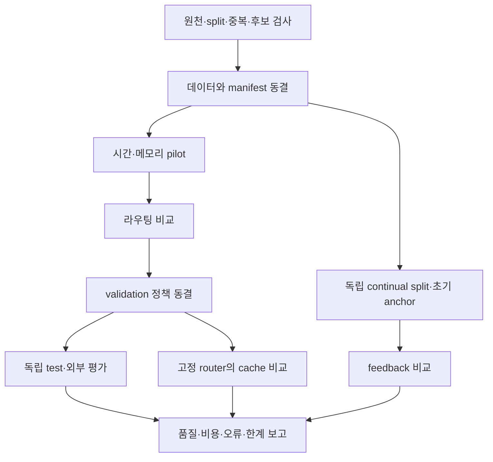
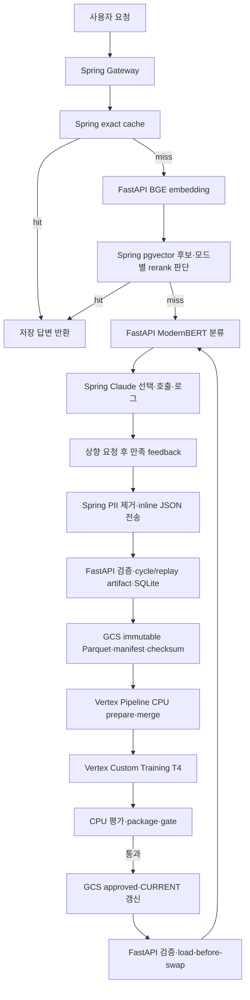
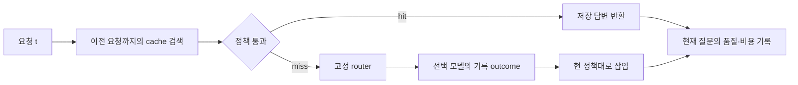

# ML 최종 실험 명세

기준일: 2026-09-23. 데이터·라우팅 비교·평가·재학습·캐시·실행 관리의 **현재 기준은 이 파일 하나**다. 과거 설정·실험 기록은 [Deprecated settings](../deprecated-settings.md), 설치·CLI 입구는 [ml/README](../../ml/README.md), 프로젝트 개요·협업 규칙은 [문서 시작점](../README.md)을 따른다. 프로젝트 결정 원장은 memorize다.

> 어떤 조건에서 임베딩 캐시와 에스컬레이션 피드백 학습을 결합한 라우팅 시스템이 더 나은 비용–품질 균형을 만드는가?

## 목차

1. [연구 전제와 최소 실험](#overview)
2. [데이터·전처리](#data)
3. [학습 목표·표현/모델·논문 라우터 비교](#routing)
4. [평가·인지 수준 분석](#evaluation)
5. [재학습 파이프라인](#retraining)
6. [캐시 실험](#cache)
7. [실행·산출물 관리](#execution) / [실행 전 구현 차이](#implementation-gaps)

<a id="overview"></a>
## 1. 연구 전제와 최소 실험

시스템의 세 축은 임베딩 캐싱, 질문 기반 라우팅, 에스컬레이션 데이터에 의한 재학습이다. 특정 모델의 우승이나 일정 절감률을 전제하지 않으며 개선이 없는 조건도 보고한다.

1. Claude는 서비스 호출 대상이다. 신규 Claude 응답·judge·preference를 대량 생성해 학습하지 않는다. 공개 benchmark에 이미 있는 결과는 재사용한다. 서비스 모델 ID는 실행 manifest에 고정하고 역사적 후보와 능력이 같다고 가정하지 않는다.
2. 비교군은 동일한 원천 질문·split·후보·score/cost·튜닝 예산을 사용한다. R0/R1/R2의 target 변환 차이는 연구 대상이다.
3. 난이도 분류, 실제 후보 선택의 품질–비용, 캐시/feedback 시스템 효과를 별도로 평가한다. 서로 다른 source pool을 같은 실제 세 모델로 합치지 않는다.
4. 학습·선택은 train/validation에서 끝낸다. RouterArena는 학습·feedback·반복 승격 gate에 사용하지 않는다. 과거 관찰 이력을 공개하고 test를 보고 재선정하지 않는다.
5. 연구 artifact·DB·gate·CURRENT namespace는 운영과 분리한다. 현행 운영 v2는 문서 정리만으로 대체하지 않는다.
6. 초기학습·비교는 Colab, 운영 ModernBERT feedback 재학습은 관리형 Vertex AI Pipelines와 Custom Training을 사용한다. GKE나 자체 KFP control plane은 사용하지 않는다.
7. 실제 router 측정, 공개 outcome 재생, 가정을 둔 simulation, Claude 서비스 관측을 구분한다. 실패 비용·오류·미측정 범위를 숨기지 않는다.

| 축 | 최소 실험 | 선택 확장 |
|---|---|---|
| 표현·모델 | TF-IDF+LR, frozen BGE+kNN, ModernBERT | RoBERTa 근접 규모 비교 |
| 학습 목표 | 같은 ModernBERT의 R0 CE / R1 성공 예측 / R2 pairwise | R3 regret |
| 논문 라우터 | 동일 실제 세 후보의 RouterDC 재학습 | GraphRouter/CARROT |
| 비학습 기준선 | always-low/mid/high, best-single, matched random, oracle | source/domain 보존 진단 |
| 재학습 | frozen / cycle-only / replay+rehearsal, 공통 feedback·6개 제출 기회 | on-policy, 15성공 pristine rebase |
| 캐시 | 없음 / exact / BGE semantic, router 고정 | reranker, 다른 router 재현 |
| 인지 수준 | 블라인드 주석·일부 인간 검증·통제 문항쌍 | 평가 주석을 학습 label로 재사용하지 않음 |

샘플·step·threshold의 pilot 시작값은 각 장에 명시한다. 최종 값은 test를 열기 전에 manifest에 동결한다. “최종”은 현재 설계가 하나라는 뜻이며 모든 구현·성능 검증이 완료되었다는 뜻이 아니다. [구현 차이 표](#implementation-gaps)에만 실행 전 작업을 모은다.



새 결정은 memorize와 이 파일의 해당 장에 반영하고 config/manifest를 함께 갱신한다. 별도의 최신 계획·체크리스트 사본을 만들지 않는다. 실행 결과는 artifact에 저장하고 이 파일에서는 위치와 검증 상태만 관리한다.

<a id="data"></a>
## 2. 데이터·전처리

<a id="data-1"></a>
### 2.1. 데이터의 역할

| 데이터 | 역할 | 허용되는 사용 |
| --- | --- | --- |
| RouterBench text-only | 공개 질문×모델 결과, 난이도 학습·비교 | train으로 학습, validation으로 선택, 고정 test로 최종 평가 |
| xRouteBench `llmrouter_generic` | 별도 모델 pool의 공개 결과, 통합 학습·3-action 비교 | 공식 train을 train/validation으로 분할, 공식 test는 최종 평가 |
| RouterArena | 독립적인 인지 수준 기반 외부 난이도 진단 | 중복 검사에 질문 text 사용; 모델·설정 동결 후 label 평가 |
| 순차 feedback 표본 | 재학습·망각 실험 | 기존 개발 데이터에서 별도 봉인; 초기 모델도 해당 질문을 보지 않음 |
| 캐시용 반복·의미 문항 | 응답 재사용 검증 | 학습·튜닝 표본과 분리; [캐시 계약](#cache) 적용 |

새 Claude 응답이나 judge 결과를 대량 생성하지 않는다. 원천에 이미 포함된 과거 Claude 결과는 공개 benchmark 기록으로 재사용한다. 후보 모델의 답변·점수·비용은 target 또는 evaluator에만 제공하고, 질문 라우터의 입력에 넣지 않는다.

공식 원천: [RouterBench](https://huggingface.co/datasets/withmartian/routerbench), [xRouteBench](https://huggingface.co/datasets/ulab-ai/xRouteBench), [RouterArena](https://github.com/RouteWorks/RouterArena). 다운로드 revision, 원본 파일 크기와 SHA-256은 dataset manifest에 고정한다. 최신 branch를 실행 시마다 다시 받는 방식은 사용하지 않는다.

<a id="data-2"></a>
### 2.2. 포함 범위와 원본 고정

RouterBench는 기존 canonicalization을 재사용한다.

- MMLU, HellaSwag, GSM8K, ARC-Challenge, WinoGrande는 5-shot source를 우선한다.
- MBPP와 MT-Bench는 0-shot source를 우선한다. RAG는 제외한다.
- 동일 `sample_id`의 0-shot/5-shot 행은 source 우선순위로 한 행만 남긴다.
- 직렬화된 prompt list는 안전한 literal parser로 복원한다. 5-shot은 마지막 미응답 질문을 추출한다.
- 원문 `prompt`, 추출한 `query_text`, 학습용 `model_input_text`를 별도로 보존한다.

xRouteBench는 다음 revision의 generic train/test와 후보 metadata만 사용한다.

```text
revision = ea4b6e1b29d9a734f55f0a637baf326bad6aa681
llmrouter_generic/train.parquet
llmrouter_generic/test.parquet
llm_candidates/train.parquet
```

파일별 checksum은 [통합 데이터 config](../../ml/config/router_model_comparison_v1.json)에 있다. 현재 확인한 pivot 전 generic query 수는 train 4,489, test 3,729다. 이는 정제·중복 제거 후 최종 학습 행 수가 아니다.

다음은 주 실험에서 제외하고 사유별 행 수를 기록한다.

- RouterBench RAG/`needs_retrieval=true`; xRouteBench memory, timeseries, video, multimodal, personalized 구성.
- 빈 질문, 파싱 불가, 범위 밖 performance, 중복 query/model 실행처럼 의미를 확정할 수 없는 행.
- 정답·생성 응답·라벨·모델명·가격이 benchmark wrapper를 통해 입력에 노출된 행.
- OpenHermes 등 질문별 동일 후보의 채점 결과가 없어 이 계약의 라벨·비용을 만들 수 없는 데이터.

문제 본문에 원래 등장하는 모델명·숫자·전문용어를 무조건 지우지는 않는다. benchmark 부가 정보와 과제 수행에 필요한 내용을 구분한다.

<a id="data-3"></a>
### 2.3. 공통 schema와 namespace

| 필드 | 의미 |
| --- | --- |
| `sample_id` | source namespace를 포함한 안정적인 질문 ID |
| `source_dataset`, `source_split`, `source_task` | 원천·공식 분할·원래 문항 식별 정보 |
| `category` | source 안에서의 분석용 영역 |
| `query_text`, `model_input_text` | 추출 원문과 모델에 전달할 정제문 |
| `valid_model_count`, `accepted_model_count`, `overall_solve_rate` | 유효 결과 수, 성공 수, 성공 비율 |
| `difficulty_label`, `difficulty_label_t2` | T1 주 라벨과 T2 민감도 라벨 |
| `label_confidence`, `sample_weight` | 원천 신뢰도와 기존 호환 metadata; 최종 학습 적용 여부는 §2.7에 고정 |
| `duplicate_group_id`, `split` | 누수 방지 그룹과 최종 분할 |
| `dataset_version`, `label_rule_version`, `preprocessing_version`, `split_version` | 재현 가능한 변환 계약 |
| `label_origin` | benchmark difficulty, 관측된 escalation 성공 action, 인지 주석 등 라벨 근거 |

RouterBench ID에는 `routerbench:`를 붙인다. xRouteBench는 `task_name + task_id(결측이면 embedding_id) + normalized query`를 query key로 만들고 hash에 `xroutebench:`를 붙인다. 키와 원래 task ID를 함께 보존한다. 단순한 정수 ID만 source 사이에서 결합하지 않는다.

영역은 RouterBench의 coarse `domain`을 `category`로, `eval_name`을 `source_task`로 둔다. xRouteBench는 `task_name`을 category로 보존한다. `knowledge`와 개별 xRoute task를 이름만으로 같은 영역으로 합치지 않는다. 공통 taxonomy가 필요하면 별도 version의 mapping table을 만들며 주 결과는 항상 `source × category`로도 제시한다.

학습 입력은 `model_input_text`뿐이다. category, source ID, 정답, 모든 후보의 결과, 실제 응답 길이는 입력 feature가 아니다. 메타데이터가 Parquet에 있어도 collator가 이를 text에 연결하지 않는지 검사한다.

원본 outcome matrix는 감사용 별도 artifact로 유지한다. 분류 학습 projection과 R1/R2 target projection은 공통 `sample_id`로 결합하며, 모델 응답을 text feature로 복사하지 않는다. 새 manifest에는 원천 checksum, 필터 이유, 성공 판정 규칙, 입력 정제 전후 hash를 남긴다.

<a id="data-4"></a>
### 2.4. 텍스트 정제와 중복 검사

`query_text`를 그대로 남기고 `model_input_text`를 결정적으로 만든다.

1. Unicode NFKC, 줄바꿈 통일, 불필요한 제어 문자·행 끝 공백·중복 빈 줄을 정리한다.
2. 객관식 출력 형식 지시처럼 benchmark에만 필요한 알려진 wrapper를 제거한다.
3. 질문 본문·선택지·코드·필요한 대화 문맥과 context는 유지한다.
4. xRoute의 `[User Query]` wrapper는 실제 원본 구조를 확인해 제거한다. system 부분이 과제 조건을 담고 있으면 삭제하지 않는다.
5. 정제 후 빈 입력, 선택지 누락, 코드 구조 손상은 전처리 오류로 처리한다.

모델 입력에서 case나 구두점을 제거하지 않는다. 코드 들여쓰기와 수식·부정·숫자도 의미의 일부다. 정제 예시를 source/category별로 샘플링해 원문과 대조한다.

중복 탐지는 입력 변환과 별도 경로다. 현재 구현은 NFKC+case-fold+단어 추출 hash로 exact 후보를 만들고, token 3-gram SimHash 후보에 Jaccard `>=0.90`을 적용한다. 최소 5 token, bucket 상한 200을 사용하며 큰 bucket을 건너뛴 수를 기록한다. 이것은 모든 의미 중복을 찾았다는 보장이 아니다.

단어만 남기는 hash는 코드 연산자 등 의미 차이를 놓칠 수 있다. 이런 충돌을 곧바로 동등한 문항으로 선언하지 않고, 원문 보존·오탐 감사와 구조 보존 검증을 거쳐 그룹을 확정한다. 같은 task ID도 namespace를 확인한 뒤 그룹 후보로 사용한다.

확정된 duplicate group은 split을 넘지 않는다. cross-source 그룹은 RouterArena 보호 집합, xRoute 공식 test, RouterBench 고정 test, validation, train 순으로 보호한다. 외부 평가와 겹치는 개발 행을 먼저 제외한다. 평가셋끼리의 overlap은 별도 집계하고 source별 점수를 제시한다.

같은 그룹에서 대표를 남기는 규칙은 정보 완전성과 안정적인 ID tie-break로 동결한다. 어떤 행을 제외했는지 모두 manifest에 보존한다. `exact`, `near`, `task-id`를 구분하며 그룹 대표만 남겼다고 raw 데이터도 삭제하지 않는다.

<a id="data-5"></a>
### 2.5. 점수에서 성공 여부로 변환

성공 판정 경계와 난이도 경계는 다르다. 먼저 질문별 각 후보 결과를 성공/실패/결측으로 변환한다.

| 원천·metric | 성공 판정 |
| --- | --- |
| RouterBench exact-match 계열 | `performance == 1.0` |
| RouterBench GSM8K partial-credit, MBPP, MT-Bench의 현재 원점수 계약 | `performance >=0.70` |
| xRoute `em_mc`, `GSM8K`, `MATH`, `code_eval` | `performance ==1.0` |
| xRoute `f1_score` | `performance >=0.70` |
| 등록하지 않은 metric 또는 null | 결측; 자동 실패나 임의의 0.70 판정 금지 |

같은 GSM8K 이름이라도 원천의 채점 형식이 다르므로 metric 계약을 먼저 확인한다. 연속 원점수는 버리지 않고 `quality`로도 보존한다. `0`은 관측된 실패이며 결측이 아니다. RouterBench v2에서 제외했던 `unresolved`를 통합 전체 성공률 방식에서도 자동 제외하지 않는다. 유효한 전부 실패 결과는 통합 난이도에서 hard가 될 수 있다.

xRoute는 `(query key, model_name)` 중복 실행을 오류로 처리한다. 18개 후보 중 유효 결과가 12개 이상이어야 통합 라벨 대상이며, 미만은 사유와 함께 제외한다. 범위 밖 `[0,1]` 점수는 조용히 clipping하지 않는다.

```text
overall_solve_rate(q) = accepted_model_count(q) / valid_model_count(q)
```

RouterBench도 실제 유효 모델 수를 분모로 검증한다. upstream에서 만들어진 `overall_solve_rate`를 읽을 때는 재계산 결과와 일치해야 한다. 분모가 0이면 라벨을 만들 수 없다.

<a id="data-6"></a>
### 2.6. 통합 난이도 T1/T2

난이도는 두 source 모두 관측된 후보 집단의 solve rate로 정의한다.

```text
rate >= t_easy                   → easy
t_hard <= rate < t_easy          → medium
rate < t_hard                    → hard
```

후보 grid는 `t_hard ∈ {0.18,0.27,0.36}`, `t_easy ∈ {0.55,0.64,0.73}`의 9개다. split을 먼저 봉인하고 train만 이용한 5-fold group OOF TF-IDF+LogisticRegression probe로 고른다. vectorizer도 fold train에만 fit한다.

```text
J_threshold = .25×source_macro_F1 + .15×balanced_accuracy
            + .15×QWK_01 + .15×min(source별 macro_F1)
            + .10×(1−ordinal_MAE/2) + .10×(1−hard→easy 비율)
            + .10×candidate-model bootstrap label agreement
QWK_01 = (QWK+1)/2
```

후보는 train의 각 class가 10% 이상·500행 이상, source별 세 class 존재, easy>medium>hard 평균 solve rate, 후보 모델 bootstrap 1,000회 평균 label agreement `>=.85`를 통과해야 한다.

T1은 최고 점수 후보다. 차이 `<.005`의 근접 후보에서는 core-category red 수, 기존 anchor `(0.27,0.64)` 여부, 점수 순으로 고른다. T2는 남은 후보 중 T1과 train 라벨이 5% 이상 다른 최고 점수 후보다. 없으면 남은 최고 후보를 사용하고 실제 불일치율을 명시한다. exact tie에는 변경 경계 수가 작은 후보와 사전 고정한 후보 ID 순서를 사용한다. 최종 tie-break를 구현·manifest에도 동일하게 남긴다.

2026-09-20 확인한 기존 통합 artifact는 T1 `(0.27,0.55)`, T2 `(0.36,0.55)`이고 train 라벨 불일치율은 약 5.83%다. 이 값은 해당 artifact의 결과이지 모든 새 dataset version의 정답이 아니다. source·정제·split이 바뀌면 train-only 선택을 다시 수행한다. test나 RouterArena에 맞춰 threshold를 수정하지 않는다.

T1은 주 실험, T2는 TF-IDF와 ModernBERT seed 42의 민감도 진단이다. 전체 모델×T2 sweep은 기본 범위에 없다. T1/T2를 모델별로 다시 고르지 않으며 T2 결과로 주 결과의 winner를 교체하지 않는다.

이 라벨은 보편적인 인간 인지 난이도가 아니라 **해당 후보 집단의 관측 성공률에 기반한 조작적 정의**다. GPT 블라인드 인지 주석과 통제 문항쌍은 [평가](#evaluation)의 보조 분석으로 분리한다. 그 주석으로 학습 라벨을 사후 수정하지 않는다.

한 source만 사용하는 공식 3-action 비교는 그 source의 train에서 같은 grid·OOF·gate로 T1을 별도 선정한다. 단일 source에서는 source macro/minimum 항을 해당 source의 값으로 계산한다. 통합 T1을 가져와 다른 source의 학습 정보를 사용하는 대신 독립 manifest를 만들며, 두 T1 값이 다를 수 있다. 현 probe의 두 source 전용 분기를 일반화하는 구현 보완이 필요하다.

<a id="data-7"></a>
### 2.7. Split, 자연분포와 coverage

| 원천 | train/validation | 최종 test |
| --- | --- | --- |
| RouterBench | 기존 duplicate-group 80/10/10 중 train 80%, validation 10% 보존 | 기존 test 10% |
| xRoute generic | 공식 train을 group-aware 약 90/10; seed 42 | 공식 test 전량에서 오염·중복을 감사 |

xRoute validation은 category와 사전 grid 전체의 solve-rate 경계 strata를 사용한다. 특정 T1을 고른 뒤 그 라벨에 유리하게 split을 바꾸지 않는다. 통합 train은 원천 train을 concatenate하고 일반 shuffle한다. source를 50:50으로 복제하거나 class를 1:1:1로 맞추지 않는다.

**최종 주 비교의 공통 가중치 정책은 eligible 행의 자연분포, effective sample weight 1, class weight 없음이다.** 기존 confidence/weight metadata는 감사·운영 호환 목적으로 보존한다. TF-IDF, kNN 투표, neural loss에 서로 다른 숨은 confidence weight를 적용하지 않는다. confidence weighting·balanced sampler는 별도 명명한 ablation에서만 사용한다. 이 규칙은 초기 라우팅 비교에 적용하며 운영 feedback sampler는 [재학습](#retraining)에 별도로 명시한다.

coverage는 source×category×label의 pre/post-split 행 수와 비율로 확인한다.

| 상태 | train 300행 이상인 core category |
| --- | --- |
| green | 모든 class 비율 ≥15%, 최대 ≤70%, 각 cell ≥100 |
| yellow | 모든 class 비율 ≥5%, 최대 ≤85%, 각 cell ≥30 |
| red | 위 yellow 조건 미달 |

300행 미만은 `small_category`로 표시한다. 평가 cell이 모두 ≥100이면 confirmatory, 모두 ≥30이면 exploratory, 하나라도 <30이면 해당 category의 세 class 우열 주장은 `insufficient_coverage`로 둔다. 자연분포를 인위적으로 고쳐 green으로 만들지 않는다.

split 때문에만 red가 생겼다면 고정 test를 건드리지 않고 개발 partition을 새 version으로 재생성한 뒤 OOF부터 다시 한다. 원래부터 red인 category는 `keep-natural` 또는 별도 데이터 보강 등의 resolution을 남긴다. 같은 label의 red가 두 source에 걸쳐 core category의 20% 이상이면 metric·결측·histogram을 train에서 재검토한다. resolution이 없으면 full sweep을 시작하지 않는다.

현재 기존 통합 manifest의 행 수는 train 31,417 / validation 3,907 / RouterBench test 3,472 / xRoute test 3,729다. 이후 정제 보완·RouterArena overlap 감사·feedback 분할의 행 수로 복사하지 않는다.

<a id="data-8"></a>
### 2.8. 난이도 label과 실제 model action

RouterBench와 xRouteBench의 후보는 각각 11개, 18개로 서로 다른 실제 모델이다. 같은 easy/medium/hard 라벨이 같은 모델 집합을 뜻하지 않는다. 세 후보를 쓰는 [라우팅 실험](#routing)은 source 안에서 train-only 비용–품질 Pareto frontier를 만들고 저비용·knee·최고 품질의 실제 모델 세 개를 봉인한다.

outcome projection에는 각 action의 `model_id`, `quality`, `success`, `actual_cost`, `decision_cost`를 보존한다. tier 평균을 실제 1회 LLM 호출 결과로 사용하지 않는다. 비용은 benchmark 원천의 당시 모델 가격·관측 token 사용량으로 계산하며 현재 Claude 가격으로 바꾸지 않는다.

- `decision_cost`: source train 평균으로 정한 고정 비용; 추론 시 사용 가능.
- `actual_cost`: 해당 응답에서 관측된 실제 비용; evaluator만 사용.
- 선택된 세 후보 중 결과가 빠진 행: 현재 계약은 dataset 생성 실패. 평균 대입·다른 모델 대체 금지.

통합 symbolic-tier 실험과 한 source의 실제 세 후보 실험을 다른 experiment ID로 관리한다. Claude service mapping은 외부 검증 대상이며 공개 결과와 능력이 같다는 전제가 아니다.

<a id="data-9"></a>
### 2.9. 운영 호환과 구현 보완

기존 운영 v2는 low 성공률≥.67→easy, 아니면 medium≥.67→medium, 아니면 high≥1/3→hard이고 unresolved를 학습에서 제외한다. v3 standalone은 overall solve rate의 `(hard=.27,easy=.64)`다. 이들은 기존 checkpoint와 feedback base artifact를 재현하기 위한 계약이며 최종 통합 T1과 섞지 않는다. 운영 모델의 학습 데이터 변경은 별도 version과 승격 절차를 거친다.

현재 소스: [통합 전처리](../../ml/src/llm_router_labeling/routing_data/preprocessing.py), [기존 RouterBench 정제](../../ml/src/llm_router_labeling/training/routerbench_preprocessing.py), [중복 정규화](../../ml/src/llm_router_labeling/shared/text_normalization.py), [outcome projection](../../ml/src/llm_router_labeling/objective_comparison/data.py).

데이터 정제·결측 분모·누수 검사·가중치·source별 runner의 구현 차이는 [실행 차이 목록](#execution-7)에서 관리한다.

문서 통합은 위 코드 수정이나 데이터 재생성을 수행한 기록이 아니다. 실행 gate와 보존 정책은 [실행·산출물](#execution), 외부 평가·인지 주석은 [평가](#evaluation), feedback의 별도 분할은 [재학습](#retraining)을 따른다.

<a id="routing"></a>
## 3. 라우팅 비교 실험

<a id="routing-1"></a>
### 3.1. 비교 질문과 범위

세 축을 구분한다.

| 축 | 고정 | 변경 | 설명 가능한 차이 |
| --- | --- | --- | --- |
| 표현·모델 | 같은 질문·split·T1 3-class label | TF-IDF, 고정 BGE+kNN, ModernBERT | 동일 난이도 목표를 추정하는 표현·학습 방식 |
| 학습 목표 | ModernBERT, 입력, 실제 세 후보, 학습 예산 | R0 CE / R1 success / R2 pairwise | 같은 원천 결과를 학습 신호로 표현하는 방식 |
| 논문 라우터 | 한 source, 같은 실제 세 후보·split·원천 결과 | RouterDC와 우리 비교군 | 완성된 라우팅 알고리즘과의 비용–품질 차이 |

캐시와 재학습은 별도 실험에서 검증한다. 주 라우팅 비교 도중 캐시를 켜거나 feedback으로 특정 비교군만 업데이트하지 않는다. 모든 비교군은 동일한 공개 원천 증거를 사용하지만 target 변환까지 같게 강제하지 않는다.

분류 확률은 난이도 label의 확률이며 LLM 정답 확률이 아니다. 후보의 상대 점수도 확률이 아니다. 각 출력의 의미를 보존하고 모두를 같은 accuracy 표 하나로 순위 매기지 않는다.

<a id="routing-2"></a>
### 3.2. 두 데이터 실행 계약

<a id="routing-a-통합-난이도와-symbolic-tier-비교"></a>
#### A. 통합 난이도와 symbolic-tier 비교

RouterBench+xRouteBench의 동일한 통합 train/validation을 사용한다. T1이 주 라벨, T2는 제한된 민감도 분석이다. source별 실제 모델 pool이 다른 상태에서 통합 난이도 표현을 학습하는 실험이다.

기존 `routing-objective-comparison-v1`은 source마다 선택한 실제 세 모델을 공통 low/medium/high index로 투영해 통합 R0/R1/R2를 학습한다. source metadata는 evaluator가 올바른 outcome/cost를 찾는 데만 쓰고 질문 encoder에 붙이지 않는다. 이 결과를 동일한 전역 모델 세 개의 성능이라고 부르지 않는다.

<a id="routing-b-최소-논문-비교의-실제-3-action-실험"></a>
#### B. 최소 논문 비교의 실제 3-action 실험

우선 xRouteBench generic 하나의 source/pool에서 R0/R1/R2와 RouterDC를 동일 train으로 다시 학습한다. 후보 세 모델은 모든 방법에 동일하다. RouterBench 재현은 별도 source 실험으로 확장한다. A의 통합 checkpoint와 B의 source-only checkpoint를 동일 조건의 직접 비교처럼 발표하지 않는다.

B의 T1은 해당 source의 train만 대상으로 동일한 threshold grid와 group OOF 절차에서 별도 선정해 B의 모든 분류기가 공유한다. A의 통합 train에서 고른 T1을 가져오지 않는다. source macro와 source 최소 F1 항은 그 한 source의 F1로 계산하고, class·bootstrap·category coverage도 해당 source 안에서 검사한다. 예를 들어 기존 클래스별 10%·500행 gate를 만족하지 못하면 그 사실을 보고하며 test를 보고 완화하지 않는다. B의 T1 값은 A와 같다고 보장하지 않고 별도 manifest에 봉인한다.

현 outcome builder는 A의 통합 projection을 생성한다. B의 source-specific runner와 외부 공식 구현 adapter는 구현 보완이 필요하다. 사용할 후보 수만 3으로 바꾸었다고 재현이 완료된 것으로 보지 않는다.

<a id="routing-3"></a>
### 3.3. 최소 비교군과 선택 확장

| 방법 | 필수 여부 | 목적 |
| --- | --- | --- |
| TF-IDF + Logistic Regression | 필수 | 저비용 text 분류 기준선 |
| Frozen BGE + kNN | 필수 | 고정 의미 표현과 가까운 학습 사례에 의한 분류 |
| ModernBERT + R0 CE | 필수 | 기본 난이도 분류기 |
| ModernBERT + R1 success | 필수 | 후보별 성공 예측 |
| ModernBERT + R2 pairwise | 필수 | 후보 간 상대 품질 예측 |
| RouterDC, 동일 세 후보 | 필수 논문 비교 1개 | 공식 방식과의 직접 비교 |
| RoBERTa-base + CE | 자원 여유 후 우선 확장 | 근접 규모 backbone 비교 |
| GraphRouter, CARROT, R3 regret | 선택 확장 | 다른 구조·학습 목표의 추가 검증 |

DeBERTa·Qwen 등 이전의 광범위한 backbone sweep은 최종 최소 범위가 아니다. RouteLLM 원형의 두 후보 비교도 3-action 방법을 사용할 수 없는 경우에만 별도 두 후보 실험으로 둔다. 이미 존재하는 구현과 notebook은 연구 선택지를 보존한 것이며 전부 실행하라는 지시가 아니다.

<a id="routing-4"></a>
### 3.4. 표현·모델 비교

<a id="routing-tf-idf--logistic-regression"></a>
#### TF-IDF + Logistic Regression

train text에 word `(1,2)`-gram, `min_df=2`, `sublinear_tf=true`, 최대 feature 100,000을 fit한다. Logistic Regression은 `C=1`, `class_weight=None`, `lbfgs`, 최대 iteration 2,000, seed 42를 기준으로 한다. validation/test에 vectorizer를 fit하지 않는다.

이것은 같은 3-class 목표를 다른 특징과 분류기로 푸는 기준선이다. 이를 독립적인 비용 최적화 목적함수라고 설명하지 않는다. epoch가 없으므로 neural epoch 수와 형식적으로 맞추지 않고 fit 시간·메모리·artifact 크기를 기록한다.

<a id="routing-frozen-bge--knn"></a>
#### Frozen BGE + kNN

서비스와 같은 `BAAI/bge-large-en-v1.5`의 고정 revision을 사용한다. 현재 서비스 예시 revision은 `d4aa6901d3a41ba39fb536a557fa166f842b0e09`이며 실험 manifest에서 실제 사용 hash를 다시 고정한다. 출력은 1,024차원 L2-normalized vector, 입력 상한 512 token이다.

1. train 질문만 임베딩해 T1 label과 함께 index에 저장한다.
2. validation에서 `k ∈ {3,5,11,21}`와 균등/거리 가중 투표를 선택한다.
3. 새 질문과 cosine 유사도가 높은 train 이웃을 찾아 class별 표를 합산한다.
4. 가장 높은 label을 반환한다. 거리 weighting 함수·epsilon·동률 순서도 config로 동결한다.

이웃 다섯 개가 easy/easy/easy/medium/hard이면 균등 투표 결과는 easy다. 같은 질문의 test 결과를 index에 추가하지 않는다. kNN의 label index는 서비스의 응답 캐시와 다르며, [캐시 실험](#cache)의 상태와 합치지 않는다.

BGE weight를 업데이트하지 않으므로 fine-tuning 비용은 없지만 pretrained encoder의 파라미터·임베딩 생성·index 저장·검색 비용은 있다. “파라미터 0” 또는 “추론 비용 0”이라고 보고하지 않는다. 투표 비중은 score이며 별도 검증 없이 calibrated probability로 부르지 않는다.

<a id="routing-modernbert와-근접-규모-모델"></a>
#### ModernBERT와 근접 규모 모델

ModernBERT-base는 3-class supervision으로 encoder와 head를 fine-tune한다. checkpoint는 `answerdotai/ModernBERT-base`, revision `8949b909ec900327062f0ebf497f51aef5e6f0c8`을 기준으로 한다. 원형의 긴 context 기능과 운영의 8,192 token 설정은 주 비교의 512 token 조건과 구분한다.

ModernBERT-base 약 149M, RoBERTa-base 약 125M은 근접 규모이지 동일 파라미터 수가 아니다. DeBERTa-v3-base를 추가하면 backbone 86M뿐 아니라 embedding 약 98M을 포함한 총 약 184M을 보고한다. [ModernBERT](https://huggingface.co/answerdotai/ModernBERT-base), [RoBERTa](https://huggingface.co/FacebookAI/roberta-base), [DeBERTa](https://huggingface.co/microsoft/deberta-v3-base).

모델별 파라미터 수·학습 가능한 수를 실제 로드 후 계산한다. 사전학습 corpus, tokenizer, 사전학습 목적이 다르므로 관측된 성능 차이를 architecture 한 가지의 인과 효과로 단정하지 않는다. 학습 목표만의 영향을 보려면 다음 절의 동일 backbone 실험을 사용한다.

<a id="routing-5"></a>
### 3.5. 같은 backbone의 학습 목표

R0/R1/R2는 동일 pretrained ModernBERT와 세 logit 출력 크기를 사용한다. seed별 head 초기화·data order·최대 optimizer step을 맞춘다. eligible sample의 주 비교 loss weight는 모두 1이다. [공통 가중치 정책](#data)을 따른다.

<a id="routing-r0-3-class-cross-entropy"></a>
#### R0: 3-class cross entropy

```text
L_R0 = CE(z(q), T1_difficulty(q))
inference_score = softmax(z)
```

원천 결과를 하나의 easy/medium/hard label로 압축해 학습한다. 기존 코드의 method 이름 `ordinal`은 이 CE 구현을 가리키며 ordinal regression 전용 loss라는 뜻이 아니다. 학술 표기는 R0 또는 3-class CE를 사용한다.

<a id="routing-r1-후보별-성공-예측"></a>
#### R1: 후보별 성공 예측

```text
L_R1 = mean_t BCEWithLogits(z_t(q), success_t(q))
inference_score_t = sigmoid(z_t)
```

후보별 성공 0/1을 독립적으로 예측한다. 세 후보가 모두 성공하거나 모두 실패할 수 있으므로 class softmax를 사용하지 않는다. source별 metric acceptance는 [데이터 계약](#data)에 고정한다. 비싼 모델이 모든 질문에서 더 잘한다고 가정해 출력에 단조 제약을 주지 않는다.

한 번 관측된 결과를 이용해 추정하는 성공 가능성이지 후보 모델의 참 성공 확률을 직접 측정한 값은 아니다. 연속 quality와 이산 success를 혼동하지 않는다.

<a id="routing-r2-결과-기반-pairwise-preference"></a>
#### R2: 결과 기반 pairwise preference

```text
P(i > j | q) = sigmoid(z_i(q) − z_j(q))
target = 1 if quality_i > quality_j else 0 if quality_i < quality_j else .5
weight = abs(quality_i − quality_j) for non-tie, .25 for exact tie
L_R2 = 품질 차이로 가중한 세 pair BCE의 정규화 평균
inference_score = z
```

동일 질문에서 관측된 후보 간 품질 우열을 학습한다. 사람 선호 데이터 또는 신규 Claude judge를 사용한다는 의미가 아니다. 동률을 버리지 않고 .5 target으로 처리한다. `quality`의 원천별 척도 차이는 source별 평가와 exact/continuous 하위 분석에 남긴다.

품질이 같은 후보의 비용 차이는 target을 임의로 승패로 바꾸는 대신 아래의 decision rule에서 처리한다. 같은 점수·비용의 최종 동률은 고정된 action ID 순서로 해결한다.

<a id="routing-무엇이-기존-성공률-라벨과-다른가"></a>
#### 무엇이 기존 성공률 라벨과 다른가?

동일한 공개 원천을 사용한다는 점은 같다. 학습에 남기는 정보가 다르다. 예를 들어 실제 세 후보 결과 X=(1,0,1), Y=(0,1,1)은 전체 성공률이 2/3으로 같아도 가장 싼 성공 후보가 다르다. R0 압축 라벨은 이 차이를 잃을 수 있고 R1/R2는 후보별 정보를 남긴다.

이 예시는 전체 성공률 압축의 설명이며 운영 v2의 tier-consensus 규칙을 그대로 재현한 예시는 아니다. 품질 관계가 단조적이고 label이 최적 행동을 충분히 나타낸다면 방법 간 차이는 작을 수 있다. 개선이 없는 결과도 연구 결과로 보고한다.

<a id="routing-r3-선택-확장"></a>
#### R3: 선택 확장

기존 구현의 `regret`은 `quality−λ×decision_cost` 최적 action에 대한 CE를 utility gap으로 가중하는 변형이다. 기대 regret 자체를 미분하는 모든 알고리즘과 동치라고 하지 않는다. λ grid를 train 전에 고정하며 R3는 최소 실행에서 제외한다.

<a id="routing-6"></a>
### 3.6. 실제 세 후보와 의사결정

각 source train에서 후보별 평균 quality와 actual cost를 계산한다. 지배당한 모델을 제거한 Pareto frontier에서 다음을 선택한다.

1. 최저 비용 후보 → low.
2. 최고 평균 품질 후보 → high.
3. 두 끝점을 정규화해 연결한 선에서 거리가 가장 큰 중간 후보 → medium.

동률은 품질 내림차순, model ID 오름차순으로 결정한다. 유효한 frontier가 세 개 미만이면 3-action 계약 실패로 보고한다. validation/test를 보고 좋은 후보를 다시 고르지 않는다. 결과와 train 통계는 `arms.json`과 `candidate-statistics.parquet`에 봉인한다.

```text
decision_cost_t = (train_mean_cost_t − train_mean_cost_low)
                  / (train_mean_cost_high − train_mean_cost_low)
action(q) = argmax_t [inference_score_t(q) − λ × decision_cost_t]
```

현재 inference rule은 후보별 observed output length를 사용하지 않는다. actual cost는 선택 후 evaluator가 집계한다. 각 방법의 score scale이 다르므로 같은 λ 숫자가 같은 비용 조건이라는 뜻이 아니다.

λ 후보 grid는 config에 사전 고정하고 validation에서 budget별 정책을 선택한다. test는 이 정책을 그대로 실행한 실제 quality/cost를 보고한다. test에서 target budget에 맞춰 λ를 재선택하지 않는다. 후보 score의 calibration, normalized area, quality target 비용 규칙은 [평가](#evaluation)에 따른다.

세 action을 서비스의 Haiku/Sonnet/Opus로 연결하는 것은 별도 mapping이다. 과거 후보의 품질·가격을 현재 Claude와 같다고 가정하지 않으며 신규 Claude API는 학습에 사용하지 않는다.

<a id="routing-7"></a>
### 3.7. 필수 비학습 기준선

| 기준선 | 정의 | 해석 |
| --- | --- | --- |
| always-low / medium / high | 모든 질문에 같은 실제 후보 선택 | 단일 모델 서비스와 비교 |
| best-single | train 평균 품질로 정한 후보 하나 | 가장 비싼 모델과 최고 평균 품질이 다를 수 있음 |
| usage-matched random | validation에서 고정한 모델 사용 비율로 무작위 배정 | 사용량을 넘어 질문별 배정이 유용한가 |
| oracle | 모든 test 후보 outcome을 보고 최적 선택 | 배포 불가능한 비교 상한 |

random 예시: 우리 방법이 low/medium/high를 600/300/100회 사용하면 random도 그 비율을 쓰되 어느 질문에 어느 후보를 줄지 섞는다. 100개 seed의 평균·분포를 보고한다. 같은 호출 비율이어도 응답 길이가 달라 실제 비용은 다를 수 있다.

별도 사후 진단으로 test action 배열 자체를 shuffle할 수 있다. test 정답은 쓰지 않지만 배포 가능한 사전 정책과 구분하고 모델 선택에 재사용하지 않는다. 통합 실험에서는 source 안에서 shuffle하며 source×category까지 보존한 변형은 추가 진단으로 명명한다.

always-high의 주 지표는 기록된 답변 품질·비용이다. 모든 난이도를 hard라고 예측하는 상수 분류 baseline은 별도 진단이다. oracle도 품질 최대 또는 고정 utility 최대 등 목적을 명시하고 비용 동률을 포함해 규칙을 고정한다.

<a id="routing-8"></a>
### 3.8. 논문 라우터

<a id="routing-routerdc-첫-공식-비교군"></a>
#### RouterDC: 첫 공식 비교군

[공식 RouterDC](https://github.com/shuhao02/RouterDC)는 질문 encoder와 모델 embedding을 dual contrastive 방식으로 학습한다. 임의 후보 중 하나를 선택하므로 동일한 세 실제 후보에 적용할 수 있다. 보편적인 인간 인지 난이도 세 class를 학습하는 논문은 아니다.

원 RouterBench loader의 11개 후보 가정을 3개로 연결한다. original top-k positive/negative 설정을 그대로 쓰면 세 후보에서 겹칠 수 있으므로 분리·tie·후보 수를 검증한다. 공개된 다른 pool의 checkpoint 출력 이름만 바꾸지 않고 공통 train으로 재학습한다.

외부 trainer가 `test`라는 이름의 split로 best checkpoint를 고르더라도 여기에 연결할 것은 우리 validation이다. 진짜 test는 최종 evaluator에만 전달한다. [LLMRouter의 RouterDC trainer](https://github.com/ulab-uiuc/LLMRouter/blob/main/llmrouter/models/routerdc/trainer.py)를 사용할 경우에도 이 경계를 확인한다.

공식 설정의 재현과 공통 encoder로 바꾼 ablation을 구분한다. 논문 방식 자체를 비교할 때 encoder가 다르면 총 compute·파라미터 수를 공개하며 동일 backbone 인과 실험이라고 부르지 않는다.

<a id="routing-선택-확장"></a>
#### 선택 확장

- [GraphRouter](https://github.com/ulab-uiuc/GraphRouter): query/task/model graph와 후보 수를 세 개로 구성하고 다시 학습한다. 새 LLM 결과 생성기를 실행하지 않고 공개 outcome으로 edge를 만든다. inference에서 정답 task metadata를 공짜로 주지 않으며 필요하면 task predictor 비용을 포함한다.
- [CARROT](https://github.com/somerstep/CARROT): 후보별 품질·비용 예측 방식으로 label-voting kNN과 구별한다. 기본 준비 코드의 OpenAI embedding 호출·key 의존을 제거한 local-only adapter가 필요하다.
- RouteLLM 원형의 두 후보 방법: 독립적인 2-action 범위에서 모든 비교군의 후보·학습 데이터를 같이 제한한다. 이 결과를 세 후보 주 결과와 직접 혼합하지 않는다.

<a id="routing-9"></a>
### 3.9. 공정 학습과 실행 예산

| 항목 | 주 비교 기준 |
| --- | --- |
| 입력 | 동일 정제문, neural encoder 최대 512 token |
| 초기화 | pinned pretrained revision; R0/R1/R2 동일 backbone |
| train distribution | 자연분포, 일반 shuffle, effective weight 1 |
| canonical seed | 42 |
| finalist 반복 | 전체에서 최대 2개 experiment/method; 최소는 B의 validation nAUC 상위 2개에 seed 17, 73 추가 |
| neural 기본 상한 | 3 epochs, 동일 optimizer step 상한 |
| batch | micro 8 × accumulation 4 = effective 32; eval 16 |
| optimizer | AdamW, LR `2e-5`, weight decay .01, warmup .10, clip norm 1 |
| precision | 지원 CUDA에서 fp16; 실제 device/runtime 기록 |
| pilot | 최대 train 1,200행 / validation 300행 / optimizer 40 step |

여기서 512 token은 tokenizer별 길이 제한이며 동일한 문자 수가 아니다. 각 모델의 truncation 비율·영역·잘린 선택지/조건을 기록한다. TF-IDF는 현 구현상 전체 정제문을 받으므로 입력량 차이를 공개한다. encoder와 동일 text window를 쓰는 추가 진단을 할 때 window 규칙을 사전 고정하고 별도 결과로 둔다.

모델별 소규모 LR 튜닝을 추가한다면 같은 trial 수·validation 접근 횟수·step 예산으로 제한한다. 한 모델만 더 많은 epoch나 LR 후보를 허용하지 않는다. 실제 GPU 시간·CPU 시간·peak memory·총/학습 파라미터 수·artifact/index 크기를 함께 기록한다. 큰 모델이 당연히 이긴다는 가정을 두지 않는다.

R0/R1/R2의 primary 목적함수 비교는 고정 training budget의 종료 checkpoint를 사용한다. epoch 선택을 추가할 경우 세 방법에 동일 validation checkpoint-selection 규칙을 적용하고 새 run contract로 남긴다. 표현 비교는 validation 분류 성능으로, model-selection 비교는 validation 비용–품질 기준으로 선택하므로 동일 가중치 artifact를 재사용하더라도 선정 근거를 구분한다.

1. 데이터·candidate pool·split·T1·공통 가중치 계약을 검증한다.
2. 경량 기준선을 실행하고 neural/외부 adapter pilot으로 row 정렬·loss·메모리·시간을 확인한다.
3. ModernBERT R0/R1/R2와 RouterDC의 canonical run을 순차 수행한다. 통합 A와 source-only B의 run을 구분한다.
4. B의 validation nAUC로 finalist 최대 2개를 정해 seed 반복한다. A/표현 비교는 최소에서 seed 42 결과임을 명시하며 추가 반복은 확장 예산으로 분리한다. T2는 정해진 최소 범위만 수행한다.
5. 설정을 lock한 뒤 sealed test와 RouterArena 외부 진단을 실행한다.

이 순서는 GPU 학습이나 유료 API 호출을 이미 수행했다는 의미가 아니다. 비용 pilot 없이 full sweep의 시간·가격을 확정하지 않는다.

<a id="routing-10"></a>
### 3.10. 구현 상태와 완료 기준

현재 소스: [TF-IDF](../../ml/src/llm_router_labeling/comparison/tfidf_baseline.py), [목적함수](../../ml/src/llm_router_labeling/objective_comparison/objectives.py), [trainer](../../ml/src/llm_router_labeling/objective_comparison/training.py), [평가](../../ml/src/llm_router_labeling/objective_comparison/evaluation.py), [목적함수 config](../../ml/config/routing_objective_comparison_v1.json).

현재 core/adapter와 최종 계약의 차이는 [실행 차이 목록](#execution-7)에서 관리한다. 구현된 method enum 전체를 최소 실행 범위로 해석하지 않는다.

완료된 run에는 데이터·config·모델 revision hash, 후보 ID, seed, 학습 시간, validation 선정 근거, 봉인된 test prediction이 있어야 한다. test outcome이 trainer 입력으로 들어갔거나 duplicate group이 split을 넘은 run은 주 비교에 사용하지 않는다. 인지 수준 정렬은 [평가](#evaluation)의 보조 실험이며 이 결과만으로 라우터의 내부 판단 원리를 입증했다고 주장하지 않는다.

<a id="evaluation"></a>
## 4. 평가·인지 수준 분석

<a id="evaluation-1"></a>
### 4.1. 서로 다른 세 평가 축

| 평가 축 | 근거 | 주 지표 | 허용되는 해석 |
|---|---|---|---|
| 난이도 분류 | 봉인된 성공률 기반 3단계 라벨 | source-macro-F1, balanced accuracy, QWK | 학습 목표의 일반화 |
| 모델 선택 | 질문×실제 후보 모델의 공개 outcome·cost | 비용별 품질, 품질별 비용, regret | 주어진 공개 후보 pool에서의 선택 성능 |
| 시스템 | 시간 순서의 요청·cache·feedback 기록 | 전체 품질·비용·호출·지연·망각 | 반복과 변화 조건에서의 시스템 효과 |

RouterArena와 인지 수준 감사는 외부 정렬 진단이다. 같은 `easy/medium/hard` 이름을 사용해도 라벨 생성 원리가 다르다. 분류 confidence는 선택 LLM의 정답 확률이 아니며, 분류 정확도를 실제 Claude 답변 정확도로 바꾸어 표기하지 않는다. 성공률 예측·pairwise·논문 router는 행동 선택이 주목적이므로 난이도 일치율만으로 우열을 정하지 않는다.

<a id="evaluation-2"></a>
### 4.2. 데이터 봉인과 비교 단위

1. 원본 revision/checksum, 전처리, 라벨 규칙, split, 중복 group, 후보 pool과 비용표를 실행 manifest로 고정한다.
2. 모든 비교군은 같은 질문과 같은 원천 outcome을 사용한다. 각 기법의 target 표현은 달라도 된다.
3. 후보 선택과 모델 fitting은 train에서, checkpoint·threshold·penalty·calibration·winner 선택은 validation에서만 한다. train-only OOF로 정한 라벨 threshold는 외부 평가로 다시 조절하지 않는다.
4. test와 RouterArena는 정책을 동결한 뒤 최종 평가한다. 결과를 보고 모델·임계값을 바꾸면 새 개발 단계로 기록하고 새로운 미사용 holdout이 필요하다.
5. RouterArena를 epoch별 의사결정, 반복 승격 gate, feedback 생성에 쓰지 않는다. 재학습 승격은 별도 `D_gate`를 사용한다.
6. 후보 pool이 다른 RouterBench/xRouteBench는 source별 결과를 먼저 낸다. source macro 평균은 두 pool을 같은 실제 모델 세 개로 만든다는 뜻이 아니다.
7. 난이도 test는 자연분포를 보존한다. 균형 표본 진단을 추가한다면 원래 test와 구분한다.
8. source/category/domain·정답·모델 outcome·실제 생성 token 수는 평가 metadata다. query-only router의 입력으로 제공하지 않는다.

질문·근접 중복·변형을 같은 group으로 다룬다. 데이터 누수 제거는 [공통 전처리](#data)의 보호 우선순위를 따른다. 전체 학습·튜닝 데이터에 대한 누수 검사 없이 smoke의 overlap 0건을 최종 비오염 증거로 사용하지 않는다. 검사의 입력 artifact hash·실행 여부·겹친 ID 목록을 남긴다. RouterArena 입력이 optional인 builder가 반환한 overlap 0건만으로 검사가 실제 실행되었다고 판단하지 않는다.

<a id="evaluation-3"></a>
### 4.3. 난이도 분류와 표현·모델 비교

라벨 순서는 `easy=0, medium=1, hard=2`다. checkpoint의 `id2label`과 config를 검증하고, 집합이 다르면 실패시킨다. 기본 `LABEL_0/1/2`는 봉인한 `label_order`로 해석한다.

필수 결과는 accuracy, macro/weighted-F1, class별 precision/recall/F1/support, balanced accuracy, QWK, ordinal MAE, under/over-routing, `hard→easy`, confusion matrix다. `hard→easy` 비율은 실제 hard 수를 분모로 쓰며 hard가 없으면 N/A로 보고한다. 클래스가 없는 slice의 수치와 전체 3-class 결과를 같은 증거 수준으로 비교하지 않는다.

전체 행 가중 평균과 source별 결과, source별 macro-F1의 산술평균을 함께 보고한다. domain/category는 원 source 의미를 유지하고 없는 metadata를 추정해 채우지 않는다. 작은 cell의 support를 항상 표시한다. 기존 코드의 class별 최소 100/30행에 따른 `confirmatory/exploratory/insufficient_coverage`는 표본 커버리지 표기이며, 통계적 유의성을 자동 보장하는 이름이 아니다.

표현 비교의 validation 요약값은 다음과 같다. 개별 지표를 숨기거나 품질·비용의 단일 절대 척도로 사용하지 않는다.

```text
Q_model = 0.45 × source_macro_F1
        + 0.15 × balanced_accuracy
        + 0.15 × (QWK + 1) / 2
        + 0.15 × (1 − hard_to_easy_rate)
        + 0.10 × (1 − ECE)
```

표현 비교의 최소 결과는 seed 42의 validation Q_model로 정책을 동결한다. 차이가 0.005 미만이면 hard→easy 비율, p95 지연, peak memory, artifact 크기 순으로 낮은 방법을 우선한다. 이 0.005는 사전 선택 규칙이며 통계적 동등성의 증명이 아니다. 결정적인 TF-IDF/kNN을 seed 이름만 바꿔 반복한 결과를 독립 학습 증거로 세지 않는다.

학습 목표 비교의 선정 지표는 source별 비용–품질 nAUC의 macro 평균이며, 단일-source 논문 비교는 해당 source의 nAUC다. Q_model로 model-selector winner를 바꾸지 않는다. 추가 학습 seed 예산은 전체 실험에서 최대 두 `(experiment_id, method)`에만 배정하며, 최소 실험에서는 실제 세 후보를 공유하는 B의 validation nAUC 상위 두 방법에 seed 17/73을 추가한다. 정확한 동률은 validation 평균 비용, p95 지연, 고정 method ID 순으로 결정한다. 반복한 방법은 세 seed 평균 validation nAUC로 최종 정책을 동결하고 test 결과로 재선정하지 않는다. A/표현 비교까지 반복하려면 별도 확장 예산으로 기록한다. 서로 다른 축의 winner가 같을 필요는 없다.

모델 크기·GPU 시간·p95 지연·메모리·artifact 크기를 함께 보고하고, 크기가 다른 모델의 차이를 학습 목표의 효과로 단정하지 않는다. 학습 목표 비교는 동일 backbone으로 별도 수행한다. 외부 평가에서 예상과 다른 결과가 나와도 그 점수로 runner-up을 새 winner로 바꾸지 않는다.

<a id="evaluation-calibration"></a>
#### Calibration

- Q_model의 ECE는 모든 3-class 표현 방법의 **미보정 class confidence**로 계산한다. LR/neural은 class probability, kNN은 비음수 가중 득표를 합계 1로 정규화한 값이다. 고정 15개 등간격 bin과 reliability diagram으로 실제 라벨 일치와 비교한다. kNN 득표를 검증된 정답 확률이라고 부르지 않는다.
- neural classifier의 temperature 보정은 별도 calibration 진단이다. validation에 5-fold cross-fitting을 적용하고 test 전 최종 temperature는 전체 validation에 한 번 적합한다. `calibration.json`에 fit split hash를 기록하며 보정 전·후를 함께 보고한다. 보정 후 ECE로 일부 방법의 Q_model만 교체하지 않는다.
- pairwise의 임의 scale score는 class probability가 아니므로 같은 ECE에 넣지 않는다.
- R1은 모델별 binary success probability이므로 후보별 calibration을 별도로 평가한다. 3-class softmax ECE와 같은 수치로 순위를 매기지 않는다.
- calibration 구현이 없는 run은 raw 지표만 보고하며, 문서에 적힌 보정 정책을 수행한 것처럼 표시하지 않는다.

<a id="evaluation-4"></a>
### 4.4. 공개 outcome을 이용한 모델 선택 평가

질문 i, 선택 후보 a_i에 대해 품질은 `q[i,a_i]`, 실제 기록 비용은 `c[i,a_i]`다. tier 그룹의 평균 성공률을 실제 단일 모델 1회 응답으로 간주하지 않는다. 주 논문 비교는 같은 source의 실제 후보 세 개를 고정한다. source-local symbolic tier 투영 실험은 별도 이름으로 보고한다.

결정 비용과 평가 비용을 구분한다. 선택 시 사용할 수 있는 비용은 공개 가격·입력 길이·train에서 추정한 출력 길이 등이며, 선택 후 알 수 있는 실제 출력 token 수를 미리 제공하지 않는다. 평가에는 기록된 비용을 사용한다. 출처·시점·통화가 불명확하면 정규화 비용으로 표시하고 달러 절감이라고 부르지 않는다.

| 결과 | 정의와 제한 |
|---|---|
| quality–cost curve | validation에서 동결한 정책 집합의 test 품질·실제 비용 점 |
| budget별 품질 | 해당 budget용으로 validation에서 고른 penalty를 그대로 적용 |
| 품질 목표별 비용 | 목표 정책을 validation에서 선택; test 목표 미달도 그대로 보고 |
| oracle regret | 모든 후보 결과를 보는 oracle과 품질·효용 차이; 배포 가능 방법 아님 |
| 후보 사용량 | source별 low/medium/high 비율과 실제 cost |
| source/domain 분석 | 이득·손해가 어느 문제 집합에 모이는지 paired 비교 |

test에서 가장 좋아 보이는 penalty를 사후 선택한 frontier는 주 성능으로 사용하지 않는다. validation budget은 test의 실제 비용 상한을 보장하지 않으므로 test cost와 초과 여부를 보고한다. 목표를 만족하는 정책이 없으면 미달로 남긴다.

비용 정규화와 nAUC는 기준 후보와 범위가 같은 실험 안에서만 비교한다. 항상 강한 모델이 항상 싼 모델보다 품질이 좋다는 보장은 없다. 비용/품질 기준점의 차가 0 이하이면 해당 정규화 결과는 N/A로 두고 raw 품질·비용을 보고한다. oracle의 동률은 가장 싼 후보, 이후 고정 ID 순서로 처리한다.

<a id="evaluation-고정무작위-기준선"></a>
#### 고정·무작위 기준선

- `always-low/medium/high`: 해당 후보의 실제 공개 답변 점수·비용. 전부 같은 difficulty를 예측하는 분류 기준선과 구분한다.
- `best-single`: test를 보기 전에 train 평균으로 고정한 단일 후보. validation 선택 변형을 쓰면 이름·선정 split을 따로 기록한다.
- `matched-random`: validation의 후보 사용 비율을 고정하고 source 안에서 무작위 배정한다. 100개 seed의 평균·분포를 보고한다.
- 사후 설명용 `action-permutation`: test의 action 개수만 보존해 질문 배정을 섞는다. 결과를 모델 선택에 쓰지 않으며 정답을 섞는 실험이 아니다.
- 같은 호출 비율은 같은 실제 비용을 뜻하지 않는다. source×domain 비율까지 보존한 permutation은 별도 진단이다.

신규 Claude 응답을 생성하지 않은 replay에서는 현재 Haiku/Sonnet/Opus의 품질을 측정했다고 주장하지 않는다. 실제 서비스 검증을 추가할 경우 별도 model ID·prompt·thinking/effort·출력 제한·채점기·가격 snapshot을 고정하고 학습 결과와 구분한다.

<a id="evaluation-5"></a>
### 4.5. RouterArena 외부 평가

<a id="evaluation-공식-난이도의-의미"></a>
#### 공식 난이도의 의미

[공식 논문 §3](https://arxiv.org/html/2510.00202v2)는 DeepSeek-V3.1의 Bloom 판정에서 remembering/understanding→easy, applying→medium, analyzing/evaluating→difficult로 묶고 create를 제외했다고 설명한다. **42개 모델의 정답 수 threshold라는 해석은 사용하지 않는다.** [공식 저장소](https://github.com/RouteWorks/RouterArena)의 evaluation-only 조건을 지킨다.

배포 Parquet에는 이미 `easy/medium/hard`인 `Difficulty`가 있고 질문별 6단계 라벨은 없다. 3단계 라벨에서 6단계를 역추정하거나 임의로 2/2/2 묶음을 재생성하지 않는다. 공식 benchmark의 선택 LLM 답변 정확도·비용과 우리의 난이도 정렬 평가는 다르다. 결과 이름은 `RouterArena difficulty-label alignment`이며 공식 Arena Score가 아니다.

<a id="evaluation-고정-배포본과-전처리"></a>
#### 고정 배포본과 전처리

```text
repository: RouteWorks/RouterArena
revision: a4a062ce3313b56bb09c042e1bc37b61d34e3bd8
dataset_version: routeworks-routerarena-a4a062ce3313b56bb09c042e1bc37b61d34e3bd8
```

| split | 원본 행 | SHA-256 | 역할 |
|---|---:|---|---|
| full | 8,400 | `358a6bb4160320b5cb5b68d6d0a885c89b128b06d3dea267d77ed6daeebe4369` | 최종 외부 평가 |
| sub_10 | 809 | `e7b4b7579e98df0b83202324357d0b91af78666ddbf1038a513d19edaf58efd5` | smoke |
| robustness | 420 | `6012eeea11e2d7b2018155e65c35ad887e9daa70e45aa38a40321da74d0cc2e9` | 변형 일관성 |

`sub_10`과 robustness의 ID는 full에 포함되므로 독립 표본으로 합산하지 않는다. 원본 schema는 `Category, Domain, Dataset name, Global Index, Context, Question, Options, Answer, Metadata, Keywords, Difficulty`다.

- HTML entity 복원, Unicode NFKC, 줄바꿈·제어문자 정규화를 적용한다. 입력은 `Context:` 블록, 질문, `A)/B)` 선택지 순으로 조립한다.
- Answer/Difficulty/source/domain/category를 입력에 넣지 않는다. 빈 질문, 동일 입력 중복, 거절 placeholder, 변형 끝의 embedded boxed answer를 제외하고 원인과 원본 ID를 보존한다.
- robustness의 빈 Difficulty는 `Global Index`로 full에서 상속한다. join 실패가 하나라도 있으면 중단한다. 원문을 `reference_model_input_text`로 보존한다.
- 전처리에서 자르지 않고 추론에서 학습과 같은 tokenizer·max length를 적용한다. 최종 공통 비교는 **512 tokens**, 기존 운영 8192-token checkpoint 진단은 별도 run이다.
- RouterBench+xRouteBench 전체 개발 데이터와 cross-source 누수를 검사한다. 동일 원본 benchmark/근접 중복 검사 결과까지 manifest에 기록한다.

평가 projection은 `sample_id, model_input_text, difficulty_label, evaluation_split, source_sample_id`다. 정답과 원본 정보는 별도 metadata에 저장하고 모델에는 `model_input_text`만 전달한다.

<a id="evaluation-세-slice와-결과-해석"></a>
#### 세 slice와 결과 해석

| slice | 선정 규칙 | 용도 |
|---|---|---|
| rb_service_aligned | 아래 unseen을 제외한 text reasoning/knowledge/math/code | 주 외부 정렬 |
| rb_unseen | WMT19, 음악, 체스, NarrativeQA | OOD 진단 |
| full_clean | 공통 누수·품질 필터를 통과한 전체 | 전체 참고 |

slice는 예측과 Difficulty를 보기 전 source와 서비스 범위로 고정한다. 최신 통합 데이터와의 누수 제거가 행 수를 바꾸므로 옛 clean 8,375/8,397행 수치를 최종 입력 크기로 복사하지 않는다. 각 slice의 행·라벨·source 분포를 새 manifest에서 계산한다. 공식 리더보드용 프로토콜과 custom clean 결과를 혼용하지 않는다.

주 그림은 `P(Arena label | predicted group)`의 count·행 정규화 3×3 표와 전체 라벨 비중 대비 증감이다. 반대 조건부 분포도 함께 낸다. macro-F1·balanced accuracy·QWK·ordinal MAE·`hard→easy`를 보조 정렬 지표로 보고한다. 여기서 under/over-routing은 **외부 라벨 대비 방향성**이며 Claude 품질 부족이나 비용 낭비를 직접 입증하지 않는다.

robustness는 원문-변형 예측의 유지율·방향 변화와 두 입력의 라벨 정렬을 paired로 비교한다. 이미 공식 라벨을 상속한 변형의 의미 보존 여부 및 품질 필터를 함께 보고한다. action selector를 상/중/하로 투영하는 경우 별도 표시하고, RouterArena에 존재하지 않는 후보 outcome이나 비용을 만들어내지 않는다.

<a id="evaluation-6"></a>
### 4.6. 인지 수준 보조 감사

연구 질문은 “성공률 기반 라벨과 그 라벨로 학습한 모델 출력이 독립적인 인지 수준 판정과 얼마나 정렬되는가?”다. GPT는 **평가용 주석자**이며 새 학습 label 공급자가 아니다. 감사 결과를 보고 라벨 threshold나 모델을 재선택하지 않는다.

<a id="evaluation-표본블라인드-주석"></a>
#### 표본·블라인드 주석

- 제안 시작 규모: RouterBench/xRouteBench × easy/medium/hard × 50문항 = 300문항. 각 cell에서 domain을 고려해 무작위 표본한다. 규모와 비용은 실행 전 봉인할 값이며 현재 측정값이 아니다.
- 같은 표본으로 모델 일반화도 평가하려면 학습·튜닝에 사용하지 않은 test에서 뽑는다. train 표본은 라벨 성격 분석만 가능하다.
- GPT에는 질문과 필요한 context/options만 제공한다. 기존 difficulty, 성공률, router 예측, source/dataset 이름은 숨긴다. 글자 수나 희귀 지식을 높은 인지 수준의 근거로 삼지 않도록 rubric에 명시한다.
- `Remember/Understand/Apply/Analyze/Evaluate/Create/판정 불가` 중 판정과 짧은 근거를 수집한다. prompt/model version·sampling 설정·입력 hash·응답을 보존한다. 자기보고 confidence를 사실상 정답 확률로 쓰지 않는다.
- 무작위 60문항을 두 사람이 GPT 결과와 기존 label을 보지 않고 독립 판정하는 것을 제안한다. 불일치 문항만 골라 검토하지 않는다. 전체와 영역별 합의도·불일치 유형을 기록한다.
- 3단계 비교에서는 기억·이해→하, 적용→중, 분석·평가→상으로 사전 매핑한다. Create/판정 불가는 별도 집계하며 임의로 상에 넣지 않는다.

RouterArena의 judge prompt는 정답과 dataset 정보도 포함한다. 위 감사는 같은 Bloom 체계를 사용하지만 입력 정보를 제한한 독립 절차이며 공식 주석의 완전 재현이라고 부르지 않는다. [논문 부록 D.1](https://arxiv.org/html/2510.00202v2#A4.SS1)

<a id="evaluation-비교와-통제-문항쌍"></a>
#### 비교와 통제 문항쌍

| 비교 | 답하는 질문 |
|---|---|
| 기존 label ↔ 인지 주석 | 성공률 기반 데이터 구분과 인지 수준의 관계 |
| 모델 prediction ↔ 인지 주석 | 보지 않은 질문에서 출력의 인지 수준 정렬 |
| 모델별 paired 차이 | 동일 문항에서 어느 표현·목표가 더 정렬되는가 |
| 사람 ↔ GPT | 자동 주석 자체의 신뢰도와 한계 |

3×3 표, 순서 가중 일치도, source/domain별 결과와 CI를 보고한다. 균등 층화 300문항의 비율은 자연분포 비율이 아니므로 층별 결과와 원 모집단 비중으로 가중한 결과를 구분한다. 기억 문제도 희귀 지식이면 실패율이 높을 수 있고 분석 문제도 충분한 맥락이면 쉬울 수 있다. 낮은 일치도를 곧 라벨링 실패로 해석하지 않는다.

추가 통제쌍은 (a) 같은 소재에서 사실 확인→규칙 적용→근거 분석으로 실제 요구를 바꾼 쌍, (b) 뜻을 유지하고 길이·문체만 바꾼 쌍, (c) “분석하라” 같은 단어만 넣고 실제 요구는 바꾸지 않은 쌍이다. 사람이 요구 수준을 검토하고 주제·길이·배경지식 차이를 최대한 통제한다. 첫 유형은 예상 방향 변화, 나머지는 불필요한 예측 변화를 측정한다. 원질문 group 단위로 split/CI를 처리한다.

외부 라벨 일치와 통제쌍 반응은 행동적 근거다. 모델 내부가 Bloom 인지 단계를 추론한다는 메커니즘 증명으로 확대하지 않는다. [LLM judge 연구](https://arxiv.org/abs/2306.05685), [CheckList 행동 평가](https://aclanthology.org/2020.acl-main.442/).

<a id="evaluation-7"></a>
### 4.7. 통계·효율·재현성

- 동일 질문의 예측을 ID로 결합하고 paired 차이를 분석한다. 기본 bootstrap은 10,000회, seed 42, 95% CI다. source와 가능한 label 층을 유지하되 근접 중복·변형·반복 요청은 **group 단위**로 resample한다.
- seed 42/17/73의 학습 변동과 질문 bootstrap의 표본 변동을 별도 보고한다. 한 seed의 CI가 모든 학습 불확실성을 대체하지 않는다.
- 미리 정한 주 비교와 탐색적 domain slice를 구분한다. 많은 slice 중 좋은 결과만 선택하지 않는다. CI가 0을 포함하면 우월성을 확정하지 않으며, 포함하지 않는다고 실용적 이득이 자동 확보되지 않는다.
- 지연은 같은 hardware/runtime/precision에서 warmup 후 측정한다. batch 1의 요청 지연과 batch 처리량을 구분하고 tokenizer·embedding·search·model forward·전체 router를 분해한다.
- GPU/CUDA 동기화와 warm/cold 조건을 기록한다. batch elapsed를 batch size로 나눈 수치를 batch-1 p95라고 쓰지 않는다. 모델 loading 시간은 별도다.
- neural/embedding 공통 512-token 비교에서 원 token 수, truncation 비율, 잘린 위치/라벨/domain slice를 보고한다. TF-IDF의 전체 정제문 입력과 tokenizer별 길이 차이는 [라우팅 비교](#routing)에 명시한 조건으로 별도 보고한다.
- inference 가능한 데이터에서만 비교하지 않고 실패·OOM·결측·timeout의 수와 분모를 보고한다. 방법마다 다른 test 부분집합으로 만든 평균을 공정 비교라 부르지 않는다.

캐시의 그룹 통계·unknown 품질 범위는 [캐시](#cache), feedback의 prequential·망각·승격 지표는 [재학습](#retraining)을 따른다.

<a id="evaluation-8"></a>
### 4.8. 산출물과 현재 구현 경계

run별 `predictions.parquet`, `metrics.json`, `model_info.json`, dataset/validation lock, calibration, runtime, 실패 내역, 그림을 저장한다. row에는 sample/group/source/split, actual label, prediction/score, selected model, 공개 outcome/cost, token/truncation, 단계별 latency와 policy version을 둔다. answer와 민감 원문은 필요 범위의 별도 artifact에 보존한다. 세부 경로와 보존 정책은 [실행·산출물](#execution)을 따른다.

평가 코드 진입점은 [분류 evaluator](../../ml/src/llm_router_labeling/comparison/evaluation.py), [목표별 evaluator](../../ml/src/llm_router_labeling/objective_comparison/evaluation.py), [선정·봉인 평가](../../ml/src/llm_router_labeling/objective_comparison/selection.py), [RouterArena 전처리](../../ml/src/llm_router_labeling/evaluation/routerarena_preprocessing.py), [RouterArena 추론](../../ml/src/llm_router_labeling/evaluation/routerarena_routing_evaluator.py)이다. 각 구현에서 최종 프로토콜까지 남은 작업은 [실행 차이 목록](#execution-7)에 모은다.

기존 config의 RouterArena max length 8192와 epoch 관찰, 운영 gate 코드를 그대로 실행한 결과를 이 최종 프로토콜을 충족한 것으로 표시하지 않는다. 문서 통합은 학습·평가 실행이나 운영 코드 변경이 아니다.

<a id="retraining"></a>
## 5. 재학습 파이프라인

<a id="retraining-1"></a>
### 5.1. 범위와 실행 구조

지속 재학습·자동 승격·FastAPI 적재의 대상은 ModernBERT다. 표현/모델·목표함수·논문 라우터 비교는 Colab에서 오프라인으로 실행하며 비교 모델 전부를 운영 pipeline에 올리지 않는다. ModernBERT 초기학습도 Colab에서 수행한다. **GCP GPU는 feedback 재학습에 사용하고, KFP v2 IR은 관리형 Vertex AI Pipelines에서 실행한다. GKE와 자체 설치 Kubeflow는 사용하지 않는다.**



| 경계 | 책임 |
|---|---|
| Spring | 공개 API, cache 조회·threshold·hit/miss, Claude API 호출, 실제 만족 수집, PII 제거, event 선택·전송, timeout/fallback |
| FastAPI serving | BGE·선택적 reranker·ModernBERT 추론, inline 검증, GCS feedback 생성, 비동기 Vertex 제출, 상태 API, 승인 모델 적재 |
| ML pipeline | canonical 전처리·holdout 보호, 재학습, 평가·gate, package·승격·rollback 도구, 실험 계보 |
| GCS | versioned 데이터·config·IR·model·평가·관측 artifact와 control ledger |

Spring은 학습용 Parquet·manifest·GCS URI를 만들지 않고 재학습용 GCS 권한을 갖지 않는다. Pipeline은 Spring DB를 직접 읽지 않는다. cache는 [독립 실험](#cache)이며 학습 DAG에 넣지 않는다. 도식은 캐시가 켜진 경로이며, cache off에서는 임베딩·캐시 조회·저장을 생략한다. 위 순서는 합의한 시스템 경계이며 Spring 서비스 전체의 현재 통합 완료를 의미하지 않는다.

<a id="retraining-2"></a>
### 5.2. 내부 API와 인증 계약

실제 schema는 serving의 [schemas.py](../../../LLM_Router-serving/src/llm_router_serving/schemas.py), endpoint·인증은 [main.py](../../../LLM_Router-serving/src/llm_router_serving/main.py)가 소유한다.

| API | 목적·핵심 계약 |
|---|---|
| `POST /router/embed` | `{message}` → `embedding`, `dim`, `modelVersion`; BGE 기본 1,024차원·512 token |
| `POST /router/rerank` | query와 조회된 후보를 받아 점수만 반환; hit/miss는 Spring이 결정; FastAPI 모델 ID 미설정 시 비활성, Spring 모드와 별도 |
| `POST /router/classify` | `{message}` → `tier`, `model`, `confidence`, `modelVersion`; tier는 easy/medium/hard, model은 haiku/sonnet/opus의 논리 이름 |
| `GET /health` | embedding과 router readiness; 선택적 reranker는 전체 readiness 조건에 포함하지 않음 |
| `POST /escalate` | `feedback-inline-v1` 접수, 비동기 재학습 제출; `202`는 완료·승격을 뜻하지 않음 |
| `GET /retraining-runs/{batchId}` | 단계, 학습 진행, 필터링 수, gate·terminal 결과, serving 활성화 상태 |
| `GET /router/model/current` | desired approved와 실제 serving 모델 및 이전 known-good 구분 |
| `GET/PUT /developer/retraining/version-policy` | 개발자 전용 version trigger 변경; feature flag와 별도 token 필요 |

운영 환경은 `LLM_ROUTER_INTERNAL_API_TOKEN`을 설정하고 `Authorization: Bearer …`로 호출한다. token 미설정은 코드상 인증을 생략하는 로컬 개발 동작이다. 개발자 API는 `LLM_ROUTER_ENABLE_DEVELOPER_API`와 `LLM_ROUTER_DEVELOPER_API_TOKEN`을 분리하며 Spring credential로 관리하지 않는다. Secret 값과 service-account JSON key를 문서·image·Git에 기록하지 않는다.

JSON의 알 수 없는 필드는 거부한다. timestamp는 UTC ISO 8601, 추적은 `X-Request-ID`, 오류 분기는 안정적인 `code`를 사용한다. `/health`는 inference readiness이지 GCS/Vertex 연결이나 재학습 가능성의 증명이 아니다. 실제 Claude 버전 ID와 온라인 fallback은 Spring 환경 설정·로그에 기록하며 이 연구 문서가 외부 모델 ID를 영구 고정하지 않는다.

<a id="retraining-3"></a>
### 5.3. Feedback 입력과 정규화

입력 envelope는 `batchId`, `schemaVersion`, `requestedAt`, `events`다. events는 **최소 1건**이며 별도의 `eventCount`, `manifestUri`, `eventsUri`를 HTTP payload에 보내지 않는다. event 필드는 다음과 같다.

```text
eventId, requestId, question,
initialLabel, initialModel, finalLabel, finalModel,
userSatisfied, escalationCount, createdAt,
routerModelVersion, piiRedacted
```

현재 [feedback config](../../ml/config/feedback_retraining_preprocessing.json)와 [전처리](../../ml/src/llm_router_labeling/training/feedback_retraining_preprocessing.py)의 계약은 다음과 같다.

1. `finalLabel > initialLabel`, `escalationCount >= 1`, `userSatisfied=true`, `piiRedacted=true`를 요구한다. PII boolean을 검사하는 것만으로 원문의 PII 부재가 자동 검증되는 것은 아니다. 원문 검토·제거는 별도 절차가 필요하다.
2. FastAPI가 event ID 순으로 정규화하고 `feedback-export-v0.1` manifest, Parquet, SHA-256을 생성한다. 같은 batch ID의 payload 충돌은 거부한다.
3. prepare가 schema·checksum·event 수·필드 의미를 확인한다. 정규화한 같은 질문의 상충 final label은 제외하고, 같은 질문·같은 label 반복은 canonical 한 행으로 병합한다.
4. 반복 feedback의 가중치는 `min(2.0, 1.0 + 0.25 × (반복 수 - 1))`이다. weight·중복·제외 이유를 metadata로 남긴다.
5. base train의 정확히 겹치는 질문은 정책에 따라 교체하고, base validation/test와 겹치는 feedback은 제외한다. 현행 exact-normalized 검사를 전체 near-duplicate 방어와 동일시하지 않는다. 연구 harness는 partition 전체의 중복 그룹을 추가 검사한다.

학습 입력은 `sample_id`, `model_input_text`, `difficulty_label`, `sample_weight`, `split`, `duplicate_group_id`의 canonical schema다. 운영 원문 event 전체를 tokenizer 입력이나 모델 feature로 넘기지 않는다.

<a id="retraining-4"></a>
### 5.4. Cycle, replay, 버전 상승

[strategy.py](../../../LLM_Router-serving/src/llm_router_serving/retraining/strategy.py)의 기본 `successfulHttpRequest`는 **pipeline이 성공한 요청 수**로 진행한다. 접수된 event 수나 `202` 횟수가 아니다. cycle은 3성공, pristine rebase는 5번째 성공 major cycle이다.

| 성공 순번 | 새 logical version | 시작 weight | 현재 cycle |
|---:|---|---|---|
| 1 | 1.1 | 승인 1.0 | B1 |
| 2 | 1.2 | 승인 1.0 | B1+B2 |
| 3 | 2.0 | 승인 1.0 | B1+B2+B3 |
| 4 | 2.1 | 승인 2.0 | B4 |
| 5 | 2.2 | 승인 2.0 | B4+B5 |
| 6 | 3.0 | 승인 2.0 | B4+B5+B6 |
| 15 | 6.0 | pinned pretrained ModernBERT | 해당 cycle |

B는 성공 run에 연결된 신규 feedback batch다. `1.2`는 `1.1`을 이어 학습하지 않는다. minor/major는 마지막 승인 `.0` anchor의 **weight만** 사용하고 optimizer·scheduler는 새로 만든다. 승격 비교 baseline은 직전 성공 모델이므로 시작 weight와 다를 수 있다.

| 데이터 구성 | 현재 구현의 상한·의미 |
|---|---|
| 현재 cycle | cycle에 누적된 feedback 전량; canonical 중복·충돌 필터 적용 |
| compact history replay | final label별 stable hash 순 최대 32 event |
| base train rehearsal | 라벨별 32행 = 최대 96행 |
| base validation rehearsal | 라벨별 16행 = 최대 48행; gradient 학습에 넣지 않음 |

Strict upward feedback의 finalLabel에는 easy가 없으므로 history replay의 가능한 상한은 **medium/hard 합계 64행**이다. 일반적인 3 label 자료구조의 96행 상한을 실제 feedback 규모로 쓰지 않는다. pristine도 원본 full train이 아니라 이 compact 구성으로 시작하므로 성능 회복을 전제하지 않는다.

`validatedUniqueBatch`는 canonical **whole-batch digest**를 committed ledger와 비교하는 대체 mode다. 변경 요청은 pending으로 두고 다음 성공 major boundary에서 활성화한다. batch digest가 달라도 일부 질문이 반복될 수 있으며, 현재 digest 예약만으로 merge 후 신규 정보나 비어 있지 않은 학습 행까지 보장하지 않는다. 주 연구는 기본 mode로 고정하고 nonempty·novel row 검사는 별도로 수행한다.

멱등성은 SQLite request fingerprint와 deterministic Vertex job ID를 함께 사용한다. 같은 batchId·같은 payload 재전송은 기존 run을 반환한다. 이미 terminal 실패한 run을 같은 ID로 다시 훈련시키는 기능이 아니다. 실패·거부·취소는 성공 횟수를 올리지 않는다. SQLite와 persistent volume을 보존하며, 유실 후 CURRENT만으로 전체 version 이력을 복구하는 migration은 구현 확인이 필요하다.

<a id="retraining-5"></a>
### 5.5. 학습·gate·모델 반영

운영 DAG는 [modernbert_retraining.py](../../ml/kubeflow/pipelines/modernbert_retraining.py)와 [model_qualification.py](../../ml/kubeflow/pipelines/model_qualification.py)에 정의되어 있다.

```text
base + cycle/replay + config import
 → CPU prepare → CPU compact merge
 → Vertex T4 weight-only warm start 또는 pristine 학습
 → CPU 평가 → model-package-v1 조립 → deploy gate
 → immutable candidate 게시 → 자동 approve → CURRENT.json
 → serving 다운로드·checksum·label 계약 검증 → 새 모델 로드 → 교체
```

Gate 통과 후 자동 승인한다. CURRENT 갱신은 GCS generation precondition으로 보호하고, FastAPI는 기본 60초 polling 후 **새 모델이 완전히 로드된 다음** 교체한다. 실패하면 현재 모델을 유지하고 desired와 serving의 불일치를 상태 API로 노출한다. pipeline 성공과 실제 serving 활성화는 별도 상태다.

Package는 model/tokenizer, metadata, label 순서 `easy=0, medium=1, hard=2`, 평가 산출물, 파일별 checksum과 승인 상태를 검증한다. rollback은 보호된 이전 approved package로 pointer를 되돌리는 [publish CLI](../../ml/src/llm_router_labeling/deployment/model_publish_cli.py)를 사용한다. GCS registry는 ML 자산이고 FastAPI의 로컬 model cache는 사본이다.

운영 cleanup은 current·previous known-good·cycle anchor를 보호하고 나머지 model package 및 오래된 derived artifact를 정리한다. **연구 snapshot·prediction은 별도 root에 보존**하여 이 cleanup에 잃지 않도록 한다.

현재 qualification은 RouterArena를 반복 gate에 사용한다. 최종 연구에서 RouterArena를 독립 평가로 남기려면 **D_gate 전용 schema adapter·config·metric metadata를 구현한 연구 pipeline**을 사용해야 한다. 운영 gate를 문서만으로 변경했다고 간주하지 않는다. minor/major gate는 현재 공통이며, 각기 다른 강화 gate는 이번 최소 실험 범위에 넣지 않는다.

<a id="retraining-6"></a>
### 5.6. 오프라인 재학습 실험 데이터

목표는 같은 feedback에서 적응·망각·비용의 차이를 확인하는 것이다. 공개 RouterBench와 xRouteBench generic의 이미 기록된 모델 결과를 사용한다. 새 Claude API 호출, RouterArena 학습 편입, 모든 실패를 hard 정답으로 바꾸는 처리는 하지 않는다.

원래 봉인한 RB test와 xRB official test는 유지한다. development pool 안에서 초기 학습 **이전**에 다음 continual split을 새 version으로 만든다. 기존 학습 모델이 D_stream을 본 적 있다면 initial anchor부터 새로 학습한다.

| Partition | 기본 설계 비중 | 용도 |
|---|---:|---|
| D_initial_train | 60% | 초기 anchor, base train rehearsal 원천 |
| D_dev | 10% | step·hyperparameter·gate 설정 pilot, 공통 validation 48행 원천 |
| D_gate | 10% | 반복 승격 판단만 |
| D_stream | 15% | 순차 도착 질문과 observed feedback |
| D_retention_test | 5% | 기존 영역 망각의 최종 진단 |

이 비중은 coverage audit 후 실행 manifest에서 동결할 설계값이다. 동일 원문·near-duplicate·cross-source group이 split을 넘지 않게 하며, test와 겹치는 개발 행을 제거한다. 데이터셋 이름이 다르다는 이유만으로 OOD라고 부르지 않는다.

source마다 D_initial_train만으로 고른 실제 후보 세 개를 고정한다. 단일 공개 모델의 관측 outcome을 사용하며 tier 평균을 한 번의 모델 호출처럼 취급하지 않는다. source pool이 다르면 별도 반복 실험으로 구분한다. 후보 선택·성공 판정은 [데이터 계약](#data)을 따른다.

초기 difficulty label과 feedback의 final action은 의미가 다르다. Ledger에 `label_origin=benchmark_difficulty|observed_escalation_action`을 보존한다. 상향 후 성공은 그 action이 성공했다는 관측일 뿐, 전체 후보 중 최소 충분 모델이라는 증명이 아니다. 현행 feedback config는 RB v2이므로 통합 데이터에는 새 base contract·config·anchor를 명시해야 한다.

<a id="retraining-7"></a>
### 5.7. Simulator와 동일 feedback 비교

각 질문에 초기 tier를 선택하고 해당 모델의 기록 outcome만 공개한다. 실패하면 바로 다음 tier로 이동하고 처음 성공하면 멈춘다. 모든 시도의 비용을 합산한다. high 시작 후 실패, 끝까지 실패, feedback이 없는 요청도 전체 metric 분모에 남긴다.

상향 후 성공한 경우만 inline event를 생성한다. `userSatisfied=true`는 benchmark success의 **모의 대리 신호**다. `initialModel/finalModel`에는 실제 공개 후보 ID를 넣는다. 검토·제거 절차를 통과한 질문에만 `piiRedacted=true`를 설정한다. Learner는 관측한 feedback만 받고 evaluator가 가진 미호출 모델 결과는 받지 않는다.

| Arm | 업데이트 학습 행 | 공통 조건 |
|---|---|---|
| F0 Frozen | 없음 | initial anchor 유지 |
| F1 Cycle-only | 해당 cycle feedback | 같은 cycle/anchor/version 규칙 |
| F2 Replay+rehearsal | cycle + history + base train rehearsal | F1과 같은 sampler·실제 optimizer step 수 |

주 실험은 frozen initial R0 logging policy로 feedback을 한 번 만들고 F1/F2에 동일 batch를 제공한다. 모든 arm은 같은 다음 window를 업데이트 전에 예측·채점한다. feedback 수집 비용은 공통 비용, 각 arm의 추론·훈련 비용은 별도로 기록한다. 각 arm이 자신의 feedback을 만드는 on-policy 실험은 같은 arrival trace라도 학습 데이터가 달라지므로 별도의 시스템 확장 실험이다.

F1/F2 모두 D_dev에서 고정한 validation 48행을 사용한다. F1에서 제거하는 것은 **base 학습 행**이다. 현행 `balanced_effective_batch`는 easy/medium/hard 모두가 필요하지만 F1에는 easy가 없으므로, 원인분리 실험은 두 arm 모두 shuffle sampler를 사용한다. F2만 운영 balanced sampler로 바꾸는 F2-P는 별도 운영 재현이다.

Pilot 업데이트는 최대 40 step, 본 실험은 pilot 후 동결한 공통 실제 step 목표를 사용한다(100 step은 실행 전 검토할 예시). 현재 trainer는 epoch 기반 step과 상한 중 작은 값을 실행한다. 따라서 `max_optimizer_steps`만 같게 놓지 않고 행 수별 epoch/반복 횟수를 조정하여 **실제 완료 step 일치**를 검증한다. token 수·반복수·시간·메모리도 기록한다. F1/F2 차이는 history와 base rehearsal의 결합 효과이며 각각의 개별 효과를 주장하지 않는다.

<a id="retraining-8"></a>
### 5.8. Window, 제출 기회, gate

최소 실험은 6개의 고정 request window다. stationary trace와 source 내부의 일반→코드/수학 비중 변화 trace를 사전에 정한다. 각각 별도 실행 비용이 들며, shift를 source 후보 모델 변경과 섞지 않는다.

각 window 끝에는 도착 순서대로 유효한 신규 canonical feedback을 최대 32행 제출한다. 이 cap은 API 최소 1건과 다른 **연구 설정값**이다. 0행은 skip, 초과·제외행도 기록한다. 성공할 때까지 질문·window를 추가하지 않는다. 기본 실험의 x축은 제출 기회·요청 수이며 version은 주석이다. 최대 6성공이면 3.0에 도달하고, 실패하면 기존 모델을 유지한다.

D_gate는 label macro-F1/hard recall과 source/domain 회귀를 검사하고, outcome 품질·비용 gate는 adapter 구현 후 포함한다. 임계값은 D_dev pilot으로 선택해 실행 전에 고정한다. smoke 규칙을 정식 성능 gate로 쓰지 않는다. 반복 D_gate 점수는 최종 독립 성능표로 사용하지 않는다.

연구용 DB·GCS root·CURRENT prefix는 운영과 분리한다. HTTP 유실 재전송은 같은 batchId로 처리한다. terminal 실패를 재실행하려면 횟수·새 ID 연결·집계 규칙을 사전등록해야 하며 기본 실험은 해당 window의 실패로 남긴다.

Pristine의 성능 효과는 15성공을 포함하는 별도 확장이다. 같은 history의 approved-anchor 유지와 pristine 초기화를 비교해야 rebase 자체의 효과를 분리할 수 있다. GPU 없는 15성공 정책 시뮬레이션은 버전 로직 검사이며 성능 검증이 아니다.

<a id="retraining-9"></a>
### 5.9. 평가·보존·완료 기준

| 대상 | 핵심 지표 |
|---|---|
| D_stream, update 이전 | 초기 선택 품질, 상향 후 resolved rate, unresolved, 호출 depth, 누적 비용 |
| Shift 이후 | 회복까지 요청·feedback·update 수, 성능 곡선; 미회복도 결과 |
| D_retention_test | 초기 대비 품질·macro-F1, easy→high 과잉 상향, 비용 증가 |
| 봉인 RB/xRB test | 후보 선택 품질–비용, difficulty alignment |
| RouterArena | 동결된 최종 snapshot의 외부 인지 난이도 정렬; 학습·gate·선택에 사용하지 않음 |

시계열 update를 독립 표본처럼 취급하지 않는다. 동일 query/group의 paired 비교와 window/block bootstrap을 적용하고 seed·trace 순서를 기록한다. canonical trace 후 finalist를 사전 지정한 다른 순서 seed로 재검증한다. upward-only 편향, base label과 final action의 충돌, domain 이동과 anchor 재시작을 원인 분석한다.

모의 LLM 비용과 실제 CPU/GPU 실험 비용을 분리한다. 성공·실패 훈련비, 추론비, 저장비를 포함하여 총비용과 손익분기 요청 수를 계산한다. 개선을 확인하지 못하거나 손익분기에 도달하지 못한 결과도 남긴다.

각 run은 split·triplet·stream order·feedback ledger·채택/제외 사유·version/anchor/policy·gate·비용·snapshot prediction을 보존한다. 최소 크기는 공유 initial anchor 하나와 `6기회 × F1/F2`이며 데이터가 없는 window는 학습하지 않는다. 실제 실행 절차·현재 미구현 항목·역사적 결과 보존은 [실행과 산출물](#execution)을 따른다.

<a id="cache"></a>
## 6. 캐시 실험

<a id="cache-1"></a>
### 6.1. 고정할 시스템과 비교군

| ID | 구성 | 목적 |
|---|---|---|
| C0 | cache off + 고정 router | 기준 |
| C1 | exact cache + 같은 router | 완전 반복의 이득 |
| C2 | BGE semantic cache + 같은 router | 의미적 재사용의 추가 이득·오류 |
| C3 | BGE 후보 검색 + cross-encoder + 같은 router | 오류 감소 대비 계산비; 선택 확장 |

C0/C1/C2가 최소 실험이다. 첫 실험의 router는 ModernBERT 하나로 고정한다. 라우팅 방법과 캐시를 동시에 바꾸지 않는다. 이후 선택된 다른 router 하나에 같은 cache 정책을 붙여 결합 효과를 확인한다. BGE+kNN router의 train-label 인덱스와 요청별 응답 cache는 별도 상태다.

현재 serving 계약은 `BAAI/bge-large-en-v1.5`, revision `d4aa6901d3a41ba39fb536a557fa166f842b0e09`, CLS pooling, L2 정규화, 1024차원, 최대 512 tokens다. FastAPI는 embedding·선택적 reranker 점수를 제공하고 Spring이 pgvector 검색·threshold·hit/miss·저장을 소유한다. 실제 Spring/DB 연결 구현과 simulator를 구분해 보고한다.

C3 후보는 `cross-encoder/quora-distilroberta-base`다. FastAPI는 `rerank_model_id` 미설정 시 비활성이지만, 통합된 Spring [설정](../../backend/src/main/resources/application.yml)의 `RERANK_MODE` 기본은 `enforce`다. 현재 코드의 캐시 경로는 exact miss 뒤에만 embedding과 semantic 후보 검색을 실행한다. 연구 C0/C1/C2/C3는 각 arm의 모드·exact shortcut 여부를 명시적으로 고정하며 운영 기본값을 암묵 적용하지 않는다.

기존 screening은 false-hit gate를 통과하지 못했다. 이후 서비스 실측은 [기존 결과 색인](../../experiments/results/README.md)의 별도 관측이며 최종 독립 검증을 대신하지 않는다. FastAPI 런타임의 최대 후보 수 기본은 16, reranker max length는 512다. model revision과 threshold를 함께 봉인하며, 연구 C3는 모델 미로딩·오류·채점 불가능한 후보를 miss로 처리한다. 현재 Spring enforce는 일반 오류에서 miss로 처리하지만 후보 원문이 전부 비어 있으면 통과시키는 `no_scorable_candidate` 예외가 있어 연구 실행 시 배제·검증해야 한다. 이번 문서 통합으로 운영 모드나 코드를 바꾸지 않는다.

<a id="cache-2"></a>
### 6.2. 데이터와 주장 범위

<a id="cache-d1-완전-반복의-기록-outcome-replay"></a>
#### D1. 완전 반복의 기록 outcome replay

비용·답변 품질의 주 실험이다. RouterBench/xRouteBench의 미학습·미튜닝 holdout 중 실제 모델 응답·점수·비용이 존재하는 질문을 사용한다. score만 있고 응답이 없으면 비용/호출 분석에는 쓸 수 있지만 cross-question answer-reuse 품질을 채점할 수 있는 것처럼 취급하지 않는다. 적합 row 수와 제외 이유를 manifest에 남긴다.

1. 같은 prompt/context/options의 원질문을 시간차로 다시 요청한다.
2. 최초 miss에서는 고정 router가 선택한 실제 후보의 기록된 답변을 반환하고 현 저장 정책대로 삽입한다.
3. 오답도 현 정책이 저장한다면 저장한다. 평가 gold를 보고 저장 여부를 결정하지 않는다.
4. C0는 매번 선택 모델의 기록 outcome을 재생하며 호출·비용을 부과한다. hit는 이전에 저장된 답을 반환한다.
5. 모든 요청의 선택·원답 provenance·정답성·비용을 기록한다. 이는 고정 outcome 시뮬레이터이며 재생성할 때의 답변 변동성을 측정한 것은 아니다.

다른 질문의 답이 semantic hit되면 **현재 질문에 대한 답변으로 재채점**한다. 객관식에서 option letter만 같다고 성공 결과를 옮기지 않고 선택지 의미와 answer text를 대응한다.

채점할 수 없는 cross-hit는 unknown이다. unknown을 방법별로 제외하면 denominator가 달라지므로 전체 N과 호출·비용에서 빼지 않는다. 전체 N 기준으로 unknown을 모두 실패/성공 처리한 보수적·낙관적 품질 범위와 unknown 비율을 보고한다. 또는 실행 전에 모든 arm에 공통으로 적용할 채점 가능 task subset을 고정한다. 잘 나온 결과만 남기는 사후 subset은 사용하지 않는다.

<a id="cache-d2-의미적-답변-재사용-검증"></a>
#### D2. 의미적 답변 재사용 검증

캐시 안전성의 주 실험이다. 제안 규모는 calibration 100개 원질문 group, test 200개 group이다. 각 group은 원질문 1개, 동등 표현 1개, 비동등 hard negative 1개로 구성하여 약 300 group/900문항을 만든다. 규모는 주석 비용과 CI 목표를 보고 실행 전 봉인한다.

- 원질문과 모든 변형은 같은 group/split에 둔다. 사람이 변형을 작성하고 두 사람이 답변 재사용 적합성을 독립 검토한다. 실행 가능한 정답 비교·unit test를 우선한다.
- `semantic_equivalent`와 `cached_answer_correct_for_target`를 별도로 주석한다. 같은 뜻이어도 원답 자체가 틀릴 수 있다.
- 원질문의 **기록된 실제 답변**을 후보 pool에 넣는다. 정답만 골라 cache를 채우지 않는다. 이후 변형 질문의 검색·선택·재사용을 평가한다.
- 생성 기록이 없는 변형 miss에는 답변을 만들어 삽입하지 않는다. 이후 cache 상태도 가상 답변으로 확장하지 않는다.
- 새 paraphrase의 모든 모델 성공 여부·출력 token·답변을 원질문에서 복사하지 않는다. 새 표현의 생성 품질은 측정하지 않았으므로 unknown이다.
- 두 독립 주석자의 원판정, 불일치 조정, 최종 근거를 저장한다. 새 생성 API나 LLM judge를 필수로 쓰지 않는다.

hard negative는 숫자/단위·부정·개체·시간·출발/도착 순서·코드 언어·출력 형식 변경을 포함한다. 앞 512 tokens는 같고 뒤 조건만 다른 long-query slice도 둔다. 긴 질문이 embedding에서 잘려 같게 보이는 실패를 제외하지 않는다.

D2는 저장된 답변의 재사용 가능성을 직접 측정하며 **모든 변형 질문에 모든 후보 LLM을 실행한 benchmark가 아니다.** 완전 end-to-end 추정을 덧붙일 경우 “같은 의미 group은 같은 생성 outcome을 공유한다”는 가정을 명시한 보조 simulation으로 표시한다. D1의 빈 cache 동적 trace와 D2의 사전 후보-pool 검증을 구분한다.

<a id="cache-d3-공개-문장쌍-진단"></a>
#### D3. 공개 문장쌍 진단

[PAWS](https://github.com/google-research-datasets/paws)는 단어 중복이 높지만 의미가 다른 쌍을 포함하고, QQP는 질문 중복 판별 자료다. 둘의 duplicate 판정은 실제 답변 재사용 정답성과 동일하지 않다. D3는 검색·reranker의 보조 진단이며 D2를 대체하지 않는다.

현재 reranker의 [모델 카드](https://huggingface.co/cross-encoder/quora-distilroberta-base)는 QQP 학습 이력을 명시한다. QQP 점수만으로 unseen 일반화를 주장하지 않는다. 새로 작성한 D2도 BGE의 모든 사전학습 노출을 배제했다는 증거는 아니다. 원본 revision/split/license와 재배포 조건을 manifest에 남긴다.

<a id="cache-3"></a>
### 6.3. 요청 시간 순서와 cache 정책



- D1의 모든 arm은 같은 trace·순서·router·가격표를 사용하고 빈 cache에서 시작한다. 현재 질문을 조회 전에 삽입하지 않는다.
- warm start를 추가하면 평가 시작 이전 데이터만 사용하고 채우기 비용을 분리한다. calibration/test 질문으로 미리 채우지 않는다.
- exact key 정규화 규칙을 고정한다. 숫자·단위·부정·코드 대소문자 등 의미를 바꾸는 변환을 사용하지 않는다.
- 주 실험은 capacity를 최대 고유 key 수 이상, TTL을 trace 기간보다 길게 두어 eviction을 제거한다. capacity/TTL 효과는 별도 민감도 실험이다.
- 기본 범위는 영어 단일턴·고정 system prompt다. multi-turn·사용자별 데이터에서는 대화 context/system prompt/접근 범위가 namespace/key에 포함되어야 한다.
- model/provider prompt version, embedding/reranker version, 출력 요구, source answer/model ID, 삽입 시각을 provenance에 포함한다. 서로 다른 정책 namespace의 답을 섞지 않는다.
- gold를 이용해 저장·삭제하지 않는다. 재학습이나 성공 escalation 뒤 cache 교체는 별도 통합 실험에서만 켠다.
- pgvector 검색과 in-memory exact cosine 실험을 구분한다. 후자를 사용했다면 DB/ANN/network 지연을 측정했다고 쓰지 않는다.

<a id="cache-4"></a>
### 6.4. 최소 실행 매트릭스와 calibration

| 실험 | 조건 |
|---|---|
| D1 | C0/C1/C2 × exact repeat 0/10/30/50% × trace seed 3개 |
| D2 | C1/C2, 선택 C3; calibration 후 봉인 test 한 번 |
| router 결합 확인 | ModernBERT와 선택된 다른 router에 같은 30% repeat trace |
| feedback 결합 확장 | cache off/on × 재학습 off/on; 같은 arrival trace |

repeat fraction은 전체 요청 중 이미 나온 동일 key의 재요청 비율이다. 0/10/30/50%는 **관측 서비스 비율이 아닌 민감도 조건**이다. 0%에서도 cross-question semantic hit가 있으므로 hit 0을 정상값으로 강제하지 않는다.

trace 길이는 조건 간 같게 하고 원질문 집합·반복 배정 규칙·seed를 저장한다. 반복 비중을 바꾸면 고유 요청 수나 sampling이 바뀔 수 있으므로 각 trace의 고유 group/라벨/domain 분포를 보고한다. 기본은 반복 배정과 난이도를 독립으로 만들고 hard-heavy 반복은 별도 조건이다. 같은 repeat 조건에서 arm 간 trace는 완전히 같다.

후보 k∈{1,4,8,16}, cosine/reranker threshold는 calibration에서만 선택한다. 제안 목적은 “hit 중 false reuse≤1%라는 제한 아래 hit 최대화”이며 1%는 검증된 운영 보장값이 아니다. 모델 revision과 threshold를 묶어 동결한다. 조건을 충족하는 값이 없으면 실패와 exact/miss fallback을 보고하며 test를 보고 다시 조절하지 않는다.

실제 test 오류율과 95% CI 상한을 함께 낸다. 독립 hit 약 300건에서 오류 0이어야 `3/n` 근사 상한이 약 1%이며, group 내 상관이 있으면 이 근사만으로 충분하지 않다. 반복 요청 수를 늘려 표본 확신이 커진 것처럼 표시하지 않는다.

<a id="cache-5"></a>
### 6.5. 품질·호출·비용 지표

N=전체 요청, H=cache 답변 수, F=재사용 관계가 틀린 답변 수, E=실제로 오답인 cache 답변 수다. F와 E를 구분한다. 잘못 매칭했지만 우연히 정답일 수 있고, 올바르게 매칭했지만 원답부터 오답일 수 있다.

| 지표 | 정의 |
|---|---|
| hit rate | H/N |
| false reuse among hits | F/H; H=0이면 N/A |
| 전체 요청에 미친 오매칭 | F/N |
| cache answer error | E/H; 원답 오류와 매칭 오류를 분리 |
| 호출 절감률 | 1 − calls_cache/calls_C0 |
| 순비용 절감률 | 1 − total_cost_cache/total_cost_C0 |
| 답변 품질 변화 | 같은 trace의 Q_cache−Q_C0; unknown 범위 포함 |
| 검색 품질 | 재사용 가능 후보 recall@k와 threshold precision |
| 로컬 성능 | embedding/search/rerank/router/전체 p50·p95, 메모리·index 크기 |
| 요청 분포 변화 | miss에 남는 난이도·domain·source 분포 |

정답이 존재하는 평가에서는 answer correctness를 우선한다. 단순 semantic-equivalence만으로 정확한 답변을 반환했다고 판단하지 않는다. D2의 unknown miss 생성 품질은 cache-hit 안전성과 섞지 않는다.

<a id="cache-6"></a>
### 6.6. 실제 연산에 따른 비용 계산

```text
C0 = Σ(router + 선택 모델의 기록된 생성 비용)
C1 = Σ(hash/key lookup) + Σ_miss(router + 생성 + 삽입) + 저장 운영비
C2 = Σ(BGE + vector search) + Σ_miss(router + 생성 + 삽입) + 저장 운영비
C3 = C2 + Σ_실제로 재채점한 요청(reranker)
```

표현식은 각 arm의 실제 경로를 따른다. C2/C3 앞단에 exact shortcut을 추가하면 BGE가 생략되는 조건과 비용도 명시한다. 모든 요청에 수행하지 않은 연산을 일괄 부과하지 않는다.

C0의 주 기준은 cache 제거와 함께 불필요한 BGE 호출도 제거한다. 현 서비스가 cache off에서도 BGE를 부르면 그 구조를 유지한 `C0-deployment`를 별도 제시할 수 있다. 서로 다른 기준선으로 계산한 절감률을 섞지 않는다.

- 실험에 쓴 실제 CPU/GPU·storage 비용과 공개 응답을 재생해 계산한 가상 생성 비용을 분리한다.
- 기록 cost/token이 없으면 정규화 비용을 사용하고 달러 절감으로 표시하지 않는다. 입력·출력 길이를 무시한 평균 1:3:10 가격으로 실제 비용을 대체하지 않는다.
- 서비스 가격을 사용하는 보조 시뮬레이션은 price snapshot/date/currency·과금 옵션을 기록한다. 현재 Claude의 품질은 공개 과거 모델 결과로 대체하지 않는다.
- embedding/pair score를 실험 편의상 미리 계산해도 배포 비용 추정에는 요청마다 필요한 연산을 반영한다.
- BGE+kNN router와 실제 embedding을 공유하면 중복 계상하지 않는다. standalone routing 비교에는 BGE 전체 비용을 포함한다.
- 생성 latency 기록이 없으면 로컬 단계까지만 실측한다. 가정한 LLM 시간을 더한 end-to-end 지연은 별도 simulation이다.
- semantic response cache와 provider의 prompt/KV cache는 다르다. 두 절감을 중복으로 합산하지 않는다.

손익분기는 요청별 누적 비용으로 구한다. 설명용 조건은 `회피한 생성·라우팅 비용 > cache 계산·저장 부가비용`이다. 반복이 적거나 cheap 모델이 충분한 조건에서 cache가 손해이면 그대로 보고한다.

<a id="cache-7"></a>
### 6.7. 통계·산출물·발표

원질문 group 단위의 paired bootstrap으로 arm 차이의 95% CI를 계산한다. trace seed별 변동도 별도로 보고한다. threshold 선택 표본, 테스트 표본, hard-negative 유형과 제외 이유를 저장한다. 수동 주석이 없는 unknown을 gold로 바꾸지 않는다.

```text
cache-experiment-v1/
  dataset-manifest.json
  annotations.parquet
  frozen-policy.json
  traces/<repeat>/<seed>/trace-manifest.json
  traces/<repeat>/<seed>/<arm>/requests.parquet
  traces/<repeat>/<seed>/<arm>/metrics.json
  runtime.json
  figures/
```

요청 log에는 request/group/trace ID, source, context/key hash, hit 여부, candidate IDs/scores, 반환 answer/source model, correctness/unknown, 각 실제 연산 표시·지연·비용, 저장·삭제 이벤트를 둔다. D1 기록 replay / D2 직접 재사용 판정 / 가정 기반 simulation을 결과마다 명시한다. 원문·라이선스·개인정보 보존은 [실행·산출물](#execution)의 범위를 따른다.

발표 그림은 다음을 우선한다.

1. false reuse율 대 호출 절감률: 품질 제약과 C1/C2/C3 비교.
2. 반복 비중별 총비용: embedding·검색·reranker·router·생성·저장 분해.
3. 요청 순서에 따른 누적 비용·오답: cold start와 손익분기점.

<a id="cache-8"></a>
### 6.8. 코드와 실행 경계

[serving config](../../../LLM_Router-serving/src/llm_router_serving/config.py), [embedding/reranker inference](../../../LLM_Router-serving/src/llm_router_serving/inference.py), [serving API 계약](../../../LLM_Router-serving/README.md)이 현재 구현 근거다. 본 문서는 cache 검색 책임을 ML 학습 DAG로 옮기지 않는다.

최종 실험에는 공통 trace runner, 현재 질문 기준 answer-reuse scorer, unknown bound, 단계별 측정, frozen policy와 manifest가 필요하다. 현재 serving API가 존재한다는 사실만으로 이 실험 harness가 완성되었다고 표시하지 않는다. 모델 다운로드·유료 API 호출·운영 cache 활성화는 문서 통합 작업에 포함되지 않는다.

<a id="execution"></a>
## 7. 실행·산출물·구현 차이

<a id="execution-1"></a>
### 7.1. 실행 경계와 순서

| 작업 | 실행 환경 | 산출물 |
|---|---|---|
| 공개 데이터 검증·정규화·split·threshold audit | 로컬 CPU/Colab | 봉인한 dataset, metadata, manifest |
| 초기 ModernBERT, 표현/모델·목표함수·논문 라우터 비교 | Colab 중심 | checkpoint, validation lock, test prediction·metric |
| 최소 feedback 성능 실험 | 로컬/Colab 공통 core | F0/F1/F2 stream·update·gate·비용 ledger |
| 운영 feedback 자동화 | 관리형 Vertex AI Pipelines CPU + Custom Training T4 | GCS package, gate, CURRENT, 활성화 상태 |
| 캐시 실험 | 동일한 로컬/serving 측정 환경 | trace, 재사용 판정, 실제 처리 지연·비용 |

Colab 초기학습이 공식 경로다. 기존 `initial-training-pipeline.yaml`은 compile regression용이며 신규 초기학습을 Vertex에 제출하지 않는다. 여러 비교 모델은 운영 자동 승격 대상이 아니다. GKE나 자체 설치 Kubeflow를 추가하지 않는다.

실행 순서는 다음과 같이 고정한다.

1. [데이터](#data)와 [라우팅 비교](#routing)의 미구현 차이를 해소하고 code/config를 commit한다.
2. 데이터·누수 audit, 공통 weight·입력 제한·후보 pool, run budget을 manifest로 동결한다.
3. CPU baseline과 작은 GPU smoke/pilot으로 runtime·실제 step·예상 비용을 확인한다.
4. validation에서 설정과 finalist를 고르고 lock을 만든다. test를 본 뒤 다시 선택하지 않는다.
5. 봉인 test와 RouterArena 평가, 독립 인지 수준 분석을 [평가 계약](#evaluation)에 따라 수행한다.
6. 새 continual partition의 initial anchor를 학습하고 [재학습 실험](#retraining)을 실행한다.
7. 같은 고정 라우터로 [캐시 실험](#cache)을 수행하고 시스템 총비용을 결합한다.

번호는 데이터 의존 순서다. 캐시 문항 작성·코드 구현처럼 독립적인 준비는 병행할 수 있다. 아직 실행하지 않은 실험의 예상 결과를 결과표에 채우지 않는다.

<a id="execution-2"></a>
### 7.2. 로컬 진입점

설치·CLI 목록과 도움말 호출은 [ML 실행 진입점](../../ml/README.md)에서 관리한다. 실제 등록은 [pyproject.toml](../../ml/pyproject.toml), 명령 옵션은 해당 CLI parser를 따른다. 아래 문서화는 명령을 실행했다는 기록이 아니다.

운영 feedback을 재현할 때는 `escalation-feedback-preprocessing`의 `--training-data-strategy compact_rehearsal`을 명시한다. objective CLI의 `--method ordinal`은 일반 3-class CE인 R0이며 `regret`은 확장용이다. CLI에 존재하는 모든 method를 자동 실행하지 않는다.

실제 통합 build 시 `--routerarena-path`를 존재하는 봉인 artifact로 명시한다. 파일이 없는 채로 실행해 `overlap=0`이 출력되었다고 누수 검사가 완료된 것으로 처리하지 않는다. 원본 Pickle은 출처·checksum을 검증한 파일에 한하여 기존 `--trust-pickle` 계약을 따른다.

현재 source tree에는 최소 실험 전체를 실행하는 단일 명령이 없다. 아래 미구현 표의 후보·weight·평가 adapter가 정렬되기 전에는 기존 notebook을 그대로 실행하고 “최종 사양을 재현했다”고 표시하지 않는다.

<a id="execution-3"></a>
### 7.3. Colab, runtime, checkpoint

학습 environment는 data-only environment와 분리한다. 비교 실험의 scikit-learn 계열은 `comparison` extra와 [비교 전용 lock](../../ml/requirements-comparison.lock)으로 설치하며, 기존 CPU 전처리 이미지의 [기본 lock](../../ml/requirements-lock.txt)에 추가하지 않는다. ModernBERT 운영 runtime은 [runtime contract](../../ml/config/modernbert_runtime_cu124_v1.json)와 [training lock](../../ml/requirements-training.lock)의 Python 3.11/3.12, PyTorch 2.5.1, Transformers 4.48.3, CUDA 12.4 기준이다. Colab의 당일 preinstalled 버전이 맞는지 확인하고, 실제 runtime fingerprint를 기록한다. 새 모델에 별도 dependency가 필요하면 environment를 version으로 분리한다.

| Archive 생성기 | 용도 |
|---|---|
| [build-router-model-comparison-colab-archive.sh](../../ml/scripts/build-router-model-comparison-colab-archive.sh) | 표현/모델 비교 source·config bundle |
| [build-routing-objective-colab-archive.sh](../../ml/scripts/build-routing-objective-colab-archive.sh) | 목표함수 비교 source·config bundle |
| [build-modernbert-colab-balanced-v2-archive.sh](../../ml/scripts/build-modernbert-colab-balanced-v2-archive.sh) | 기존 운영 v2 재현·호환 bundle |
| [build-modernbert-colab-smoke-archive.sh](../../ml/scripts/build-modernbert-colab-smoke-archive.sh) | 작은 운영 trainer smoke |

비교 code archive는 dataset 자체를 포함하지 않으므로 데이터 manifest·checksum과 별도로 전달한다. archive를 만들 때 들어간 실제 code commit과 tar SHA-256을 함께 기록한다. 노트북은 [표현/모델 폴더](../../ml/notebooks/router_model_comparison/)와 [목표함수 폴더](../../ml/notebooks/routing_objective_comparison/)를 사용하되 최종 정책 반영 여부를 먼저 확인한다.

운영 Colab driver는 다음 내구성 정책을 구현한다.

- 학습 I/O는 Colab 로컬 disk, durable 사본은 Drive에 둔다.
- 기본 50 optimizer step마다 로컬 checkpoint, 500 step마다 Drive 동기화; epoch 끝·최종 step도 동기화한다.
- model·optimizer·scheduler·scaler·epoch/batch cursor·RNG를 저장한다. `.partial-*` 복사 후 파일 checksum이 일치해야 완결 checkpoint로 승격한다.
- `_SUCCESS`와 manifest가 있는 checkpoint만 resume한다. data/config/runtime/step fingerprint가 다르면 재개를 거부한다.
- 기본 최근 checkpoint 2개 보존은 모든 epoch weight 보존과 다르다. 최종 비교·feedback 분석에 필요한 snapshot은 별도 경로로 복사해 보호한다.

재학습의 approved-anchor warm start는 위 interrupted-run resume와 다르다. 재학습은 weight만 재사용하고 optimizer를 새로 만든다. 기존 baseline notebook의 epoch별 RouterArena 관측을 최종 연구의 checkpoint 선택에 사용하지 않는다. 새로운 run directory와 version을 만들고 과거 artifact를 덮어쓰지 않는다.

<a id="execution-4"></a>
### 7.4. GCP image·IR·resource 계약

현행 component source: [vertex_training.py](../../ml/kubeflow/components/vertex_training.py), [task_config.py](../../ml/kubeflow/task_config.py), [compiler](../../ml/kubeflow/compile_training_workflows.py).

| 항목 | 코드에서 확인한 값 |
|---|---|
| Region 기본값 | `us-west1`; 실제 project·bucket·service account는 배포 manifest로 관리 |
| KFP / Google components | 2.17.0 / 2.22.0 |
| Training worker | `n1-standard-4`, T4 1장, replica 1, pd-ssd 100GB |
| GPU timeout / 재시도 | `21600s`(6시간), 학습 task retry 없음, worker restart=false |
| CPU task retry | **2회**, 30초부터 exponential backoff; 전체 DAG가 retry 0인 것은 아님 |
| 동시 feedback | SQLite lease로 하나의 active run; cloud quota·다른 제출 경로도 별도 관리 |
| Pipeline caching | serving의 `PipelineJob(enable_caching=False)`; publish/approve는 task에서도 cache 비활성 |
| GPU 위치 | CustomJob worker pool에만 T4; KFP task에 `nvidia.com/gpu` 요청 없음 |

네 image는 data-processing, modernbert-training, modernbert-evaluation, model-promotion이다. [Dockerfile 폴더](../../ml/docker/)에서 `COPY ml/...`를 사용하므로 **build context는 저장소 root `.`**다. Mac에서도 target은 `linux/amd64`로 맞춘다. 학습 image는 TorchInductor를 위한 `build-essential`, `cc`, `c++`를 포함한다. CPU 추론 task라고 evaluation image까지 CPU-only base인 것은 아니다. 현재 evaluation Dockerfile은 CUDA 포함 PyTorch base이며 경량화는 별도 작업이다.

로컬 build 예:

```bash
./ml/scripts/build-data-processing-image.sh
./ml/scripts/build-modernbert-training-image.sh
```

cloud용은 네 image를 registry에 게시하고 각각 immutable `@sha256:…`를 확보한다. 실제 digest를 다음 네 환경변수에 넣어 IR을 컴파일한다.

```text
LLM_ROUTER_VERTEX_DATA_PROCESSING_IMAGE
LLM_ROUTER_VERTEX_TRAINING_IMAGE
LLM_ROUTER_VERTEX_EVALUATION_IMAGE
LLM_ROUTER_VERTEX_PROMOTION_IMAGE
```

```bash
.venv-kubeflow/bin/python -m ml.kubeflow.compile_training_workflows \
  --output-dir ml/artifacts/kubeflow/training-workflows-final
```

위 environment에는 먼저 [requirements-kubeflow.txt](../../ml/requirements-kubeflow.txt)를 설치한다. compiler 기본 URI의 `replace-project`/`replace-me`가 남아 있거나 mutable tag인 IR은 게시하지 않는다. 새 image를 push하면 IR도 **재컴파일·새 prefix로 업로드**하고 serving의 template URI를 갱신해야 새 코드가 실행된다. image 교체만으로 이미 컴파일한 IR은 바뀌지 않는다.

운영 active 학습 template은 `feedback-retraining-pipeline.yaml`, 기존 checkpoint 자격검증은 `model-qualification-pipeline.yaml`이다. 최초 학습 IR은 회귀검사용으로 보존한다. 연구 gate로 전환한 IR은 운영 prefix와 분리하고 config·image·IR SHA를 연결한다.

<a id="execution-5"></a>
### 7.5. 배포 전후 확인과 비용

GPU 실행 전 billing credit 잔액·만료일, T4 quota, 실제 region 가용성, 실행당 상한과 총 제출 횟수를 확인한다. 과거 문서의 시간당 가격이나 무료 저장 한도를 현재 보장으로 재사용하지 않는다. billing budget alert는 지출 차단기가 아니다. 파일·image 수명, soft delete·object versioning, pipeline CPU 비용도 총비용에 포함한다.

| 주체 | 필요한 권한 경계 |
|---|---|
| Serving SA | model/config/IR 읽기, derived feedback·observability 경계 접근, Vertex 제출, Pipeline SA actAs, image pull, logging |
| Pipeline SA | pipeline artifact·model registry 작업, CustomJob 제출, Training SA actAs, image pull |
| Training SA | 입력 dataset/config/model 읽기, checkpoint/관측 output 쓰기, image pull |
| Spring | 내부 HTTP 호출 credential; 재학습 GCS 권한 불필요 |

Role 이름만 맞는지 보지 않고 resource 범위를 확인한다. Serving의 `Settings.retraining_configuration_errors()`로 dataset·config·pipeline template·root·allowed bucket·model provenance가 모두 설정되었는지 검사한다. [설정 소스](../../../LLM_Router-serving/src/llm_router_serving/config.py)를 기준으로 오래된 “환경변수 12개” 목록에 의존하지 않는다.

운영 VM 재구성 시 image pull 권한, image 크기에 맞는 boot disk, UID/GID 10001의 model/SQLite persistent volume 쓰기 권한을 확인한다. SQLite를 새로 만들면 version history를 잃으므로 backup과 migration을 먼저 검증한다. IP/hostname은 설정으로 전달한다.

E2E 완료는 유효 batch의 `202 → running → terminal gate 결과 → CURRENT → serving activation`과 동일 batch retry·load 실패·rollback 증거가 있을 때 표시한다. `/health=200`, Docker build, IR compile만으로 이 전체 경로를 통과했다고 기록하지 않는다. 작은 유효 batch라도 실제 `/escalate`는 GPU 비용을 발생시킬 수 있다.

GCS는 다음 논리 영역을 versioned prefix로 분리한다.

```text
datasets/       원본·전처리·split·feedback/replay
config/         label/training/evaluation/gate 계약
pipelines/      image digest가 고정된 IR
pipeline-root/  임시 component artifact
models/router-modernbert/<version>/candidate|approved/
models/router-modernbert/CURRENT.json
retraining-runs/<batch>/observability-v1/
research/<experiment-version>/  독립 dataset·prediction·snapshot·비용 ledger
```

임시 pipeline artifact에는 별도 lifecycle을 적용하되 durable model/research 결과를 함께 만료시키지 않는다. [lifecycle 예시](../../ml/config/gcs_pipeline_artifacts_lifecycle.example.json)는 실제 prefix와 복구 요구에 맞춰 검토한다. 모델은 current/previous/anchor, 연구 증거는 연구 retention 정책으로 보존한다.

<a id="execution-6"></a>
### 7.6. 실험별 필수 산출물

| 묶음 | 반드시 보존할 내용 |
|---|---|
| Source/data | 원본 URL·revision·license 기록, 파일 크기·SHA-256, sample/group IDs, partition manifest, 제외 사유, source/domain/label 분포, 누수 audit |
| Config | 데이터/라벨/전처리/후보 pool 버전, tokenizer·model revision, seed, input 길이·truncation, sample weight·sampler, objective·selection·gate 규칙 |
| Code/runtime | 실제 code commit, dirty 여부와 재현 snapshot, archive·image·IR digest, dependency lock, CPU/GPU·메모리·runtime fingerprint |
| Training | 실제 optimizer step·token 수·시간, loss/validation, 선택 근거, checkpoint manifest·`_SUCCESS` |
| Routing 평가 | validation lock, 질문별 선택·확률·품질·비용, seed별 지표와 신뢰구간, baseline·oracle 정의 |
| Cognitive audit | judge model/prompt/version, blind 입력·출력, human 독립 주석, 판정 불가·불일치, 통제 문항쌍 |
| Feedback | arrival trace, 공개한 outcome, event/batch/canonical digest, accepted/excluded, anchor/version, gate/활성화, 실패 비용 |
| Cache | 후보·hit/miss·answer correctness, namespace/version, calibration freeze, 전체 요청 분모·미측정 범위, 실제 지연·순비용 |

최종 보고서는 실제 model prediction과 evaluator 입력을 별도로 보존한다. 누락 outcome이나 미판정 cache 응답을 방법별로 유리하게 분모에서 빼지 않는다. 새 API 생성은 공개 replay 결과와 구분하고 시행했다면 호출량·가격 시점·실제 청구를 기록한다.

<a id="implementation-gaps"></a>
<a id="execution-7"></a>
### 7.7. 현재 구현과 최종 명세의 차이

ML 항목은 2026-09-20 로컬 코드 확인 기준이며, serving 관측 계약의 참조는 2026-09-23에 갱신했다. 이 표가 연구 실행 차이 목록이며 다른 문서의 설계 설명을 구현 완료 표시로 읽지 않는다. HTTP 관측 보장의 상세는 serving API 계약이 소유한다.

| 범위 | 확인한 상태 | 최종 실행 전에 필요한 것 |
|---|---|---|
| RB+xRB 공통 데이터 | build·manifest·train-only threshold 선택 코드 있음 | 코드 들여쓰기·수식·필수 system 조건 보존, word-only 중복 key의 기호 충돌·task-ID 감사, 실제 결측 분모/solve-rate 재계산, metric registry 검증, 봉인 파일로 overlap 검사 실행 증거; 최종 provenance·manifest 재생성 |
| 공통 학습 weight | objective trainer는 sample weight 사용, TF-IDF는 동일 적용 안 됨 | 최종 초기 비교의 effective weight 1을 모든 방법에 구현·manifest 기록; 기존 metadata weight는 보존하고 운영 feedback 가중치와 구분 |
| 3개 실제 후보 비교 | objective 데이터·훈련·lock CLI 있음 | B의 source-only T1 probe와 실제 3-model outcome/비용 adapter·공통 후보 계약 검증; 집단 평균을 실제 호출로 해석하지 않음 |
| R0/R1/R2 | ModernBERT CE/pointwise/pairwise core 존재 | selection의 `METHODS`가 R3 포함 4개를 요구하므로 최소 3-arm lock 지원으로 조정; 최종 데이터·후보·가중치·선택 규칙을 맞춘 smoke와 실제 결과; R0 명칭 정정 |
| 표현/모델 | TF-IDF 코드·비교 notebook 있음 | BGE+kNN, 동일 예산·입력 길이·sample weight audit, 최종 최소 모델군 결과 |
| 공식 라우터 | 논문·adapter 설계 | RouterDC 공통 pool adapter, test를 validation으로 사용하는 코드 경로 방지, 고정 budget 재학습; GraphRouter 등은 확장 |
| Held-out 평가 | RouterArena evaluator와 objective test CLI 있음 | label/선택품질/인지 정렬 구분, global nAUC를 source별 curve/macro와 정렬, 퇴화 정규화 N/A, row bootstrap을 group 단위로 보완, robustness paired 지표·batch-1 latency·최종512 config |
| Calibration·선정 | raw ECE·Q_model와 기존 finalist lock 코드 | 공통 raw-confidence ECE, neural 보정 진단 분리, B 우선 전역 2개 finalist 반복 예산을 명시적으로 구현; 표현 축의 별도 top2 sweep 방지 |
| 기준선의 선택 정책 | 현재 random은 균등 1 seed, best-single은 validation 기반 | 최종 matched-random 100 seed와 train-only best-single로 정렬; 진단용 test action shuffle과 배포 가능한 val-ratio random 구분 |
| 인지 수준 보조 실험 | blind annotation·통제 문항쌍 설계 | 고정 judge prompt/model, 사람 검증, 평가 데이터 봉인; API 호출은 미실행 |
| 운영 feedback core | inline→GCS, prepare/merge, version/replay, CustomJob, gate/publish/watcher 코드 있음 | 최신 유효 batch E2E·실제 serving 활성화 증거 확보; code 존재와 cloud 실측 분리 |
| 연구 feedback | F0/F1/F2·6기회 사양 | fresh continual split, frozen logger·shared batch harness, F1/F2 공통 shuffle·실제 step 일치·공통 validation48 |
| 연구 승격 gate | 운영 DAG는 RouterArena gate | D_gate schema·metric adapter와 별도 root; D_dev로 고른 임계값 freeze; 통합 base contract 새 version |
| Canonical uniqueness | whole-batch digest 예약/commit 구현 | merge 후 nonempty·novel 정보 검증을 연구 harness에 추가; 중복 mode가 이를 보장한다고 가정하지 않음 |
| 캐시 | Spring exact-first·기본 enforce 설정, FastAPI reranker 모델 미설정 시 비활성, 별도 실험 사양 | exact replay·semantic reuse trace, human/정답 검증, 비용·지연 ledger; arm별 모드 고정, 채점 불가능 후보의 운영 호환 bypass 배제·검증 |
| Colab→운영 인수 | checksum checkpoint와 package CLI 있음 | 통합 데이터 초기 모델의 검증된 인수 manifest·gate·baseline; 자동 importer의 검증 범위 확인 |
| 운영 복구·효율 | SQLite lease, atomic CURRENT, load-before-swap, rollback 코드 | state 유실 복구 migration, 상태 polling 부하, evaluation CPU image 경량화는 별도 후속; 관측 보장의 현재 한계는 [Serving 구현 범위](../../../LLM_Router-serving/docs/api-contract.md#implementation) 참조 |

실행 중 각 행을 갱신할 때 증거 artifact URI·commit·검증일을 남긴다. 과거 체크리스트의 `[x]`를 새 실험 완료로 승계하지 않는다.

과거 v1/v2 결과·최초 승격의 한계·Git 복구는 [Deprecated settings](../deprecated-settings.md)에 모았다. 현재 설계·구현·원격 배포 상태는 구분하며, 원본 artifact가 없는 실험을 문서 수치만으로 재현했다고 표시하지 않는다.
