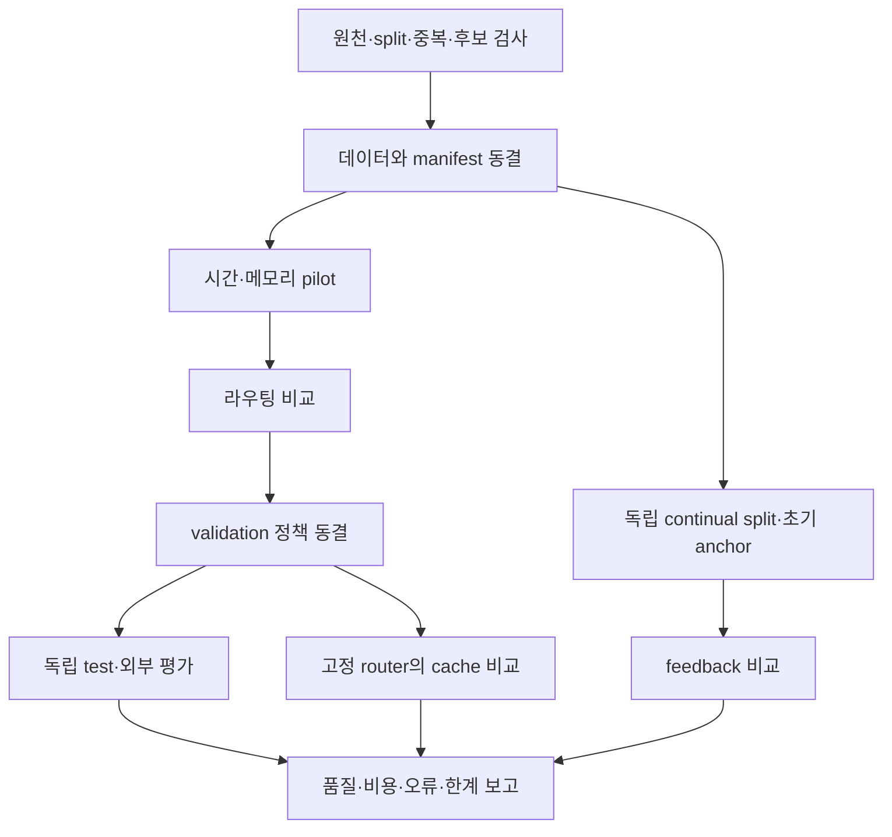
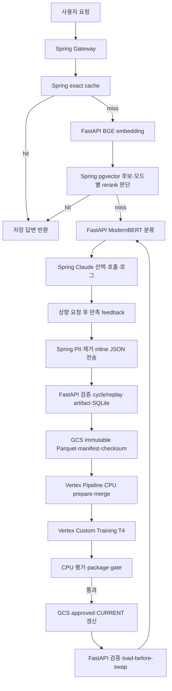
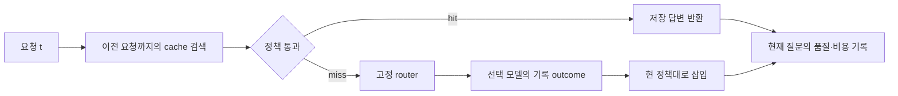

# ML 최종 실험 명세

> **2026-10-01:** 학습·평가에 쓴 벤치마크 기록 점수에서 체계적인 채점 오류를 발견해 검증 데이터셋 v2를 만들었다. 현재 기준 데이터는 v1(T1 0.27/0.64)을 유지하고, v2는 config 교체로 언제든 실험할 수 있게 보관한다. v1 기반 수치는 이 오류를 포함한다. → [2.5.1절](#outcome-audit)

기준일: 2026-09-27. 데이터·라우팅 비교·평가·재학습·캐시·실행 관리의 **현재 기준은 이 파일 하나**다. 과거 설정·실험 기록은 [Deprecated settings](../deprecated-settings.md), 설치·CLI 입구는 [ml/README](../../ml/README.md), 프로젝트 개요·협업 규칙은 [문서 시작점](../README.md)을 따른다. 프로젝트 결정 원장은 memorize다.

> 어떤 조건에서 임베딩 캐시와 에스컬레이션 피드백 학습을 결합한 라우팅 시스템이 더 나은 비용–품질 균형을 만드는가?

## 목차

1. [연구 전제와 최소 실험](#overview)
2. [데이터·전처리](#data)
3. [학습 목표·표현/모델·논문 라우터 비교](#routing)
4. [평가·인지 수준 분석](#evaluation)
5. [재학습 파이프라인](#retraining)
6. [캐시 실험](#cache)
7. [실행·산출물 관리](#execution) / [실행 전 구현 차이](#implementation-gaps)
8. [쉬운 용어 정리](#plain-language-glossary)

처음 읽는다면 [R0~R3 요약과 쉬운 설명](#objectives-plain-language) → [세 후보를 3단계로 선택하는 과정](#three-stage-selection-explained) → [용어표](#plain-language-glossary) 순으로 볼 수 있다.

<a id="overview"></a>
## 1. 연구 전제와 최소 실험

시스템의 세 축은 임베딩 캐싱, 질문 기반 라우팅, 에스컬레이션 데이터에 의한 재학습이다. 특정 모델의 우승이나 일정 절감률을 전제하지 않으며 개선이 없는 조건도 보고한다.

1. Claude는 서비스 호출 대상이다. 신규 Claude 응답·judge·preference를 대량 생성해 학습하지 않는다. 공개 benchmark에 이미 있는 결과는 재사용한다. 서비스 모델 ID는 실행 manifest에 고정하고 역사적 후보와 능력이 같다고 가정하지 않는다.
2. 비교군은 동일한 원천 질문·split·후보·score/cost·튜닝 예산을 사용한다. R0/R1/R2의 target 변환 차이는 연구 대상이다.
3. 난이도 분류, 실제 후보 선택의 품질–비용, 캐시/feedback 시스템 효과를 별도로 평가한다. 서로 다른 source pool을 같은 실제 세 모델로 합치지 않는다.
4. 학습·선택은 train/validation에서 끝낸다. RouterArena는 학습·feedback·반복 승격 gate에 사용하지 않는다. 과거 관찰 이력을 공개하고 test를 보고 재선정하지 않는다.
5. 연구 artifact·DB·gate·CURRENT namespace는 운영과 분리한다. 현행 운영 v2는 문서 정리만으로 대체하지 않는다.
6. 초기학습·비교는 Colab, 운영 ModernBERT feedback 재학습은 관리형 Vertex AI Pipelines와 Custom Training을 사용한다. GKE나 자체 KFP control plane은 사용하지 않는다.
7. 실제 router 측정, 공개 outcome 재생, 가정을 둔 simulation, Claude 서비스 관측을 구분한다. 실패 비용·오류·미측정 범위를 숨기지 않는다.

| 축 | 최소 실험 | 선택 확장 |
|---|---|---|
| 표현·모델 | TF-IDF+LR, frozen BGE+kNN, ModernBERT | RoBERTa 근접 규모 비교 |
| 학습 목표 | 같은 ModernBERT의 R0 CE / R1 성공 예측 / R2 pairwise | R3 regret |
| 논문 라우터 | 동일 실제 세 후보의 RouterDC 재학습 | GraphRouter/CARROT |
| 비학습 기준선 | always-low/mid/high, best-single, matched random, oracle | source/domain 보존 진단 |
| 재학습 | frozen / cycle-only / replay+rehearsal, 공통 feedback·6개 제출 기회 | on-policy, 15성공 pristine rebase |
| 캐시 | 없음 / exact / BGE semantic, router 고정 | reranker, 다른 router 재현 |
| 인지 수준 | 블라인드 주석·일부 인간 검증·통제 문항쌍 | 평가 주석을 학습 label로 재사용하지 않음 |

샘플·step·threshold의 pilot 시작값은 각 장에 명시한다. 최종 값은 test를 열기 전에 manifest에 동결한다. “최종”은 현재 설계가 하나라는 뜻이며 모든 구현·성능 검증이 완료되었다는 뜻이 아니다. [구현 차이 표](#implementation-gaps)에만 실행 전 작업을 모은다.



새 결정은 memorize와 이 파일의 해당 장에 반영하고 config/manifest를 함께 갱신한다. 별도의 최신 계획·체크리스트 사본을 만들지 않는다. 실행 원본은 artifact에 보존하고 이 파일에 주요 결과·해석·다음 실험의 근거를 함께 기록한다.

<a id="observed-objective-results"></a>
### 1.1. R0·R1·R2 실측 결과와 추가 실험의 근거

2026-09-24 통합 A는 동일한 ModernBERT-base, train 21,406문항, D_dev 3,581문항, 최대 512토큰, seed 42, 2,007 optimizer step으로 세 방법을 학습했다. R0는 난이도 CE, R1은 실제 후보별 성공 BCE, R2는 후보 품질 차이의 pairwise 학습이다. 독립 seed 반복은 아직 없다. [학습·선정 원본](../../experiments/results/routing-objectives-continual-v1-A-20260924/REPORT.md), [고정 test 원본](../../experiments/results/routing-objectives-continual-v1-A-20260924/sealed-tests/REPORT.md).

| 방법 | D_dev source-macro 비용–품질 nAUC ↑ | 고정 test 기본 budget .50의 평균 품질 ↑ | 같은 test의 상대 실제 비용 |
|---|---:|---:|---:|
| R0 | 0.166115 | 0.656886 | 0.112373 |
| R1 | **0.863179** | **0.789141** | 0.513201 |
| R2 | 0.833874 | 0.762016 | 0.340807 |

선정은 D_dev의 nAUC로 완료했고 승자는 R1이다. nAUC는 여러 비용 구간의 정규화 품질 회복량이며 성공 확률이 아니다. Test는 RouterBench 3,473개와 xRouteBench 3,729개, 총 7,202개 문항에 validation에서 고정한 정책을 적용한 결과다. 원천별 실제 비용을 정규화한 뒤 같은 비중으로 평균했으므로 달러 비용이나 현재 Claude 절감률로 읽지 않는다. R1의 품질 이득은 지출 증가를 동반하며 동일 비용 우월성을 입증하지 않는다. xRouteBench에서는 R1·R2 상대 비용이 각각 .537229·.541151로 .50 상한을 넘었다. Test 결과로 λ를 다시 맞추지 않았다.

R1−R0 test 평균 품질 차이는 +.132255, 질문 group paired bootstrap 95% 구간은 [.123020, .141503]이다. 이는 고정된 학습 모델·정책에 대한 표본 변동이며 seed 안정성이나 R1−R2의 유의성을 뜻하지 않는다. 통합 A의 세 출력은 원천별 서로 다른 실제 LLM을 나타낸다. RouterBench의 Mistral-7B/Yi-34B/GPT-4와 xRouteBench의 gpt-oss-20B/gpt-oss-120B/Cogito-671B를 같은 실제 모델 풀로 해석하지 않는다.

#### RouterArena 외부 라벨 정렬

2026-09-24~25 새 평가에서는 원본을 구조 보존 입력으로 다시 조립하고 개발 데이터 35,733문항과 중복을 감사했다. Full 8,400개에서 near overlap 18개·중복 2개·빈 질문 1개를 제외해 **8,379개**를 평가했다. Robustness 412개는 원문과 짝지어진 변형으로 독립 표본 수에 더하지 않는다. 세 모델에 같은 문항, 512토큰, λ=0을 적용했고 26,373개 추론의 원본·모델 SHA를 확인했다. [평가 명세·실행 기록](../../experiments/results/routing-objectives-continual-v1-A-20260924/routing-diagnostics/run.json), [외부 평가 원본](../../experiments/results/routing-objectives-continual-v1-A-20260924/routing-diagnostics/arena-evidence/report-REPORT.md).

| 방법 | 공식 라벨과의 일치율 | 3-label macro-F1 | 이 수치의 의미 |
|---|---:|---:|---|
| R0 | 45.48% | .3961 | 난이도 분류기의 외부 라벨 정렬 |
| R1 | 22.80% | .1754 | 비용 없는 후보 선택을 난이도 슬롯으로 투영한 정렬 |
| R2 | 21.36% | .1927 | 비용 없는 후보 선택을 난이도 슬롯으로 투영한 정렬 |

R0는 hard 재현율 15.02%, hard→easy 오분류율 52.34%였다. Always-easy 정확도 47.49%도 넘지 못했으나 macro-F1는 그 상수 기준선보다 높다. R1/R2는 난이도 분류기로 학습하지 않았으므로 위 표로 실제 라우팅 품질의 승자를 재선정하지 않는다. T1은 정답률 기반 라벨, Arena는 공식 인지 수준 라벨이라 같은 과제의 정확도 하락으로 직접 해석할 수도 없다. 최대 길이를 넘은 문항은 748개(8.93%)다. 과거 Arena 결과 관찰 이력이 있어 완전히 처음 보는 blind test라고 주장하지 않는다.

#### 출처·카테고리 일반화에 대한 관측

학습 데이터의 원천·카테고리별 최빈 라벨만 답하는 기준선은 xRouteBench D_dev에서 정확도 71.46%, R0는 72.11%였다. 추가 정답은 459문항 중 3개이며 macro-F1는 기준선 .5986이 R0 .5905보다 높았다. RouterBench에서는 같은 기준선 53.01%에 비해 R0 58.84%로 개선됐다. 이 결과는 일부 높은 정확도가 카테고리 사전 분포로 설명됨을 보이지만, 모델이 그 정보만 사용한다는 인과 증거는 아니다. [train-only 기준선 원본](../../experiments/results/routing-objectives-continual-v1-A-20260924/routing-diagnostics/category-baselines/original-audit.md).

같은 원천·카테고리 안에서 선택을 1,000회 재배정한 사후 D_dev 진단에서는 R1/R2의 RouterBench 품질이 재배정 범위보다 높았지만 비용도 높았다. xRouteBench는 세 방법 모두 그 품질 범위 안이었다. 이는 질문별 선택 정보의 보조 진단이며, 그 범위는 신뢰구간이나 독립 test 검정이 아니다. [재배정 진단 원본](../../experiments/results/routing-objectives-continual-v1-A-20260924/routing-diagnostics/category-permutation/original-audit.md).

따라서 **R1의 기존 개발검증 선정은 유지하되, 보지 않은 task에서의 일반화와 실제 서비스 후보에 대한 성공·비용 성능은 별도 검증한다.** 이를 위해 일반화용 데이터 버전과 R1/R3×학습 분포 실험을 추가한다. 기존 결과를 좋은 결과로 바꾸기 위한 test 재튜닝이나 Arena의 학습 편입이 목적이 아니다. 이번 결과는 로컬에 보존했고 추가 GCS 업로드·운영 활성화는 하지 않았다. 평가 T4는 개인 `alexyoo0506@gmail.com` Colab에서 실행 후 종료했으며, 관측 잔액은 190.65→189.83 CU였다.

<a id="context-length-adoption"></a>
### 1.2. 8,192토큰 추론 채택의 근거와 적용 범위 — 2026-09-26

**R0와 R1의 새 서비스 패키지는 추론 최대 길이 8,192를 목표로 구현한다.** 동일 체크포인트를 재학습 없이 평가한 결과와 사용자의 적용 결정을 반영한다. 512로 학습했다는 사실을 8,192로 학습한 것으로 바꾸지 않는다. 과거 [길이 검증 원본 보고서](../../experiments/results/context-length-qualification-20260925/REPORT.md)의 9월 25일 운영 전환 보류 판단은 그대로 보존한다. 이번 결정은 코드·패키지의 적용 목표를 확정한 것으로, 원본 결과나 미측정 운영 성능을 사후에 통과 처리하는 결정은 아니다.

| 검증 항목 | R0 | 선정 후보 G1 R1-natural | 적용 판단에 쓰는 범위 |
|---|---|---|---|
| 동일 가중치 8,192 추론 | 전체 평가 완료, T4 OOM 없음 | 전체 평가 완료, T4 OOM 없음 | 추가 학습 없이 길이를 늘려 실행할 수 있다는 근거 |
| 내부 검증·고정 test | D_dev/RouterBench/xRouteBench 정확도 60.542%/57.357%/66.130%로 동일 | calibration/selection/holdout 선택 품질 .757790/.751785/.652622로 동일 | 관측 데이터에서 핵심 품질 점수가 유지됨 |
| RouterArena 전체 라벨 일치율 | 45.483% → 45.387% | 23.571% → 23.857% | 후보 선택 품질과 구분한 외부 난이도 진단 |
| RouterArena 512 초과 748문항 | 33.155% → 32.086%; 변화 −1.070pp, 95% CI [−3.209,+1.070] | 56.417% → 59.626%; 변화 +3.209pp, 95% CI [+1.604,+4.813] | R0의 이득·동등성은 미입증, R1 장문 라벨 정렬은 개선 |
| 비용 변화 | 내부 후보 품질 동일; xRouteBench 선택 1건 변화 | calibration 상대 비용 .428741 → .429315 | 동일 정확도라도 선택·비용이 바뀔 수 있음 |

A R1도 별도 평가했으며 RouterArena 장문 일치율은 54.278%→56.551%, 실제 후보 품질은 동일했다. xRouteBench 상대 비용 .537229→.537993은 기존 .50 예산 초과가 조금 커진 결과다. G1 R1-natural의 실제 후보 결과가 있는 장문은 calibration 10개·selection 8개뿐이고 holdout에는 없다. RouterArena에는 현재 서비스 Claude 후보의 정답 결과가 없으므로 위 개선을 Claude 성공률 개선으로 표현하지 않는다. 8,192 초과 원문 8개는 여전히 잘리며, 변형 및 초장문 소표본의 하락도 원본에 남겼다.

채택 이유는 **검증된 8,192 추론 가능성, 내부 품질 유지, 512에서 잘리던 문맥을 사용하는 공통 인터페이스**다. R0의 장문 성능 향상을 전제하지 않으며 불확실성을 공개한 상태로 구현한다. 같은 모델 계열 안에서 R0/R1을 비교하므로 서로 다른 모델과의 과거 공정 비교를 위해 선택한 512를 영구적인 서비스 제한으로 유지할 필요는 없다. 다만 실제 서비스의 품질·비용 gate와 자원 한도는 통과해야 한다.

새 계약은 `length_contract_version=train-inference-lengths-v1`, 실제 학습 기록인 `training_max_length=512`, `inference_max_length=8192`, 호환 필드 `tokenizer_max_length=8192`를 기록한다. R1 policy의 `max_length`는 추론 길이이며 manifest와 일치해야 한다. `config.json.max_position_embeddings`보다 큰 길이는 거부한다. 과거 training config·실험 manifest·기존 GCS package는 소급 수정하지 않는다. 향후 재학습 길이를 8,192로 늘리는 것은 별도 자원 검증을 거쳐 새 training config에 기록하며, 이번 추론 길이 채택으로 자동 변경하지 않는다.

후보와 기준 모델은 **같은 8,192 입력·전처리·정책 계약**으로 gate 평가한다. 기존 512 지표를 새 8,192 승격 근거로 재사용하지 않는다. GPU 배치 총시간이나 Colab CPU 전체 프로세스 시간을 FastAPI 응답 지연으로 해석하지 않는다. 실제 VM의 p50/p95·최대 메모리·동시 요청·Spring timeout 검증은 배포 후 단계이며, 통과 전에는 자동 재학습·운영 포인터 전환을 완료로 표시하지 않는다.

<a id="r1-to-r0-transfer-experiment"></a>
### 1.3. R1→R0 전이·피드백 적응의 세 비교군 — 2026-09-27

후보별 성공 정보를 모두 얻기 어려운 서비스에서, R1으로 학습한 질문 표현을 R0의 단계 분류로 전환해 재사용할 수 있는지 검증한다. **A: 기존 R0 추가 학습, B: 같은 초기 데이터의 R1 인코더에 새 R0 출력층을 붙여 추가 학습, C: 기존 R1 동결**을 비교한다. 주 비교는 동일 초기 코호트의 A R0/A R1을 사용하며 초기학습을 다시 하지 않는다.

상세 절차·학술 근거·데이터 역할·채택 기준은 별도 [R1→R0 전이 실험 설계서](R1_TO_R0_TRANSFER_EXPERIMENT.md), 사용자가 직접 실행할 절차는 [전용 Colab 노트북 안내](../../ml/notebooks/r1_to_r0_transfer/README.md)에 둔다. 준비/A/B/C/최종 비교용 노트북 5개와 설정·출처 pin·실행 코드·소스 번들 생성기가 있다. A/B는 bridge 200 step과 6×100 step을 adaptation seed 42/43/44로 학습한다. **학습 512·평가 8192**이며 이미 수행한 길이 검증을 반복하는 512 평가, 별도 pilot, 학습 중간 전체 dev 추론은 이번 실행에서 생략한다. 공통 trainer의 작은 validation 48행은 내부적으로 유지하며 사용자가 별도 실행할 단계는 아니다. C는 학습하지 않는다.

재학습 입력도 기존 **RouterBench+xRouteBench**이며, 초기학습에서 분리한 D_stream 5,368문항을 사용한다. 피드백은 benchmark 라벨을 이용한 공통 상향 교정 **대리 신호**이고 실제 사용자 만족·Claude 성공률의 증거는 아니다. **새로운 분야·다른 출처로의 적응은 미래 연구로 남기며 이번 졸업프로젝트의 추가 실험 범위에서 제외한다.** 기존 연구·평가 기록은 보존한다.

사용자가 개인 Colab에서 A/B의 모든 학습을 완료한 뒤 **04 노트북 한 번의 최종 평가 흐름**으로 baseline/final dev 평가 → 선택 동결 → gate/forget/RouterArena 최종 평가·분석을 진행한다. bridge·중간 cycle 성능 곡선 대신 baseline과 최종 결과를 비교한다. 입력 SHA·누수 검증과 25 step 간격 복구 checkpoint는 유지한다. 실제 config는 `r1-to-r0-transfer-v2-final-only`다. 사용자가 개인 Colab에서 00→01/02→04를 실행해 2026-09-27에 42 stage 학습과 최종 평가를 완료했다(run `r1-to-r0-transfer-v2-run001`). Spring/FastAPI·GCS 모델·운영 포인터는 변경하지 않았다.

**결과([분석](../../experiments/results/r1-to-r0-transfer-v2-final-only-20260927/ANALYSIS.md)):** 개발검증 source-macro-F1은 A 0.411, B 0.405(B−A −0.006, 95% CI −0.022~+0.011)로 **주 가설은 지지되지 않았고 A가 선택 고정**되었다. RouterArena에서는 B가 A보다 유의하게 낮았다(−0.012). 두 군 모두 원본 R0(0.517) 대비 forget source-macro-F1이 약 0.1 떨어져 망각 허용폭 0.01을 넘었으므로 **배포 후보가 없다.** 피드백 적응 뒤 hard recall은 0.25→0.52로 올랐지만 easy 예측이 크게 줄어 accuracy가 0.60→0.40으로 내려갔다. 선택 비용은 약 3.5배 늘었다. 128–192행 window를 100 step씩(약 17–25 epoch) 학습한 과적합과 상향 대리 라벨의 반복이 주요 원인으로 보인다. 2026-09-28 사용자 결정으로 이 과적합 가설의 추가 검증 실험은 수행하지 않으며, 이 비교는 현재 결과로 종료한다.

<a id="data"></a>
## 2. 데이터·전처리

<a id="data-1"></a>
### 2.1. 데이터의 역할

| 데이터 | 역할 | 허용되는 사용 |
| --- | --- | --- |
| RouterBench text-only | 공개 질문×모델 결과, 난이도 학습·비교 | train으로 학습, validation으로 선택, 고정 test로 최종 평가 |
| xRouteBench `llmrouter_generic` | 별도 모델 pool의 공개 결과, 통합 학습·3-action 비교 | 공식 train을 train/validation으로 분할, 공식 test는 최종 평가 |
| RouterArena | 독립적인 인지 수준 기반 외부 난이도 진단 | 중복 검사에 질문 text 사용; 모델·설정 동결 후 label 평가 |
| 일반화 G1 | 기존 개발 질문의 task/domain 분리 및 학습 분포 ablation | 새 train에서만 후보·가중치 결정; calibration/selection과 task/domain holdout 분리 |
| 순차 feedback 표본 | 재학습·망각 실험 | 기존 개발 데이터에서 별도 봉인; 초기 모델도 해당 질문을 보지 않음 |
| 캐시용 반복·의미 문항 | 응답 재사용 검증 | 학습·튜닝 표본과 분리; [캐시 계약](#cache) 적용 |

새 Claude 응답이나 judge 결과를 대량 생성하지 않는다. 원천에 이미 포함된 과거 Claude 결과는 공개 benchmark 기록으로 재사용한다. 후보 모델의 답변·점수·비용은 target 또는 evaluator에만 제공하고, 질문 라우터의 입력에 넣지 않는다.

공식 원천: [RouterBench](https://huggingface.co/datasets/withmartian/routerbench), [xRouteBench](https://huggingface.co/datasets/ulab-ai/xRouteBench), [RouterArena](https://github.com/RouteWorks/RouterArena). 다운로드 revision, 원본 파일 크기와 SHA-256은 dataset manifest에 고정한다. 최신 branch를 실행 시마다 다시 받는 방식은 사용하지 않는다.

<a id="data-2"></a>
### 2.2. 포함 범위와 원본 고정

RouterBench는 기존 canonicalization을 재사용한다.

- MMLU, HellaSwag, GSM8K, ARC-Challenge, WinoGrande는 5-shot source를 우선한다.
- MBPP와 MT-Bench는 0-shot source를 우선한다. RAG는 제외한다.
- 동일 `sample_id`의 0-shot/5-shot 행은 source 우선순위로 한 행만 남긴다.
- 직렬화된 prompt list는 안전한 literal parser로 복원한다. 5-shot은 마지막 미응답 질문을 추출한다.
- 원문 `prompt`, 추출한 `query_text`, 학습용 `model_input_text`를 별도로 보존한다.

xRouteBench는 다음 revision의 generic train/test와 후보 metadata만 사용한다.

```text
revision = ea4b6e1b29d9a734f55f0a637baf326bad6aa681
llmrouter_generic/train.parquet
llmrouter_generic/test.parquet
llm_candidates/train.parquet
```

파일별 checksum은 [통합 데이터 config](../../ml/config/router_model_comparison_v1.json)에 있다. 현재 확인한 pivot 전 generic query 수는 train 4,489, test 3,729다. 이는 정제·중복 제거 후 최종 학습 행 수가 아니다.

다음은 주 실험에서 제외하고 사유별 행 수를 기록한다.

- RouterBench RAG/`needs_retrieval=true`; xRouteBench memory, timeseries, video, multimodal, personalized 구성.
- 빈 질문, 파싱 불가, 범위 밖 performance, 중복 query/model 실행처럼 의미를 확정할 수 없는 행.
- 정답·생성 응답·라벨·모델명·가격이 benchmark wrapper를 통해 입력에 노출된 행.
- OpenHermes 등 질문별 동일 후보의 채점 결과가 없어 이 계약의 라벨·비용을 만들 수 없는 데이터.

문제 본문에 원래 등장하는 모델명·숫자·전문용어를 무조건 지우지는 않는다. benchmark 부가 정보와 과제 수행에 필요한 내용을 구분한다.

<a id="data-3"></a>
### 2.3. 공통 schema와 namespace

| 필드 | 의미 |
| --- | --- |
| `sample_id` | source namespace를 포함한 안정적인 질문 ID |
| `source_dataset`, `source_split`, `source_task` | 원천·공식 분할·원래 문항 식별 정보 |
| `category` | source 안에서의 분석용 영역 |
| `query_text`, `model_input_text` | 추출 원문과 모델에 전달할 정제문 |
| `valid_model_count`, `accepted_model_count`, `overall_solve_rate` | 유효 결과 수, 성공 수, 성공 비율 |
| `difficulty_label`, `difficulty_label_t2` | T1 주 라벨과 T2 민감도 라벨 |
| `label_confidence`, `sample_weight` | 원천 신뢰도와 기존 호환 metadata; 최종 학습 적용 여부는 §2.7에 고정 |
| `duplicate_group_id`, `split` | 누수 방지 그룹과 최종 분할 |
| `dataset_version`, `label_rule_version`, `preprocessing_version`, `split_version` | 재현 가능한 변환 계약 |
| `label_origin` | benchmark difficulty, 관측된 escalation 성공 action, 인지 주석 등 라벨 근거 |

RouterBench ID에는 `routerbench:`를 붙인다. xRouteBench는 `task_name + task_id(결측이면 embedding_id) + normalized query`를 query key로 만들고 hash에 `xroutebench:`를 붙인다. 키와 원래 task ID를 함께 보존한다. 단순한 정수 ID만 source 사이에서 결합하지 않는다.

영역은 RouterBench의 coarse `domain`을 `category`로, `eval_name`을 `source_task`로 둔다. xRouteBench는 `task_name`을 category로 보존한다. `knowledge`와 개별 xRoute task를 이름만으로 같은 영역으로 합치지 않는다. 공통 taxonomy가 필요하면 별도 version의 mapping table을 만들며 주 결과는 항상 `source × category`로도 제시한다.

학습 입력은 `model_input_text`뿐이다. category, source ID, 정답, 모든 후보의 결과, 실제 응답 길이는 입력 feature가 아니다. 메타데이터가 Parquet에 있어도 collator가 이를 text에 연결하지 않는지 검사한다.

원본 outcome matrix는 감사용 별도 artifact로 유지한다. 분류 학습 projection과 R1/R2 target projection은 공통 `sample_id`로 결합하며, 모델 응답을 text feature로 복사하지 않는다. 새 manifest에는 원천 checksum, 필터 이유, 성공 판정 규칙, 입력 정제 전후 hash를 남긴다.

<a id="data-4"></a>
### 2.4. 텍스트 정제와 중복 검사

`query_text`를 그대로 남기고 `model_input_text`를 결정적으로 만든다.

1. Unicode NFKC, 줄바꿈 통일, 불필요한 제어 문자·행 끝 공백·중복 빈 줄을 정리한다.
2. 객관식 출력 형식 지시처럼 benchmark에만 필요한 알려진 wrapper를 제거한다.
3. 질문 본문·선택지·코드·필요한 대화 문맥과 context는 유지한다.
4. xRoute의 `[User Query]` wrapper는 실제 원본 구조를 확인해 제거한다. system 부분이 과제 조건을 담고 있으면 삭제하지 않는다.
5. 정제 후 빈 입력, 선택지 누락, 코드 구조 손상은 전처리 오류로 처리한다.

모델 입력에서 case나 구두점을 제거하지 않는다. 코드 들여쓰기와 수식·부정·숫자도 의미의 일부다. 정제 예시를 source/category별로 샘플링해 원문과 대조한다.

중복 탐지는 입력 변환과 별도 경로다. 현재 구현은 NFKC+case-fold+단어 추출 hash로 exact 후보를 만들고, token 3-gram SimHash 후보에 Jaccard `>=0.90`을 적용한다. 최소 5 token, bucket 상한 200을 사용하며 큰 bucket을 건너뛴 수를 기록한다. 이것은 모든 의미 중복을 찾았다는 보장이 아니다.

단어만 남기는 hash는 코드 연산자 등 의미 차이를 놓칠 수 있다. 이런 충돌을 곧바로 동등한 문항으로 선언하지 않고, 원문 보존·오탐 감사와 구조 보존 검증을 거쳐 그룹을 확정한다. 같은 task ID도 namespace를 확인한 뒤 그룹 후보로 사용한다.

확정된 duplicate group은 split을 넘지 않는다. cross-source 그룹은 RouterArena 보호 집합, xRoute 공식 test, RouterBench 고정 test, validation, train 순으로 보호한다. 외부 평가와 겹치는 개발 행을 먼저 제외한다. 평가셋끼리의 overlap은 별도 집계하고 source별 점수를 제시한다.

같은 그룹에서 대표를 남기는 규칙은 정보 완전성과 안정적인 ID tie-break로 동결한다. 어떤 행을 제외했는지 모두 manifest에 보존한다. `exact`, `near`, `task-id`를 구분하며 그룹 대표만 남겼다고 raw 데이터도 삭제하지 않는다.

<a id="data-5"></a>
### 2.5. 점수에서 성공 여부로 변환

성공 판정 경계와 난이도 경계는 다르다. 먼저 질문별 각 후보 결과를 성공/실패/결측으로 변환한다.

| 원천·metric | 성공 판정 |
| --- | --- |
| RouterBench exact-match 계열 | `performance == 1.0` |
| RouterBench GSM8K partial-credit, MBPP, MT-Bench의 현재 원점수 계약 | `performance >=0.70` |
| xRoute `em_mc`, `GSM8K`, `MATH`, `code_eval` | `performance ==1.0` |
| xRoute `f1_score` | `performance >=0.70` |
| 등록하지 않은 metric 또는 null | 결측; 자동 실패나 임의의 0.70 판정 금지 |

같은 GSM8K 이름이라도 원천의 채점 형식이 다르므로 metric 계약을 먼저 확인한다. 연속 원점수는 버리지 않고 `quality`로도 보존한다. `0`은 관측된 실패이며 결측이 아니다. RouterBench v2에서 제외했던 `unresolved`를 통합 전체 성공률 방식에서도 자동 제외하지 않는다. 유효한 전부 실패 결과는 통합 난이도에서 hard가 될 수 있다.

xRoute는 `(query key, model_name)` 중복 실행을 오류로 처리한다. 18개 후보 중 유효 결과가 12개 이상이어야 통합 라벨 대상이며, 미만은 사유와 함께 제외한다. 범위 밖 `[0,1]` 점수는 조용히 clipping하지 않는다.

```text
overall_solve_rate(q) = accepted_model_count(q) / valid_model_count(q)
```

RouterBench도 실제 유효 모델 수를 분모로 검증한다. upstream에서 만들어진 `overall_solve_rate`를 읽을 때는 재계산 결과와 일치해야 한다. 분모가 0이면 라벨을 만들 수 없다.

<a id="outcome-audit"></a>
#### 2.5.1. 벤치마크 채점 오류와 검증 데이터셋 v2 — 2026-10-01

**위 표의 원점수를 그대로 믿으면 안 된다.** 공개 정답과 모델 응답을 직접 대조한 결과, 두 벤치마크에 기록된 채점이 실제 정오와 크게 달랐다. 이 오류는 v1 데이터셋의 난이도 라벨, R1/R2/R3의 후보별 성공 라벨, D_gate·D_stream 평가, F0~F3 시뮬레이션에 모두 들어가 있다. 2026-10-01 이전의 모든 실험 수치는 오류가 포함된 v1 기준이다.

| 원천·과제 | 발견한 오류 | 정정 방법 | 규모 |
|---|---|---|---|
| RouterBench GSM8K | 점수가 정오가 아니라 0.25 단위 평가값이다. 세 모델이 모두 정답 숫자를 냈는데 0.75/0.5/0.5로 기록되는 식이다. `>=0.70` 기준 때문에 0.5점 정답(97%가 실제 정답)이 실패가 됐다. GPT-4 정답률이 68.1%로 기록됐지만 실제는 95.3%다 | GSM8K 공식 정답과 최종 답 숫자를 대조해 재채점 | 81,950칸 재채점, 14,904칸 성공 여부 반전 |
| RouterBench MMLU | MMLU 원본 정답 키 자체의 오류(예: `−47 = g + 24`의 정답이 −23으로 표기). RouterBench 채점은 원본 키와 일치한다 | MMLU-Redux 2.0 사람 검수: 정답 오류는 정정 답으로 재채점, 질문·보기 불명확·복수 정답·정답 없음·전문가 판단 필요는 제외 | 99문항 정정(781칸), 269문항 제외 |
| RouterBench 기타 객관식 | HellaSwag·ARC·Winogrande는 공개 정답과 일치. claude-instant 8칸만 불일치 | 공개 정답으로 재채점 | 8칸 |
| xRouteBench `em_mc` | `(C)` 형식만 정답 처리하고, 정답 글자 `C`나 `C. 보기문`은 0점 | 명확한 정답 글자면 성공으로 정정 | 5,546칸 |
| xRouteBench GSM8K | `$720.00`, `\boxed{12}`, `24{,}960` 같은 정답 형식을 실패 처리 | 최종 답 숫자가 공식 정답과 같으면 성공 | 1,804칸 |
| xRouteBench MATH | `\text{odd}` 대 `odd`, `(-4,\,1)` 대 `(-4,1)` 같은 표기 차이를 실패 처리 | 표기를 정규화한 boxed 답이 같으면 성공 | 124칸 |
| xRouteBench SQuAD | token F1 `>=0.70`이라 "comes from Latin." 같은 문장형 정답이 실패. 응답의 80.6%가 정답을 포함하는데 성공은 2.4% | F1 `>=0.70` 또는 정규화한 정답 포함 | 6,259칸 |

정정 원칙은 다음과 같다.

- **xRouteBench는 실패를 성공으로만 고친다.** 형식 차이가 명백한 경우만 고치고, 기록된 성공은 취소하지 않는다. MATH의 단위 생략(`8 cm`→`8`)처럼 원 채점기 판단이 타당한 경우가 섞여 있기 때문이다.
- **최종 답 추출은 보수적으로 한다.** 박스 답·`####` 답을 우선하고, 없으면 마지막 줄의 첫 숫자와 끝 숫자만 본다. 줄 가운데 숫자는 인정하지 않으므로 중간에 끊긴 응답은 통과하지 못한다. 표본 검사에서 오탐이 없었고, GPT-4 등 모델별 재채점 정답률이 공개 성능과 일치했다.
- **RouterBench 학습 라벨은 5-shot 원본(34,271행)과 0-shot 원본(507행)에서 왔다.** 응답 대조도 행별로 같은 원본을 사용한다.

검증하지 못한 범위도 남긴다. RouterBench MBPP와 xRouteBench `code_eval`은 같은 응답에 다른 점수가 붙은 사례가 0건이지만, 코드를 실행해 재채점하지 않았다. MT-Bench는 judge 평점이라 그대로 둔다. MMLU-Redux가 다루지 않는 8,342문항의 MMLU 정답 오류, HellaSwag의 알려진 라벨 잡음, RouterBench 5-shot 원본의 중복 `sample_id` 14개(182칸 불일치)는 남아 있다. RouterArena는 모델 응답·채점 기록 없이 공식 난이도와 정답만 쓰므로 이번 정정 대상이 아니다.

| 산출물 | 위치 |
|---|---|
| 정정표·제외 목록·요약 | `ml/artifacts/benchmark-outcome-audit-v1/` (`audit-outcomes`로 재생성) |
| 정정 규칙 코드·테스트 | [`outcome_audit.py`](../../ml/src/llm_router_labeling/routing_data/outcome_audit.py), [`test_outcome_audit.py`](../../ml/tests/test_outcome_audit.py) |
| v2 데이터 config | [`modernbert_initial_v2_verified_data.json`](../../ml/config/modernbert_initial_v2_verified_data.json) — 공개 정답 파일의 URL·SHA-256 고정 |
| v2 데이터셋 | `ml/artifacts/modernbert-initial-v2-verified/dataset/` |
| 점검 보고서 | [benchmark-outcome-audit-20261001](../../experiments/results/benchmark-outcome-audit-20261001/REPORT.md) |

```bash
# 공개 정답 파일은 config의 gold_sources URL에서 ml/data/raw/gold/ 아래로 받는다
routing-comparison-data --config ml/config/modernbert_initial_v2_verified_data.json \
  audit-outcomes --output-dir ml/artifacts/benchmark-outcome-audit-v1
routing-comparison-data --config ml/config/modernbert_initial_v2_verified_data.json \
  build --output-dir ml/artifacts/modernbert-initial-v2-verified/dataset
```

v2는 42,646행(v1 대비 제외 289행)이다. 성공률이 올라 train-only 임계값 선택이 T1 hard/easy 경계를 0.27/0.64에서 **0.36/0.73**으로 바꿨고, 난이도 라벨의 19.6%가 달라졌다(easy 50.1%→45.5%, hard 13.1%→15.4%). 같은 seed로 다시 층화 분할했기 때문에 문항의 59.0%만 v1과 같은 분할에 남았다. v1과 v2의 D_gate·D_stream 수치를 같은 문항 비교로 읽지 않는다.

`outcome_audit`가 없는 config(v1)는 기존 동작 그대로 빌드되므로 과거 산출물은 재현할 수 있다. **현재 학습·평가 기준은 v1(T1 0.27/0.64)을 유지한다.** v2는 위 config와 정정표로 보관하며, 실험 config의 데이터 경로를 v2로 바꾸면 언제든 v2 기준으로 실행할 수 있다. 기존 실험(R0 1.0 라벨, R0~R3, D_gate 승격 하한, F0~F3)을 v2로 다시 돌릴지와 그 범위는 2026-10-01 기준 보류이며, 그 전까지 v1 수치는 위 오류를 포함한 결과로 읽는다.

<a id="data-6"></a>
### 2.6. 통합 난이도 T1/T2

난이도는 두 source 모두 관측된 후보 집단의 solve rate로 정의한다.

```text
rate >= t_easy                   → easy
t_hard <= rate < t_easy          → medium
rate < t_hard                    → hard
```

후보 grid는 `t_hard ∈ {0.18,0.27,0.36}`, `t_easy ∈ {0.55,0.64,0.73}`의 9개다. split을 먼저 봉인하고 train만 이용한 5-fold group OOF TF-IDF+LogisticRegression probe로 고른다. vectorizer도 fold train에만 fit한다.

```text
J_threshold = .25×source_macro_F1 + .15×balanced_accuracy
            + .15×QWK_01 + .15×min(source별 macro_F1)
            + .10×(1−ordinal_MAE/2) + .10×(1−hard→easy 비율)
            + .10×candidate-model bootstrap label agreement
QWK_01 = (QWK+1)/2
```

후보는 train의 각 class가 10% 이상·500행 이상, source별 세 class 존재, easy>medium>hard 평균 solve rate, 후보 모델 bootstrap 1,000회 평균 label agreement `>=.85`를 통과해야 한다.

T1은 최고 점수 후보다. 차이 `<.005`의 근접 후보에서는 core-category red 수, 기존 anchor `(0.27,0.64)` 여부, 점수 순으로 고른다. T2는 남은 후보 중 T1과 train 라벨이 5% 이상 다른 최고 점수 후보다. 없으면 남은 최고 후보를 사용하고 실제 불일치율을 명시한다. exact tie에는 변경 경계 수가 작은 후보와 사전 고정한 후보 ID 순서를 사용한다. 최종 tie-break를 구현·manifest에도 동일하게 남긴다.

2026-09-20 확인한 기존 통합 artifact는 T1 `(0.27,0.55)`, T2 `(0.36,0.55)`이고 train 라벨 불일치율은 약 5.83%다. 이 값은 해당 artifact의 결과이지 모든 새 dataset version의 정답이 아니다. source·정제·split이 바뀌면 train-only 선택을 다시 수행한다. test나 RouterArena에 맞춰 threshold를 수정하지 않는다.

T1은 주 실험, T2는 TF-IDF와 ModernBERT seed 42의 민감도 진단이다. 전체 모델×T2 sweep은 기본 범위에 없다. T1/T2를 모델별로 다시 고르지 않으며 T2 결과로 주 결과의 winner를 교체하지 않는다.

이 라벨은 보편적인 인간 인지 난이도가 아니라 **해당 후보 집단의 관측 성공률에 기반한 조작적 정의**다. GPT 블라인드 인지 주석과 통제 문항쌍은 [평가](#evaluation)의 보조 분석으로 분리한다. 그 주석으로 학습 라벨을 사후 수정하지 않는다.

한 source만 사용하는 공식 3-action 비교는 그 source의 train에서 같은 grid·OOF·gate로 T1을 별도 선정한다. 단일 source에서는 source macro/minimum 항을 해당 source의 값으로 계산한다. 통합 T1을 가져와 다른 source의 학습 정보를 사용하는 대신 독립 manifest를 만들며, 두 T1 값이 다를 수 있다. 현 probe의 두 source 전용 분기를 일반화하는 구현 보완이 필요하다.

<a id="data-7"></a>
### 2.7. Split, 자연분포와 coverage

| 원천 | train/validation | 최종 test |
| --- | --- | --- |
| RouterBench | 기존 duplicate-group 80/10/10 중 train 80%, validation 10% 보존 | 기존 test 10% |
| xRoute generic | 공식 train을 group-aware 약 90/10; seed 42 | 공식 test 전량에서 오염·중복을 감사 |

xRoute validation은 category와 사전 grid 전체의 solve-rate 경계 strata를 사용한다. 특정 T1을 고른 뒤 그 라벨에 유리하게 split을 바꾸지 않는다. 통합 train은 원천 train을 concatenate하고 일반 shuffle한다. source를 50:50으로 복제하거나 class를 1:1:1로 맞추지 않는다.

**최종 주 비교의 공통 가중치 정책은 eligible 행의 자연분포, effective sample weight 1, class weight 없음이다.** 기존 confidence/weight metadata는 감사·운영 호환 목적으로 보존한다. TF-IDF, kNN 투표, neural loss에 서로 다른 숨은 confidence weight를 적용하지 않는다. confidence weighting·balanced sampler는 별도 명명한 ablation에서만 사용한다. 이 규칙은 초기 라우팅 비교에 적용하며 운영 feedback sampler는 [재학습](#retraining)에 별도로 명시한다.

coverage는 source×category×label의 pre/post-split 행 수와 비율로 확인한다.

| 상태 | train 300행 이상인 core category |
| --- | --- |
| green | 모든 class 비율 ≥15%, 최대 ≤70%, 각 cell ≥100 |
| yellow | 모든 class 비율 ≥5%, 최대 ≤85%, 각 cell ≥30 |
| red | 위 yellow 조건 미달 |

300행 미만은 `small_category`로 표시한다. 평가 cell이 모두 ≥100이면 confirmatory, 모두 ≥30이면 exploratory, 하나라도 <30이면 해당 category의 세 class 우열 주장은 `insufficient_coverage`로 둔다. 자연분포를 인위적으로 고쳐 green으로 만들지 않는다.

split 때문에만 red가 생겼다면 고정 test를 건드리지 않고 개발 partition을 새 version으로 재생성한 뒤 OOF부터 다시 한다. 원래부터 red인 category는 `keep-natural` 또는 별도 데이터 보강 등의 resolution을 남긴다. 같은 label의 red가 두 source에 걸쳐 core category의 20% 이상이면 metric·결측·histogram을 train에서 재검토한다. resolution이 없으면 full sweep을 시작하지 않는다.

현재 기존 통합 manifest의 행 수는 train 31,417 / validation 3,907 / RouterBench test 3,472 / xRoute test 3,729다. 이후 정제 보완·RouterArena overlap 감사·feedback 분할의 행 수로 복사하지 않는다.

<a id="data-8"></a>
### 2.8. 난이도 label과 실제 model action

RouterBench와 xRouteBench의 후보는 각각 11개, 18개로 서로 다른 실제 모델이다. 같은 easy/medium/hard 라벨이 같은 모델 집합을 뜻하지 않는다. 세 후보를 쓰는 [라우팅 실험](#routing)은 source 안에서 train-only 비용–품질 Pareto frontier를 만들고 저비용·knee·최고 품질의 실제 모델 세 개를 봉인한다.

outcome projection에는 각 action의 `model_id`, `quality`, `success`, `actual_cost`, `decision_cost`를 보존한다. tier 평균을 실제 1회 LLM 호출 결과로 사용하지 않는다. 비용은 benchmark 원천의 당시 모델 가격·관측 token 사용량으로 계산하며 현재 Claude 가격으로 바꾸지 않는다.

- `decision_cost`: source train 평균으로 정한 고정 비용; 추론 시 사용 가능.
- `actual_cost`: 해당 응답에서 관측된 실제 비용; evaluator만 사용.
- 선택된 세 후보 중 결과가 빠진 행: 현재 계약은 dataset 생성 실패. 평균 대입·다른 모델 대체 금지.

통합 symbolic-tier 실험과 한 source의 실제 세 후보 실험을 다른 experiment ID로 관리한다. Claude service mapping은 외부 검증 대상이며 공개 결과와 능력이 같다는 전제가 아니다.

<a id="data-9"></a>
### 2.9. 운영 호환과 구현 보완

기존 운영 v2는 low 성공률≥.67→easy, 아니면 medium≥.67→medium, 아니면 high≥1/3→hard이고 unresolved를 학습에서 제외한다. v3 standalone은 overall solve rate의 `(hard=.27,easy=.64)`다. 이들은 기존 checkpoint와 feedback base artifact를 재현하기 위한 계약이며 최종 통합 T1과 섞지 않는다. 운영 모델의 학습 데이터 변경은 별도 version과 승격 절차를 거친다.

현재 소스: [통합 전처리](../../ml/src/llm_router_labeling/routing_data/preprocessing.py), [기존 RouterBench 정제](../../ml/src/llm_router_labeling/training/routerbench_preprocessing.py), [중복 정규화](../../ml/src/llm_router_labeling/shared/text_normalization.py), [outcome projection](../../ml/src/llm_router_labeling/objective_comparison/data.py).

데이터 정제·결측 분모·누수 검사·가중치·source별 runner의 구현 차이는 [실행 차이 목록](#execution-7)에서 관리한다.

문서 통합은 위 코드 수정이나 데이터 재생성을 수행한 기록이 아니다. 실행 gate와 보존 정책은 [실행·산출물](#execution), 외부 평가·인지 주석은 [평가](#evaluation), feedback의 별도 분할은 [재학습](#retraining)을 따른다.

<a id="generalization-data"></a>
### 2.10. 추가 데이터 유형 G1: task/domain 일반화

G1은 새로운 benchmark 원천을 수집했다는 뜻이 아니라 **기존 개발 질문의 역할을 다시 고정한 별도 데이터 버전**이다. A의 R0/R1/R2 실측에서 출처·카테고리 경향과 질문별 능력의 구분이 필요해졌기 때문에 추가한다. Natural과 balanced는 같은 질문·후보 outcome·split을 사용하며 학습 loss의 가중치만 다르게 보는 두 view다. balanced용 질문을 복제하거나 별도 평가 정답을 만들지 않는다.

입력 범위는 기존 D_initial_train 21,406개와 D_dev 3,581개, 합계 24,987개다. D_gate·stream·retention, 원본 고정 test, Arena를 학습 또는 새 선택 pool로 편입하지 않는다. 기존 모델은 이 pool의 질문을 보았으므로 그 checkpoint를 G1의 미관측 기준선으로 재사용하지 않고 pinned pretrained backbone에서 다시 시작한다.

`source_task`가 문항 ID인 원천이 있어 해당 문자열만 나누면 가짜 task holdout이 생긴다. [G1 config](../../ml/config/routing_generalization_v1.json)의 원천별 mapping으로 공통 task family를 고정한다. 기본 최종 holdout은 `arc_challenge` task와 `code_generation` 수행유형(domain: MBPP/HumanEval)이다. 이 domain은 코드 생성 유형을 뜻하며 컴퓨터과학 지식 전체가 학습에서 제외됐다는 뜻은 아니다. 같은 family는 두 원천에서 함께 제외하고, duplicate group도 모든 역할을 가로질러 검사한다. Holdout family를 바꾸면 새 version으로 기록한다.

| G1 partition | 허용 역할 |
|---|---|
| train | 후보 pool·decision cost·학습 가중치 추정, 모델 학습 |
| calibration | 후보 점수/비용 정책 보정; 학습 gradient에 사용하지 않음 |
| selection | 고정된 보정 정책으로 비교군 선택 |
| task/domain holdout | 학습에서 제외한 family의 최종 일반화 평가; 선택·보정에 사용하지 않음 |

Holdout을 먼저 제외한 나머지를 duplicate-group 단위 train/calibration/selection 80/10/10으로 나눈다. inherited T1은 진단 metadata이며 R1/R3의 target·분할·균형 가중치에 사용하지 않는다. 원천별 실제 세 후보와 decision cost는 **새 train의 outcome만** 사용해 다시 선정하고 네 비교군이 공유한다. Source metadata는 감사·가중치·evaluator에만 사용하며 질문에 접두어로 넣지 않는다. 보호된 partition이나 다른 source의 outcome으로 결측을 보충하지 않는다.

이는 새로 학습하는 모델에 대한 task-disjoint 평가다. 분석자가 기존 benchmark 결과를 보았다는 이력까지 지우는 pristine blind test는 아니다. 서로 다른 원천의 symbolic action 의미도 자동으로 같아지지 않는다. 새 외부 benchmark는 [후보 조사](#external-evaluation-candidates)의 중복·모델 ID·채점 계약을 통과한 경우에만 별도 도입한다.

2026-09-25 실제 로컬 prepare를 완료했다. [manifest](../../ml/artifacts/routing-generalization-v1/dataset/manifest.json) SHA-256은 `956406a392b10cd97c49ae04ae6a1d4733c6e672e53e396cc240c7eb8c8ae98c`다. 모델 학습 완료 기록은 아니다.

| 역할 | RouterBench | xRouteBench | 합계 |
|---|---:|---:|---:|
| train | 16,616 | 1,975 | 18,591 |
| calibration | 2,038 | 237 | 2,275 |
| selection | 2,060 | 254 | 2,314 |
| task/domain holdout | 1,173 | 634 | 1,807 |

Holdout은 ARC-Challenge 1,221·MBPP 496·HumanEval 90문항이며 확인한 duplicate-group 교차는 0이다. Balanced view의 weight 평균은 1, 최소 약 0.50170, 최대 3이고 같은 행과 순서를 보존한다. 새 train의 후보 재선정에서 RB의 세 ID는 이전과 같았고, **xRB high는 `cogito-v2-1-671b`에서 `llama-4-maverick`으로 바뀌었다**. xRB low/medium은 GPT-OSS 20B/120B다. [봉인된 후보](../../ml/artifacts/routing-generalization-v1/dataset/arms.json)를 기준으로 삼으며 이전 모델의 가중치·정책을 그대로 재사용하지 않는다.

<a id="routing"></a>
## 3. 라우팅 비교 실험

<a id="routing-1"></a>
### 3.1. 비교 질문과 범위

세 축을 구분한다.

| 축 | 고정 | 변경 | 설명 가능한 차이 |
| --- | --- | --- | --- |
| 표현·모델 | 같은 질문·split·T1 3-class label | TF-IDF, 고정 BGE+kNN, ModernBERT | 동일 난이도 목표를 추정하는 표현·학습 방식 |
| 학습 목표 | ModernBERT, 입력, 실제 세 후보, 학습 예산 | R0 CE / R1 success / R2 pairwise | 같은 원천 결과를 학습 신호로 표현하는 방식 |
| 논문 라우터 | 한 source, 같은 실제 세 후보·split·원천 결과 | RouterDC와 우리 비교군 | 완성된 라우팅 알고리즘과의 비용–품질 차이 |

캐시와 재학습은 별도 실험에서 검증한다. 주 라우팅 비교 도중 캐시를 켜거나 feedback으로 특정 비교군만 업데이트하지 않는다. 모든 비교군은 동일한 공개 원천 증거를 사용하지만 target 변환까지 같게 강제하지 않는다.

분류 확률은 난이도 label의 확률이며 LLM 정답 확률이 아니다. 후보의 상대 점수도 확률이 아니다. 각 출력의 의미를 보존하고 모두를 같은 accuracy 표 하나로 순위 매기지 않는다.

<a id="routing-2"></a>
### 3.2. 두 데이터 실행 계약

<a id="routing-a-통합-난이도와-symbolic-tier-비교"></a>
#### A. 통합 난이도와 symbolic-tier 비교

RouterBench+xRouteBench의 동일한 통합 train/validation을 사용한다. T1이 주 라벨, T2는 제한된 민감도 분석이다. source별 실제 모델 pool이 다른 상태에서 통합 난이도 표현을 학습하는 실험이다.

기존 `routing-objective-comparison-v1`은 source마다 선택한 실제 세 모델을 공통 low/medium/high index로 투영해 통합 R0/R1/R2를 학습한다. source metadata는 evaluator가 올바른 outcome/cost를 찾는 데만 쓰고 질문 encoder에 붙이지 않는다. 이 결과를 동일한 전역 모델 세 개의 성능이라고 부르지 않는다.

2026-09-24 운영 `1.0` 후보 선정은 **A의 R0/R1/R2 세 방법을 모두 비교한 뒤** 진행한다. 이미 학습 중인 R0는 비교 후보이며 단독으로 운영 anchor를 확정하지 않는다. 이번 최소 비교는 봉인한 continual split의 D_initial_train/D_dev, T1 `(hard=.27, easy=.64)`, seed 42, pinned ModernBERT, 512 tokens와 동일 학습 예산을 공유한다. D_gate·D_stream·D_retention_test·원본 test·RouterArena는 방법 선택에 사용하지 않는다.

R1/R2의 후보별 target을 결합한 뒤 세 방법의 sample ID·입력 hash·data order·실제 optimizer step이 같은지 검증한다. 결측 outcome 때문에 공통 eligible 행이 줄면 R0도 같은 행으로 다시 학습하며, 복구 중인 R0를 조건 확인 없이 재사용하지 않는다. R1/R2는 각각 같은 pretrained revision에서 초기화하고 R0가 fine-tune한 weight에서 시작하지 않는다. 채택은 D_dev의 source별 비용–품질 nAUC의 macro 평균으로 결정하며, 지표·동률 규칙·정책 lock은 [평가 계약](#evaluation-3)을 따른다. GCS의 연구 후보 보관과 운영 `approved/CURRENT` 갱신은 별도 상태다.

<a id="routing-b-최소-논문-비교의-실제-3-action-실험"></a>
#### B. 최소 논문 비교의 실제 3-action 실험

우선 xRouteBench generic 하나의 source/pool에서 R0/R1/R2와 RouterDC를 동일 train으로 다시 학습한다. 후보 세 모델은 모든 방법에 동일하다. RouterBench 재현은 별도 source 실험으로 확장한다. A의 통합 checkpoint와 B의 source-only checkpoint를 동일 조건의 직접 비교처럼 발표하지 않는다.

B의 T1은 해당 source의 train만 대상으로 동일한 threshold grid와 group OOF 절차에서 별도 선정해 B의 모든 분류기가 공유한다. A의 통합 train에서 고른 T1을 가져오지 않는다. source macro와 source 최소 F1 항은 그 한 source의 F1로 계산하고, class·bootstrap·category coverage도 해당 source 안에서 검사한다. 예를 들어 기존 클래스별 10%·500행 gate를 만족하지 못하면 그 사실을 보고하며 test를 보고 완화하지 않는다. B의 T1 값은 A와 같다고 보장하지 않고 별도 manifest에 봉인한다.

현 outcome builder는 A의 통합 projection을 생성한다. B의 source-specific runner와 외부 공식 구현 adapter는 구현 보완이 필요하다. 사용할 후보 수만 3으로 바꾸었다고 재현이 완료된 것으로 보지 않는다.

A의 운영 후보 선정 완료가 B의 논문 비교 완료를 뜻하지 않는다. B의 RouterDC 및 상위 두 방법의 seed 17/73 반복은 전체 최소 연구에 남아 있는 별도 실행 범위다. 이번 A의 R0/R1/R2 seed 42 결과를 세 seed 결과나 RouterDC 직접 비교로 표시하지 않는다.

<a id="routing-3"></a>
### 3.3. 최소 비교군과 선택 확장

| 방법 | 필수 여부 | 목적 |
| --- | --- | --- |
| TF-IDF + Logistic Regression | 필수 | 저비용 text 분류 기준선 |
| Frozen BGE + kNN | 필수 | 고정 의미 표현과 가까운 학습 사례에 의한 분류 |
| ModernBERT + R0 CE | 필수 | 기본 난이도 분류기 |
| ModernBERT + R1 success | 필수 | 후보별 성공 예측 |
| ModernBERT + R2 pairwise | 필수 | 후보 간 상대 품질 예측 |
| RouterDC, 동일 세 후보 | 필수 논문 비교 1개 | 공식 방식과의 직접 비교 |
| RoBERTa-base + CE | 자원 여유 후 우선 확장 | 근접 규모 backbone 비교 |
| GraphRouter, CARROT, R3 regret | 선택 확장 | 다른 구조·학습 목표의 추가 검증 |

DeBERTa·Qwen 등 이전의 광범위한 backbone sweep은 최종 최소 범위가 아니다. RouteLLM 원형의 두 후보 비교도 3-action 방법을 사용할 수 없는 경우에만 별도 두 후보 실험으로 둔다. 이미 존재하는 구현과 notebook은 연구 선택지를 보존한 것이며 전부 실행하라는 지시가 아니다.

<a id="routing-4"></a>
### 3.4. 표현·모델 비교

<a id="routing-tf-idf--logistic-regression"></a>
#### TF-IDF + Logistic Regression

train text에 word `(1,2)`-gram, `min_df=2`, `sublinear_tf=true`, 최대 feature 100,000을 fit한다. Logistic Regression은 `C=1`, `class_weight=None`, `lbfgs`, 최대 iteration 2,000, seed 42를 기준으로 한다. validation/test에 vectorizer를 fit하지 않는다.

이것은 같은 3-class 목표를 다른 특징과 분류기로 푸는 기준선이다. 이를 독립적인 비용 최적화 목적함수라고 설명하지 않는다. epoch가 없으므로 neural epoch 수와 형식적으로 맞추지 않고 fit 시간·메모리·artifact 크기를 기록한다.

<a id="routing-frozen-bge--knn"></a>
#### Frozen BGE + kNN

서비스와 같은 `BAAI/bge-large-en-v1.5`의 고정 revision을 사용한다. 현재 서비스 예시 revision은 `d4aa6901d3a41ba39fb536a557fa166f842b0e09`이며 실험 manifest에서 실제 사용 hash를 다시 고정한다. 출력은 1,024차원 L2-normalized vector, 입력 상한 512 token이다.

1. train 질문만 임베딩해 T1 label과 함께 index에 저장한다.
2. validation에서 `k ∈ {3,5,11,21}`와 균등/거리 가중 투표를 선택한다.
3. 새 질문과 cosine 유사도가 높은 train 이웃을 찾아 class별 표를 합산한다.
4. 가장 높은 label을 반환한다. 거리 weighting 함수·epsilon·동률 순서도 config로 동결한다.

이웃 다섯 개가 easy/easy/easy/medium/hard이면 균등 투표 결과는 easy다. 같은 질문의 test 결과를 index에 추가하지 않는다. kNN의 label index는 서비스의 응답 캐시와 다르며, [캐시 실험](#cache)의 상태와 합치지 않는다.

BGE weight를 업데이트하지 않으므로 fine-tuning 비용은 없지만 pretrained encoder의 파라미터·임베딩 생성·index 저장·검색 비용은 있다. “파라미터 0” 또는 “추론 비용 0”이라고 보고하지 않는다. 투표 비중은 score이며 별도 검증 없이 calibrated probability로 부르지 않는다.

<a id="routing-modernbert와-근접-규모-모델"></a>
#### ModernBERT와 근접 규모 모델

ModernBERT-base는 3-class supervision으로 encoder와 head를 fine-tune한다. checkpoint는 `answerdotai/ModernBERT-base`, revision `8949b909ec900327062f0ebf497f51aef5e6f0c8`을 기준으로 한다. 원형의 긴 context 기능과 운영의 8,192 token 설정은 주 비교의 512 token 조건과 구분한다.

ModernBERT-base 약 149M, RoBERTa-base 약 125M은 근접 규모이지 동일 파라미터 수가 아니다. DeBERTa-v3-base를 추가하면 backbone 86M뿐 아니라 embedding 약 98M을 포함한 총 약 184M을 보고한다. [ModernBERT](https://huggingface.co/answerdotai/ModernBERT-base), [RoBERTa](https://huggingface.co/FacebookAI/roberta-base), [DeBERTa](https://huggingface.co/microsoft/deberta-v3-base).

모델별 파라미터 수·학습 가능한 수를 실제 로드 후 계산한다. 사전학습 corpus, tokenizer, 사전학습 목적이 다르므로 관측된 성능 차이를 architecture 한 가지의 인과 효과로 단정하지 않는다. 학습 목표만의 영향을 보려면 다음 절의 동일 backbone 실험을 사용한다.

<a id="routing-5"></a>
### 3.5. 같은 backbone의 학습 목표

<a id="objectives-plain-language"></a>
#### R0~R3 요약과 쉬운 설명

R0~R3는 이 프로젝트의 실험 이름이다. 학계 전체에서 같은 뜻으로 쓰는 고유 알고리즘 이름은 아니다. 핵심 차이는 **같은 질문을 보더라도 무엇을 맞히도록 가르치는가**다. 라우터는 직접 답을 쓰는 학생보다 질문을 어느 담당자에게 맡길지 정하는 선생님에 가깝다.

| 방법 | 학술적 학습 형태 | 모델에게 가르치는 내용 | 효용 | 주요 한계 |
|---|---|---|---|---|
| **R0** | 다중 클래스 분류, Cross-Entropy | 질문의 easy/medium/hard 라벨 | 단순한 구조로 난이도 분류를 직접 학습 | 후보별 결과를 한 라벨로 압축하면서 선택에 필요한 정보를 잃을 수 있음 |
| **R1** | 후보별 독립 이진 예측, Binary Cross-Entropy | 각 후보가 성공 기준을 넘는가 | 여러 후보가 함께 성공하는 상황과 후보별 차이를 표현 | 성공/실패 변환으로 세밀한 품질 차이가 줄며 출력의 확률 정확성은 별도 검증 필요 |
| **R2** | 쌍별 순위 학습, Pairwise Learning-to-Rank | 같은 질문에서 후보 A와 B 중 누가 더 좋은가 | 공개 품질 점수의 상대적 우열·동률을 학습 | 상대 점수는 성공 확률이 아니며 비용은 선택 정책에서 반영 |
| **R3** | 비용·품질 효용 기반 가중 분류, utility-gap-weighted CE | 비용까지 고려할 때 어떤 후보가 좋은 선택인가 | 학습부터 비용–품질 선택을 반영 | 비용 기준·λ grid에 의존하며 기대 regret 직접 최소화와 동치가 아님 |

**R0는 난이도 스티커를 붙이는 학습이다.** 공개 채점 결과를 정해진 규칙으로 easy/medium/hard 중 하나로 바꾸어 가르친다. 그 스티커는 사람이 느끼는 인지 난이도와 반드시 같지 않다. 스티커 하나로 요약하는 과정에서 어느 후보가 실제로 성공했는지의 차이가 사라질 수 있다.

**R1은 각 담당자에게 “이 질문을 풀 수 있니?”를 묻는 학습이다.** 정답으로 후보별 성공 1·실패 0을 알려주고, 새 질문에서는 세 후보의 성공 점수를 각각 예측한다. 셋 다 성공할 수 있으므로 세 점수의 합이 1일 필요가 없다. 출력 .8이 실제 성공률 80%에 해당하는지는 별도 검증할 문제다.

**R2는 담당자끼리 비교해 순위를 배우는 학습이다.** 같은 질문의 후보별 공개 품질 점수로 승리·패배·동률을 만든다. 라우터가 두 답변 본문을 읽고 직접 심사하거나 새 사람 선호를 수집하는 구조가 아니다. 질문을 입력받아 어떤 후보가 상대적으로 나을지 예측한다. 품질 점수가 이진값뿐인 태스크에서는 원천에 없는 세밀한 품질 정보를 만들어내지 못한다.

**R3는 학습할 때부터 가성비를 고려한다.** `선택의 가치 = 품질 − λ×비용`으로 좋은 후보를 정하고 그 선택을 맞히게 가르친다. λ는 비용을 얼마나 중요하게 보는지다. 설명용으로 품질 점수가 70/90/95, 비용 감점이 0/9/30이면 최종 가치는 70/81/65여서 중간 후보가 선택된다. 이 숫자는 실제 실험 결과가 아닌 예시다. 최선과 차선의 가치 차이가 큰 사례에 더 큰 학습 가중치를 준다. 여기서 regret은 최선의 선택에 비해 잃은 가치를 뜻한다.

번호가 클수록 더 우수하다는 뜻은 아니다. 기존 A에서는 R1이 개발 검증 기준으로 선정됐고, 2026-09-25 G1의 네 GPU 학습과 selection 평가에서도 R1-natural이 선정됐다. R3 실측은 [G1 선정 결과](#generalization-selection-results)에 기록한다. 새 유형 질문의 holdout과 새 G1 모델의 RouterArena 진단도 완료했으며, [최종 평가](#generalization-final-evaluation)는 선정 결과와 구분한다. 아래 식과 데이터 계약은 이 설명을 실제 코드에 대응시킨 것이다.

R0/R1/R2는 동일 pretrained ModernBERT와 세 logit 출력 크기를 사용한다. seed별 head 초기화·data order·최대 optimizer step을 맞춘다. eligible sample의 주 비교 loss weight는 모두 1이다. [공통 가중치 정책](#data)을 따른다.

<a id="routing-r0-3-class-cross-entropy"></a>
#### R0: 3-class cross entropy

```text
L_R0 = CE(z(q), T1_difficulty(q))
inference_score = softmax(z)
```

원천 결과를 하나의 easy/medium/hard label로 압축해 학습한다. 기존 코드의 method 이름 `ordinal`은 이 CE 구현을 가리키며 ordinal regression 전용 loss라는 뜻이 아니다. 학술 표기는 R0 또는 3-class CE를 사용한다.

<a id="routing-r1-후보별-성공-예측"></a>
#### R1: 후보별 성공 예측

```text
L_R1 = mean_t BCEWithLogits(z_t(q), success_t(q))
inference_score_t = sigmoid(z_t)
```

후보별 성공 0/1을 독립적으로 예측한다. 세 후보가 모두 성공하거나 모두 실패할 수 있으므로 class softmax를 사용하지 않는다. source별 metric acceptance는 [데이터 계약](#data)에 고정한다. 비싼 모델이 모든 질문에서 더 잘한다고 가정해 출력에 단조 제약을 주지 않는다.

한 번 관측된 결과를 이용해 추정하는 성공 가능성이지 후보 모델의 참 성공 확률을 직접 측정한 값은 아니다. 연속 quality와 이산 success를 혼동하지 않는다.

R1의 정답은 미리 알려진 성공 확률이 아니라 **공개 후보별 채점 결과를 이진화한 값**이다. RouterBench의 MMLU/HellaSwag/ARC-Challenge/WinoGrande는 점수 1.0, GSM8K/MBPP/MT-Bench 등 연속 점수로 처리한 유형은 .70 이상을 성공으로 삼았다. xRouteBench의 `em_mc/GSM8K/MATH/code_eval`은 `performance=1.0`, `f1_score`는 .70 이상이다. 이 .70은 후보별 결과의 성공 판정 기준이며 TF-IDF OOF에서 고른 easy/hard 라벨 경계와 다르다. 새 Claude 호출이나 임의 판정으로 정답을 채운 것이 아니다. [실제 변환 코드](../../ml/src/llm_router_labeling/routing_data/preprocessing.py).

기존 A의 [학습 원본](../../ml/artifacts/routing-objective-continual-v1/dataset/train.parquet)을 2026-09-25 집계한 결과는 다음과 같다. G1의 새 분할·후보 결과와 구분한다.

| 원천 | 학습 질문 수 | low 성공 / 실패 | medium 성공 / 실패 | high 성공 / 실패 |
|---|---:|---:|---:|---:|
| RouterBench | 18,765 | 8,946 / 9,819 | 13,643 / 5,122 | 15,433 / 3,332 |
| xRouteBench | 2,641 | 1,741 / 900 | 1,854 / 787 | 1,939 / 702 |

모든 후보에 양쪽 사례가 있어 학습 신호는 존재했다. 21,406개 질문에 세 target이 있지만 이를 독립적인 64,218개 질문으로 세지 않는다. 개발 검증의 라우팅 성과는 [실측 분석](#observed-objective-results)에 있다. 그 성과만으로 출력 .8의 실제 성공률이 80%인지, 질문별 판단이 출처·유형별 사전 분포를 넘는지, 새 분야와 서비스 Claude에서 성립하는지까지 입증되지는 않는다. 현재는 유용한 선택 점수를 학습한 근거와 확률 보정·일반화의 미검증 범위를 구분한다.

<a id="routing-r2-결과-기반-pairwise-preference"></a>
#### R2: 결과 기반 pairwise preference

```text
P(i > j | q) = sigmoid(z_i(q) − z_j(q))
target = 1 if quality_i > quality_j else 0 if quality_i < quality_j else .5
weight = abs(quality_i − quality_j) for non-tie, .25 for exact tie
L_R2 = 품질 차이로 가중한 세 pair BCE의 정규화 평균
inference_score = z
```

동일 질문에서 관측된 후보 간 품질 우열을 학습한다. 사람 선호 데이터 또는 신규 Claude judge를 사용한다는 의미가 아니다. 동률을 버리지 않고 .5 target으로 처리한다. `quality`의 원천별 척도 차이는 source별 평가와 exact/continuous 하위 분석에 남긴다.

품질이 같은 후보의 비용 차이는 target을 임의로 승패로 바꾸는 대신 아래의 decision rule에서 처리한다. 같은 점수·비용의 최종 동률은 고정된 action ID 순서로 해결한다.

#### R1과 R2가 실제로 사용한 같은 문항의 차이

R2는 R1과 같은 후보별 공개 결과에서 **성공/실패로 바꾸기 전의 quality**를 사용한다. 질문마다 low–medium, low–high, medium–high의 세 쌍을 비교한다. 모델의 입력은 질문이며 아래 채점값은 학습 정답이다. 추론 때 후보 답변이나 정답을 미리 읽지 않는다.

| 기존 A 학습 원본의 실제 문항 | 후보 | 공개 quality | R1 target |
|---|---|---:|---:|
| RB `grade-school-math.dev.1` | Mistral-7B / low | .75 | 성공 1 |
| 같은 문항 | Yi-34B / medium | .25 | 실패 0 |
| 같은 문항 | GPT-4 / high | .75 | 성공 1 |
| xRB SQuAD `49c1f6dc64cb4fad00d6` | GPT-OSS-20B / low | 약 .154 | 실패 0 |
| 같은 문항 | GPT-OSS-120B / medium | 약 .222 | 실패 0 |
| 같은 문항 | Cogito-671B / high | .100 | 실패 0 |

첫 문항에서 R2는 low가 medium보다 우세, low와 high는 동률, medium은 high보다 열세라고 배운다. 둘째 문항에서 R1은 셋 다 성공 기준 미달이라고 배우지만 R2는 해당 공개 지표에서 medium > low > high라는 상대 관계를 배운다. 상대적으로 가장 낫다는 것이 성공 기준을 넘거나 사람이 만족할 답이라는 뜻은 아니다. 두 사례는 설명용으로 지어낸 점수가 아니라 위 학습 parquet의 관측값이다.

<a id="routing-무엇이-기존-성공률-라벨과-다른가"></a>
#### 무엇이 기존 성공률 라벨과 다른가?

동일한 공개 원천을 사용한다는 점은 같다. 학습에 남기는 정보가 다르다. 예를 들어 실제 세 후보 결과 X=(1,0,1), Y=(0,1,1)은 전체 성공률이 2/3으로 같아도 가장 싼 성공 후보가 다르다. R0 압축 라벨은 이 차이를 잃을 수 있고 R1/R2는 후보별 정보를 남긴다.

이 예시는 전체 성공률 압축의 설명이며 운영 v2의 tier-consensus 규칙을 그대로 재현한 예시는 아니다. 품질 관계가 단조적이고 label이 최적 행동을 충분히 나타낸다면 방법 간 차이는 작을 수 있다. 개선이 없는 결과도 연구 결과로 보고한다.

<a id="routing-r3-선택-확장"></a>
#### R3: 비용·품질 목표의 추가 비교

기존 구현의 `regret`은 `quality−λ×decision_cost` 최적 action에 대한 CE를 utility gap으로 가중하는 변형이다. 학습 logits에도 같은 λ×decision_cost를 반영한다. 기대 regret 자체를 직접 미분하는 모든 알고리즘과 동치라고 하지 않는다. λ grid를 train 전에 고정한다. R3는 완료된 A의 최소 세 방법 비교에는 없었으며, [G1 추가 비교](#generalization-experiments)에서 실제 GPU 학습과 selection 평가를 완료한 연구 방법이다. 운영 feedback objective 또는 package 호환성을 자동으로 확대하지 않는다.

각 λ에서 top-1과 top-2 utility 차이를 가중치로 사용하고 최솟값을 `1e-4`로 제한한다. Utility 동률은 첫 action slot을 선택하며, 각 λ의 row loss를 grid 전체에서 평균한다. R1의 binary success target에서 R3의 continuous quality 기반 utility target으로도 바뀌므로 이 비교는 loss·target 체계의 결합 효과이며 비용 항 하나만의 인과 효과가 아니다.

<a id="routing-6"></a>
### 3.6. 실제 세 후보와 의사결정

각 source train에서 후보별 평균 quality와 actual cost를 계산한다. 지배당한 모델을 제거한 Pareto frontier에서 다음을 선택한다.

1. 최저 비용 후보 → low.
2. 최고 평균 품질 후보 → high.
3. 두 끝점을 정규화해 연결한 선에서 거리가 가장 큰 중간 후보 → medium.

동률은 품질 내림차순, model ID 오름차순으로 결정한다. 유효한 frontier가 세 개 미만이면 3-action 계약 실패로 보고한다. validation/test를 보고 좋은 후보를 다시 고르지 않는다. 결과와 train 통계는 `arms.json`과 `candidate-statistics.parquet`에 봉인한다.

```text
decision_cost_t = (train_mean_cost_t − train_mean_cost_low)
                  / (train_mean_cost_high − train_mean_cost_low)
action(q) = argmax_t [inference_score_t(q) − λ × decision_cost_t]
```

현재 inference rule은 후보별 observed output length를 사용하지 않는다. actual cost는 선택 후 evaluator가 집계한다. 각 방법의 score scale이 다르므로 같은 λ 숫자가 같은 비용 조건이라는 뜻이 아니다.

λ 후보 grid는 config에 사전 고정하고 validation에서 budget별 정책을 선택한다. test는 이 정책을 그대로 실행한 실제 quality/cost를 보고한다. test에서 target budget에 맞춰 λ를 재선택하지 않는다. 후보 score의 calibration, normalized area, quality target 비용 규칙은 [평가](#evaluation)에 따른다.

세 action을 서비스의 Haiku/Sonnet/Opus로 연결하는 것은 별도 mapping이다. 과거 후보의 품질·가격을 현재 Claude와 같다고 가정하지 않으며 신규 Claude API는 학습에 사용하지 않는다.

<a id="three-stage-selection-explained"></a>
#### R1·R2는 어떻게 최종 3단계를 선택하는가?

**점수 하나를 두 임계값으로 잘라 세 구간을 만드는 방식이 아니다.** 처음부터 고정된 세 후보 자리에 점수를 출력하고, 비용을 반영한 점수가 가장 높은 후보 하나를 선택한다. 질문마다 후보를 점수순으로 정렬해 low/medium/high라는 이름을 다시 붙이지 않는다.

| 단계 | R1 | R2 |
|---|---|---|
| 질문에서 세 점수 출력 | 후보별 독립 sigmoid 성공 점수 | 후보별 상대 품질 logit |
| 선택 점수 계산 | 성공 점수 − λ×decision cost | 상대 점수 − λ×decision cost |
| 후보 결정 | 가장 높은 선택 점수의 고정 후보 | 같은 규칙으로 고정 후보 선택 |
| 3단계 표현 | low→easy, medium→medium, high→hard | 같은 대응 관계 |

예를 들어 R1 성공 점수가 .70/.90/.95이고 비용 감점이 0/.06/.20이면 선택 점수는 .70/.84/.75다. medium 후보가 선택되어 medium 단계로 표시된다. **이 숫자는 계산을 설명하는 가상 예시**이며 실제 R1 출력이나 확률 검증 결과가 아니다. R2는 같은 선택 절차를 쓰지만 점수가 −.4/1.2/1.5처럼 나와도 되는 상대 척도이므로 R1과 λ 숫자를 무조건 같게 쓰지 않는다. λ=0이면 비용 감점 없이 점수만 비교한다. 새 G1에서는 calibration에서 정책을 정하고 selection·holdout에서는 고정한다.

| 방법 | 3단계 표시의 의미 |
|---|---|
| R0 | 직접 학습한 난이도 라벨의 예측; 비용 정책을 적용하면 그 정책의 선택과 원래 argmax 예측을 구분 |
| R1·R2 | 선택한 후보 action의 서비스용 표현; `hard`가 인지적으로 어려운 문제라는 판정을 뜻하지 않음 |
| R3 | 비용·품질 목표로 학습한 점수에서 후보를 선택할 수 있으나 현재 연구 구현이며 운영 API 호환은 별도 |

서비스에서는 easy→Haiku, medium→Sonnet, hard→Opus로 연결하려는 구조를 유지할 수 있다. 그러나 과거 공개 후보를 이 이름으로 바꾸는 것만으로 정확성·비용 성능이 이전되지는 않는다. 실제 서비스 후보와 정책을 검증해야 한다. 기존 실험 브랜치의 Spring v2 구현은 R0/R1/R2를 허용하고 R3는 미지원이다. 이 Spring 변경은 이번 main 통합에서 제외했으며 R1 전용 브랜치에서 인수한다. [운영 인수 계약](#retraining-objective-handoff)을 따른다.

<a id="routing-7"></a>
### 3.7. 필수 비학습 기준선

| 기준선 | 정의 | 해석 |
| --- | --- | --- |
| always-low / medium / high | 모든 질문에 같은 실제 후보 선택 | 단일 모델 서비스와 비교 |
| best-single | train 평균 품질로 정한 후보 하나 | 가장 비싼 모델과 최고 평균 품질이 다를 수 있음 |
| usage-matched random | validation에서 고정한 모델 사용 비율로 무작위 배정 | 사용량을 넘어 질문별 배정이 유용한가 |
| oracle | 모든 test 후보 outcome을 보고 최적 선택 | 배포 불가능한 비교 상한 |

random 예시: 우리 방법이 low/medium/high를 600/300/100회 사용하면 random도 그 비율을 쓰되 어느 질문에 어느 후보를 줄지 섞는다. 100개 seed의 평균·분포를 보고한다. 같은 호출 비율이어도 응답 길이가 달라 실제 비용은 다를 수 있다.

별도 사후 진단으로 test action 배열 자체를 shuffle할 수 있다. test 정답은 쓰지 않지만 배포 가능한 사전 정책과 구분하고 모델 선택에 재사용하지 않는다. 통합 실험에서는 source 안에서 shuffle하며 source×category까지 보존한 변형은 추가 진단으로 명명한다.

always-high의 주 지표는 기록된 답변 품질·비용이다. 모든 난이도를 hard라고 예측하는 상수 분류 baseline은 별도 진단이다. oracle도 품질 최대 또는 고정 utility 최대 등 목적을 명시하고 비용 동률을 포함해 규칙을 고정한다.

<a id="routing-8"></a>
### 3.8. 논문 라우터

<a id="routing-routerdc-첫-공식-비교군"></a>
#### RouterDC: 첫 공식 비교군

[공식 RouterDC](https://github.com/shuhao02/RouterDC)는 질문 encoder와 모델 embedding을 dual contrastive 방식으로 학습한다. 임의 후보 중 하나를 선택하므로 동일한 세 실제 후보에 적용할 수 있다. 보편적인 인간 인지 난이도 세 class를 학습하는 논문은 아니다.

원 RouterBench loader의 11개 후보 가정을 3개로 연결한다. original top-k positive/negative 설정을 그대로 쓰면 세 후보에서 겹칠 수 있으므로 분리·tie·후보 수를 검증한다. 공개된 다른 pool의 checkpoint 출력 이름만 바꾸지 않고 공통 train으로 재학습한다.

외부 trainer가 `test`라는 이름의 split로 best checkpoint를 고르더라도 여기에 연결할 것은 우리 validation이다. 진짜 test는 최종 evaluator에만 전달한다. [LLMRouter의 RouterDC trainer](https://github.com/ulab-uiuc/LLMRouter/blob/main/llmrouter/models/routerdc/trainer.py)를 사용할 경우에도 이 경계를 확인한다.

공식 설정의 재현과 공통 encoder로 바꾼 ablation을 구분한다. 논문 방식 자체를 비교할 때 encoder가 다르면 총 compute·파라미터 수를 공개하며 동일 backbone 인과 실험이라고 부르지 않는다.

<a id="routing-선택-확장"></a>
#### 선택 확장

- [GraphRouter](https://github.com/ulab-uiuc/GraphRouter): query/task/model graph와 후보 수를 세 개로 구성하고 다시 학습한다. 새 LLM 결과 생성기를 실행하지 않고 공개 outcome으로 edge를 만든다. inference에서 정답 task metadata를 공짜로 주지 않으며 필요하면 task predictor 비용을 포함한다.
- [CARROT](https://github.com/somerstep/CARROT): 후보별 품질·비용 예측 방식으로 label-voting kNN과 구별한다. 기본 준비 코드의 OpenAI embedding 호출·key 의존을 제거한 local-only adapter가 필요하다.
- RouteLLM 원형의 두 후보 방법: 독립적인 2-action 범위에서 모든 비교군의 후보·학습 데이터를 같이 제한한다. 이 결과를 세 후보 주 결과와 직접 혼합하지 않는다.

<a id="routing-9"></a>
### 3.9. 공정 학습과 실행 예산

| 항목 | 주 비교 기준 |
| --- | --- |
| 입력 | 동일 정제문, neural encoder 최대 512 token |
| 초기화 | pinned pretrained revision; R0/R1/R2 동일 backbone |
| train distribution | 자연분포, 일반 shuffle, effective weight 1 |
| canonical seed | 42 |
| finalist 반복 | 전체에서 최대 2개 experiment/method; 최소는 B의 validation nAUC 상위 2개에 seed 17, 73 추가 |
| neural 기본 상한 | 3 epochs, 동일 optimizer step 상한 |
| batch | micro 8 × accumulation 4 = effective 32; eval 16 |
| optimizer | AdamW, LR `2e-5`, weight decay .01, warmup .10, clip norm 1 |
| precision | 지원 CUDA에서 fp16; 실제 device/runtime 기록 |
| pilot | 최대 train 1,200행 / validation 300행 / optimizer 40 step |

여기서 512 token은 tokenizer별 길이 제한이며 동일한 문자 수가 아니다. 각 모델의 truncation 비율·영역·잘린 선택지/조건을 기록한다. TF-IDF는 현 구현상 전체 정제문을 받으므로 입력량 차이를 공개한다. encoder와 동일 text window를 쓰는 추가 진단을 할 때 window 규칙을 사전 고정하고 별도 결과로 둔다.

모델별 소규모 LR 튜닝을 추가한다면 같은 trial 수·validation 접근 횟수·step 예산으로 제한한다. 한 모델만 더 많은 epoch나 LR 후보를 허용하지 않는다. 실제 GPU 시간·CPU 시간·peak memory·총/학습 파라미터 수·artifact/index 크기를 함께 기록한다. 큰 모델이 당연히 이긴다는 가정을 두지 않는다.

R0/R1/R2의 primary 목적함수 비교는 고정 training budget의 종료 checkpoint를 사용한다. epoch 선택을 추가할 경우 세 방법에 동일 validation checkpoint-selection 규칙을 적용하고 새 run contract로 남긴다. 표현 비교는 validation 분류 성능으로, model-selection 비교는 validation 비용–품질 기준으로 선택하므로 동일 가중치 artifact를 재사용하더라도 선정 근거를 구분한다.

1. 데이터·candidate pool·split·T1·공통 가중치 계약을 검증한다.
2. 경량 기준선을 실행하고 neural/외부 adapter pilot으로 row 정렬·loss·메모리·시간을 확인한다.
3. ModernBERT R0/R1/R2와 RouterDC의 canonical run을 순차 수행한다. 통합 A와 source-only B의 run을 구분한다.
4. B의 validation nAUC로 finalist 최대 2개를 정해 seed 반복한다. A/표현 비교는 최소에서 seed 42 결과임을 명시하며 추가 반복은 확장 예산으로 분리한다. T2는 정해진 최소 범위만 수행한다.
5. 설정을 lock한 뒤 sealed test와 RouterArena 외부 진단을 실행한다.

이 순서는 GPU 학습이나 유료 API 호출을 이미 수행했다는 의미가 아니다. 비용 pilot 없이 full sweep의 시간·가격을 확정하지 않는다.

<a id="routing-10"></a>
### 3.10. 구현 상태와 완료 기준

현재 소스: [TF-IDF](../../ml/src/llm_router_labeling/comparison/tfidf_baseline.py), [목적함수](../../ml/src/llm_router_labeling/objective_comparison/objectives.py), [trainer](../../ml/src/llm_router_labeling/objective_comparison/training.py), [평가](../../ml/src/llm_router_labeling/objective_comparison/evaluation.py), [목적함수 config](../../ml/config/routing_objective_comparison_v1.json).

현재 core/adapter와 최종 계약의 차이는 [실행 차이 목록](#execution-7)에서 관리한다. 구현된 method enum 전체를 최소 실행 범위로 해석하지 않는다.

완료된 run에는 데이터·config·모델 revision hash, 후보 ID, seed, 학습 시간, validation 선정 근거, 봉인된 test prediction이 있어야 한다. test outcome이 trainer 입력으로 들어갔거나 duplicate group이 split을 넘은 run은 주 비교에 사용하지 않는다. 인지 수준 정렬은 [평가](#evaluation)의 보조 실험이며 이 결과만으로 라우터의 내부 판단 원리를 입증했다고 주장하지 않는다.

<a id="generalization-experiments"></a>
### 3.11. G1 추가 실험: 목표 함수와 학습 분포의 2×2 비교

추가하는 방법은 세 가지이고 기준선까지 합치면 네 arm이다. 기존 A의 R1 결과를 새 holdout에 그대로 대입하지 않는다. **G1 분할로 R1-natural도 다시 학습**해야 비교가 성립하므로 실제 실행 횟수는 baseline 포함 네 번이다. 서로 다른 split의 과거 점수와 새 점수를 개선량으로 빼지 않는다.

| Arm | 목표 함수 | 학습 분포 | 검증하려는 가설 |
|---|---|---|---|
| R1-natural | 후보별 성공 BCE | 자연분포·weight 1 | 새 분할에서의 기준 성능 |
| R1-balanced | 같은 BCE | source×task 기반 bounded loss weight | 목표 함수 변경 없이 출처·task 편중을 줄이면 일반화가 개선되는가 |
| R3-natural | utility gap 가중 cost-adjusted CE | 자연분포·weight 1 | 비용–품질 선택에 더 직접적인 학습 신호가 개선을 만드는가 |
| R3-balanced | 같은 R3 loss | R1-balanced와 같은 weight | 목표 함수와 분포 조정의 결합 효과가 있는가 |

세 추가 arm의 이득을 전제하지 않는다. R1-balanced는 다중 성공 target의 loss 가중치 실험이므로 R0의 3-class sampler를 복사하지 않는다. 가중치는 G1 train의 source/task 개수만으로 정하며 범위·정규화·최종 effective weight를 manifest에 기록한다. 작은 집단에 무한 가중치를 주지 않는다. calibration/selection/holdout은 원래 분포를 유지하고 평가 점수에 학습 가중치를 적용하지 않는다.

네 arm은 동일 train 질문 순서·일반 shuffle·초기 backbone/revision·seed 42·optimizer·최대 길이 512·총 optimizer step·종료 checkpoint 규칙을 공유한다. Natural/balanced를 같은 학습 질문의 view로 만들어 목적함수 효과와 분포 효과를 구분한다. R3의 λ grid는 시작 전에 고정하고 비용 정책까지 동일 숫자로 강제하지 않는다. R1 sigmoid와 R3 raw score는 척도가 다르기 때문이다. Interrupted-run resume는 objective, λ grid, view weight, split/config/model hash를 확인한다. 다른 arm의 checkpoint를 이어 학습하지 않는다.

선택 절차는 train 학습 → calibration에서 정책 보정 → selection에서 고정 정책의 source별 품질·실제 비용과 source-macro 지표 비교 → 방법·정책 lock → task/domain holdout 평가 순서다. Holdout에서 λ를 다시 맞추거나 같은 holdout 결과로 다음 설정을 반복 선택하지 않는다. Always-low/medium/high, source pool별 train-best-single, source/task 기준선과 함께 비교하고 예산 초과·task별 품질·원천별 표본 수를 공개한다. 미관측 task의 기준선은 해당 source의 train-best-single로 돌아가며 holdout 정답으로 후보를 고르지 않는다. 서로 다른 pool을 합쳐 global best 후보를 정하지 않는다. 낮은 표본 수의 task 결과와 단일 seed를 일반적 우월성으로 확대하지 않는다.

Calibration에서 source별·명목 budget별 λ를 고정한다. Selection의 `source_macro_locked_policy_quality_auc`는 그 정책의 low/high 기준 정규화 품질을 고정 budget `[0,.1,.25,.5,.75,1]`에 대해 적분한 값이다. **기존 A의 재최적화 frontier nAUC와 다른 지표**이며, 분포 변화로 실제 비용이 명목 budget을 넘을 수 있다. 현재 hard guard는 기본 budget `.5`에서 모든 source의 실제 relative cost가 `.5` 이하여야 한다는 조건이다. 다른 grid 지점의 위반도 보고하지만 이 조건으로 배제하지 않는다. 유효한 품질 정규화와 기본 예산 조건을 만족한 arm 중 해당 AUC 내림차순, 기본 source-macro 비용 오름차순, arm 이름순으로 선택한다. 적격 arm이 없으면 lock을 만들지 않고 holdout 추론을 중단한다. OOD에서 high 품질이 low 이하여도 비용 판정은 별개이며 정규화 AUC만 N/A로 남긴다.

Lock에는 calibration 정책·selection 근거·train 기준선·dataset/config/run hash를 보존한다. Holdout 접근 전에 봉인된 pre-holdout 증거로 정책과 승자를 재계산해 lock의 의미까지 검증한다. 최종 보고서는 네 arm을 보여주되 선택 arm을 holdout 결과로 바꾸지 않는다. 이 lock은 운영 승격 승인이 아니다.

초기 pilot과 canonical run은 별도 폴더에 두며 synthetic CPU smoke를 실제 G1 학습 결과로 표시하지 않는다. 최초 추가 작업의 코드·CPU 검증 이후, 2026-09-25 개인 Colab에서 네 arm 모두 2,007 step 학습과 selection 평가를 완료했다. [선정 결과](#generalization-selection-results)와 완료된 [holdout·RouterArena 진단](#generalization-final-evaluation)을 구분한다. 실행 시 개인 Colab 계정과 CU를 확인하고, FastAPI의 GCP 프로젝트에 초기학습 GPU job을 만들지 않는다. 운영 게시·CURRENT 교체·GCS 업로드는 이 실험 코드의 자동 동작에 포함하지 않는다.

R0/R1/R2의 출력 평균 또는 모델 가중치 병합은 이번 세 추가 arm에 포함하지 않는다. 서로 다른 의미의 점수를 그대로 섞지 않으며 앙상블·보조 난이도 head는 별도 후속 ablation이다. 외부 데이터의 질문만 늘리고 그 질문에 대한 실제 후보 outcome을 임의로 붙이는 방식도 사용하지 않는다.

<a id="generalization-selection-results"></a>
#### 2026-09-25 G1 학습·selection 실측

네 arm 모두 같은 seed 42·2,007 optimizer step을 완료했고 개인 Drive의 완료 manifest·artifact SHA 및 CPU merge 검증을 통과했다. Calibration에서 고정한 정책을 selection 2,314문항(RouterBench 2,060, xRouteBench 254)에 적용한 결과다. Selection lock SHA는 `c6fad17c23390305d62769e30f213c8381db620679c949ac6a80bd3695ee75f3`다. [상세 보고서](../../experiments/results/routing-generalization-v1-20260925/report.md)에 원본·시각화를 연결한다. **아래 표는 selection 결과이며, 완료된 task holdout·새 G1 RouterArena 결과는 [별도 절](#generalization-final-evaluation)에 기록한다.**

| 방법 | 고정 정책 품질 AUC | 기본 budget .5 품질 · source macro | 기본 상대비용 · source macro | 선정 적격 |
|---|---:|---:|---:|---|
| **R1-natural** | **.814739** | **.751785** | .426774 | **예 · 선정** |
| R1-balanced | .809377 | .747759 | .493867 | 아니오 · xRouteBench 예산 초과 |
| R3-natural | .463653 | .701311 | .312073 | 예 |
| R3-balanced | .470166 | .701984 | .256387 | 예 |

R1-natural은 모든 source의 기본 예산을 통과한 방법 중 AUC가 가장 높아 선정됐다. R1-balanced는 macro 상대비용이 .5보다 작아도 xRouteBench에서 .519797로 상한을 넘는다. 해당 arm의 AUC도 R1-natural보다 낮으므로 예산 조건만으로 순위가 뒤집힌 것은 아니다. 이 AUC는 명목 budget grid의 고정 정책 지표로, 기존 A의 frontier nAUC와 같은 척도가 아니다.

| 방법 | Source | 기본 품질 | 관측 평균 비용 | 기본 상대비용 | 고정 λ |
|---|---|---:|---:|---:|---:|
| R1-natural | RouterBench | .768155 | .003777985 | .445639 | .1 |
| R1-natural | xRouteBench | .735415 | .000133079 | .407909 | .01 |
| R1-balanced | RouterBench | .768641 | .003959606 | .467937 | .1 |
| R1-balanced | xRouteBench | .726876 | .000166045 | **.519797** | .003 |
| R3-natural | RouterBench | .746432 | .003560250 | .418908 | 0 |
| R3-natural | xRouteBench | .656190 | .000073363 | .205238 | 0 |
| R3-balanced | RouterBench | .747888 | .003498991 | .411387 | .01 |
| R3-balanced | xRouteBench | .656080 | .000042765 | .101387 | .01 |

관측 비용은 benchmark의 당시 가격·사용량에 따른 값으로 현재 Claude 청구액이 아니다. R3-balanced는 R3-natural보다 macro 품질이 .000673 높고 상대비용은 .055686 낮지만, 원천별 품질 변화는 RouterBench +.001456, xRouteBench −.000109다. 따라서 balancing이 두 source의 품질을 모두 높였다고 해석하지 않는다. R1-balanced는 R1-natural보다 macro 품질이 .004027 낮고 비용이 .067093 높다. 단일 seed 결과이며 통계적 유의성을 검증한 비교가 아니다.

| Source | 고정 기준선 | 품질 | 관측 평균 비용 |
|---|---|---:|---:|
| RouterBench | always-low | .488204 | .000148136 |
| RouterBench | always-medium | .715752 | .000593195 |
| RouterBench | always-high / train-best / train-task | .803592 | .008293398 |
| xRouteBench | always-low | .632568 | .000012892 |
| xRouteBench | always-medium | **.744685** | **.000041376** |
| xRouteBench | always-high / train-best | .737985 | .000307533 |
| xRouteBench | train-source×task | .761607 | .000133246 |

RouterBench에서 R1-natural은 always-high보다 비용을 약 54.45% 줄이는 대신 품질이 .035437 낮고, always-medium보다 품질이 .052403 높은 대신 비용은 약 6.37배다. **xRouteBench의 기본 운영점에서는 always-medium이 네 학습 arm 모두보다 품질이 높고 비용도 낮다.** 이는 단일후보 기준선 비교이며 선택 비율 분석이 아니다. Train-source×task 기준선 역시 R1-natural보다 품질이 .026192 높으면서 비용 차이는 약 .126%에 불과하다. 따라서 네 학습 방법 중 선정됐다는 사실이 간단한 기준선에 대한 경제적 우월성을 증명하지 않는다. Selection 결과를 보고 train-best 후보를 medium으로 다시 바꾸지도 않는다.

전체 nominal budget grid에서 확인한 예산 초과는 다음 다섯 지점이다. 선정 조건은 기본 .5에 적용하며 다른 지점의 초과도 숨기지 않는다. Calibration 정책을 selection 결과에 맞춰 재조정하지 않았다.

| 방법 | Source | 명목 budget | 실제 상대비용 |
|---|---|---:|---:|
| R1-natural | xRouteBench | 0 | .001583 |
| R1-balanced | xRouteBench | 0 | .000901 |
| R1-balanced | xRouteBench | .5 | .519797 |
| R3-balanced | RouterBench | .1 | .105520 |
| R3-balanced | xRouteBench | 0 | .000644 |

현재 결론은 **R1-natural을 G1 연구 후보로 고정**한 것이다. R3 두 방법은 xRouteBench에서 비용을 낮췄지만 품질 약 .656으로 R1-natural .735보다 낮았고, R3-natural은 기본 λ=0에서도 이 차이가 남는다. 원인이나 범용적 우열을 단정하지 않는다. Holdout에서는 고정된 방법·정책을 평가하며 결과에 따라 다시 승자를 고르지 않는다. 운영 채택은 실제 서비스 pool·feedback·정책·승격 계약을 별도로 검증해야 한다.

<a id="generalization-final-evaluation"></a>
#### G1 고정 holdout·RouterArena 최종 평가와 채택 판단

네 G1 arm의 **task holdout 1,807문항과 RouterArena 진단 평가를 완료**했고 GPU 결과 원본과 artifact SHA를 검증했다. 이번 완료 범위는 R1/R3×natural/balanced의 G1 실험이다. 기존 A의 원본 test·D_gate·feedback stream·retention을 재평가한 것이 아니며, R0/R2의 동일 G1 조건 재학습 결과도 아니다. [최종 보고서](../../experiments/results/routing-generalization-v1-20260925/report.md), [holdout 원본](../../experiments/results/routing-generalization-v1-20260925/holdout-report/manifest.json), [Arena 원본](../../experiments/results/routing-generalization-v1-20260925/arena-stress/results/summary.json).

| 방법 | Holdout 원 품질 · source macro | 실제 상대비용 · source macro | 기본 .5 모든 source 통과 | 정규화 AUC |
|---|---:|---:|---|---|
| **R1-natural · 잠긴 선정 방법** | .652622 | .412801 | **실패** | N/A |
| R1-balanced | .669544 | .567213 | 실패 | N/A |
| R3-natural | .684976 | .374278 | 통과 | N/A |
| R3-balanced | .682972 | .359348 | 통과 | N/A |

R1-natural의 RouterBench 상대비용은 .173356으로 통과하지만 **xRouteBench는 .652245로 .5를 초과**한다. 실제 xRouteBench 평균 비용 .000170596은 기본 예산에 대응하는 .000133987보다 약 27.32% 높다. Source macro .412801만 보고 예산 통과라고 해석하지 않는다. R3-natural의 원 품질은 R1-natural보다 .032354 높고 예산도 통과했으나, 이는 holdout 사후 관측으로 selection lock의 승자를 R3로 바꾸지 않는다.

| Source | R1-natural 품질 / 평균 비용 | R3-natural 품질 / 평균 비용 | always-low 품질 / 평균 비용 | always-medium 품질 / 평균 비용 |
|---|---|---|---|---|
| RouterBench | .800512 / .001105606 | .843137 / .002572909 | .595908 / .000088596 | .791986 / .000361271 |
| xRouteBench | .504732 / .000170596 | .526814 / .000091927 | .703470 / .000013754 | .735016 / .000048862 |

xRouteBench에서는 **always-low와 always-medium 모두 네 학습 arm보다 품질이 높고 비용도 낮다.** RouterBench에서 R3-natural의 품질 이득은 주로 MBPP(.661597 대 R1-natural .414449)에서 비용을 약 5.94배 사용한 결과이고, ARC 품질은 .895604로 R1-natural .912088보다 낮다. 모든 task에서의 일반화 향상이나 동일 비용 우월성으로 확대하지 않는다.

xRouteBench holdout의 고정 후보 품질은 low .703470, medium .735016, high .498423이다. **High−low 품질 차이가 음수라 고정 평가 계약의 xRouteBench AUC와 source-macro AUC는 N/A**다. 모델 완료 실패나 누락값을 0으로 채운 결과가 아니다. 후보 순서·분모를 사후 교체하지 않고 원 품질·비용으로 진단한다.

| xRouteBench task | 문항 수 | low 품질 | medium 품질 | high 품질 |
|---|---:|---:|---:|---:|
| ARC-Challenge | 311 | .958199 | .974277 | .932476 |
| MBPP | 233 | .630901 | .699571 | .111588 |
| HumanEval | 90 | .011111 | 0 | 0 |

High 품질 반전의 약 93.08%는 MBPP가 기여하며, task를 동등 가중해도 반전은 유지된다. HumanEval의 거의 전부 실패한 결과는 원천 응답·실행·형식·채점 조건을 감사할 이유다. 그러나 quality·success·cost 결측률은 모두 0%이므로 결측이라고 처리하거나, 결과를 본 뒤 제외하거나, 채점 오류로 단정하지 않는다. 실제 모델 능력과 원천 scoring 조건의 영향은 이 집계만으로 분리할 수 없다.

RouterArena는 8,379문항과 변형 질문 412쌍을 사용했고 최대 512토큰을 넘은 문항은 748개다. 아래는 **λ=0에서 세 action slot을 easy/medium/hard로 투영한 난이도 라벨 일치 진단**이다. Source별 잠긴 비용 정책을 Arena에 임의 적용하지 않았으며, 실제 후보 답변의 routing quality·cost 또는 Claude 성능을 측정한 표가 아니다.

| G1 방법 | Arena 라벨 일치 정확도 | Macro-F1 | 변형 쌍의 같은 선택 비율 |
|---|---:|---:|---:|
| R1-natural | 23.57% | .1953 | 72.09% |
| R1-balanced | 21.04% | .1726 | 80.10% |
| R3-natural | 31.58% | .3149 | 51.70% |
| R3-balanced | 31.35% | .3094 | 59.95% |

R3의 F1은 R1보다 높지만 변형 쌍 일관성은 더 낮다. 특히 R3-natural은 약 48.30%의 쌍에서 선택이 달랐다. 반대로 같은 선택을 반복하는 상수 모델도 일관성 100%를 얻으므로 R1의 높은 일관성만으로 정확성을 주장하지 않는다. Always-easy 정확도 47.49%는 네 방법 모두보다 높지만 상수 분류의 macro-F1 한계도 함께 고려한다. 난이도 라벨과 후보 선택의 목표 차이, 역사적 Arena 관찰, 단일 seed 한계를 유지하며 Arena 결과로 winner·λ를 다시 고르지 않았다.

개인 Drive의 `LLM_Router/routing-generalization-v1-20260925/evaluation-final-1790317240`에 완료 평가 archive를 보존했다. [보관 receipt](../../experiments/results/routing-generalization-v1-20260925/archive-receipt.json)는 95,344,820 bytes, SHA `ff3c72721881f7dbec6ec75ad47c7ecf8b03998413354675c7625ef8487448f0`, status `complete`를 기록한다. 학습 모델은 앞서 각 세션의 Drive 경로에 보존·검증했다. 평가 완료 후 CPU·T4 세션을 모두 종료했으며, 개인 Colab 조회에서 활성 0개·사용률 0 CU/h·잔액 181.73 CU를 확인했다. 이 평가에서 Spring 코드·커밋·운영 브랜치·배포는 변경하지 않았다.

**분석 권고:** 연구 선정은 R1-natural로 유지하되 운영 채택은 보류한다. 잠긴 방법의 xRouteBench 예산 실패, 저가 단일후보 기준선의 우위, task별 후보 품질 반전 때문에 source별 데이터·채점·후보·평가 계약을 먼저 감사하고 새 독립 비교 후 채택 방식을 확정하는 것이 타당하다. 이는 사용자의 최종 채택 결정이 아니다. 기존에 확정한 main 기반 R0/채택 방식별 분리 브랜치·워크트리와 Spring 변경 목록 공유 계획은 보존한다. R3로 즉시 바꾸거나 이미 본 holdout을 반복 튜닝하는 것은 이 권고에 포함하지 않는다.

#### R0~R3 통합 판단과 비용 감점 없는 추가 진단

2026-09-25 후속 [종합 비교 분석](../../experiments/results/routing-method-review-20260925/REVIEW.md)은 A와 G1의 조건 차이를 유지하면서 개발 후보로 **R1-natural**, 일반화·비용 대안으로 **R3-natural**을 권고한다. 이는 사용자의 최종 채택 결정 또는 운영 배포 승인이 아니다. R2는 A에서 R1 다음 nAUC와 일부 낮은 비용의 장점이 있으나 G1의 R3와 직접 비교하지 않았다. 난이도 라벨 일치 목적에는 R0가 가장 높았지만 실제 후보 선택의 품질·비용 우위를 뜻하지 않는다.

저장된 G1 logits에서 추론 비용 감점 λ=0을 적용한 **사후 진단**의 holdout source-macro 성공률은 R1-natural 68.5145%, R1-balanced 69.9084%, R3-natural 68.4976%, R3-balanced 68.3398%다. 원본 선택 함수와 독립 argmax가 전 행에서 일치했고 기존 selection lock은 변경하지 않았다. 따라서 기존 고정 비용 정책에서 R3-natural이 좋았다는 관측을 비용 없는 정확도의 우위로 확대하지 않는다. 이 holdout의 quality는 0/1 success와 같지만 selection에는 연속 quality가 있으므로 두 지표를 구분한다.

Natural/balanced는 같은 18,591문항의 loss 가중치 view다. 실제 xRouteBench loss 비중은 10.62%→31.87%, RouterBench는 89.38%→68.13%로 변한다. 난이도 class 수를 맞춘 데이터셋이 아니다. R1 balancing은 λ=0 holdout 성공률 +1.3939%p와 기본 정책의 비용 증가를 동반했고, R3 balancing은 λ=0 성공률 −.1577%p와 기본 macro 상대비용 감소를 동반했다. Balanced의 일관된 우위나 R0/R2에서의 효과는 확인하지 않았다. 현 checkpoint 배포 보류 및 실제 서비스 후보·원천 채점 감사·독립 평가 조건은 앞 절과 같다.

<a id="evaluation"></a>
## 4. 평가·인지 수준 분석

<a id="evaluation-1"></a>
### 4.1. 서로 다른 세 평가 축

| 평가 축 | 근거 | 주 지표 | 허용되는 해석 |
|---|---|---|---|
| 난이도 분류 | 봉인된 성공률 기반 3단계 라벨 | source-macro-F1, balanced accuracy, QWK | 학습 목표의 일반화 |
| 모델 선택 | 질문×실제 후보 모델의 공개 outcome·cost | 비용별 품질, 품질별 비용, regret | 주어진 공개 후보 pool에서의 선택 성능 |
| 시스템 | 시간 순서의 요청·cache·feedback 기록 | 전체 품질·비용·호출·지연·망각 | 반복과 변화 조건에서의 시스템 효과 |

RouterArena와 인지 수준 감사는 외부 정렬 진단이다. 같은 `easy/medium/hard` 이름을 사용해도 라벨 생성 원리가 다르다. 분류 confidence는 선택 LLM의 정답 확률이 아니며, 분류 정확도를 실제 Claude 답변 정확도로 바꾸어 표기하지 않는다. 성공률 예측·pairwise·논문 router는 행동 선택이 주목적이므로 난이도 일치율만으로 우열을 정하지 않는다.

<a id="evaluation-2"></a>
### 4.2. 데이터 봉인과 비교 단위

1. 원본 revision/checksum, 전처리, 라벨 규칙, split, 중복 group, 후보 pool과 비용표를 실행 manifest로 고정한다.
2. 모든 비교군은 같은 질문과 같은 원천 outcome을 사용한다. 각 기법의 target 표현은 달라도 된다.
3. 후보 선택과 모델 fitting은 train에서, checkpoint·threshold·penalty·calibration·winner 선택은 validation에서만 한다. train-only OOF로 정한 라벨 threshold는 외부 평가로 다시 조절하지 않는다.
4. test와 RouterArena는 정책을 동결한 뒤 최종 평가한다. 결과를 보고 모델·임계값을 바꾸면 새 개발 단계로 기록하고 새로운 미사용 holdout이 필요하다.
5. RouterArena를 epoch별 의사결정, 반복 승격 gate, feedback 생성에 쓰지 않는다. 재학습 승격은 별도 `D_gate`를 사용한다.
6. 후보 pool이 다른 RouterBench/xRouteBench는 source별 결과를 먼저 낸다. source macro 평균은 두 pool을 같은 실제 모델 세 개로 만든다는 뜻이 아니다.
7. 난이도 test는 자연분포를 보존한다. 균형 표본 진단을 추가한다면 원래 test와 구분한다.
8. source/category/domain·정답·모델 outcome·실제 생성 token 수는 평가 metadata다. query-only router의 입력으로 제공하지 않는다.

질문·근접 중복·변형을 같은 group으로 다룬다. 데이터 누수 제거는 [공통 전처리](#data)의 보호 우선순위를 따른다. 전체 학습·튜닝 데이터에 대한 누수 검사 없이 smoke의 overlap 0건을 최종 비오염 증거로 사용하지 않는다. 검사의 입력 artifact hash·실행 여부·겹친 ID 목록을 남긴다. RouterArena 입력이 optional인 builder가 반환한 overlap 0건만으로 검사가 실제 실행되었다고 판단하지 않는다.

<a id="evaluation-3"></a>
### 4.3. 난이도 분류와 표현·모델 비교

라벨 순서는 `easy=0, medium=1, hard=2`다. checkpoint의 `id2label`과 config를 검증하고, 집합이 다르면 실패시킨다. 기본 `LABEL_0/1/2`는 봉인한 `label_order`로 해석한다.

필수 결과는 accuracy, macro/weighted-F1, class별 precision/recall/F1/support, balanced accuracy, QWK, ordinal MAE, under/over-routing, `hard→easy`, confusion matrix다. `hard→easy` 비율은 실제 hard 수를 분모로 쓰며 hard가 없으면 N/A로 보고한다. 클래스가 없는 slice의 수치와 전체 3-class 결과를 같은 증거 수준으로 비교하지 않는다.

전체 행 가중 평균과 source별 결과, source별 macro-F1의 산술평균을 함께 보고한다. domain/category는 원 source 의미를 유지하고 없는 metadata를 추정해 채우지 않는다. 작은 cell의 support를 항상 표시한다. 기존 코드의 class별 최소 100/30행에 따른 `confirmatory/exploratory/insufficient_coverage`는 표본 커버리지 표기이며, 통계적 유의성을 자동 보장하는 이름이 아니다.

표현 비교의 validation 요약값은 다음과 같다. 개별 지표를 숨기거나 품질·비용의 단일 절대 척도로 사용하지 않는다.

```text
Q_model = 0.45 × source_macro_F1
        + 0.15 × balanced_accuracy
        + 0.15 × (QWK + 1) / 2
        + 0.15 × (1 − hard_to_easy_rate)
        + 0.10 × (1 − ECE)
```

표현 비교의 최소 결과는 seed 42의 validation Q_model로 정책을 동결한다. 차이가 0.005 미만이면 hard→easy 비율, p95 지연, peak memory, artifact 크기 순으로 낮은 방법을 우선한다. 이 0.005는 사전 선택 규칙이며 통계적 동등성의 증명이 아니다. 결정적인 TF-IDF/kNN을 seed 이름만 바꿔 반복한 결과를 독립 학습 증거로 세지 않는다.

학습 목표 비교의 선정 지표는 source별 비용–품질 nAUC의 macro 평균이며, 단일-source 논문 비교는 해당 source의 nAUC다. Q_model로 model-selector winner를 바꾸지 않는다. 추가 학습 seed 예산은 전체 실험에서 최대 두 `(experiment_id, method)`에만 배정하며, 최소 실험에서는 실제 세 후보를 공유하는 B의 validation nAUC 상위 두 방법에 seed 17/73을 추가한다. 정확한 동률은 validation 평균 비용, p95 지연, 고정 method ID 순으로 결정한다. 반복한 방법은 세 seed 평균 validation nAUC로 최종 정책을 동결하고 test 결과로 재선정하지 않는다. A/표현 비교까지 반복하려면 별도 확장 예산으로 기록한다. 서로 다른 축의 winner가 같을 필요는 없다.

모델 크기·GPU 시간·p95 지연·메모리·artifact 크기를 함께 보고하고, 크기가 다른 모델의 차이를 학습 목표의 효과로 단정하지 않는다. 학습 목표 비교는 동일 backbone으로 별도 수행한다. 외부 평가에서 예상과 다른 결과가 나와도 그 점수로 runner-up을 새 winner로 바꾸지 않는다.

<a id="evaluation-calibration"></a>
#### Calibration

- Q_model의 ECE는 모든 3-class 표현 방법의 **미보정 class confidence**로 계산한다. LR/neural은 class probability, kNN은 비음수 가중 득표를 합계 1로 정규화한 값이다. 고정 15개 등간격 bin과 reliability diagram으로 실제 라벨 일치와 비교한다. kNN 득표를 검증된 정답 확률이라고 부르지 않는다.
- neural classifier의 temperature 보정은 별도 calibration 진단이다. validation에 5-fold cross-fitting을 적용하고 test 전 최종 temperature는 전체 validation에 한 번 적합한다. `calibration.json`에 fit split hash를 기록하며 보정 전·후를 함께 보고한다. 보정 후 ECE로 일부 방법의 Q_model만 교체하지 않는다.
- pairwise의 임의 scale score는 class probability가 아니므로 같은 ECE에 넣지 않는다.
- R1은 모델별 binary success probability이므로 후보별 calibration을 별도로 평가한다. 3-class softmax ECE와 같은 수치로 순위를 매기지 않는다.
- calibration 구현이 없는 run은 raw 지표만 보고하며, 문서에 적힌 보정 정책을 수행한 것처럼 표시하지 않는다.

<a id="evaluation-4"></a>
### 4.4. 공개 outcome을 이용한 모델 선택 평가

질문 i, 선택 후보 a_i에 대해 품질은 `q[i,a_i]`, 실제 기록 비용은 `c[i,a_i]`다. tier 그룹의 평균 성공률을 실제 단일 모델 1회 응답으로 간주하지 않는다. 주 논문 비교는 같은 source의 실제 후보 세 개를 고정한다. source-local symbolic tier 투영 실험은 별도 이름으로 보고한다.

결정 비용과 평가 비용을 구분한다. 선택 시 사용할 수 있는 비용은 공개 가격·입력 길이·train에서 추정한 출력 길이 등이며, 선택 후 알 수 있는 실제 출력 token 수를 미리 제공하지 않는다. 평가에는 기록된 비용을 사용한다. 출처·시점·통화가 불명확하면 정규화 비용으로 표시하고 달러 절감이라고 부르지 않는다.

| 결과 | 정의와 제한 |
|---|---|
| quality–cost curve | validation에서 동결한 정책 집합의 test 품질·실제 비용 점 |
| budget별 품질 | 해당 budget용으로 validation에서 고른 penalty를 그대로 적용 |
| 품질 목표별 비용 | 목표 정책을 validation에서 선택; test 목표 미달도 그대로 보고 |
| oracle regret | 모든 후보 결과를 보는 oracle과 품질·효용 차이; 배포 가능 방법 아님 |
| 후보 사용량 | source별 low/medium/high 비율과 실제 cost |
| source/domain 분석 | 이득·손해가 어느 문제 집합에 모이는지 paired 비교 |

test에서 가장 좋아 보이는 penalty를 사후 선택한 frontier는 주 성능으로 사용하지 않는다. validation budget은 test의 실제 비용 상한을 보장하지 않으므로 test cost와 초과 여부를 보고한다. 목표를 만족하는 정책이 없으면 미달로 남긴다.

비용 정규화와 nAUC는 기준 후보와 범위가 같은 실험 안에서만 비교한다. 항상 강한 모델이 항상 싼 모델보다 품질이 좋다는 보장은 없다. 비용/품질 기준점의 차가 0 이하이면 해당 정규화 결과는 N/A로 두고 raw 품질·비용을 보고한다. oracle의 동률은 가장 싼 후보, 이후 고정 ID 순서로 처리한다.

<a id="evaluation-고정무작위-기준선"></a>
#### 고정·무작위 기준선

- `always-low/medium/high`: 해당 후보의 실제 공개 답변 점수·비용. 전부 같은 difficulty를 예측하는 분류 기준선과 구분한다.
- `best-single`: test를 보기 전에 train 평균으로 고정한 단일 후보. validation 선택 변형을 쓰면 이름·선정 split을 따로 기록한다.
- `matched-random`: validation의 후보 사용 비율을 고정하고 source 안에서 무작위 배정한다. 100개 seed의 평균·분포를 보고한다.
- 사후 설명용 `action-permutation`: test의 action 개수만 보존해 질문 배정을 섞는다. 결과를 모델 선택에 쓰지 않으며 정답을 섞는 실험이 아니다.
- 같은 호출 비율은 같은 실제 비용을 뜻하지 않는다. source×domain 비율까지 보존한 permutation은 별도 진단이다.

신규 Claude 응답을 생성하지 않은 replay에서는 현재 Haiku/Sonnet/Opus의 품질을 측정했다고 주장하지 않는다. 실제 서비스 검증을 추가할 경우 별도 model ID·prompt·thinking/effort·출력 제한·채점기·가격 snapshot을 고정하고 학습 결과와 구분한다.

<a id="evaluation-5"></a>
### 4.5. RouterArena 외부 평가

<a id="evaluation-공식-난이도의-의미"></a>
#### 공식 난이도의 의미

[공식 논문 §3](https://arxiv.org/html/2510.00202v2)는 DeepSeek-V3.1의 Bloom 판정에서 remembering/understanding→easy, applying→medium, analyzing/evaluating→difficult로 묶고 create를 제외했다고 설명한다. **42개 모델의 정답 수 threshold라는 해석은 사용하지 않는다.** [공식 저장소](https://github.com/RouteWorks/RouterArena)의 evaluation-only 조건을 지킨다.

배포 Parquet에는 이미 `easy/medium/hard`인 `Difficulty`가 있고 질문별 6단계 라벨은 없다. 3단계 라벨에서 6단계를 역추정하거나 임의로 2/2/2 묶음을 재생성하지 않는다. 공식 benchmark의 선택 LLM 답변 정확도·비용과 우리의 난이도 정렬 평가는 다르다. 결과 이름은 `RouterArena difficulty-label alignment`이며 공식 Arena Score가 아니다.

<a id="evaluation-고정-배포본과-전처리"></a>
#### 고정 배포본과 전처리

```text
repository: RouteWorks/RouterArena
revision: a4a062ce3313b56bb09c042e1bc37b61d34e3bd8
dataset_version: routeworks-routerarena-a4a062ce3313b56bb09c042e1bc37b61d34e3bd8
```

| split | 원본 행 | SHA-256 | 역할 |
|---|---:|---|---|
| full | 8,400 | `358a6bb4160320b5cb5b68d6d0a885c89b128b06d3dea267d77ed6daeebe4369` | 최종 외부 평가 |
| sub_10 | 809 | `e7b4b7579e98df0b83202324357d0b91af78666ddbf1038a513d19edaf58efd5` | smoke |
| robustness | 420 | `6012eeea11e2d7b2018155e65c35ad887e9daa70e45aa38a40321da74d0cc2e9` | 변형 일관성 |

`sub_10`과 robustness의 ID는 full에 포함되므로 독립 표본으로 합산하지 않는다. 원본 schema는 `Category, Domain, Dataset name, Global Index, Context, Question, Options, Answer, Metadata, Keywords, Difficulty`다.

- HTML entity 복원, Unicode NFKC, 줄바꿈·제어문자 정규화를 적용한다. 입력은 `Context:` 블록, 질문, `A)/B)` 선택지 순으로 조립한다.
- Answer/Difficulty/source/domain/category를 입력에 넣지 않는다. 빈 질문, 동일 입력 중복, 거절 placeholder, 변형 끝의 embedded boxed answer를 제외하고 원인과 원본 ID를 보존한다.
- robustness의 빈 Difficulty는 `Global Index`로 full에서 상속한다. join 실패가 하나라도 있으면 중단한다. 원문을 `reference_model_input_text`로 보존한다.
- 전처리에서 자르지 않고 추론에서 학습과 같은 tokenizer·max length를 적용한다. 최종 공통 비교는 **512 tokens**, 기존 운영 8192-token checkpoint 진단은 별도 run이다.
- RouterBench+xRouteBench 전체 개발 데이터와 cross-source 누수를 검사한다. 동일 원본 benchmark/근접 중복 검사 결과까지 manifest에 기록한다.

평가 projection은 `sample_id, model_input_text, difficulty_label, evaluation_split, source_sample_id`다. 정답과 원본 정보는 별도 metadata에 저장하고 모델에는 `model_input_text`만 전달한다.

<a id="evaluation-세-slice와-결과-해석"></a>
#### 세 slice와 결과 해석

| slice | 선정 규칙 | 용도 |
|---|---|---|
| rb_service_aligned | 아래 unseen을 제외한 text reasoning/knowledge/math/code | 주 외부 정렬 |
| rb_unseen | WMT19, 음악, 체스, NarrativeQA | OOD 진단 |
| full_clean | 공통 누수·품질 필터를 통과한 전체 | 전체 참고 |

slice는 예측과 Difficulty를 보기 전 source와 서비스 범위로 고정한다. 최신 통합 데이터와의 누수 제거가 행 수를 바꾸므로 옛 clean 8,375/8,397행 수치를 최종 입력 크기로 복사하지 않는다. 각 slice의 행·라벨·source 분포를 새 manifest에서 계산한다. 공식 리더보드용 프로토콜과 custom clean 결과를 혼용하지 않는다.

주 그림은 `P(Arena label | predicted group)`의 count·행 정규화 3×3 표와 전체 라벨 비중 대비 증감이다. 반대 조건부 분포도 함께 낸다. macro-F1·balanced accuracy·QWK·ordinal MAE·`hard→easy`를 보조 정렬 지표로 보고한다. 여기서 under/over-routing은 **외부 라벨 대비 방향성**이며 Claude 품질 부족이나 비용 낭비를 직접 입증하지 않는다.

robustness는 원문-변형 예측의 유지율·방향 변화와 두 입력의 라벨 정렬을 paired로 비교한다. 이미 공식 라벨을 상속한 변형의 의미 보존 여부 및 품질 필터를 함께 보고한다. action selector를 상/중/하로 투영하는 경우 별도 표시하고, RouterArena에 존재하지 않는 후보 outcome이나 비용을 만들어내지 않는다.

<a id="evaluation-6"></a>
### 4.6. 인지 수준 보조 감사

연구 질문은 “성공률 기반 라벨과 그 라벨로 학습한 모델 출력이 독립적인 인지 수준 판정과 얼마나 정렬되는가?”다. GPT는 **평가용 주석자**이며 새 학습 label 공급자가 아니다. 감사 결과를 보고 라벨 threshold나 모델을 재선택하지 않는다.

<a id="evaluation-표본블라인드-주석"></a>
#### 표본·블라인드 주석

- 제안 시작 규모: RouterBench/xRouteBench × easy/medium/hard × 50문항 = 300문항. 각 cell에서 domain을 고려해 무작위 표본한다. 규모와 비용은 실행 전 봉인할 값이며 현재 측정값이 아니다.
- 같은 표본으로 모델 일반화도 평가하려면 학습·튜닝에 사용하지 않은 test에서 뽑는다. train 표본은 라벨 성격 분석만 가능하다.
- GPT에는 질문과 필요한 context/options만 제공한다. 기존 difficulty, 성공률, router 예측, source/dataset 이름은 숨긴다. 글자 수나 희귀 지식을 높은 인지 수준의 근거로 삼지 않도록 rubric에 명시한다.
- `Remember/Understand/Apply/Analyze/Evaluate/Create/판정 불가` 중 판정과 짧은 근거를 수집한다. prompt/model version·sampling 설정·입력 hash·응답을 보존한다. 자기보고 confidence를 사실상 정답 확률로 쓰지 않는다.
- 무작위 60문항을 두 사람이 GPT 결과와 기존 label을 보지 않고 독립 판정하는 것을 제안한다. 불일치 문항만 골라 검토하지 않는다. 전체와 영역별 합의도·불일치 유형을 기록한다.
- 3단계 비교에서는 기억·이해→하, 적용→중, 분석·평가→상으로 사전 매핑한다. Create/판정 불가는 별도 집계하며 임의로 상에 넣지 않는다.

RouterArena의 judge prompt는 정답과 dataset 정보도 포함한다. 위 감사는 같은 Bloom 체계를 사용하지만 입력 정보를 제한한 독립 절차이며 공식 주석의 완전 재현이라고 부르지 않는다. [논문 부록 D.1](https://arxiv.org/html/2510.00202v2#A4.SS1)

<a id="evaluation-비교와-통제-문항쌍"></a>
#### 비교와 통제 문항쌍

| 비교 | 답하는 질문 |
|---|---|
| 기존 label ↔ 인지 주석 | 성공률 기반 데이터 구분과 인지 수준의 관계 |
| 모델 prediction ↔ 인지 주석 | 보지 않은 질문에서 출력의 인지 수준 정렬 |
| 모델별 paired 차이 | 동일 문항에서 어느 표현·목표가 더 정렬되는가 |
| 사람 ↔ GPT | 자동 주석 자체의 신뢰도와 한계 |

3×3 표, 순서 가중 일치도, source/domain별 결과와 CI를 보고한다. 균등 층화 300문항의 비율은 자연분포 비율이 아니므로 층별 결과와 원 모집단 비중으로 가중한 결과를 구분한다. 기억 문제도 희귀 지식이면 실패율이 높을 수 있고 분석 문제도 충분한 맥락이면 쉬울 수 있다. 낮은 일치도를 곧 라벨링 실패로 해석하지 않는다.

추가 통제쌍은 (a) 같은 소재에서 사실 확인→규칙 적용→근거 분석으로 실제 요구를 바꾼 쌍, (b) 뜻을 유지하고 길이·문체만 바꾼 쌍, (c) “분석하라” 같은 단어만 넣고 실제 요구는 바꾸지 않은 쌍이다. 사람이 요구 수준을 검토하고 주제·길이·배경지식 차이를 최대한 통제한다. 첫 유형은 예상 방향 변화, 나머지는 불필요한 예측 변화를 측정한다. 원질문 group 단위로 split/CI를 처리한다.

외부 라벨 일치와 통제쌍 반응은 행동적 근거다. 모델 내부가 Bloom 인지 단계를 추론한다는 메커니즘 증명으로 확대하지 않는다. [LLM judge 연구](https://arxiv.org/abs/2306.05685), [CheckList 행동 평가](https://aclanthology.org/2020.acl-main.442/).

<a id="evaluation-7"></a>
### 4.7. 통계·효율·재현성

- 동일 질문의 예측을 ID로 결합하고 paired 차이를 분석한다. 기본 bootstrap은 10,000회, seed 42, 95% CI다. source와 가능한 label 층을 유지하되 근접 중복·변형·반복 요청은 **group 단위**로 resample한다.
- seed 42/17/73의 학습 변동과 질문 bootstrap의 표본 변동을 별도 보고한다. 한 seed의 CI가 모든 학습 불확실성을 대체하지 않는다.
- 미리 정한 주 비교와 탐색적 domain slice를 구분한다. 많은 slice 중 좋은 결과만 선택하지 않는다. CI가 0을 포함하면 우월성을 확정하지 않으며, 포함하지 않는다고 실용적 이득이 자동 확보되지 않는다.
- 지연은 같은 hardware/runtime/precision에서 warmup 후 측정한다. batch 1의 요청 지연과 batch 처리량을 구분하고 tokenizer·embedding·search·model forward·전체 router를 분해한다.
- GPU/CUDA 동기화와 warm/cold 조건을 기록한다. batch elapsed를 batch size로 나눈 수치를 batch-1 p95라고 쓰지 않는다. 모델 loading 시간은 별도다.
- neural/embedding 공통 512-token 비교에서 원 token 수, truncation 비율, 잘린 위치/라벨/domain slice를 보고한다. TF-IDF의 전체 정제문 입력과 tokenizer별 길이 차이는 [라우팅 비교](#routing)에 명시한 조건으로 별도 보고한다.
- inference 가능한 데이터에서만 비교하지 않고 실패·OOM·결측·timeout의 수와 분모를 보고한다. 방법마다 다른 test 부분집합으로 만든 평균을 공정 비교라 부르지 않는다.

캐시의 그룹 통계·unknown 품질 범위는 [캐시](#cache), feedback의 prequential·망각·승격 지표는 [재학습](#retraining)을 따른다.

<a id="evaluation-8"></a>
### 4.8. 산출물과 현재 구현 경계

run별 `predictions.parquet`, `metrics.json`, `model_info.json`, dataset/validation lock, calibration, runtime, 실패 내역, 그림을 저장한다. row에는 sample/group/source/split, actual label, prediction/score, selected model, 공개 outcome/cost, token/truncation, 단계별 latency와 policy version을 둔다. answer와 민감 원문은 필요 범위의 별도 artifact에 보존한다. 세부 경로와 보존 정책은 [실행·산출물](#execution)을 따른다.

평가 코드 진입점은 [분류 evaluator](../../ml/src/llm_router_labeling/comparison/evaluation.py), [목표별 evaluator](../../ml/src/llm_router_labeling/objective_comparison/evaluation.py), [선정·봉인 평가](../../ml/src/llm_router_labeling/objective_comparison/selection.py), [RouterArena 전처리](../../ml/src/llm_router_labeling/evaluation/routerarena_preprocessing.py), [RouterArena 추론](../../ml/src/llm_router_labeling/evaluation/routerarena_routing_evaluator.py)이다. 각 구현에서 최종 프로토콜까지 남은 작업은 [실행 차이 목록](#execution-7)에 모은다.

기존 config의 RouterArena max length 8192와 epoch 관찰, 운영 gate 코드를 그대로 실행한 결과를 이 최종 프로토콜을 충족한 것으로 표시하지 않는다. 문서 통합은 학습·평가 실행이나 운영 코드 변경이 아니다.

<a id="external-evaluation-candidates"></a>
### 4.9. RouterArena 외 외부 평가 후보 조사

2026-09-25 공식 논문·저자 저장소·공개 dataset card를 확인했다. 우선순위는 **LLMRouterBench → SPROUT**이다. 문항별 여러 LLM의 결과가 있어 난이도 label 일치율을 넘어 품질–비용 선택을 평가할 수 있기 때문이다. 아직 대용량 원본 다운로드·중복 제거·완전한 질문×모델 교집합 검증·신규 모델 호출을 수행한 것은 아니다.

| 후보 | 공개 정보와 적합한 평가 | 제약·현재 판단 |
|---|---|---|
| **LLMRouterBench** | 33 모델·21개 이상 데이터셋·400K+ 평가 인스턴스. 응답·score·입출력 토큰·cost로 공개 pool의 비용–품질 평가에 유리. [논문](https://arxiv.org/abs/2601.07206), [공식 코드](https://github.com/ynulihao/LLMRouterBench), [데이터](https://huggingface.co/datasets/NPULH/LLMRouterBench) | 400K는 고유 질문 수가 아니다. 기존 MATH/MBPP/HumanEval/MMLU-Pro 등과 중복 위험이 있고, 도구·다중턴 과제는 현재 단일 입력 계약에 별도 adapter 필요. 명시적 dataset license 미확인. **수집 적합성 조사 1순위**. |
| **SPROUT / CARROT** | 공개 원본 44,241문항, 현재 스키마 13 모델. 문항별 응답·judge score·토큰. RAGBench·OpenHermes·MuSR 등으로 태스크 확장 가능. [논문](https://arxiv.org/abs/2502.03261), [공식 데이터](https://huggingface.co/datasets/CARROT-LLM-Routing/SPROUT) | 0–1 score에 연속값이 있으며 달러 비용은 기록 토큰·단가로 별도 추정해야 한다. MATH/MMLU-Pro 중복 위험, 긴 RAG context의 512-token 절단 영향, dataset license 미확인. **수집 적합성 조사 2순위**. |
| **LiveBench** | 객관적 자동 채점과 공개 model answers/judgments. 시점 일반화 평가 후보. [논문](https://arxiv.org/abs/2406.19314), [답변](https://huggingface.co/datasets/livebench/model_answer), [점수](https://huggingface.co/datasets/livebench/model_judgment) | 답변과 점수 snapshot의 모델·문항 범위가 다르므로 교집합 검증 필요. [공식 안내](https://github.com/LiveBench/LiveBench/blob/main/README.md)의 전체 공개 질문은 2024-11-25 버전이므로 최신 평가라고 부르지 않는다. 공개 총비용을 문항별 실비로 간주하지 않는다. [Datasheet](https://github.com/LiveBench/LiveBench/blob/main/docs/DATASHEET.md)는 Apache-2.0. |
| **HELM Lite / Capabilities** | 특정 release의 요청·응답·문항별 통계 공개. 과거 Claude 후보를 포함한 실행 재현에 유용. [논문](https://openreview.net/forum?id=iO4LZibEqW), [원본 결과 문서](https://crfm-helm.readthedocs.io/en/latest/downloading_raw_results/), [Lite v1.7.0](https://crfm.stanford.edu/helm/lite/v1.7.0/) | 선택 release/model/adapter/few-shot를 함께 고정하고 필요한 run만 수집한다. 코드 Apache-2.0과 원천 dataset 조건을 구분. 과거 Claude 3 결과를 현재 서비스 모델 성능으로 치환하지 않는다. |
| **R2-Bench / R2-Router** | 문항×모델×출력 예산의 응답·token count·judge score. 비용 예산 제어 후속 연구에 적합. [논문](https://arxiv.org/abs/2602.02823), [코드](https://github.com/jqxue1999/R2-Router), [HF 카드](https://huggingface.co/datasets/JiaqiXue/R2-Bench/blob/main/README.md) | 공식 GitHub 15 모델 vs HF 카드 10 모델, 마지막 예산 `default` vs `8000`이 달라 실제 파일 확인 선행. SPROUT과 문항 중복 위험. HF MIT, 원천 조건 별도. **우리 pairwise R2와 다른 연구**이며 독립 평가 우선순위는 낮다. |
| **KMMLU-Pro** | 한국 전문자격 14종의 한국어 2,822문항. 한국어 지식 평가 보완. [논문](https://arxiv.org/abs/2507.08924), [공식 카드](https://huggingface.co/datasets/LGAI-EXAONE/KMMLU-Pro/blob/main/README.md) | 질문·정답은 있으나 원하는 후보별 outcome/cost 행렬은 미확인. `score`는 시험 배점이다. 서비스 모델 호출·usage 수집이 필요. CC-BY-NC-ND-4.0, gated 비상업 이용·평가 전용 조건 확인 전제로 고려한다. |

LLMRouterBench에서 확인한 HF revision은 `0e5af1b84bf73437a01a1849c0f1d2468baa93fc`, SPROUT은 `d54e3cda2189ca1ed13a877a44ed34736c4b6920`이다. 최신 GitHub 설명의 모든 태스크가 이 과거 archive에도 있다고 가정하지 않는다. SPROUT의 code license를 dataset 이용·재배포 허가로 대신하지 않는다.

도입 순서는 사용 조건 확인 → frozen archive inventory → 기존 train/dev/test와 ID·정규화 텍스트·근접 중복 비교 → 실제 모델 ID·실행 설정·점수 의미·비용 근거의 교집합 확정 → calibration과 external test 봉인이다. 같은 family의 새 문항과 완전히 새로운 family를 분리해 보고한다. 기록된 후보의 결과만 재사용하면 LLM 재호출은 피할 수 있지만 현재 RB/xRB 또는 서비스 Claude 세 후보 전체와 같은 pool인지는 아직 확인되지 않았다. **새 모델 세 개를 가격순 low/medium/high에 넣어 기존 R1/R2의 외부 성능이라고 보고하지 않는다.** 새 pool 학습·보정은 별도 전이 실험이다.

GroupDRO의 연구는 집단 편중과 정규화의 중요성을 검토하는 참고이며 이번 bounded weighting을 GroupDRO 구현이라고 부르지 않는다. [GroupDRO 논문](https://arxiv.org/abs/1911.08731). RouteLLM의 preference·augmentation 및 후보 전이 결과도 후속 설계 근거로 참고하되, 두 후보 라우팅 결과를 우리 세 출력의 전이 보장으로 확장하지 않는다. [RouteLLM 논문](https://arxiv.org/abs/2406.18665).

<a id="retraining"></a>
## 5. 재학습 파이프라인

<a id="retraining-1"></a>
### 5.1. 범위와 실행 구조

지속 재학습·자동 승격·FastAPI 적재의 대상은 ModernBERT다. 표현/모델·목표함수·논문 라우터 비교는 Colab에서 오프라인으로 실행하며 비교 모델 전부를 운영 pipeline에 올리지 않는다. ModernBERT 초기학습도 Colab에서 수행한다. **GCP GPU는 feedback 재학습에 사용하고, KFP v2 IR은 관리형 Vertex AI Pipelines에서 실행한다. GKE와 자체 설치 Kubeflow는 사용하지 않는다.**



| 경계 | 책임 |
|---|---|
| Spring | 공개 API, cache 조회·threshold·hit/miss, Claude API 호출, 실제 만족 수집, PII 제거, event 선택·전송, timeout/fallback |
| FastAPI serving | BGE·선택적 reranker·ModernBERT 추론, inline 검증, GCS feedback 생성, 비동기 Vertex 제출, 상태 API, 승인 모델 적재 |
| ML pipeline | canonical 전처리·holdout 보호, 재학습, 평가·gate, package·승격·rollback 도구, 실험 계보 |
| GCS | versioned 데이터·config·IR·model·평가·관측 artifact와 control ledger |

Spring은 학습용 Parquet·manifest·GCS URI를 만들지 않고 재학습용 GCS 권한을 갖지 않는다. Pipeline은 Spring DB를 직접 읽지 않는다. cache는 [독립 실험](#cache)이며 학습 DAG에 넣지 않는다. 도식은 캐시가 켜진 경로이며, cache off에서는 임베딩·캐시 조회·저장을 생략한다. 위 순서는 합의한 시스템 경계이며 Spring 서비스 전체의 현재 통합 완료를 의미하지 않는다.

<a id="retraining-2"></a>
### 5.2. 내부 API와 인증 계약

실제 schema는 serving의 [schemas.py](../../../LLM_Router-serving/src/llm_router_serving/schemas.py), endpoint·인증은 [main.py](../../../LLM_Router-serving/src/llm_router_serving/main.py)가 소유한다.

| API | 목적·핵심 계약 |
|---|---|
| `POST /router/embed` | `{message}` → `embedding`, `dim`, `modelVersion`; BGE 기본 1,024차원·512 token |
| `POST /router/rerank` | query와 조회된 후보를 받아 점수만 반환; hit/miss는 Spring이 결정; FastAPI 모델 ID 미설정 시 비활성, Spring 모드와 별도 |
| `POST /router/classify` | `{message}` → `tier`, `model`, `confidence`, `modelVersion`; tier는 easy/medium/hard, model은 haiku/sonnet/opus의 논리 이름 |
| `GET /health` | embedding과 router readiness; 선택적 reranker는 전체 readiness 조건에 포함하지 않음 |
| `POST /escalate` | `feedback-inline-v1` 접수, 비동기 재학습 제출; `202`는 완료·승격을 뜻하지 않음 |
| `GET /retraining-runs/{batchId}` | 단계, 학습 진행, 필터링 수, gate·terminal 결과, serving 활성화 상태 |
| `GET /router/model/current` | desired approved와 실제 serving 모델 및 이전 known-good 구분 |
| `GET/PUT /developer/retraining/version-policy` | 개발자 전용 version trigger 변경; feature flag와 별도 token 필요 |

운영 환경은 `LLM_ROUTER_INTERNAL_API_TOKEN`을 설정하고 `Authorization: Bearer …`로 호출한다. token 미설정은 코드상 인증을 생략하는 로컬 개발 동작이다. 개발자 API는 `LLM_ROUTER_ENABLE_DEVELOPER_API`와 `LLM_ROUTER_DEVELOPER_API_TOKEN`을 분리하며 Spring credential로 관리하지 않는다. Secret 값과 service-account JSON key를 문서·image·Git에 기록하지 않는다.

JSON의 알 수 없는 필드는 거부한다. timestamp는 UTC ISO 8601, 추적은 `X-Request-ID`, 오류 분기는 안정적인 `code`를 사용한다. `/health`는 inference readiness이지 GCS/Vertex 연결이나 재학습 가능성의 증명이 아니다. 실제 Claude 버전 ID와 온라인 fallback은 Spring 환경 설정·로그에 기록하며 이 연구 문서가 외부 모델 ID를 영구 고정하지 않는다.

<a id="retraining-3"></a>
### 5.3. Feedback 입력과 정규화

입력 envelope는 `batchId`, `schemaVersion`, `requestedAt`, `events`다. events는 **최소 1건**이며 별도의 `eventCount`, `manifestUri`, `eventsUri`를 HTTP payload에 보내지 않는다. event 필드는 다음과 같다.

```text
eventId, requestId, question,
initialLabel, initialModel, finalLabel, finalModel,
userSatisfied, escalationCount, createdAt,
routerModelVersion, piiRedacted
```

현재 [feedback config](../../ml/config/feedback_retraining_preprocessing.json)와 [전처리](../../ml/src/llm_router_labeling/training/feedback_retraining_preprocessing.py)의 계약은 다음과 같다.

1. `finalLabel > initialLabel`, `escalationCount >= 1`, `userSatisfied=true`, `piiRedacted=true`를 요구한다. PII boolean을 검사하는 것만으로 원문의 PII 부재가 자동 검증되는 것은 아니다. 원문 검토·제거는 별도 절차가 필요하다.
2. FastAPI가 event ID 순으로 정규화하고 `feedback-export-v0.1` manifest, Parquet, SHA-256을 생성한다. 같은 batch ID의 payload 충돌은 거부한다.
3. prepare가 schema·checksum·event 수·필드 의미를 확인한다. 정규화한 같은 질문의 상충 final label은 제외하고, 같은 질문·같은 label 반복은 canonical 한 행으로 병합한다.
4. 반복 feedback의 가중치는 `min(2.0, 1.0 + 0.25 × (반복 수 - 1))`이다. weight·중복·제외 이유를 metadata로 남긴다.
5. base train의 정확히 겹치는 질문은 정책에 따라 교체하고, base validation/test와 겹치는 feedback은 제외한다. 현행 exact-normalized 검사를 전체 near-duplicate 방어와 동일시하지 않는다. 연구 harness는 partition 전체의 중복 그룹을 추가 검사한다.

학습 입력은 `sample_id`, `model_input_text`, `difficulty_label`, `sample_weight`, `split`, `duplicate_group_id`의 canonical schema다. 운영 원문 event 전체를 tokenizer 입력이나 모델 feature로 넘기지 않는다.

<a id="retraining-4"></a>
### 5.4. Cycle, replay, 버전 상승

[strategy.py](../../../LLM_Router-serving/src/llm_router_serving/retraining/strategy.py)의 기본 `successfulHttpRequest`는 **pipeline이 성공한 요청 수**로 진행한다. 접수된 event 수나 `202` 횟수가 아니다. cycle은 3성공, pristine rebase는 5번째 성공 major cycle이다.

| 성공 순번 | 새 logical version | 시작 weight | 현재 cycle |
|---:|---|---|---|
| 1 | 1.1 | 승인 1.0 | B1 |
| 2 | 1.2 | 승인 1.0 | B1+B2 |
| 3 | 2.0 | 승인 1.0 | B1+B2+B3 |
| 4 | 2.1 | 승인 2.0 | B4 |
| 5 | 2.2 | 승인 2.0 | B4+B5 |
| 6 | 3.0 | 승인 2.0 | B4+B5+B6 |
| 15 | 6.0 | pinned pretrained ModernBERT | 해당 cycle |

B는 성공 run에 연결된 신규 feedback batch다. `1.2`는 `1.1`을 이어 학습하지 않는다. minor/major는 마지막 승인 `.0` anchor의 **weight만** 사용하고 optimizer·scheduler는 새로 만든다. 승격 비교 baseline은 직전 성공 모델이므로 시작 weight와 다를 수 있다.

| 데이터 구성 | 현재 구현의 상한·의미 |
|---|---|
| 현재 cycle | cycle에 누적된 feedback 전량; canonical 중복·충돌 필터 적용 |
| compact history replay | final label별 stable hash 순 최대 32 event |
| base train rehearsal | 라벨별 32행 = 최대 96행 |
| base validation rehearsal | 라벨별 16행 = 최대 48행; gradient 학습에 넣지 않음 |

Strict upward feedback의 finalLabel에는 easy가 없으므로 history replay의 가능한 상한은 **medium/hard 합계 64행**이다. 일반적인 3 label 자료구조의 96행 상한을 실제 feedback 규모로 쓰지 않는다. pristine도 원본 full train이 아니라 이 compact 구성으로 시작하므로 성능 회복을 전제하지 않는다.

`validatedUniqueBatch`는 canonical **whole-batch digest**를 committed ledger와 비교하는 대체 mode다. 변경 요청은 pending으로 두고 다음 성공 major boundary에서 활성화한다. batch digest가 달라도 일부 질문이 반복될 수 있으며, 현재 digest 예약만으로 merge 후 신규 정보나 비어 있지 않은 학습 행까지 보장하지 않는다. 주 연구는 기본 mode로 고정하고 nonempty·novel row 검사는 별도로 수행한다.

멱등성은 SQLite request fingerprint와 deterministic Vertex job ID를 함께 사용한다. 같은 batchId·같은 payload 재전송은 기존 run을 반환한다. 이미 terminal 실패한 run을 같은 ID로 다시 훈련시키는 기능이 아니다. 실패·거부·취소는 성공 횟수를 올리지 않는다. SQLite와 persistent volume을 보존하며, 유실 후 CURRENT만으로 전체 version 이력을 복구하는 migration은 구현 확인이 필요하다.

<a id="retraining-5"></a>
### 5.5. 학습·gate·모델 반영

운영 DAG는 [modernbert_retraining.py](../../ml/kubeflow/pipelines/modernbert_retraining.py)와 [model_qualification.py](../../ml/kubeflow/pipelines/model_qualification.py)에 정의되어 있다.

```text
base + cycle/replay + config import
 → CPU prepare → CPU compact merge
 → Vertex T4 weight-only warm start 또는 pristine 학습
 → CPU 평가 → model-package-v1 조립 → deploy gate
 → immutable candidate 게시 → 자동 approve → CURRENT.json
 → serving 다운로드·checksum·label 계약 검증 → 새 모델 로드 → 교체
```

Gate 통과 후 자동 승인한다. CURRENT 갱신은 GCS generation precondition으로 보호하고, FastAPI는 기본 60초 polling 후 **새 모델이 완전히 로드된 다음** 교체한다. 실패하면 현재 모델을 유지하고 desired와 serving의 불일치를 상태 API로 노출한다. pipeline 성공과 실제 serving 활성화는 별도 상태다.

Package는 model/tokenizer, metadata, label 순서 `easy=0, medium=1, hard=2`, 평가 산출물, 파일별 checksum과 승인 상태를 검증한다. rollback은 보호된 이전 approved package로 pointer를 되돌리는 [publish CLI](../../ml/src/llm_router_labeling/deployment/model_publish_cli.py)를 사용한다. GCS registry는 ML 자산이고 FastAPI의 로컬 model cache는 사본이다.

운영 cleanup은 current·previous known-good·cycle anchor를 보호하고 나머지 model package 및 오래된 derived artifact를 정리한다. **연구 snapshot·prediction은 별도 root에 보존**하여 이 cleanup에 잃지 않도록 한다.

현재 qualification은 RouterArena를 반복 gate에 사용한다. 최종 연구에서 RouterArena를 독립 평가로 남기려면 **D_gate 전용 schema adapter·config·metric metadata를 구현한 연구 pipeline**을 사용해야 한다. 운영 gate를 문서만으로 변경했다고 간주하지 않는다. minor/major gate는 현재 공통이며, 각기 다른 강화 gate는 이번 최소 실험 범위에 넣지 않는다.

<a id="retraining-6"></a>
### 5.6. 오프라인 재학습 실험 데이터

목표는 같은 feedback에서 적응·망각·비용의 차이를 확인하는 것이다. 공개 RouterBench와 xRouteBench generic의 이미 기록된 모델 결과를 사용한다. 새 Claude API 호출, RouterArena 학습 편입, 모든 실패를 hard 정답으로 바꾸는 처리는 하지 않는다.

원래 봉인한 RB test와 xRB official test는 유지한다. development pool 안에서 초기 학습 **이전**에 다음 continual split을 새 version으로 만든다. 기존 학습 모델이 D_stream을 본 적 있다면 initial anchor부터 새로 학습한다.

| Partition | 기본 설계 비중 | 용도 |
|---|---:|---|
| D_initial_train | 60% | 초기 anchor, base train rehearsal 원천 |
| D_dev | 10% | step·hyperparameter·gate 설정 pilot, 공통 validation 48행 원천 |
| D_gate | 10% | 반복 승격 판단만 |
| D_stream | 15% | 순차 도착 질문과 observed feedback |
| D_retention_test | 5% | 기존 영역 망각의 최종 진단 |

이 비중은 coverage audit 후 실행 manifest에서 동결할 설계값이다. 동일 원문·near-duplicate·cross-source group이 split을 넘지 않게 하며, test와 겹치는 개발 행을 제거한다. 데이터셋 이름이 다르다는 이유만으로 OOD라고 부르지 않는다.

source마다 D_initial_train만으로 고른 실제 후보 세 개를 고정한다. 단일 공개 모델의 관측 outcome을 사용하며 tier 평균을 한 번의 모델 호출처럼 취급하지 않는다. source pool이 다르면 별도 반복 실험으로 구분한다. 후보 선택·성공 판정은 [데이터 계약](#data)을 따른다.

초기 difficulty label과 feedback의 final action은 의미가 다르다. Ledger에 `label_origin=benchmark_difficulty|observed_escalation_action`을 보존한다. 상향 후 성공은 그 action이 성공했다는 관측일 뿐, 전체 후보 중 최소 충분 모델이라는 증명이 아니다. 현행 feedback config는 RB v2이므로 통합 데이터에는 새 base contract·config·anchor를 명시해야 한다.

<a id="retraining-7"></a>
### 5.7. Simulator와 동일 feedback 비교

각 질문에 초기 tier를 선택하고 해당 모델의 기록 outcome만 공개한다. 실패하면 바로 다음 tier로 이동하고 처음 성공하면 멈춘다. 모든 시도의 비용을 합산한다. high 시작 후 실패, 끝까지 실패, feedback이 없는 요청도 전체 metric 분모에 남긴다.

상향 후 성공한 경우만 inline event를 생성한다. `userSatisfied=true`는 benchmark success의 **모의 대리 신호**다. `initialModel/finalModel`에는 실제 공개 후보 ID를 넣는다. 검토·제거 절차를 통과한 질문에만 `piiRedacted=true`를 설정한다. Learner는 관측한 feedback만 받고 evaluator가 가진 미호출 모델 결과는 받지 않는다.

| Arm | 업데이트 학습 행 | 공통 조건 |
|---|---|---|
| F0 Frozen | 없음 | initial anchor 유지 |
| F1 Cycle-only | 해당 cycle feedback | 같은 cycle/anchor/version 규칙 |
| F2 Replay+rehearsal | cycle + history + base train rehearsal | F1과 같은 sampler·실제 optimizer step 수 |

주 실험은 frozen initial R0 logging policy로 feedback을 한 번 만들고 F1/F2에 동일 batch를 제공한다. 모든 arm은 같은 다음 window를 업데이트 전에 예측·채점한다. feedback 수집 비용은 공통 비용, 각 arm의 추론·훈련 비용은 별도로 기록한다. 각 arm이 자신의 feedback을 만드는 on-policy 실험은 같은 arrival trace라도 학습 데이터가 달라지므로 별도의 시스템 확장 실험이다.

이 단락의 R0 logger는 기존 CE feedback 원인분리 실험의 계약이다. A에서 R1/R2를 채택한 뒤 해당 방법의 재학습 효과를 검증하려면 선택한 공통 anchor·관측 가능한 target·loss·고정 logger를 새 run contract에 명시한다. 기존 finalLabel CE 실험을 실행하고 R1/R2 재학습 결과라고 부르지 않는다. 필요한 변경은 [채택 방법의 운영 인수 계약](#retraining-objective-handoff)을 따른다.

F1/F2 모두 D_dev에서 고정한 validation 48행을 사용한다. F1에서 제거하는 것은 **base 학습 행**이다. 현행 `balanced_effective_batch`는 easy/medium/hard 모두가 필요하지만 F1에는 easy가 없으므로, 원인분리 실험은 두 arm 모두 shuffle sampler를 사용한다. F2만 운영 balanced sampler로 바꾸는 F2-P는 별도 운영 재현이다.

Pilot 업데이트는 최대 40 step, 본 실험은 pilot 후 동결한 공통 실제 step 목표를 사용한다(100 step은 실행 전 검토할 예시). 현재 trainer는 epoch 기반 step과 상한 중 작은 값을 실행한다. 따라서 `max_optimizer_steps`만 같게 놓지 않고 행 수별 epoch/반복 횟수를 조정하여 **실제 완료 step 일치**를 검증한다. token 수·반복수·시간·메모리도 기록한다. F1/F2 차이는 history와 base rehearsal의 결합 효과이며 각각의 개별 효과를 주장하지 않는다.

<a id="retraining-8"></a>
### 5.8. Window, 제출 기회, gate

최소 실험은 6개의 고정 request window다. stationary trace와 source 내부의 일반→코드/수학 비중 변화 trace를 사전에 정한다. 각각 별도 실행 비용이 들며, shift를 source 후보 모델 변경과 섞지 않는다.

각 window 끝에는 도착 순서대로 유효한 신규 canonical feedback을 최대 32행 제출한다. 이 cap은 API 최소 1건과 다른 **연구 설정값**이다. 0행은 skip, 초과·제외행도 기록한다. 성공할 때까지 질문·window를 추가하지 않는다. 기본 실험의 x축은 제출 기회·요청 수이며 version은 주석이다. 최대 6성공이면 3.0에 도달하고, 실패하면 기존 모델을 유지한다.

D_gate는 label macro-F1/hard recall과 source/domain 회귀를 검사하고, outcome 품질·비용 gate는 adapter 구현 후 포함한다. 임계값은 D_dev pilot으로 선택해 실행 전에 고정한다. smoke 규칙을 정식 성능 gate로 쓰지 않는다. 반복 D_gate 점수는 최종 독립 성능표로 사용하지 않는다.

연구용 DB·GCS root·CURRENT prefix는 운영과 분리한다. HTTP 유실 재전송은 같은 batchId로 처리한다. terminal 실패를 재실행하려면 횟수·새 ID 연결·집계 규칙을 사전등록해야 하며 기본 실험은 해당 window의 실패로 남긴다.

Pristine의 성능 효과는 15성공을 포함하는 별도 확장이다. 같은 history의 approved-anchor 유지와 pristine 초기화를 비교해야 rebase 자체의 효과를 분리할 수 있다. GPU 없는 15성공 정책 시뮬레이션은 버전 로직 검사이며 성능 검증이 아니다.

<a id="retraining-9"></a>
### 5.9. 평가·보존·완료 기준

| 대상 | 핵심 지표 |
|---|---|
| D_stream, update 이전 | 초기 선택 품질, 상향 후 resolved rate, unresolved, 호출 depth, 누적 비용 |
| Shift 이후 | 회복까지 요청·feedback·update 수, 성능 곡선; 미회복도 결과 |
| D_retention_test | 초기 대비 품질·macro-F1, easy→high 과잉 상향, 비용 증가 |
| 봉인 RB/xRB test | 후보 선택 품질–비용, difficulty alignment |
| RouterArena | 동결된 최종 snapshot의 외부 인지 난이도 정렬; 학습·gate·선택에 사용하지 않음 |

시계열 update를 독립 표본처럼 취급하지 않는다. 동일 query/group의 paired 비교와 window/block bootstrap을 적용하고 seed·trace 순서를 기록한다. canonical trace 후 finalist를 사전 지정한 다른 순서 seed로 재검증한다. upward-only 편향, base label과 final action의 충돌, domain 이동과 anchor 재시작을 원인 분석한다.

모의 LLM 비용과 실제 CPU/GPU 실험 비용을 분리한다. 성공·실패 훈련비, 추론비, 저장비를 포함하여 총비용과 손익분기 요청 수를 계산한다. 개선을 확인하지 못하거나 손익분기에 도달하지 못한 결과도 남긴다.

각 run은 split·triplet·stream order·feedback ledger·채택/제외 사유·version/anchor/policy·gate·비용·snapshot prediction을 보존한다. 최소 크기는 공유 initial anchor 하나와 `6기회 × F1/F2`이며 데이터가 없는 window는 학습하지 않는다. 실제 실행 절차·현재 미구현 항목·역사적 결과 보존은 [실행과 산출물](#execution)을 따른다.

<a id="retraining-objective-handoff"></a>
### 5.10. 채택 방법의 운영 인수 계약

R0/R1/R2의 개발 검증 우승 방법과 즉시 운영 가능한 package는 별도로 확인한다. 2026-09-24 확인한 현재 운영 FastAPI classifier는 세 logit에 항상 softmax를 적용하고 argmax를 easy/medium/hard로 반환한다. feedback trainer는 finalLabel을 CE target으로 사용한다. 출력 크기가 모두 3이라는 이유로 R1/R2 weight를 이 경로에 그대로 넣지 않는다.

**세 방법 모두 최종 선택을 easy/medium/hard → Haiku/Sonnet/Opus의 기존 3단계 흐름으로 연결할 수 있다.** R1/R2 지원에 단계 수를 늘리거나 줄이는 변경은 필요하지 않다. 차이는 세 점수의 의미, 비용을 포함한 선택 규칙, 재학습 target/loss다. R1/R2의 tier는 후보 action의 서비스 투영이며 난이도 분류 확률과 구분한다.

| 경계 | R0 | R1 | R2 |
|---|---|---|---|
| 학습 target | T1 난이도 class | source별 실제 후보의 success 0/1 | 같은 질문·후보 쌍의 공개 quality 차이 |
| 추론 score | 3-class softmax | 후보별 독립 sigmoid | 상대 quality logit; pair 확률은 logit 차이의 sigmoid |
| 라우팅 정책 | 동결한 score−λ×decision_cost | 같은 식에 success score 사용 | 같은 식에 상대 score 사용 |
| confidence 의미 | 난이도 class 신뢰도 | 특정 후보의 학습된 success score; 검증 없이 현재 Claude 정답 확률로 해석하지 않음 | class confidence 없음; 상대 margin/pair score를 별도 의미로 반환 |
| 현재 inline feedback의 직접 사용 | finalLabel CE라는 기존 운영 proxy; T1 gold와 다른 의미를 기록 | 세 후보 success 전체를 제공하지 못함 | quality 차이·비교 선호를 제공하지 못함 |

다음 인수 조건을 구현·검증한 후에만 채택 방법의 `1.0` 및 이후 재학습 모델을 활성화한다.

1. **모델·정책 package:** objective ID, output/score 의미, action 순서, source별 `arms.json` hash, 실제 서비스 모델 mapping·가격/decision-cost version, 선택 budget·λ, 학습/추론 길이를 분리한 입력 계약과 policy hash를 함께 보존한다. 새 R0/R1 추론 목표는 8,192이며 [채택 근거](#context-length-adoption)를 따른다. serving loader가 지원하지 않는 objective/contract를 거부하도록 한다. 현재 softmax argmax는 λ=0인 경로이므로 R0가 이겨도 비교에서 동결한 정책과 자동으로 같아지는 것은 아니다.
2. **추론·응답:** offline evaluator와 online adapter에 같은 logits를 주었을 때 score·action·동률 처리의 일치를 검사한다. API에는 objective·policy version과 score 의미를 식별할 수 있는 계약이 필요하다. R1/R2의 action을 기존 tier 문자열로 전달할 때는 low/medium/high의 서비스 호환 투영임을 명시하고 인지 난이도 prediction이라고 부르지 않는다. 현 응답의 필수 숫자 `confidence`를 R2의 임의 softmax 값으로 채우지 않으며, 명시적인 별도 score 또는 nullable confidence를 지원하는 versioned 응답을 마련한다. Spring의 실제 모델 선택과 fallback도 같은 policy version을 기록한다.
3. **후보 pool 이전:** A의 low/medium/high는 source마다 다른 역사적 실제 모델이다. 공개 source를 입력으로 모르는 서비스 요청에 source별 evaluator 정책을 그대로 적용할 수 없다. 하나의 서비스 후보 pool과 질문에서 사용 가능한 decision cost를 별도로 고정하고 mapping을 검증한다. Haiku/Sonnet/Opus에 이름을 대응시키는 것만으로 공개 benchmark의 품질·확률·비용이 이전되었다고 주장하지 않는다.
4. **Feedback target과 loss:** 현 `initialLabel/finalLabel/userSatisfied`는 최종 만족과 escalation 경로의 일부만 담는다. 미호출 후보를 실패 0으로 채우거나, 중간 호출을 추정하거나, 만족=true를 객관적인 quality 점수로 만들지 않는다. R1의 online target에는 실제 호출별 모델 ID·관측 결과·판정 기준·관측 mask가 필요하며, loss는 관측된 후보 항에만 적용한다. 사용자 만족을 success proxy로 쓰면 별도 target version과 편향을 기록한다. R2에는 같은 질문의 관측된 두 응답에 대한 비교 가능한 quality/명시적 preference가 필요하다. 공개 quality 차이가 없는 online preference를 별도 loss/weight로 사용하면 초기 R2와의 차이를 이름·manifest에 남긴다. 근거가 부족한 행은 해당 target 업데이트에서 제외하고 제외 사유를 기록한다.
5. **전처리·replay·실행:** 새 feedback schema, manifest, canonical digest에 objective·candidate/policy·target version과 관측 mask를 연결한다. 충돌 판정은 같은 질문의 finalLabel뿐 아니라 같은 후보/판정 계약의 상충 결과를 검사한다. 후보별 mask/quality를 유지하는 base rehearsal와 history replay, trainer dispatch, package 검증, image digest·IR·serving 설정을 함께 갱신한다. CE 전용 행으로 target을 잃은 뒤 R1/R2 loss만 바꾸는 방식은 허용하지 않는다.
6. **승격·rollback:** D_dev로 선택·동결한 뒤 D_gate의 동일 질문과 candidate/outcome 계약에서 선택 품질·비용과 source/domain 회귀를 비교한다. R1/R2의 3-class label alignment는 진단으로 별도 표시한다. CE macro-F1/hard recall만 통과시켜 R1/R2 승격을 완료로 보지 않는다. dataset·evaluation role·objective·policy 및 baseline 계약을 검사하고, CURRENT/실제 serving 일치·재학습→gate→승격·이전 package rollback을 검증한다. sealed test와 RouterArena를 반복 승격 기준으로 바꾸지 않는다.

위 항목은 필요한 호환성 조건이며 구현 완료 주장이 아니다. R1/R2가 개발 검증에서 이겼는데 운영 계약이 아직 준비되지 않았다면 그 방법을 채택 후보로 고정하고 인수를 완성한다. 편의상 CE로 재학습하거나 차순위 방법을 조용히 우승으로 바꾸지 않는다. 새 Claude 호출·judge 생성은 이 인수 정의에 포함하지 않는다.

2026-09-24 코드 점검에서 Spring의 [`EscalationEvent`](../../backend/src/main/java/com/llmrouter/dto/EscalationEvent.java)는 명시적 만족 버튼이 없고 체인 종료를 `userSatisfied=true`로 간주한다고 문서화한다. 이 신호를 실제 만족 관측이나 객관적인 정답으로 표시하지 않는다. 초기 공개 데이터 비교와 온라인 피드백 수집 변경은 별도 실행이며, 명시적 만족·선호 입력의 추가 여부는 사용자 확인 중이다.

로컬 구현 증거: `2bb4395`의 [정책 helper](../../ml/src/llm_router_labeling/training/routing_policy.py)와 v2 후보 패키지는 세 목적함수의 score/action 및 기존 tier 투영을 검증한다. `2d0e503`은 물리 버전별 파일·정책 identity를 고정하고 현재 CE gate로 v2가 자동 승인되는 것을 차단한다. `e565f21`은 이전 approved 패키지의 실제 SHA와 메타데이터로 롤백한다. 이는 실제 서비스 policy 값의 선정·게시·활성화 완료를 뜻하지 않는다.

<a id="common-first-implementation"></a>
### 5.11. 공통 기반을 먼저 완성하는 R0·R1 구현 순서 — 2026-09-26

두 저장소의 원격 main을 기준으로 `feat/retraining-common-foundation`을 만들고, 검증한 공통 커밋에서 `feat/r0-retraining-8192`와 `feat/r1-retraining-8192`를 각각 분기한다. 이전 작업 브랜치·미커밋 변경은 별도 원본 작업 공간에 보존하며 공통 코드와 섞어 병합하지 않는다. Spring 담당자가 확인할 변경 목록은 [공통 Spring 인계 문서](SPRING_COMMON_HANDOFF.md)에 기록한다. 현재 단계는 로컬 코드·브랜치 작성이며 main 병합·원격 push·운영 전환을 완료했다고 표시하지 않는다.

| 순서 | 공통으로 먼저 만들 항목 | 완료 판단 | 시점 |
|---|---|---|---|
| 1 | 학습/추론 길이 manifest, 전처리, package/policy hash, 시작 적재·hot reload | R0/v1·R1/v2 생산자→소비자 fixture 일치, 잘못된 새 package 거부 및 기존 모델 유지 | 분기 전 |
| 2 | Spring 기존 v1 계약 유지·내부 정책 provenance, feedback 원자적 claim, 요청 snapshot·멱등 재시도, PII 검사, 상태 polling | 기존 v1 회귀와 PostgreSQL 동시 제출·rollback·migration 검증 | 분기 전 |
| 3 | GCS 경로·API·IAM·서비스 계정·AR·보존 정책 | 실제 inventory, 새 feedback 경로의 VM 계정 접근 확인, 기존 CURRENT 보존 | 분기 전 |
| 4 | 승격 증거·CURRENT CAS·실제 활성화 상태 | Vertex 성공만으로 승격 성공을 만들지 않고 gate/manifest/pipeline/batch/hash 결합 확인 | 분기 전 |
| 5 | R0/R1별 target·loss·gate·release 설정 | 아래 방법별 계약을 각 브랜치에서 검증; 실제 release 입력 누락 시 차단 | 공통 커밋 후 병렬 |
| 6 | 방법별 이미지 digest→IR→config/data SHA 고정·게시 | smoke gate·빈 baseline·미확정 정책을 차단하고 새 immutable 객체로 보존 | 방법별 코드 확정 후 |
| 7 | 실제 서버 환경·지연·메모리·연결 및 재학습 E2E | 202→학습→gate→CURRENT→실제 적재, 실패·재시도·rollback 검증 | 서버 배포 후 |

**2026-09-27 변경: 기존 큰 A 데이터로 R0 학습한 ModernBERT를 초기 서비스 및 재학습의 출발점으로 채택한다.** 이 결정은 9월 26일의 R1 운영 우선 방침을 대체한다. R1 관측 수집·재학습은 연구 브랜치에 보존하고 운영 범위에서 보류한다. R1→R0 전환 학습이 아니며 기존 R0 체크포인트의 실제 manifest·SHA·데이터 이력을 확인해 사용한다. 학습 길이 512 이력은 유지하고 추론·승격 비교는 8192로 검증한다. 출발 모델 보존 기록은 A train 21,406·dev 3,581·2,007 step의 `modernbert-initial-v1-20260924`이며, archive·weights SHA와 재검증 경계는 [사용자 인계](R0_USER_HANDOFF.md#출발-모델)에 기록한다. 향후 R0↔R1 전환 때 기존 API 경로·요청·응답 필드를 바꾸지 않는다. Spring은 기존 `/router/classify`와 feedback API를 계속 사용하고 서버 내부의 모델·loss·정책·설정만 전환한다. v2 상세 진단 경로가 존재해도 서비스 연결의 필수 조건으로 만들지 않는다.

**9월 27일 실행 상태:** 기존 A R0의 archive·7개 파일 SHA를 검증하고, D_dev에서 먼저 동결한 기준으로 D_gate 3,581건을 실제8192 평가했다. 정확도59.76%, macro-F1 0.50825로 초기 등록의9개 기준을 통과했다. D_dev conversation8건은 사전 소표본 정책에 따라 보고 전용이며 대화 품질은 미검증이다. 새 R0 registry에 `router-modernbert-r0-a-20260927-v1`을 논리1.0·initial_training으로 승인 등록했고 승인manifest SHA는 `68dd3b9cd5c13bd5275e4d0ac05fcfbc7f8c7e1e9d112908d5181873590ad1d2`다. 실제 승인 baseline에 결합한 normal release 설정·보호 데이터18개 객체를 GCS에 게시하고 원격 재읽기 SHA를 확인했다. [검증 원본과 상태](../../experiments/results/r0-production-qualification-20260927/REPORT.md)에 기록한다. 이미지5개는 amd64 로컬 빌드·검사 완료이며 원격 digest·새 IR·실제 VM8192/재학습 인수는 남는다. 현재 운영 VM은 여전히8월 R0와 이전설정을 사용하므로 **GCS 등록을 운영 배포 완료로 해석하지 않는다.** 원본 작업 디렉터리의 미커밋 실험 코드는 변경하지 않았다.

공통 cloud namespace는 `gs://llm-router-mlserver/releases/r0/`와 `.../r1/`이다. 두 방식의 설정 경로는 예약하되 **GCS에는 활성 방식의 모델 그룹만 둔다.** 두 모델 그룹을 동시에 운영·보존하는 계획이 아니다. feedback·control·관측·SQLite는 방법을 식별해 잘못된 이력을 재사용하지 않으며, 활성 방식의 registry·CURRENT만 연결한다. 임시 Vertex artifact만 `pipeline-root/r0/`와 `pipeline-root/r1/`에 두며 이 prefix에는 기존 1일 lifecycle 삭제가 적용된다. 모델·평가 원본·현재/직전/anchor는 그 임시 prefix에 두지 않는다. 동일 서비스 계정을 공유한 경로 분리는 권한상 완전 격리를 의미하지 않는다. [실제 cloud 증거와 재검사 도구](CLOUD_FOUNDATION.md)를 연결하며 inventory 확인과 실제 계정별 접근, 배포 준비 완료를 구분한다.

모델 그룹 교체 순서는 자동 재학습·승격 중지 및 진행 작업 종료 → 기존 그룹의 current/previous/anchor·tokenizer·policy·manifest·gate 증거를 개인 Drive로 보존 → **Drive 원격 재읽기와 파일별 SHA 검증** → 기존 GCS 모델 객체를 generation 조건으로 제거 → 새 그룹 게시·CURRENT 설정 → 실제 로딩·API 호환 확인 → 재학습 재개다. Drive Desktop 폴더에 복사된 것만으로 원격 보존 완료로 판단하지 않는다. 두 그룹의 GCS 동시 존재를 허용하지 않으므로 교체 도중 짧은 유지보수 구간을 계획하고, 실패 시 Drive 보존본으로 복구한다. 같은 방식의 버전업에서는 current/previous/anchor를 유지할 수 있지만 다른 방식의 이전 그룹은 Drive에서 관리한다. 현재 단계에서는 기존 운영 모델을 삭제하거나 교체하지 않았다.

| 구분 | R0 브랜치 | R1 브랜치 |
|---|---|---|
| Spring | 기존 escalation의 finalLabel proxy 유지, 공통 batch/retry/polling 적용 | 실제 호출 모델·정책과 연결된 명시적 관측 target·판정 출처·관측 mask 수집; 종료=true를 성공으로 사용하지 않음 |
| FastAPI·전처리 | 구조 보존 입력과 8,192 추론, finalLabel CE 데이터 계약 | 8,192 pointwise 추론, 별도 관측 feedback 계약·정책/pool 검증 |
| ML 재학습 | 기존 난이도 CE, 보호 split·replay 유지 | 관측된 후보 항에만 BCE, 미호출 후보는 결측, target/mask를 replay까지 보존 |
| 승격 | 보호 D_gate의 분류 품질·회귀 및 동일 길이 baseline | 동결 서비스 pool의 선택 품질·비용 gate; CE 점수로 대신 승인 금지 |
| 배포 기본 | 자동 제출·활성화는 검증된 release 입력이 있을 때만 | 동일; benchmark 모델 ID를 Claude로 이름만 바꾼 release 금지 |

R0 교체 브랜치의 실제 입력·CLI·Spring/FastAPI 설정 계약은 [R0 release 실행 인터페이스](R0_RELEASE_CONFIG.md)에 연결한다. 이 브랜치의 cloud target은 r0이며 2026-09-27부터 운영 재학습의 중심이다. 로컬 준비기는 8192 approved baseline과 D_dev pilot·D_gate 증거가 없으면 release를 생성하지 않는다.

공통 부분이라고 해서 배포 후 검증을 미리 완료 처리하지 않는다. 컨테이너의 실제 UID·볼륨·ADC·secret, Spring→FastAPI 연결, 8,192 p95/메모리, CURRENT와 실제 로딩 모델의 일치는 서버가 준비된 뒤 측정한다. Spring 기존 15초 timeout은 측정 없이 임의로 늘리지 않는다. 지금 존재하지 않는 실제 서비스 pool 결과·baseline·gate 기준은 만들어 넣지 않고 release 준비 검사에서 누락을 명시한다.

<a id="post-implementation-work"></a>
### 5.12. 파이프라인·서비스 코드 완성 이후 남은 작업 — 2026-09-27

코드 구현 완료, 실제 서비스 인수, 전체 연구 완료는 서로 다른 단계다. 기본 운영은 기존 A의 R0이며 R1은 연구 브랜치로 보존한다. A의 R0/R1/R2, G1의 R1/R3 natural/balanced, 고정 holdout·RouterArena 및 512→8192 길이 비교는 이미 수행했으므로 아래 목록을 이 실험의 전면 재실행 요구로 읽지 않는다.

**보류한 R1 연구 연결.** 다음 항목은 R0 출시의 선행 조건이 아니다. R1의 명시적 관측 저장·내부 export, 부분 관측 masked BCE, 기존 API를 유지하는 추론 프로필, 품질·비용 qualification 함수는 로컬 구성요소다. 실제 판정 수집→관측 배치 제출→Vertex 재학습→R1 전용 승격 증거·publisher 연결을 완료한 것은 아니다. 기존 finalLabel CE 입력을 R1 성공 라벨로 바꾸거나 R0 gate로 R1을 승인하지 않으며, 이 연결 전에는 legacy 자동 제출을 차단한다. 이 문단의 미완료 구현을 아래의 배포 후 시험만 남은 상태로 표시하지 않는다.

| 운영 순서 | 코드 완성 이후 수행할 작업 | 완료 증거 |
|---|---|---|
| 1. R0 출발 모델 확인 | 큰 A 데이터로 학습한 기존 R0의 checkpoint·tokenizer·manifest·학습 데이터 이력을 검증한다. G1 R1/R3 또는 R1→R0 변환 모델을 대신 쓰지 않는다. 실제 tier→서비스 모델 매핑도 확인한다. | 출발 모델·데이터 manifest·SHA, 기존512 학습 및 새8192 추론 기록 |
| 2. R0 기준 모델·승격 시험 준비 | 동일8192 기준 모델과 보호된 D_dev/D_gate를 사용하고 분류 품질·회귀 기준을 D_dev에서 동결한다. 기존 finalLabel은 대리 라벨이며 체인 종료를 명시적 성공으로 보지 않는다. 기존 데이터 복습을 유지하고 상위 단계 편중·비용을 관찰한다. | 데이터/평가 manifest·SHA, 승인 baseline, 동결 기준 및 실제 평가 결과 |
| 3. R0 배포 | image digest→새 Vertex IR→config/data/model SHA를 고정한다. 계정별 실제 IAM·image pull·quota·비용 한도, DB migration·SQLite/볼륨·secret을 확인한다. 기존 그룹을 Drive에서 원격 재읽기·SHA 검증한 후 교체하여 GCS에는 활성 모델 그룹 하나만 둔다. | 재현 가능한 release, Drive 보존/교체 기록, 기존 API 연결 및 실제 적재 모델 |
| 4. 실제 서버8192 시험 | 짧은/긴 입력의 p50/p95, 최대 메모리, 동시 요청, timeout·fallback을 측정한다. 기존 Spring 15초 timeout의 적합성을 결과로 판단한다. | 대상 VM 측정 보고서; Colab GPU의 forward 성공으로 대체하지 않음 |
| 5. 전체 재학습·복구 시험 | 유효 피드백→학습→승격 시험→CURRENT→서버 실제 적재를 실행한다. 중복 제출·재시도·동시 요청·gate 탈락·적재 실패·rollback·Drive 복구도 확인한다. | 배치별 로그/지표/승격 증거와 서버 modelVersion 일치; 단순202 또는 Vertex 성공만으로 완료 처리하지 않음 |

**2026-09-28 운영 인수 범위 결정.** 1·2단계는 완료했고, 3단계는 직접 승격 모드의 실제 배포까지 확인했다([5.14절](#r0-direct-promotion)). 사용자 결정에 따라 **4단계(실서버 8192 부하 시험)와 5단계(전체 재학습·복구 시험)는 수행하지 않는다.** 9/27 합성 피드백 시험에서 확인한 승격·거절·rollback 동작 외의 부하·장애 복구 특성은 검증하지 않은 상태로 남긴다.

이후 연구를 완성하기 위한 실행은 다음과 같다. 운영 인수의 필수 조건과 분리하여 예산·일정을 정한다.

| 연구 항목 | 남은 실행과 확인할 질문 |
|---|---|
| 재학습 F0/F1/F2 | 고정 모델 / 새 cycle 데이터만 학습 / replay·rehearsal 포함 학습을 같은 피드백·6회 제출 기회·학습량·validation48 조건에서 비교한다. 실제 개선과 기존 능력의 망각, 비용을 측정한다. R0/R1이라는 목적함수 비교와는 다른 축이다. 실행 범위는 [재학습 효과 실험 계획서](RETRAINING_EFFECT_EXPERIMENT.md)에 고정했다(2026-09-28, 실행 전). |
| 캐시 C0/C1/C2 | 캐시 없음 / exact / semantic을 고정 라우터 아래 비교한다. D1 반복 replay와 D2 사람 검증 동의어·hard negative trace를 준비하고 오답 재사용·품질·호출 비용·지연을 평가한다. C3 reranker는 선택 확장이다. |
| 추가 외부 평가 | §4.9에서 조사한 LLMRouterBench, SPROUT의 이용 조건·실제 후보 교집합·중복·점수/비용 매핑을 확인한 뒤 독립 평가 데이터를 봉인한다. 후보 조사가 데이터 준비 완료를 뜻하지 않는다. |
| 공정한 기준선·논문 비교 | source-only B의 실제 공통 세 후보에서 TF-IDF, BGE+kNN, ModernBERT 및 RouterDC를 같은 조건으로 비교한다. finalist 추가 seed, confidence 보정, group bootstrap을 마무리한다. |
| 인지 수준·최종 보고서 | blind 주석·통제 문항쌍과 사람 검증을 수행하고, 난이도 label 일치·후보 선택 품질·인지 정렬을 분리해 재현 가능한 보고서와 그림을 완성한다. |

권장 실행 순서는 **R0 공통·운영 코드 통합 → 운영 인수1~5 → 재학습 효과 → 캐시 → 외부 일반화·논문 비교 보완**이다. 독립적인 데이터 적합성 조사·보고서 정리는 병렬로 진행할 수 있다. 사용자가 직접 확인할 작업과 Spring 담당자 인계는 [R0 사용자 인계](R0_USER_HANDOFF.md)에 정리한다. R1의 연구 선정 결과는 그대로 보존하며 운영 선택 변경을 실험 우승 변경으로 표현하지 않는다.

<a id="r0-promotion-thresholds"></a>
### 5.13. R0 1.0의 승격 하한선과 산정 근거

아래는 2026-09-27에 적용한 품질 검증 모드의 규칙 `r0-a-continual-8192-ddev-width-20260927-v1`이다. 같은 날 사용자는 품질 검증을 생략하는 직접 승격 모드로 교체하도록 결정했다([5.14절](#r0-direct-promotion)). 직접 승격 실행에는 아래 점수 기준을 적용하지 않으며, 기준 자체는 검증 모드의 재현·복원을 위해 보존한다. 이 절은 실제 적용한 기준과 해석을 정리한다. README를 최종 보고서의 본문으로 유지하고, 큰 실험의 상세 결과·원본 증거는 별도 보고서로 연결한다. 아래 기준은 난이도 라벨 분류의 보호 기준이며 실제 Claude 답변 성공률·비용·사용자 만족의 기준이 아니다. R1/R2/R3에 그대로 적용하는 공통 품질 기준도 아니다.

#### 출처: 우리 R0 한 모델의 개발 검증 예측

기준 모델은 RouterBench+xRouteBench의 통합 A 학습 데이터 21,406건으로 학습한 기존 R0 ModernBERT이며, 운영 등록명은 `router-modernbert-r0-a-20260927-v1`이다. 가중치는 그대로 두고 추론 한도만 8192로 평가했다. 역사적 학습 한도 512는 변경하지 않았다.

하한 산정에는 2026-09-25 길이 검증 실험의 `experiments/results/context-length-qualification-20260925/r0/scores/validation-8192.parquet`를 사용했다. 이 예측을 원래 D_dev 3,581건과 sample ID로 결합하고, 가중치·데이터·예측 파일 SHA 및 공통 열의 일치를 검증했다. 가중치 SHA는 `e1a40fec7d269d8f925b5391e4f5e75df5d0fedbb1e37b4eea96521e27b1a6a7`이다.

여기서 **점수 분포는 R0·R1·R2·R3 실험 결과를 합친 분포도, 모델을 1,000번 학습한 결과도 아니다.** 고정된 R0 하나의 D_dev 예측과 정답 라벨을 재표집해 만든 분포다. RouterArena나 D_gate의 성능을 보고 하한을 조정하지 않았다.

#### 산정 절차와 두 가지 통과 조건

1. D_dev 3,581건의 고정 예측으로 전체 Macro-F1, hard 재현율, 분야별·출처별 Macro-F1을 계산한다.
2. `duplicate_group_id` 단위로 복원 추출하는 cluster bootstrap을 1,000회 수행한다(seed 42). 같은 그룹의 모든 행을 함께 뽑으며, 이번 D_dev는 3,581개 고유 그룹이었다.
3. 각 지표 분포의 2.5·97.5 백분위수로 지표별 양측 95% percentile 구간을 계산한다. **2.5 백분위수를 절대 최소 점수로 동결**한다.
4. 일반 재학습의 **하락 허용량은 D_dev 점추정값에서 그 최소 점수를 뺀 값**으로 정한다. 초기 최소 점수는 그대로 유지한다.
5. 별도 D_gate 3,581건에서 후보를 8192토큰 조건으로 평가한다. 후보가 모든 최소 점수와 승인 기준 모델 대비 하락 허용량을 함께 만족해야 승격한다. 파일 무결성·버전·데이터·라벨·전처리·평가 역할과 길이 계약도 일치해야 한다.

```text
절대 하한 = D_dev bootstrap 지표 분포의 2.5 백분위수
하락 허용량 = 기존 R0의 D_dev 점수 − 절대 하한

후보의 D_gate 점수 ≥ 절대 하한
후보의 D_gate 점수 − 승인 기준 모델의 D_gate 점수 ≥ −하락 허용량
```

예를 들어 전체 Macro-F1의 D_dev 점수는 `0.5197668103`, bootstrap 구간은 `[0.4998517521, 0.5414626444]`다. 따라서 최소 점수는 `0.4998517521`, 하락 허용량은 `0.0199150581`이다. D_dev 점수와 후보의 D_gate 점수를 직접 빼는 것이 아니라, **동일 D_gate에서 평가한 승인 기준 모델과 후보의 차이**를 검사한다.

#### 실제 동결값과 초기 모델의 통과 결과

점수는 0~1 범위이며 아래 표는 소수 여섯 자리로 반올림했다. 판정에는 JSON 원본의 정밀도를 사용한다. Macro-F1은 전체 평가에서 세 라벨의 F1을 균등 평균하며, 분야·출처 부분집합에서는 실제 정답 표본이 존재하는 라벨을 평균한다. hard 재현율은 실제 hard 중 hard로 분류한 비율이다.

| 지표 | D_dev 점수 | 절대 최소 점수 | 최대 허용 하락량 | 초기 R0의 D_gate 점수 |
|---|---:|---:|---:|---:|
| 전체 Macro-F1 | 0.519767 | 0.499852 | 0.019915 | 0.508248 |
| hard 재현율 | 0.249448 | 0.209710 | 0.039738 | 0.223947 |
| 코드 Macro-F1 | 0.397750 | 0.302952 | 0.094798 | 0.494807 |
| 상식 Macro-F1 | 0.363624 | 0.343560 | 0.020064 | 0.354819 |
| 대화 Macro-F1 | 0.250000 | 설정하지 않음 | 0 — 하락 불허 | 0.552381 |
| 지식 Macro-F1 | 0.456708 | 0.429031 | 0.027677 | 0.431917 |
| 수학 Macro-F1 | 0.554648 | 0.514667 | 0.039981 | 0.542896 |
| 독해 Macro-F1 | 0.615432 | 0.534746 | 0.080686 | 0.628184 |
| RouterBench Macro-F1 | 0.461652 | 0.443136 | 0.018516 | 0.444737 |
| xRouteBench Macro-F1 | 0.590526 | 0.544514 | 0.046012 | 0.609159 |

대화는 D_dev 8건으로 사전 최소 표본 30건에 못 미쳐, 초기 등록에서는 보고만 하고 절대 하한을 만들지 않았다. 일반 재학습에서는 대화 지표를 제외하지 않고 승인 기준 모델보다 하락하지 않도록 한다. 이는 표본 부족이 해결됐다는 뜻이 아니다.

**초기 1.0은 별도 D_gate에서 9개 절대 하한을 모두 통과했다.** 초기 등록에서는 이전 운영 모델 대비 하락 검사를 적용하지 않았으며, 이후 후보부터 절대 하한과 비교 기준 모델 대비 하락 검사를 함께 적용한다. 초기 R0의 D_dev 정확도는 60.54%, D_gate 정확도는 59.76%다. 정확도 자체는 위 승격 지표 목록의 독립 하한이 아니며, Macro-F1이나 실제 LLM 답변 성공률과 혼동하지 않는다.

#### 해석의 한계와 시스템 시험에서 확인한 동작

이 기준은 기존 R0 성능을 보존하기 위한 **경험적 운영 보호 장치**다. D_dev는 모델 개발에 사용됐으므로 독립 최종 시험이 아니다. 구간은 지표별이며 다중 비교 보정을 하지 않았고, 후보와 기준 모델의 paired 차이에 대한 통계검정도 아니다. 단일 학습 모델의 재표집은 여러 seed의 학습 변동성을 포함하지 않는다. D_dev의 불확실성 폭을 하락 허용량으로 사용하는 것 자체가 운영상의 선택이다. 특히 표본이 적은 분야는 허용폭이 커질 수 있다. 통과를 통계적 동등성·성능 개선·충분한 서비스 품질의 입증으로 해석하지 않는다.

2026-09-27 첫 합성 피드백 시스템 시험은 새 피드백 1건과 기존 학습 96건으로 학습한 후보의 전체 Macro-F1이 `0.484525`로 하락했다. 전체·수학·xRouteBench 각각의 절대 하한과 하락 제한, 총 6개 검사가 실패해 정상적으로 승격을 거절했다. 학습·평가·패키징은 성공했고, FastAPI 상태 조회는 HTTP 200과 `status=rejected`, `failureCode=DEPLOY_GATE_REJECTED`, `retryable=false`를 반환했다. 기존 1.0과 성공 횟수는 유지됐다. 이는 시스템 보호 경로의 검증이며, 피드백 1건이면 항상 성능이 악화된다는 실험 결론은 아니다. 사용자가 추가 제출을 중단했으므로 이를 3회 시험 완료로 기록하지 않는다.

#### 재현 근거와 상세 보고서

- [초기 R0 등록 검증 보고서 — 고정된 main 이력](https://github.com/HYUCapstoneProject/LLM_Router/blob/06a4c912ced8340ae98d43c7837b726d0e8dd413/experiments/results/r0-production-qualification-20260927/REPORT.md): 초기 qualification과 일반 재학습 규칙의 관계를 기록한다. 배포 상태 설명은 보고서 작성 당시의 이력이다.
- 계산 코드·출처·bootstrap 원본은 로컬 `ml/artifacts/r0-release-20260927/qualification/`의 `freeze_initial_rules.py`, `development-provenance.json`, `initial-pilot.json`에 보존한다. 일반 하락 허용량 계산 증거는 같은 release의 `normal-calibration/normal-calibration-evidence.json`에 있다. 이 로컬 산출물이 모두 Git에 포함돼 있다고 가정하지 않는다.
- 실제 게시된 정밀 기준은 `gs://llm-router-mlserver/releases/r0/config/r0-a-20260927-1300f76/gate-rules.json`, 비교 기준 실측은 같은 경로의 `baseline-metrics.json`이다. 로컬 사본은 `ml/artifacts/r0-release-20260927/runtime-release/`에 있다.
- 시스템 시험 원본은 `ml/artifacts/r0-release-20260927/e2e/direct-run-01-retry2/r0-evidence-run01-retry2-gate-rejected/`에 보존한다. 큰 실험의 원본 파일은 별도로 유지하되, 기준·결론·한계의 본문은 이 README에 정리한다.

<a id="r0-direct-promotion"></a>
### 5.14. R0 직접 승격 모드 — 2026-09-27 변경 결정

사용자는 재학습 후 승격 전 품질 검증을 생략하는 파이프라인으로 운영 구성을 교체하도록 결정했다. 이는 하한을 낮추거나 후보를 검증 통과로 표시하는 변경이 아니라, 품질 평가를 하지 않는 별도 모드를 선택하는 변경이다.

**배포 상태 (2026-09-28 확인).**

| 확인 항목 | 결과 | 근거 |
|---|---|---|
| 코드 | ML PR #39(`b37e1e2`)와 serving의 baseline guard(`84d11ff`) 반영 | `ml/artifacts/r0-release-20260927/direct-promotion*`, `direct-baseline-guard/` |
| 파이프라인 | `feedback-direct-retraining-pipeline.yaml` 게시(SHA `eef680e9…`) | `direct-promotion-serving/publication.json` |
| 서빙 VM | `llm-router-serving` RUNNING. 이미지 `llm-router-serving@sha256:0ad73325…`(baseline guard), 환경 변수 `LLM_ROUTER_RETRAINING_PROMOTION_MODE=direct` | `gcloud compute instances describe` 읽기 전용 조회 |
| 실제 동작 | 9/27 합성 피드백으로 v1.1 직접 승격이 두 번 성공했고, 두 번 모두 수동 rollback으로 1.0에 복귀 | `direct-e2e/rollback/` |
| 현재 CURRENT | `router-modernbert-r0-a-20260927-v1`(logical 1.0). 14:23Z 수동 rollback 기록 | GCS `CURRENT.json` 읽기 전용 조회 |

서버 내부의 `/health`·`/router/model/current` 응답과, rollback 뒤 retraining ledger 정합화(`direct-baseline-guard/deploy.sh` 6단계)가 실행됐는지는 이번에 조회하지 않았다. 이 두 항목은 운영 서버 접근 권한이 있는 사용자가 확인한다.

| 항목 | 품질 검증 모드 | 직접 승격 모드 |
|---|---|---|
| 피드백 검증·정규화·데이터 병합 | 실행 | 실행 |
| 학습 및 학습 내부 validation | 실행 | 실행 |
| 별도 D_gate 전체 평가 | 실행 | 생략 |
| 5.13절 점수 하한·하락 제한 | 적용 | 미적용 |
| 모델 패키징·파일 무결성·식별자 검증 | 실행 | 유지 |
| CURRENT 교체 | 품질 기준 통과 후 | 직접 승격 증거와 패키지 검증 후 |
| API 평가·gate 단계 | 실행 결과 표시 | `skipped` |
| API `gatePassed` | true 또는 false | `null` — 미평가 |

이번 직접 승격은 기존 `successfulHttpRequest` 버전 정책만 지원한다. `validatedUniqueBatch`가 활성화됐거나 전환 예약된 경우 학습 제출 전에 거절한다. 실행별 승격 모드를 저장하며, 기존 기록은 `quality_gate`로 해석한다.

직접 승격에서도 후보·배치·파이프라인·기준 모델의 연결, 파일 해시, CURRENT의 동시 변경 방지와 서빙 로딩 검증은 유지한다. 손상되거나 다른 실행의 모델을 게시하는 경로로 바꾸지 않는다. 학습 내부 validation은 학습 과정의 일부이며 별도 D_gate 승격 심사를 대체하지 않는다. 직접 승격은 학습 성공 이후에도 패키징·게시·로딩 오류로 실패할 수 있다.

**직접 승격 성공은 품질 향상을 뜻하지 않는다.** 점수가 낮아진 후보도 품질 검증 없이 교체될 수 있으며, 기존 1.0보다 성능이 나아졌다는 주장에 사용하지 않는다. 기존 품질 규칙과 승인 모델 증거는 보존한다. 품질 검증 모드로 복원할 때는 올바른 비교 기준 모델의 동일 D_gate 지표가 필요하며, 평가하지 않은 모델의 점수를 임의로 채우지 않는다.

이번 교체 작업은 코드·이미지·IR·운영 설정의 변경과 확인을 대상으로 한다. 앞서 중단한 합성 피드백 시험의 세 번째 요청이나 새 GPU 재학습을 자동으로 실행하는 승인으로 확대하지 않는다. 큰 실험의 결과는 별도 보고서에 두고, 운영 모드와 해석은 이 README에서 관리한다.

<a id="cache"></a>
## 6. 캐시 실험

<a id="cache-1"></a>
### 6.1. 고정할 시스템과 비교군

| ID | 구성 | 목적 |
|---|---|---|
| C0 | cache off + 고정 router | 기준 |
| C1 | exact cache + 같은 router | 완전 반복의 이득 |
| C2 | BGE semantic cache + 같은 router | 의미적 재사용의 추가 이득·오류 |
| C3 | BGE 후보 검색 + cross-encoder + 같은 router | 오류 감소 대비 계산비; 선택 확장 |

C0/C1/C2가 최소 실험이다. 첫 실험의 router는 ModernBERT 하나로 고정한다. 라우팅 방법과 캐시를 동시에 바꾸지 않는다. 이후 선택된 다른 router 하나에 같은 cache 정책을 붙여 결합 효과를 확인한다. BGE+kNN router의 train-label 인덱스와 요청별 응답 cache는 별도 상태다.

현재 serving 계약은 `BAAI/bge-large-en-v1.5`, revision `d4aa6901d3a41ba39fb536a557fa166f842b0e09`, CLS pooling, L2 정규화, 1024차원, 최대 512 tokens다. FastAPI는 embedding·선택적 reranker 점수를 제공하고 Spring이 pgvector 검색·threshold·hit/miss·저장을 소유한다. 실제 Spring/DB 연결 구현과 simulator를 구분해 보고한다.

C3 후보는 `cross-encoder/quora-distilroberta-base`다. FastAPI는 `rerank_model_id` 미설정 시 비활성이지만, 통합된 Spring [설정](../../backend/src/main/resources/application.yml)의 `RERANK_MODE` 기본은 `enforce`다. 현재 코드의 캐시 경로는 exact miss 뒤에만 embedding과 semantic 후보 검색을 실행한다. 연구 C0/C1/C2/C3는 각 arm의 모드·exact shortcut 여부를 명시적으로 고정하며 운영 기본값을 암묵 적용하지 않는다.

기존 screening은 false-hit gate를 통과하지 못했다. 이후 서비스 실측은 [기존 결과 색인](../../experiments/results/README.md)의 별도 관측이며 최종 독립 검증을 대신하지 않는다. FastAPI 런타임의 최대 후보 수 기본은 16, reranker max length는 512다. model revision과 threshold를 함께 봉인하며, 연구 C3는 모델 미로딩·오류·채점 불가능한 후보를 miss로 처리한다. 현재 Spring enforce는 일반 오류에서 miss로 처리하지만 후보 원문이 전부 비어 있으면 통과시키는 `no_scorable_candidate` 예외가 있어 연구 실행 시 배제·검증해야 한다. 이번 문서 통합으로 운영 모드나 코드를 바꾸지 않는다.

<a id="cache-2"></a>
### 6.2. 데이터와 주장 범위

<a id="cache-d1-완전-반복의-기록-outcome-replay"></a>
#### D1. 완전 반복의 기록 outcome replay

비용·답변 품질의 주 실험이다. RouterBench/xRouteBench의 미학습·미튜닝 holdout 중 실제 모델 응답·점수·비용이 존재하는 질문을 사용한다. score만 있고 응답이 없으면 비용/호출 분석에는 쓸 수 있지만 cross-question answer-reuse 품질을 채점할 수 있는 것처럼 취급하지 않는다. 적합 row 수와 제외 이유를 manifest에 남긴다.

1. 같은 prompt/context/options의 원질문을 시간차로 다시 요청한다.
2. 최초 miss에서는 고정 router가 선택한 실제 후보의 기록된 답변을 반환하고 현 저장 정책대로 삽입한다.
3. 오답도 현 정책이 저장한다면 저장한다. 평가 gold를 보고 저장 여부를 결정하지 않는다.
4. C0는 매번 선택 모델의 기록 outcome을 재생하며 호출·비용을 부과한다. hit는 이전에 저장된 답을 반환한다.
5. 모든 요청의 선택·원답 provenance·정답성·비용을 기록한다. 이는 고정 outcome 시뮬레이터이며 재생성할 때의 답변 변동성을 측정한 것은 아니다.

다른 질문의 답이 semantic hit되면 **현재 질문에 대한 답변으로 재채점**한다. 객관식에서 option letter만 같다고 성공 결과를 옮기지 않고 선택지 의미와 answer text를 대응한다.

채점할 수 없는 cross-hit는 unknown이다. unknown을 방법별로 제외하면 denominator가 달라지므로 전체 N과 호출·비용에서 빼지 않는다. 전체 N 기준으로 unknown을 모두 실패/성공 처리한 보수적·낙관적 품질 범위와 unknown 비율을 보고한다. 또는 실행 전에 모든 arm에 공통으로 적용할 채점 가능 task subset을 고정한다. 잘 나온 결과만 남기는 사후 subset은 사용하지 않는다.

<a id="cache-d2-의미적-답변-재사용-검증"></a>
#### D2. 의미적 답변 재사용 검증

캐시 안전성의 주 실험이다. 제안 규모는 calibration 100개 원질문 group, test 200개 group이다. 각 group은 원질문 1개, 동등 표현 1개, 비동등 hard negative 1개로 구성하여 약 300 group/900문항을 만든다. 규모는 주석 비용과 CI 목표를 보고 실행 전 봉인한다.

- 원질문과 모든 변형은 같은 group/split에 둔다. 사람이 변형을 작성하고 두 사람이 답변 재사용 적합성을 독립 검토한다. 실행 가능한 정답 비교·unit test를 우선한다.
- `semantic_equivalent`와 `cached_answer_correct_for_target`를 별도로 주석한다. 같은 뜻이어도 원답 자체가 틀릴 수 있다.
- 원질문의 **기록된 실제 답변**을 후보 pool에 넣는다. 정답만 골라 cache를 채우지 않는다. 이후 변형 질문의 검색·선택·재사용을 평가한다.
- 생성 기록이 없는 변형 miss에는 답변을 만들어 삽입하지 않는다. 이후 cache 상태도 가상 답변으로 확장하지 않는다.
- 새 paraphrase의 모든 모델 성공 여부·출력 token·답변을 원질문에서 복사하지 않는다. 새 표현의 생성 품질은 측정하지 않았으므로 unknown이다.
- 두 독립 주석자의 원판정, 불일치 조정, 최종 근거를 저장한다. 새 생성 API나 LLM judge를 필수로 쓰지 않는다.

hard negative는 숫자/단위·부정·개체·시간·출발/도착 순서·코드 언어·출력 형식 변경을 포함한다. 앞 512 tokens는 같고 뒤 조건만 다른 long-query slice도 둔다. 긴 질문이 embedding에서 잘려 같게 보이는 실패를 제외하지 않는다.

D2는 저장된 답변의 재사용 가능성을 직접 측정하며 **모든 변형 질문에 모든 후보 LLM을 실행한 benchmark가 아니다.** 완전 end-to-end 추정을 덧붙일 경우 “같은 의미 group은 같은 생성 outcome을 공유한다”는 가정을 명시한 보조 simulation으로 표시한다. D1의 빈 cache 동적 trace와 D2의 사전 후보-pool 검증을 구분한다.

<a id="cache-d3-공개-문장쌍-진단"></a>
#### D3. 공개 문장쌍 진단

[PAWS](https://github.com/google-research-datasets/paws)는 단어 중복이 높지만 의미가 다른 쌍을 포함하고, QQP는 질문 중복 판별 자료다. 둘의 duplicate 판정은 실제 답변 재사용 정답성과 동일하지 않다. D3는 검색·reranker의 보조 진단이며 D2를 대체하지 않는다.

현재 reranker의 [모델 카드](https://huggingface.co/cross-encoder/quora-distilroberta-base)는 QQP 학습 이력을 명시한다. QQP 점수만으로 unseen 일반화를 주장하지 않는다. 새로 작성한 D2도 BGE의 모든 사전학습 노출을 배제했다는 증거는 아니다. 원본 revision/split/license와 재배포 조건을 manifest에 남긴다.

<a id="cache-3"></a>
### 6.3. 요청 시간 순서와 cache 정책



- D1의 모든 arm은 같은 trace·순서·router·가격표를 사용하고 빈 cache에서 시작한다. 현재 질문을 조회 전에 삽입하지 않는다.
- warm start를 추가하면 평가 시작 이전 데이터만 사용하고 채우기 비용을 분리한다. calibration/test 질문으로 미리 채우지 않는다.
- exact key 정규화 규칙을 고정한다. 숫자·단위·부정·코드 대소문자 등 의미를 바꾸는 변환을 사용하지 않는다.
- 주 실험은 capacity를 최대 고유 key 수 이상, TTL을 trace 기간보다 길게 두어 eviction을 제거한다. capacity/TTL 효과는 별도 민감도 실험이다.
- 기본 범위는 영어 단일턴·고정 system prompt다. multi-turn·사용자별 데이터에서는 대화 context/system prompt/접근 범위가 namespace/key에 포함되어야 한다.
- model/provider prompt version, embedding/reranker version, 출력 요구, source answer/model ID, 삽입 시각을 provenance에 포함한다. 서로 다른 정책 namespace의 답을 섞지 않는다.
- gold를 이용해 저장·삭제하지 않는다. 재학습이나 성공 escalation 뒤 cache 교체는 별도 통합 실험에서만 켠다.
- pgvector 검색과 in-memory exact cosine 실험을 구분한다. 후자를 사용했다면 DB/ANN/network 지연을 측정했다고 쓰지 않는다.

<a id="cache-4"></a>
### 6.4. 최소 실행 매트릭스와 calibration

| 실험 | 조건 |
|---|---|
| D1 | C0/C1/C2 × exact repeat 0/10/30/50% × trace seed 3개 |
| D2 | C1/C2, 선택 C3; calibration 후 봉인 test 한 번 |
| router 결합 확인 | ModernBERT와 선택된 다른 router에 같은 30% repeat trace |
| feedback 결합 확장 | cache off/on × 재학습 off/on; 같은 arrival trace |

repeat fraction은 전체 요청 중 이미 나온 동일 key의 재요청 비율이다. 0/10/30/50%는 **관측 서비스 비율이 아닌 민감도 조건**이다. 0%에서도 cross-question semantic hit가 있으므로 hit 0을 정상값으로 강제하지 않는다.

trace 길이는 조건 간 같게 하고 원질문 집합·반복 배정 규칙·seed를 저장한다. 반복 비중을 바꾸면 고유 요청 수나 sampling이 바뀔 수 있으므로 각 trace의 고유 group/라벨/domain 분포를 보고한다. 기본은 반복 배정과 난이도를 독립으로 만들고 hard-heavy 반복은 별도 조건이다. 같은 repeat 조건에서 arm 간 trace는 완전히 같다.

후보 k∈{1,4,8,16}, cosine/reranker threshold는 calibration에서만 선택한다. 제안 목적은 “hit 중 false reuse≤1%라는 제한 아래 hit 최대화”이며 1%는 검증된 운영 보장값이 아니다. 모델 revision과 threshold를 묶어 동결한다. 조건을 충족하는 값이 없으면 실패와 exact/miss fallback을 보고하며 test를 보고 다시 조절하지 않는다.

실제 test 오류율과 95% CI 상한을 함께 낸다. 독립 hit 약 300건에서 오류 0이어야 `3/n` 근사 상한이 약 1%이며, group 내 상관이 있으면 이 근사만으로 충분하지 않다. 반복 요청 수를 늘려 표본 확신이 커진 것처럼 표시하지 않는다.

<a id="cache-5"></a>
### 6.5. 품질·호출·비용 지표

N=전체 요청, H=cache 답변 수, F=재사용 관계가 틀린 답변 수, E=실제로 오답인 cache 답변 수다. F와 E를 구분한다. 잘못 매칭했지만 우연히 정답일 수 있고, 올바르게 매칭했지만 원답부터 오답일 수 있다.

| 지표 | 정의 |
|---|---|
| hit rate | H/N |
| false reuse among hits | F/H; H=0이면 N/A |
| 전체 요청에 미친 오매칭 | F/N |
| cache answer error | E/H; 원답 오류와 매칭 오류를 분리 |
| 호출 절감률 | 1 − calls_cache/calls_C0 |
| 순비용 절감률 | 1 − total_cost_cache/total_cost_C0 |
| 답변 품질 변화 | 같은 trace의 Q_cache−Q_C0; unknown 범위 포함 |
| 검색 품질 | 재사용 가능 후보 recall@k와 threshold precision |
| 로컬 성능 | embedding/search/rerank/router/전체 p50·p95, 메모리·index 크기 |
| 요청 분포 변화 | miss에 남는 난이도·domain·source 분포 |

정답이 존재하는 평가에서는 answer correctness를 우선한다. 단순 semantic-equivalence만으로 정확한 답변을 반환했다고 판단하지 않는다. D2의 unknown miss 생성 품질은 cache-hit 안전성과 섞지 않는다.

<a id="cache-6"></a>
### 6.6. 실제 연산에 따른 비용 계산

```text
C0 = Σ(router + 선택 모델의 기록된 생성 비용)
C1 = Σ(hash/key lookup) + Σ_miss(router + 생성 + 삽입) + 저장 운영비
C2 = Σ(BGE + vector search) + Σ_miss(router + 생성 + 삽입) + 저장 운영비
C3 = C2 + Σ_실제로 재채점한 요청(reranker)
```

표현식은 각 arm의 실제 경로를 따른다. C2/C3 앞단에 exact shortcut을 추가하면 BGE가 생략되는 조건과 비용도 명시한다. 모든 요청에 수행하지 않은 연산을 일괄 부과하지 않는다.

C0의 주 기준은 cache 제거와 함께 불필요한 BGE 호출도 제거한다. 현 서비스가 cache off에서도 BGE를 부르면 그 구조를 유지한 `C0-deployment`를 별도 제시할 수 있다. 서로 다른 기준선으로 계산한 절감률을 섞지 않는다.

- 실험에 쓴 실제 CPU/GPU·storage 비용과 공개 응답을 재생해 계산한 가상 생성 비용을 분리한다.
- 기록 cost/token이 없으면 정규화 비용을 사용하고 달러 절감으로 표시하지 않는다. 입력·출력 길이를 무시한 평균 1:3:10 가격으로 실제 비용을 대체하지 않는다.
- 서비스 가격을 사용하는 보조 시뮬레이션은 price snapshot/date/currency·과금 옵션을 기록한다. 현재 Claude의 품질은 공개 과거 모델 결과로 대체하지 않는다.
- embedding/pair score를 실험 편의상 미리 계산해도 배포 비용 추정에는 요청마다 필요한 연산을 반영한다.
- BGE+kNN router와 실제 embedding을 공유하면 중복 계상하지 않는다. standalone routing 비교에는 BGE 전체 비용을 포함한다.
- 생성 latency 기록이 없으면 로컬 단계까지만 실측한다. 가정한 LLM 시간을 더한 end-to-end 지연은 별도 simulation이다.
- semantic response cache와 provider의 prompt/KV cache는 다르다. 두 절감을 중복으로 합산하지 않는다.

손익분기는 요청별 누적 비용으로 구한다. 설명용 조건은 `회피한 생성·라우팅 비용 > cache 계산·저장 부가비용`이다. 반복이 적거나 cheap 모델이 충분한 조건에서 cache가 손해이면 그대로 보고한다.

<a id="cache-7"></a>
### 6.7. 통계·산출물·발표

원질문 group 단위의 paired bootstrap으로 arm 차이의 95% CI를 계산한다. trace seed별 변동도 별도로 보고한다. threshold 선택 표본, 테스트 표본, hard-negative 유형과 제외 이유를 저장한다. 수동 주석이 없는 unknown을 gold로 바꾸지 않는다.

```text
cache-experiment-v1/
  dataset-manifest.json
  annotations.parquet
  frozen-policy.json
  traces/<repeat>/<seed>/trace-manifest.json
  traces/<repeat>/<seed>/<arm>/requests.parquet
  traces/<repeat>/<seed>/<arm>/metrics.json
  runtime.json
  figures/
```

요청 log에는 request/group/trace ID, source, context/key hash, hit 여부, candidate IDs/scores, 반환 answer/source model, correctness/unknown, 각 실제 연산 표시·지연·비용, 저장·삭제 이벤트를 둔다. D1 기록 replay / D2 직접 재사용 판정 / 가정 기반 simulation을 결과마다 명시한다. 원문·라이선스·개인정보 보존은 [실행·산출물](#execution)의 범위를 따른다.

발표 그림은 다음을 우선한다.

1. false reuse율 대 호출 절감률: 품질 제약과 C1/C2/C3 비교.
2. 반복 비중별 총비용: embedding·검색·reranker·router·생성·저장 분해.
3. 요청 순서에 따른 누적 비용·오답: cold start와 손익분기점.

<a id="cache-8"></a>
### 6.8. 코드와 실행 경계

[serving config](../../../LLM_Router-serving/src/llm_router_serving/config.py), [embedding/reranker inference](../../../LLM_Router-serving/src/llm_router_serving/inference.py), [serving API 계약](../../../LLM_Router-serving/README.md)이 현재 구현 근거다. 본 문서는 cache 검색 책임을 ML 학습 DAG로 옮기지 않는다.

최종 실험에는 공통 trace runner, 현재 질문 기준 answer-reuse scorer, unknown bound, 단계별 측정, frozen policy와 manifest가 필요하다. 현재 serving API가 존재한다는 사실만으로 이 실험 harness가 완성되었다고 표시하지 않는다. 모델 다운로드·유료 API 호출·운영 cache 활성화는 문서 통합 작업에 포함되지 않는다.

<a id="execution"></a>
## 7. 실행·산출물·구현 차이

<a id="execution-1"></a>
### 7.1. 실행 경계와 순서

| 작업 | 실행 환경 | 산출물 |
|---|---|---|
| 공개 데이터 검증·정규화·split·threshold audit | 로컬 CPU/Colab | 봉인한 dataset, metadata, manifest |
| 초기 ModernBERT, 표현/모델·목표함수·논문 라우터 비교 | Colab 중심 | checkpoint, validation lock, test prediction·metric |
| 최소 feedback 성능 실험 | 로컬/Colab 공통 core | F0/F1/F2 stream·update·gate·비용 ledger |
| 운영 feedback 자동화 | 관리형 Vertex AI Pipelines CPU + Custom Training T4 | GCS package, gate, CURRENT, 활성화 상태 |
| 캐시 실험 | 동일한 로컬/serving 측정 환경 | trace, 재사용 판정, 실제 처리 지연·비용 |

Colab 초기학습이 공식 경로다. 기존 `initial-training-pipeline.yaml`은 compile regression용이며 신규 초기학습을 Vertex에 제출하지 않는다. 여러 비교 모델은 운영 자동 승격 대상이 아니다. GKE나 자체 설치 Kubeflow를 추가하지 않는다.

실행 순서는 다음과 같이 고정한다.

1. [데이터](#data)와 [라우팅 비교](#routing)의 미구현 차이를 해소하고 code/config를 commit한다.
2. 데이터·누수 audit, 공통 weight·입력 제한·후보 pool, run budget을 manifest로 동결한다.
3. CPU baseline과 작은 GPU smoke/pilot으로 runtime·실제 step·예상 비용을 확인한다.
4. validation에서 설정과 finalist를 고르고 lock을 만든다. test를 본 뒤 다시 선택하지 않는다.
5. 봉인 test와 RouterArena 평가, 독립 인지 수준 분석을 [평가 계약](#evaluation)에 따라 수행한다.
6. continual partition에서 선택한 방법의 initial anchor와 운영 인수 계약을 확인하고 [재학습 실험](#retraining)을 실행한다.
7. 같은 고정 라우터로 [캐시 실험](#cache)을 수행하고 시스템 총비용을 결합한다.

번호는 데이터 의존 순서다. 캐시 문항 작성·코드 구현처럼 독립적인 준비는 병행할 수 있다. 아직 실행하지 않은 실험의 예상 결과를 결과표에 채우지 않는다.

현재 `1.0` 전달의 선행 조건은 A의 R0/R1/R2 canonical 비교와 D_dev 선택 lock이다. 동일 continual split을 이미 먼저 봉인했으므로 세 후보 모두 그 D_initial_train/D_dev에서 학습·선택한다. R0 복구·보관, R1/R2 trainer와 평가 코드, 운영 인수·상태 관측 수정은 병행할 수 있지만 운영 게시/활성화는 비교와 호환성 검증 후 진행한다. B·표현/모델·feedback·cache 등 전체 연구의 남은 실행과 이번 세 후보 선정 상태는 따로 보고한다.

<a id="execution-2"></a>
### 7.2. 로컬 진입점

설치·CLI 목록과 도움말 호출은 [ML 실행 진입점](../../ml/README.md)에서 관리한다. 실제 등록은 [pyproject.toml](../../ml/pyproject.toml), 명령 옵션은 해당 CLI parser를 따른다. 아래 문서화는 명령을 실행했다는 기록이 아니다.

운영 feedback을 재현할 때는 `escalation-feedback-preprocessing`의 `--training-data-strategy compact_rehearsal`을 명시한다. objective CLI의 `--method ordinal`은 일반 3-class CE인 R0이며 `regret`은 확장용이다. CLI에 존재하는 모든 method를 자동 실행하지 않는다.

실제 통합 build 시 `--routerarena-path`를 존재하는 봉인 artifact로 명시한다. 파일이 없는 채로 실행해 `overlap=0`이 출력되었다고 누수 검사가 완료된 것으로 처리하지 않는다. 원본 Pickle은 출처·checksum을 검증한 파일에 한하여 기존 `--trust-pickle` 계약을 따른다.

운영 `1.0` 후보 비교의 공통 데이터는 [전용 데이터 config](../../ml/config/modernbert_initial_v1_data.json)로 만든다. 고정 test 보호 후 development pool을 `60/10/10/15/5`로 먼저 분할하고, **D_initial_train만** threshold OOF에 사용한다. [R0 전용 학습 config](../../ml/config/modernbert_initial_v1_training.json)는 일반 3-class CE, 512 tokens, shuffle, effective weight 1, batch 8 × accumulation 4, 3 epochs, clip norm 1이다. 이는 R0 후보의 설정이며 R1/R2 비교 없이 운영 `1.0`을 확정하는 계약이 아니다. 운영 v2 설정을 덮어쓰지 않는다.

`routing-comparison-data --config ml/config/modernbert_initial_v1_data.json build --output-dir ml/artifacts/modernbert-initial-v1/dataset` 후 [bundle 생성기](../../ml/scripts/build-modernbert-initial-v1-archive.py)를 실행한다. Bundle에는 train+D_dev만 전달하며 gate·stream·retention·test 질문은 포함하지 않는다. [Colab 실행기](../../ml/scripts/run-modernbert-initial-v1.py)의 `--pilot`은 최대 train 1,200/validation 300행·40 step이고, full은 별도 run 폴더에서 pristine backbone으로 시작한다. source/config/data checksum과 실제 runtime을 검증하고 Drive에 checkpoint를 보존한다. Colab 기본 Python 버전이 계약과 다르면 별도 Python 3.12 환경을 사용한다.

2026-09-24 로컬 CPU 실행에서 T1 `(hard=.27,easy=.64)`, T2 `(.27,.55)`를 선정했다. 이 값은 `D_initial_train`의 9개 후보·5-fold OOF·bootstrap 1,000회 결과이며 미리 고정한 예전 임계값을 재사용한 것이 아니다. 산출물 기준은 `ml/artifacts/modernbert-initial-v1/dataset/manifest.json`이며, 학습·GCS 승격 완료를 뜻하지 않는다. R0 initial run은 A의 공통 조건을 검증해 비교 후보로 연결했다. 2026-09-24 세 방법의 full run 및 D_dev 선택 lock을 완료했으며 결과는 [실제 통합 A 보고서](../../experiments/results/routing-objectives-continual-v1-A-20260924/REPORT.md)에 있다. R1 0.863179, R2 0.833874, R0 0.166115의 source-macro nAUC로 R1을 선정했다. seed 42 단일 비교이며 서비스 Claude 성능 또는 운영 활성화 완료를 뜻하지 않는다.

현재 source tree에는 최소 실험 전체를 실행하는 단일 명령이 없다. 아래 미구현 표의 후보·weight·평가 adapter가 정렬되기 전에는 기존 notebook을 그대로 실행하고 “최종 사양을 재현했다”고 표시하지 않는다.

#### G1의 로컬 준비와 추가 실험 진입점

코드는 [데이터 준비](../../ml/src/llm_router_labeling/generalization/data.py), [네 arm 학습](../../ml/src/llm_router_labeling/generalization/training.py), [보정·선정 잠금·holdout 평가](../../ml/src/llm_router_labeling/generalization/evaluation.py)로 나뉜다. 아래 경로는 저장소 루트 기준이다. `prepare`는 새 output directory에서만 실행하고 이미 준비된 canonical 데이터에는 `verify`를 사용한다.

```bash
export PYTHONPATH=ml/src
G1_CONFIG=ml/config/routing_generalization_v1.json
G1_DATA=ml/artifacts/routing-generalization-v1/dataset
G1_RUN=ml/artifacts/routing-generalization-v1/run-seed42
G1_RUNTIME=ml/config/modernbert_runtime_cu124_v1.json

# 처음 준비할 때만 실행; 현재 canonical 경로는 로컬 준비 완료
# python -m llm_router_labeling.generalization prepare \
#   --config "$G1_CONFIG" --project-root . --output-dir "$G1_DATA"
python -m llm_router_labeling.generalization verify --dataset-dir "$G1_DATA"
python -m llm_router_labeling.generalization.train_cli plan \
  --dataset-dir "$G1_DATA" --config "$G1_CONFIG" --runtime-contract "$G1_RUNTIME"

# GPU가 필요한 전체 네 arm 실행 예시; 현재 Colab 실행은 아래처럼 두 세션에 분담
python -m llm_router_labeling.generalization.train_cli train \
  --dataset-dir "$G1_DATA" --config "$G1_CONFIG" --runtime-contract "$G1_RUNTIME" \
  --output-dir "$G1_RUN"
python -m llm_router_labeling.generalization.eval_cli lock \
  --dataset-dir "$G1_DATA" --config "$G1_CONFIG" --runs-dir "$G1_RUN" \
  --output-dir "$G1_RUN-selection-lock"
python -m llm_router_labeling.generalization.eval_cli infer \
  --dataset-dir "$G1_DATA" --config "$G1_CONFIG" --runs-dir "$G1_RUN" \
  --lock-dir "$G1_RUN-selection-lock" --output-dir "$G1_RUN-holdout-scores"
python -m llm_router_labeling.generalization.eval_cli evaluate \
  --dataset-dir "$G1_DATA" --config "$G1_CONFIG" --runs-dir "$G1_RUN" \
  --lock-dir "$G1_RUN-selection-lock" --scores-dir "$G1_RUN-holdout-scores" \
  --output-dir "$G1_RUN-holdout-report"
```

학습 runner의 기본 실행은 네 arm을 순차 처리하며, `--arms`로 같은 네 arm 계획의 일부를 세션별로 분담할 수 있다. 500 optimizer step마다 checkpoint를 남기고 네 arm 모두 총 2,007 step이다. 현재 train 크기에서는 필요한 반복 수를 4로 계산하고 마지막 반복을 중간 종료한다. 따라서 과거 A의 3 epochs와 이름만 맞추지 않는다. 같은 output에서 재개하면 plan·소스·데이터·objective·λ·weight 계약을 검증하고 완료된 arm을 재사용한다. Checkpoint callback을 통해 영구 저장소 보관을 연결할 수 있지만 CLI가 개인 Drive를 자동 mount하거나 원격 백업하지는 않는다. Colab 실행 전에 output을 승인된 영구 저장 위치에 두는 연결을 마쳐야 한다.

원본 score parquet, arm별 model/manifest, root run-plan/manifest, selection-lock/manifest, holdout score/report manifest를 함께 보존한다. `_SUCCESS` 없는 부분 실행은 완료로 사용하지 않는다. Lock·holdout output은 덮어쓰기를 거부한다. 고정 정책 재적용 보고서의 다른 경로 생성은 새로운 독립 평가로 세지 않는다. 실제 GPU 실험 후에는 같은 단일 문서에 결과를 추가하고, 이번 CPU 검증을 새 모델의 품질 증거로 사용하지 않는다.

2026-09-25 최초 코드 작업의 관련 CPU 검증은 73개 통과, CUDA 전용 1개 제외다. 실제 tiny 모델의 네 arm optimizer 실행과 중간/최종 checkpoint 재개 동등성, 학습·선정 동안 holdout 파일이 없는 상태, lock 이후 저장 모델 재로딩·holdout 평가, score/model/lock 변조 거부를 포함한다. Ruff·diff-check와 새 문서 내부 파일 링크도 통과했다. 이후 실제 G1 Colab 실행에 착수했으며, 아래 기록 시점에는 두 세션의 natural arm 학습 프로세스와 T4 사용률 97%, GPU 메모리 3,607MiB를 확인했다. 이는 최초 실행 관측 기록으로, 당시에는 첫 checkpoint와 arm 완료 및 새 학습 결과·selection·holdout 성능을 확인하지 못했다. 이후 완료 상태는 아래의 학습·선정 완료 갱신을 따른다.

**2026-09-25 03:10 KST 상태 갱신.** 개인 계정 조회에서 활성 Colab 세션 0개와 사용률 0 CU/h를 확인했다. 앞선 GPU 학습 시작 확인과 구분하며, 세션이 없는 것을 완료로 간주하지 않는다. Drive의 완료 manifest·checkpoint 검증과 필요 시 복구가 선행되어야 하며 당시 채택 방식은 미정이었다.

**2026-09-25 G1 Colab 실행 설정.** 개인 계정 `alexyoo0506@gmail.com`의 Colab T4 세션 두 개에 다음처럼 분담한다. 각 세션 안에서는 두 arm을 순차 실행한다. FastAPI 운영 프로젝트의 GPU 학습 작업으로 제출하지 않는다.

| 개인 Colab 세션 | 담당 arm | 개인 Drive의 MyDrive 기준 출력 경로 |
|---|---|---|
| R1 세션 · T4 1장 | `r1-natural`, `r1-balanced` | `LLM_Router/routing-generalization-v1-20260925/r1-session` |
| R3 세션 · T4 1장 | `r3-natural`, `r3-balanced` | `LLM_Router/routing-generalization-v1-20260925/r3-session` |

양쪽 모두 bundle에 고정한 [초기 비교 전용 lock](../../ml/requirements-objective-initial-v1.lock)과 그 하위 training lock을 설치하고 runtime 계약을 검증한다. Torch 2.5.1의 CUDA 12.4 wheel은 별도로 설치한다. 최소 환경 변수만 넘긴 supervisor에서 CUDA 인식이 실패했고, **`LD_LIBRARY_PATH`를 보존하면 CUDA 인식이 복구되는 것을 확인**했다. 따라서 launcher는 설치 검증 때의 GPU 라이브러리 탐색 환경을 보존해야 한다. 환경 변수 값 전체나 인증 정보를 로그에 남기지 않는다.

사용자가 승인한 표준 Drive 연결 후 [Colab 실행기](../../ml/scripts/run-generalization-colab.py)의 `--drive-root` 모드로 해당 Drive 경로에 직접 저장한다. 쓰기·재읽기와 checkpoint SHA를 검사하며, 최종 원격 보존 확인은 학습 진행 상태와 별도로 수행한다. 두 세션의 부분 실행 결과를 합칠 때 같은 `run-plan.json`과 네 arm의 완료 manifest를 검증한 뒤에만 전체 비교를 봉인한다. Holdout 질문은 학습 bundle에서 제외하고 selection lock 이후에만 전달한다.

**2026-09-25 재개 운영 메모.** 첫 두 세션이 사라진 뒤 확인한 개인 Colab 잔액은 **187.54 CU**였으므로 사용량 소진으로 확인된 장애가 아니다. 종료 원인은 아직 확정하지 않았고 idle 회수는 가설로만 남긴다. 앞의 GPU 실행 관측과 이후 활성 세션 0개 기록은 각 관측 시점의 상태이며, 완료 기록으로 해석하지 않는다.

개인 T4 두 세션을 다시 할당하고 동일한 frozen bundle·runtime·원본 Drive 출력 경로로 복구 preflight를 통과했다. 이번 실행은 `foreground_kernel_wait` 방식으로 kernel이 실제 학습 subprocess의 종료까지 기다린다. CLI 대기 제한은 22,800초, 학습 subprocess 제한은 21,600초이며, 환경을 상속해 `LD_LIBRARY_PATH`를 보존한다. 이는 실행 방식 변경으로, 학습 코드·데이터·계획·500-step checkpoint 간격을 바꾼 새 실험이 아니다.

복구 시 원본 `run-plan.json` 일치와 기존 step 500을 포함한 checkpoint의 manifest·파일 SHA를 검사하고 최신 유효 checkpoint에서 재개한다. 복구 직후 기록 시점에는 **step 1,000 도달과 arm 완료를 아직 확인하지 않았다.** 이후 진행·완료는 아래 갱신으로 구분한다. 재개 attempt는 독립 seed 반복으로 세지 않는다.

**2026-09-25 학습·선정 완료 갱신.** R3 세션은 05:04 KST, R1 세션은 05:12 KST에 완료됐고 네 arm 모두 각각 2,007 optimizer step을 수행했다. 개인 Drive의 완료 manifest와 모든 artifact SHA를 검증한 뒤 CPU에서 동일 계획의 네 arm을 merge하고 selection lock을 재검증했다. Lock SHA는 `c6fad17c23390305d62769e30f213c8381db620679c949ac6a80bd3695ee75f3`, 선정 arm은 `r1-natural`이다. [선정 수치](#generalization-selection-results) 이후 task holdout과 새 G1 모델의 RouterArena 진단도 완료했다. [최종 평가와 보관 기록](#generalization-final-evaluation)을 따른다. 이 갱신 작업에서 Spring 코드·운영 브랜치·배포는 변경하지 않았다.

**사용자 확정 후속 계획.** 실험 산출물의 완료·보존을 확인하고 정해진 calibration/selection 절차로 선정 lock을 만든 다음, 고정 holdout 평가와 결과 분석을 수행한다. 그 근거로 채택 방식을 결정한 뒤 다음 순서로 운영 구현을 진행한다. G1 연구 후보는 selection lock으로 R1-natural이 선정됐으며, 고정 holdout·RouterArena 평가는 완료했으나 서비스 인수는 미완료다. 2026-09-25 사용자는 Spring 변경을 제외한 작업의 main 병합과, 통합 main에서 R1 구현 및 R0 완성 브랜치를 분리하도록 지시했다. R1 구현 선택과 연구 체크포인트의 운영 승인은 구분한다. 실제 서비스 pool 검증과 승격 gate 완료 전에는 운영 활성화를 표시하지 않는다.

1. `LLM_Router`의 Spring 코드와 `LLM_Router-serving`의 FastAPI 코드 모두 각 저장소의 `main`을 기준으로 R0용과 채택한 다른 방식용 브랜치·워크트리를 분리한다. 기존 미커밋 변경을 보존하며, 현재 작업 디렉터리를 `main` 체크아웃으로 덮어쓰지 않는다. 실험 코드를 운영 브랜치에 통째로 옮기지 않고 필요한 변경을 검토해 반영한다.
2. 각 방식에 맞는 API 응답·score 의미, feedback 관측·target·mask, 학습 loss, 실제 후보 모델 mapping·비용·λ·model policy를 구현한다. R0의 finalLabel CE와 R1/R3의 후보별 관측 계약을 같은 것으로 취급하지 않는다. Spring 담당자가 검토할 변경 파일·API/DTO·설정·동작 차이와 검증 결과 목록을 별도 산출물로 남긴다.
3. Spring→FastAPI→재학습 파이프라인→평가·승격→서빙 갱신의 전체 흐름과 이전 모델·정책으로의 rollback을 검증한다. 연구 점수를 그대로 서비스 모델의 성공 확률로 해석하지 않으며, package·policy version과 실제 활성 모델의 일치를 확인한다.
4. 실제 서비스 후보 pool에서 같은 품질·비용 기준으로 평가한 뒤 우수한 모델을 라우터에 배포한다. 연구 실험 승자 선정만으로 배포 자격을 충족했다고 보지 않는다.

기존 A와 G1은 학습 분할·후보 pool·평가 지표 정의가 달라 보고된 수치만으로 우열을 직접 비교하지 않는다. R0와 채택 방식의 최종 비교가 필요하면 **동일한 데이터·분할·후보 pool·학습 예산·평가 정책의 비교를 별도 계약으로 재현**하고, 이미 확인한 test/holdout 결과를 새 독립 검증처럼 취급하지 않는다. G1의 잠긴 평가 결과를 보고 같은 holdout에 맞춰 방법이나 λ를 다시 고르지 않는다.

<a id="execution-3"></a>
### 7.3. Colab, runtime, checkpoint

학습 environment는 data-only environment와 분리한다. 비교 실험의 scikit-learn 계열은 `comparison` extra와 [비교 전용 lock](../../ml/requirements-comparison.lock)으로 설치하며, 기존 CPU 전처리 이미지의 [기본 lock](../../ml/requirements-lock.txt)에 추가하지 않는다. ModernBERT 운영 runtime은 [runtime contract](../../ml/config/modernbert_runtime_cu124_v1.json)와 [training lock](../../ml/requirements-training.lock)의 Python 3.11/3.12, PyTorch 2.5.1, Transformers 4.48.3, CUDA 12.4 기준이다. Colab의 당일 preinstalled 버전이 맞는지 확인하고, 실제 runtime fingerprint를 기록한다. 새 모델에 별도 dependency가 필요하면 environment를 version으로 분리한다.

2026-09-24 통합 A의 R0/R1/R2 실행은 [초기 비교 전용 lock](../../ml/requirements-objective-initial-v1.lock)을 사용한다. 이 lock은 학습 lock의 NumPy 2.1.2 등 R0 수치 환경을 유지하면서 평가 의존성만 추가한다. 기존 비교 lock으로 실행 중인 R0 환경을 교체하지 않는다. 세 방법은 [공통 실행기](../../ml/scripts/run-routing-objectives-v1.py)와 고정 입력 manifest를 사용한다.

| Archive 생성기 | 용도 |
|---|---|
| [build-modernbert-initial-v1-archive.py](../../ml/scripts/build-modernbert-initial-v1-archive.py) | 통합 continual R0 후보의 검증된 source/config와 train+D_dev bundle; 운영 채택은 세 방법 비교 후 |
| [build-router-model-comparison-colab-archive.sh](../../ml/scripts/build-router-model-comparison-colab-archive.sh) | 표현/모델 비교 source·config bundle |
| [build-routing-objective-colab-archive.sh](../../ml/scripts/build-routing-objective-colab-archive.sh) | 목표함수 비교 source·config bundle |
| [build-modernbert-colab-balanced-v2-archive.sh](../../ml/scripts/build-modernbert-colab-balanced-v2-archive.sh) | 기존 운영 v2 재현·호환 bundle |
| [build-modernbert-colab-smoke-archive.sh](../../ml/scripts/build-modernbert-colab-smoke-archive.sh) | 작은 운영 trainer smoke |

비교 code archive는 dataset 자체를 포함하지 않으므로 데이터 manifest·checksum과 별도로 전달한다. archive를 만들 때 들어간 실제 code commit과 tar SHA-256을 함께 기록한다. 노트북은 [표현/모델 폴더](../../ml/notebooks/router_model_comparison/)와 [목표함수 폴더](../../ml/notebooks/routing_objective_comparison/)를 사용하되 최종 정책 반영 여부를 먼저 확인한다.

운영 Colab driver는 다음 내구성 정책을 구현한다.

- 학습 I/O는 Colab 로컬 disk, durable 사본은 Drive에 둔다.
- 기본 50 optimizer step마다 로컬 checkpoint, 500 step마다 Drive 동기화; epoch 끝·최종 step도 동기화한다.
- model·optimizer·scheduler·scaler·epoch/batch cursor·RNG를 저장한다. `.partial-*` 복사 후 파일 checksum이 일치해야 완결 checkpoint로 승격한다.
- `_SUCCESS`와 manifest가 있는 checkpoint만 resume한다. data/config/runtime/step fingerprint가 다르면 재개를 거부한다. 이미 완료된 로컬·Drive 모델을 재사용할 때도 현재 요청의 fingerprint가 같아야 하며, 다르면 기존 결과를 보존하고 실패한다.
- 기본 최근 checkpoint 2개 보존은 모든 epoch weight 보존과 다르다. 최종 비교·feedback 분석에 필요한 snapshot은 별도 경로로 복사해 보호한다.

재학습의 approved-anchor warm start는 위 interrupted-run resume와 다르다. 재학습은 weight만 재사용하고 optimizer를 새로 만든다. 기존 baseline notebook의 epoch별 RouterArena 관측을 최종 연구의 checkpoint 선택에 사용하지 않는다. 새로운 run directory와 version을 만들고 과거 artifact를 덮어쓰지 않는다.

<a id="execution-4"></a>
### 7.4. GCP image·IR·resource 계약

현행 component source: [vertex_training.py](../../ml/kubeflow/components/vertex_training.py), [task_config.py](../../ml/kubeflow/task_config.py), [compiler](../../ml/kubeflow/compile_training_workflows.py).

| 항목 | 코드에서 확인한 값 |
|---|---|
| Region 기본값 | `us-west1`; 실제 project·bucket·service account는 배포 manifest로 관리 |
| KFP / Google components | 2.17.0 / 2.22.0 |
| Training worker | `n1-standard-4`, T4 1장, replica 1, pd-ssd 100GB |
| GPU timeout / 재시도 | `21600s`(6시간), 학습 task retry 없음, worker restart=false |
| CPU task retry | **2회**, 30초부터 exponential backoff; 전체 DAG가 retry 0인 것은 아님 |
| 동시 feedback | SQLite lease로 하나의 active run; cloud quota·다른 제출 경로도 별도 관리 |
| Pipeline caching | serving의 `PipelineJob(enable_caching=False)`; publish/approve는 task에서도 cache 비활성 |
| GPU 위치 | CustomJob worker pool에만 T4; KFP task에 `nvidia.com/gpu` 요청 없음 |

네 image는 data-processing, modernbert-training, modernbert-evaluation, model-promotion이다. [Dockerfile 폴더](../../ml/docker/)에서 `COPY ml/...`를 사용하므로 **build context는 저장소 root `.`**다. Mac에서도 target은 `linux/amd64`로 맞춘다. 학습 image는 TorchInductor를 위한 `build-essential`, `cc`, `c++`를 포함한다. CPU 추론 task라고 evaluation image까지 CPU-only base인 것은 아니다. 현재 evaluation Dockerfile은 CUDA 포함 PyTorch base이며 경량화는 별도 작업이다.

로컬 build 예:

```bash
./ml/scripts/build-data-processing-image.sh
./ml/scripts/build-modernbert-training-image.sh
```

cloud용은 네 image를 registry에 게시하고 각각 immutable `@sha256:…`를 확보한다. 실제 digest를 다음 네 환경변수에 넣어 IR을 컴파일한다.

```text
LLM_ROUTER_VERTEX_DATA_PROCESSING_IMAGE
LLM_ROUTER_VERTEX_TRAINING_IMAGE
LLM_ROUTER_VERTEX_EVALUATION_IMAGE
LLM_ROUTER_VERTEX_PROMOTION_IMAGE
```

```bash
.venv-kubeflow/bin/python -m ml.kubeflow.compile_training_workflows \
  --output-dir ml/artifacts/kubeflow/training-workflows-final
```

위 environment에는 먼저 [requirements-kubeflow.txt](../../ml/requirements-kubeflow.txt)를 설치한다. compiler 기본 URI의 `replace-project`/`replace-me`가 남아 있거나 mutable tag인 IR은 게시하지 않는다. 새 image를 push하면 IR도 **재컴파일·새 prefix로 업로드**하고 serving의 template URI를 갱신해야 새 코드가 실행된다. image 교체만으로 이미 컴파일한 IR은 바뀌지 않는다.

운영 active 학습 template은 `feedback-retraining-pipeline.yaml`, 기존 checkpoint 자격검증은 `model-qualification-pipeline.yaml`이다. 최초 학습 IR은 회귀검사용으로 보존한다. 연구 gate로 전환한 IR은 운영 prefix와 분리하고 config·image·IR SHA를 연결한다.

<a id="execution-5"></a>
### 7.5. 배포 전후 확인과 비용

GPU 실행 전 billing credit 잔액·만료일, T4 quota, 실제 region 가용성, 실행당 상한과 총 제출 횟수를 확인한다. 과거 문서의 시간당 가격이나 무료 저장 한도를 현재 보장으로 재사용하지 않는다. billing budget alert는 지출 차단기가 아니다. 파일·image 수명, soft delete·object versioning, pipeline CPU 비용도 총비용에 포함한다.

| 주체 | 필요한 권한 경계 |
|---|---|
| Serving SA | model/config/IR 읽기, derived feedback·observability 경계 접근, Vertex 제출, Pipeline SA actAs, image pull, logging |
| Pipeline SA | pipeline artifact·model registry 작업, CustomJob 제출, Training SA actAs, image pull |
| Training SA | 입력 dataset/config/model 읽기, checkpoint/관측 output 쓰기, image pull |
| Spring | 내부 HTTP 호출 credential; 재학습 GCS 권한 불필요 |

Role 이름만 맞는지 보지 않고 resource 범위를 확인한다. Serving의 `Settings.retraining_configuration_errors()`로 dataset·config·pipeline template·root·allowed bucket·model provenance가 모두 설정되었는지 검사한다. [설정 소스](../../../LLM_Router-serving/src/llm_router_serving/config.py)를 기준으로 오래된 “환경변수 12개” 목록에 의존하지 않는다.

운영 VM 재구성 시 image pull 권한, image 크기에 맞는 boot disk, UID/GID 10001의 model/SQLite persistent volume 쓰기 권한을 확인한다. SQLite를 새로 만들면 version history를 잃으므로 backup과 migration을 먼저 검증한다. IP/hostname은 설정으로 전달한다.

E2E 완료는 유효 batch의 `202 → running → terminal gate 결과 → CURRENT → serving activation`과 동일 batch retry·load 실패·rollback 증거가 있을 때 표시한다. `/health=200`, Docker build, IR compile만으로 이 전체 경로를 통과했다고 기록하지 않는다. 작은 유효 batch라도 실제 `/escalate`는 GPU 비용을 발생시킬 수 있다.

GCS는 다음 논리 영역을 versioned prefix로 분리한다.

```text
datasets/       원본·전처리·split·feedback/replay
config/         label/training/evaluation/gate 계약
pipelines/      image digest가 고정된 IR
pipeline-root/  임시 component artifact
models/router-modernbert/<version>/candidate|approved/
models/router-modernbert/CURRENT.json
retraining-runs/<batch>/observability-v1/
research/<experiment-version>/  독립 dataset·prediction·snapshot·비용 ledger
```

임시 pipeline artifact에는 별도 lifecycle을 적용하되 durable model/research 결과를 함께 만료시키지 않는다. [lifecycle 예시](../../ml/config/gcs_pipeline_artifacts_lifecycle.example.json)는 실제 prefix와 복구 요구에 맞춰 검토한다. 활성 방식 안의 모델은 current/previous/anchor를 보존한다. R0↔R1 교체로 비활성화되는 모델 그룹은 원격 Drive 보존·SHA 검증 후 GCS에서 제거한다. 연구 결과의 비모델 증거는 연구 retention 정책으로 보존하고, 연구 archive에 포함된 checkpoint도 교체 시 모델 inventory에 포함한다.

<a id="execution-6"></a>
### 7.6. 실험별 필수 산출물

실행마다 [공통 보고서 템플릿](../../experiments/templates/RUN_REPORT.md)을 복사해 `experiments/results/<run_id>/REPORT.md`와 `run.json`을 남긴다. 실제 예시는 [R0 후보 학습·복구 기록](../../experiments/results/modernbert-initial-v1-20260924/REPORT.md)이다. 프로세스 성공, 최종 파일의 원격 보존, 세 방법 비교·선정, 운영 인수, 모델 게시, 서버 활성화 상태를 각각 기록한다. 미측정은 0으로 채우지 않으며 checkpoint에서 재개한 attempt를 독립 seed 반복으로 세지 않는다. 큰 파일은 Drive/GCS의 immutable URI·크기·checksum으로 연결한다.

| 묶음 | 반드시 보존할 내용 |
|---|---|
| Source/data | 원본 URL·revision·license 기록, 파일 크기·SHA-256, sample/group IDs, partition manifest, 제외 사유, source/domain/label 분포, 누수 audit |
| Config | 데이터/라벨/전처리/후보 pool 버전, tokenizer·model revision, seed, input 길이·truncation, sample weight·sampler, objective·selection·gate 규칙 |
| Code/runtime | 실제 code commit, dirty 여부와 재현 snapshot, archive·image·IR digest, dependency lock, CPU/GPU·메모리·runtime fingerprint |
| Training | 실제 optimizer step·token 수·시간, loss/validation, 선택 근거, checkpoint manifest·`_SUCCESS` |
| Routing 평가 | validation lock, 질문별 선택·확률·품질·비용, seed별 지표와 신뢰구간, baseline·oracle 정의 |
| 방법 채택·운영 인수 | R0/R1/R2 실행 상태와 source별 nAUC·macro, 선정 method·policy lock, objective별 추론/feedback/loss/gate 계약, 게시·활성화 증거 |
| Cognitive audit | judge model/prompt/version, blind 입력·출력, human 독립 주석, 판정 불가·불일치, 통제 문항쌍 |
| Feedback | arrival trace, 공개한 outcome, event/batch/canonical digest, accepted/excluded, anchor/version, gate/활성화, 실패 비용 |
| Cache | 후보·hit/miss·answer correctness, namespace/version, calibration freeze, 전체 요청 분모·미측정 범위, 실제 지연·순비용 |

최종 보고서는 실제 model prediction과 evaluator 입력을 별도로 보존한다. 누락 outcome이나 미판정 cache 응답을 방법별로 유리하게 분모에서 빼지 않는다. 새 API 생성은 공개 replay 결과와 구분하고 시행했다면 호출량·가격 시점·실제 청구를 기록한다.

<a id="implementation-gaps"></a>
<a id="execution-7"></a>
### 7.7. 현재 구현과 최종 명세의 차이

별도 날짜가 없는 항목은 2026-09-20 로컬 코드 확인 기준이다. 2026-09-24~26 초기 모델·재학습 복구·공통 기반의 증거를 갱신했으며, 코드 완성 이후의 우선순위는 [남은 작업](#post-implementation-work)에 정리한다. 이 표가 연구 실행 차이 목록이며 다른 문서의 설계 설명을 구현 완료 표시로 읽지 않는다. HTTP 관측 보장의 상세는 serving API 계약이 소유한다.

| 범위 | 확인한 상태 | 최종 실행 전에 필요한 것 |
|---|---|---|
| RB+xRB 공통 데이터 | 2026-09-24 구조 보존·중복/누수 감사·train-only T1 선정 후 42,935행 봉인, GCS checksum 검증; [실행 기록](../../experiments/results/modernbert-initial-v1-20260924/REPORT.md) | 최종 모델 평가와 연결; 데이터 준비 완료를 모델 채택 완료로 해석하지 않음 |
| 공통 학습 weight | objective trainer는 sample weight 사용, TF-IDF는 동일 적용 안 됨 | 최종 초기 비교의 effective weight 1을 모든 방법에 구현·manifest 기록; 기존 metadata weight는 보존하고 운영 feedback 가중치와 구분 |
| 3개 실제 후보 비교 | objective 데이터·훈련·lock CLI 있음 | B의 source-only T1 probe와 실제 3-model outcome/비용 adapter·공통 후보 계약 검증; 집단 평균을 실제 호출로 해석하지 않음 |
| R0/R1/R2 | 2026-09-24 `85c422c` T4 동일 2,007 step·seed 42 세 방법 완료, D_dev 선택 lock의 승자는 R1; GCS·Drive 보존 및 예측 기반 nAUC 재검산 완료 | 독립 test 7,202문항 평가 완료·서비스 인수 미완료; B의 추가 seed/RouterDC 실행은 별도 |
| G1 추가 비교 | 2026-09-25 개인 Colab에서 네 arm 각각 2,007 step 완료; Drive 완료 manifest·전체 artifact SHA·CPU merge 검증, selection lock의 선정은 R1-natural | [선정 수치·기준선 한계](#generalization-selection-results). [Task holdout·새 G1 RouterArena 완료](#generalization-final-evaluation); 당시 연구 보고서는 xRouteBench 예산 실패와 기준선 한계로 운영 채택 보류를 권고했다. 이후 사용자는 R1 구현·단독 운영 방향을 선택했으나 실제 서비스 pool 검증·운영 인수는 미완료다. 기존 A와 직접 점수 비교 불가. [고정 config](../../ml/config/routing_generalization_v1.json) |
| 표현/모델 | TF-IDF 코드·비교 notebook 있음 | BGE+kNN, 동일 예산·입력 길이·sample weight audit, 최종 최소 모델군 결과 |
| 공식 라우터 | 논문·adapter 설계 | RouterDC 공통 pool adapter, test를 validation으로 사용하는 코드 경로 방지, 고정 budget 재학습; GraphRouter 등은 확장 |
| Held-out 평가 | RouterArena evaluator와 objective test CLI 있음 | label/선택품질/인지 정렬 구분, global nAUC를 source별 curve/macro와 정렬, 퇴화 정규화 N/A, row bootstrap을 group 단위로 보완, robustness paired 지표·batch-1 latency; 역사적 공통 비교512와 새 서비스 추론8192의 조건·증거를 분리 |
| RouterArena 실제 진단 | 2026-09-24 최종512 조건에서 8,379 label·412 paired 쌍, R0/R1/R2 총 26,373 추론·모델 hash 검증 완료; [분석](#observed-objective-results) | 학습 목표별 해석 유지, 추가 GCS 보존은 수행하지 않음. 단일 seed·과거 노출·라벨 정의 차이를 제거한 일반화 증거로 확대하지 않음 |
| 추가 외부 평가셋 | 공식 자료 6개 후보 조사, LLMRouterBench·SPROUT 우선 inventory 제안 | 사용 조건·실제 pool 교집합·문항 중복·점수/비용 매핑 검증 미실행. [후보와 제한](#external-evaluation-candidates) |
| Calibration·선정 | raw ECE·Q_model와 기존 finalist lock 코드 | 공통 raw-confidence ECE, neural 보정 진단 분리, B 우선 전역 2개 finalist 반복 예산을 명시적으로 구현; 표현 축의 별도 top2 sweep 방지 |
| 기준선의 선택 정책 | 2026-09-24 `d150e87` [봉인 평가기](../../ml/scripts/evaluate-sealed-routing.py)로 7,202 test 질문·세 모델 추론 및 고정 정책 평가 완료; train-best·validation 비율 random 100 seed·paired group bootstrap 10,000회 | [실제 보고서](../../experiments/results/routing-objectives-continual-v1-A-20260924/sealed-tests/REPORT.md). R1/R2 xRouteBench 기본 budget 초과를 명시; 연구 진단이며 운영 D_gate 아님 |
| 인지 수준 보조 실험 | blind annotation·통제 문항쌍 설계 | 고정 judge prompt/model, 사람 검증, 평가 데이터 봉인; API 호출은 미실행 |
| 공통 코드·cloud 기반 | 2026-09-26 공통 ML `961717d`·Serving `6f83f8d`: 길이/정책·승격 증거·기존 API 및 Spring batch/retry/polling; 실제 cloud namespace·VM feedback 경로 접근 확인 | 실제 release 입력·Pipeline/Training 계정 실행 권한·image/IR·VM8192·전체 E2E는 별도. CURRENT/운영 모델 미변경. [증거](CLOUD_FOUNDATION.md) |
| 운영 feedback core | inline→GCS, prepare/merge, version/replay, CustomJob, gate/publish/watcher 코드 있음 | 최신 유효 batch E2E·실제 serving 활성화 증거 확보; code 존재와 cloud 실측 분리 |
| 연구 feedback | F0/F1/F2·6기회 사양 | fresh continual split, frozen logger·shared batch harness, F1/F2 공통 shuffle·실제 step 일치·공통 validation48 |
| 연구 승격 gate | 2026-09-24 `55e3cc3` D_gate 분류 adapter·평가 계약 검사, `de11724` 보호 분할을 보존한 base 구성, `d2fc8f9` 고정 후보 outcome projection 구현; 원격 DAG는 아직 이전 설정 | 선택 objective의 품질/비용 gate와 baseline, 통합 base 게시·새 image/IR 및 E2E; CE 분류 gate만으로 R1/R2 승격하지 않음 |
| Canonical uniqueness | whole-batch digest 예약/commit 구현 | merge 후 nonempty·novel 정보 검증을 연구 harness에 추가; 중복 mode가 이를 보장한다고 가정하지 않음 |
| 캐시 | Spring exact-first·기본 enforce 설정, FastAPI reranker 모델 미설정 시 비활성, 별도 실험 사양 | exact replay·semantic reuse trace, human/정답 검증, 비용·지연 ledger; arm별 모드 고정, 채점 불가능 후보의 운영 호환 bypass 배제·검증 |
| Colab→운영 인수 | checksum checkpoint와 package CLI 있음 | 통합 데이터 초기 모델의 검증된 인수 manifest·gate·baseline; 자동 importer의 검증 범위 확인 |
| R0/R1/R2 채택→운영 | R1 개발 검증 승자 동결. 로컬 policy/package-v2 및 격리 serving `7a6cb03` 3단계 추론, `9991ca4` CLI/image loss 전달 회귀 통과. 실제 운영은 이전 CE 모델 유지 | 실제 서비스 후보·policy 선정, 관측된 feedback target/mask, D_gate 품질/비용 및 E2E 인수; [계약](#retraining-objective-handoff) |
| 운영 복구·효율 | SQLite lease, atomic CURRENT, load-before-swap, rollback 코드 | state 유실 복구 migration, 상태 polling 부하, evaluation CPU image 경량화는 별도 후속; 관측 보장의 현재 한계는 [Serving 구현 범위](../../../LLM_Router-serving/docs/api-contract.md#implementation) 참조 |

실행 중 각 행을 갱신할 때 증거 artifact URI·commit·검증일을 남긴다. 과거 체크리스트의 `[x]`를 새 실험 완료로 승계하지 않는다.

과거 v1/v2 결과·최초 승격의 한계·Git 복구는 [Deprecated settings](../deprecated-settings.md)에 모았다. 현재 설계·구현·원격 배포 상태는 구분하며, 원본 artifact가 없는 실험을 문서 수치만으로 재현했다고 표시하지 않는다.

<a id="plain-language-glossary"></a>
## 8. 쉬운 용어 정리

| 용어 | 쉬운 뜻 | 이 프로젝트의 예·주의점 |
|---|---|---|
| Dataset · 데이터셋 | 공부하거나 평가할 문제와 관련 정보의 묶음 | 질문, 후보별 품질·비용·성공 여부 |
| Candidate · 후보 | 라우터가 선택할 실제 LLM | low/medium/high는 미리 정한 세 후보 자리이며 질문마다 이름을 재정렬하지 않음 |
| Label / Target · 라벨·목표값 | 학습할 때 맞히라고 알려주는 정답 | R0 난이도, R1 후보별 성공, R2 후보 간 비교 |
| Split · 데이터 분할 | 문제들을 목적에 따라 나누는 것 | 학습 문제와 최종 시험 문제를 분리 |
| Train · 학습 데이터 | 답을 보며 모델을 수정하는 문제집 | G1의 18,591문항 |
| Calibration · 보정 데이터 | 점수를 어떻게 사용할지 조정하는 자료 | G1에서는 비용 정책 λ를 정하는 2,275문항. 확률 보정 완료라는 뜻은 아님 |
| Selection · 선택 데이터 | 보정된 방법들 중 채택할 방법을 고르는 자료 | G1의 2,314문항 |
| Holdout / Test · 보류 평가 | 학습·선택에 쓰지 않고 남긴 시험 문제 | G1 미관측 task 1,807문항. 결과를 보고 다시 고르면 같은 독립 시험이 아님 |
| Task / Domain · 과제·영역 | 질문이 요구하는 일의 종류 또는 묶음 | G1의 code_generation은 코드 생성 수행유형이며 컴퓨터과학 지식 전체가 아님 |
| Manifest · 매니페스트 | 실험 상자의 내용물 목록과 설명서 | 파일·개수·설정·검사값을 기록. 성적표 자체도, 기록만으로 검증이 완료된다는 뜻도 아님 |
| Hash · 해시 | 파일 내용으로 계산한 지문 같은 검사값 | 저장·전송 후 파일이 바뀌었는지 확인 |
| Checkpoint · 체크포인트 | 중간에 저장한 모델과 학습 진행 상태 | 중단 후 같은 조건으로 이어 학습 |
| Epoch / Optimizer step | 문제집 한 바퀴 / 모델 파라미터를 한 번 수정하는 횟수 | G1 네 방법은 각각 2,007 step; batch 여러 개를 모아 한 step으로 쓸 수 있음 |
| Loss · 손실 | 학습 목표를 얼마나 못 맞혔는지 나타내는 벌점 | 모델은 정해진 loss를 줄이도록 수정됨. 실제 서비스 효용과 자동으로 같지는 않음 |
| Logit / Sigmoid / Softmax | 원점수 / 개별 점수를 0~1로 변환 / 여러 점수를 합계 1로 변환 | R1 독립 sigmoid, R0 softmax, R2·R3 선택 점수는 raw logit |
| Policy / λ · 정책·람다 | 점수를 행동으로 바꾸는 규칙 / 비용의 중요도 | `점수−λ×비용`이 가장 높은 후보를 선택 |
| Seed · 시드 | 무작위 과정의 시작 번호 | 초기화·학습 순서 재현을 위한 seed 42. 하나의 seed만으로 안정성을 입증하지 않음 |
| Baseline / Arm | 비교 기준 / 실험의 한 가지 방법 | R1-natural 기준선, R3-balanced 비교군 |
| Sample weight · 표본 가중치 | 어떤 학습 사례를 더 중요하게 반영할지 정한 값 | G1-balanced는 행을 바꾸지 않고 source/task별 loss 가중치를 조정 |
| Regret · 후회값 | 최선의 선택에 비해 잃은 가치 | 감정이 아닌 수치. 우리 R3의 실제 loss는 효용 차이를 이용한 가중 분류 |
| nAUC | 여러 비용 구간의 성능을 정규화해 요약한 수치 | 성공 확률이 아님. 기존 A와 G1의 지표 정의 차이를 확인해야 함 |

실험을 읽을 때는 **어떤 문제집(dataset)을 어떻게 나누고(split), 무엇을 정답(target)으로 가르쳤으며, 어떤 규칙(policy)으로 선택했는지**를 먼저 확인한다. Manifest는 그 조건과 사용한 파일을 다시 확인하기 위한 설명서다.


<a id="r0-long-context-http-budget"></a>
### 2026-09-27 R0 장문 HTTP 대기 예산

현재 CPU serving 검증에서 8,192토큰 단일 추론은 1 thread 기준 약 181.9초였고, 2 thread의 2,048토큰도 약 17.8초였다. 2 thread의 8,192토큰 단일 측정은 171.124초, OOM 0이었다. 이 수치는 별도 warm 반복 측정이나 p95 결과가 아니다. 8,192토큰 HTTP 200 및 OOM 없음은 입력 길이를 처리한다는 증거이며, 기존 15초 응답 목표를 통과했다는 뜻은 아니다. 현재 VM에서 장문 한 건에 수분이 걸릴 수 있으며 동시 장문 처리 성능도 별도 검증 대상이다.

`prod,r0`의 라우터 read timeout 기본값을 240초로 두고, 한 요청은 1회만 시도해 timeout 뒤 동일한 긴 추론이 중복 실행되는 것을 피한다. `ROUTER_READ_TIMEOUT`과 `ROUTER_MAX_ATTEMPTS`로 명시적으로 조정할 수 있다. 공통/R1 기본값과 공개 API, 8,192토큰 입력 계약, 재학습 제출 60초 timeout은 유지한다.

브라우저에 전체 응답을 한 번에 반환하므로 nginx 응답 대기에는 임베딩·분류·Claude 생성 시간이 함께 들어간다. frontend 컨테이너의 `NGINX_PROXY_READ_TIMEOUT`/`NGINX_PROXY_SEND_TIMEOUT` 기본값은 600초이며, 배포 스크립트도 Cloud Run 요청 timeout을 기본 600초로 설정한다(`FRONTEND_REQUEST_TIMEOUT`으로 변경 가능). 이는 장문 요청을 너무 일찍 끊지 않기 위한 대기 예산이며 응답 속도 개선이나 지연 SLO 달성의 근거가 아니다. 실제 운영 전환 후 응답 시간·메모리·동시성 확인이 필요하다.
