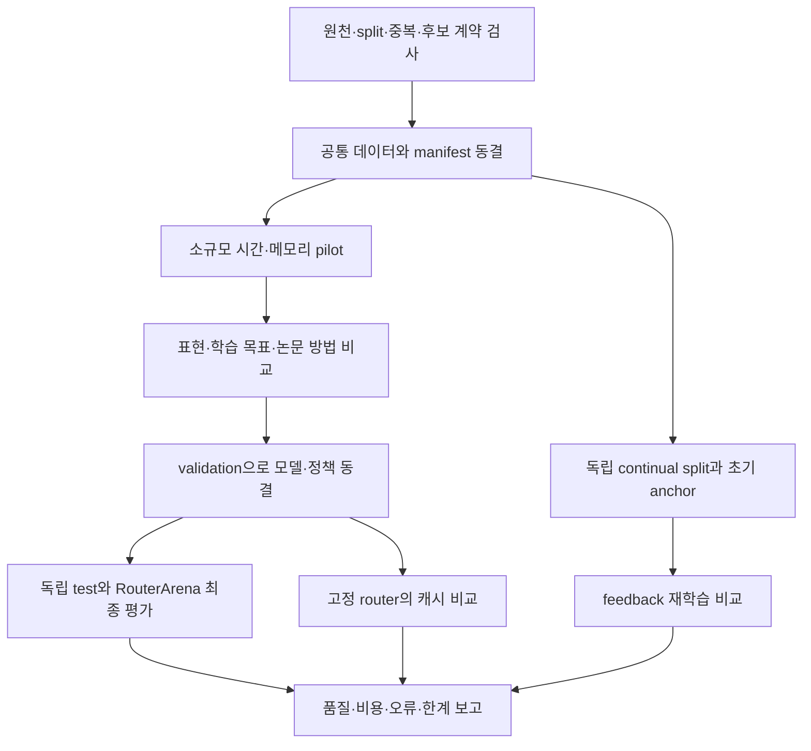

# ML 최종 실험 문서

기준일: 2026-09-20. 이 디렉터리는 졸업 프로젝트의 최신 ML 실험 사양만 유지한다. 프로젝트 결정 원장은 memorize이며, 실행 계약과 근거는 아래 문서와 versioned config/manifest로 관리한다.

> 어떤 조건에서 임베딩 캐시와 에스컬레이션 피드백 학습을 결합한 라우팅 시스템이 더 나은 비용–품질 균형을 만드는가?

세 축은 **임베딩 캐싱, 질문 기반 라우팅, 에스컬레이션 데이터에 의한 재학습**이다. 특정 모델의 우승이나 일정 절감률을 연구 전제로 두지 않는다. 개선이 없는 조건도 결과로 보고한다.

## 1. 읽는 순서와 문서 소유 범위

| 문서 | 여기에서만 정의하는 내용 |
|---|---|
| [데이터·전처리](data-and-preprocessing.md) | RouterBench+xRouteBench 원천, score 해석, label, 입력 정제, 중복, split, 공통 outcome |
| [라우팅 비교 실험](routing-experiments.md) | 학습 목표 비교, 표현·모델 비교, 논문 라우터, 후보 모델과 비교군, 학습 예산 |
| [평가](evaluation.md) | 난이도·품질/비용·외부 일반화, RouterArena, 인지 수준 분석, 통계와 결과 해석 |
| [재학습 파이프라인](retraining-pipeline.md) | 서비스 경계, feedback 계약, version/승격 정책, 재학습 데이터와 순차 실험 |
| [캐시 실험](semantic-cache.md) | exact/semantic cache, 답변 재사용 검증, 반복 요청, 절감·오류·지연 |
| [실행·산출물 관리](execution-and-artifacts.md) | Colab/Vertex 실행, 구현 상태와 남은 작업, 재현 기록, 과거 결과와 복원 |

설치와 CLI 진입점은 [ml/README.md](../../ml/README.md)에 둔다. 이 안내서 외에 별도 총괄 계획·체크리스트·회의용 정책 사본을 만들지 않는다. 각 세부 문서는 다른 문서의 수치를 복사하기보다 해당 계약으로 연결한다.

## 2. 모든 실험에 공통인 결정

1. **Claude는 서비스 호출 대상이다.** 신규 Claude 응답·judge·preference를 대량 생성해 학습하지 않는다. 공개 benchmark에 이미 포함된 과거 모델 결과는 재사용한다. 서비스의 Haiku/Sonnet/Opus 버전은 실행 manifest에서 고정하며 역사적 benchmark와의 능력 등가성을 가정하지 않는다.
2. **동일한 원천 증거로 비교한다.** 같은 질문, split, 후보, score/cost와 튜닝 예산을 사용한다. R0/R1/R2가 원천 결과를 서로 다른 target으로 변환하는 차이는 비교 대상이다.
3. **난이도 분류와 모델 선택을 구분한다.** 상·중·하 일치율, 선택한 모델의 답변 품질·비용, 캐시/feedback 시스템 효과를 별도 표로 보고한다. source가 다른 모델 pool을 동일한 실제 세 모델로 합치지 않는다.
4. **학습과 선택은 train/validation에서 끝낸다.** test 결과로 threshold, checkpoint, 예산 정책을 다시 고르지 않는다. RouterArena는 학습·feedback·반복 gate에 쓰지 않는다. 과거 관찰 이력이 있는 데이터는 완전히 새로운 외부 test라고 부르지 않는다.
5. **실험 범위를 제한한다.** 경량 기준선과 ModernBERT의 학습 목표 비교를 먼저 수행하고, 논문 라우터는 RouterDC 하나부터 비교한다. 캐시와 feedback은 먼저 분리해 검증한다. 모든 backbone×loss×seed 조합을 돌리지 않는다.
6. **실험과 운영 artifact를 분리한다.** 연구 데이터 계약은 현재 v2 운영 모델을 문서만으로 대체하지 않는다. 연구용 model root, DB, evaluation gate와 version namespace를 사용한다.
7. **초기학습·비교는 Colab, 운영 feedback 재학습은 Vertex다.** 관리형 Vertex AI Pipelines와 Custom Training을 사용하며 GKE나 자체 KFP control plane을 만들지 않는다. 연구용 feedback 성능 비교는 로컬/Colab 공통 코어에서 먼저 검증한다.
8. **관측 범위를 표시한다.** 실제 router 실행, 공개 outcome 재생, 가정을 둔 simulation, Claude 서비스 관측을 구별한다. 계산량·오류·실패한 실행을 비용에서 제외하지 않는다.

## 3. 최종 실험 구성

| 축 | 주 실험 | 확장 조건 |
|---|---|---|
| 표현·모델 | TF-IDF+Logistic Regression, frozen BGE+kNN, ModernBERT | RoBERTa 근접 규모 비교는 별도 추가 |
| 학습 목표 | 같은 ModernBERT의 R0 3-class CE, R1 성공 예측, R2 pairwise | R3 regret는 후속 후보 |
| 논문 방법 | 동일한 실제 세 후보의 RouterDC 재학습 | GraphRouter/CARROT은 예산·adapter 검증 후 |
| 고정 기준선 | always-low/mid/high, best-single, 비율을 맞춘 random, oracle | source/domain을 더 엄격히 맞춘 random 진단 |
| 재학습 | frozen / cycle-only / replay+rehearsal, 공통 feedback·6개 제출 기회 | on-policy 및 15성공 pristine rebase는 별도 |
| 캐시 | 없음 / exact / BGE semantic, router 고정 | reranker 및 다른 router에서 재현 |
| 인지 수준 | 독립 블라인드 주석, 일부 인간 검증, 통제 문항쌍 | 자동 주석은 학습 정답으로 재사용하지 않음 |

샘플 수·step·threshold의 **pilot 시작값**과 현재 운영 기본값은 각 소유 문서에 명시한다. 최종 수치는 test를 열기 전에 실행 manifest로 동결한다. 문서의 “최종”은 현재 유효한 설계가 하나라는 뜻이며, 성능 실험 완료나 모든 adapter 구현 완료를 뜻하지 않는다.

## 4. 실행 순서



각 실행의 착수 조건과 미구현 항목은 [실행·산출물 관리](execution-and-artifacts.md)에만 모은다. 결과가 없는 칸에는 예상 성능을 채우지 않는다.

## 5. 이전 문서·실험 기록의 보존

통합 전 22개 ML 문서의 디스크 상태를 Git commit **`fa09cb8931526faeb3ed44f934b032adbb5bcce3`**에 보존했다. 현재 디렉터리에서 삭제한 과거 계획, 학습 보고서, 승격 로그는 해당 commit에서 조회할 수 있다. 기존 commit history도 그대로 유지한다.

```bash
# 과거 문서 목록
git ls-tree -r --name-only fa09cb8 docs/ml

# 과거 학습 보고서 읽기
git show fa09cb8:docs/ml/training-reports/modernbert-v2-balanced-training-report.md

# 통합 전 문서를 별도 압축파일로 추출
git archive --format=tar --output=/tmp/llm-router-ml-docs-before-consolidation.tar fa09cb8 docs/ml
```

| 이전 문서 묶음 | 현재 내용의 위치 |
|---|---|
| charter, integrated plan, objective plan, literature/model reports | 이 안내서 + 라우팅 비교 + 평가 |
| RouterBench labeling, benchmark analysis | 데이터·전처리 |
| RouterArena preprocessing/evaluation | 평가 |
| continual strategy, escalation plan, backend agreement/meeting guide | 재학습 파이프라인 |
| semantic cache plan | 캐시 실험 |
| GCP rollout, training spec, workstream, development questions | 실행·산출물 관리 + 재학습 파이프라인 |
| v1/v2 training reports, promotion log | 실행 문서의 과거 관측 요약 + `fa09cb8` 원문 |

**Git이 모든 원본 로그를 보관하는 것은 아니다.** `.gitignore`의 `ml/data/`, `ml/artifacts/`에는 원본 데이터·가중치·metric·로그가 별도로 존재하며 이번 정리에서 삭제하지 않는다. Drive/GCS의 존재와 백업 상태를 Git commit만으로 보증하지 않는다. 최근 비교 실험의 코드·config·notebook은 이 문서 통합 시작 시 미커밋 상태였으며, 문서 보존 commit에 코드까지 포함되었다고 해석하지 않는다.

## 6. 변경 원칙

- 새 결정은 memorize에 남기고 해당 소유 문서와 config/manifest를 함께 갱신한다.
- 과거 설명이 필요하면 Git history를 참조한다. 활성 디렉터리에 날짜별 계획 사본을 쌓지 않는다.
- 실험 결과는 실행별 artifact에 저장하고 실행 문서의 결과 색인으로 연결한다. 설계 문서에 장문의 실행 일지를 섞지 않는다.
- 새로운 데이터나 모델을 추가하면 후보 pool·split·비용·추론 입력의 공정성부터 갱신한다.
- 인지 수준과의 정렬은 난이도의 구성 타당성에 관한 보조 분석이며 모델 내부 기제나 Claude의 실제 성공을 증명한 것으로 서술하지 않는다.
