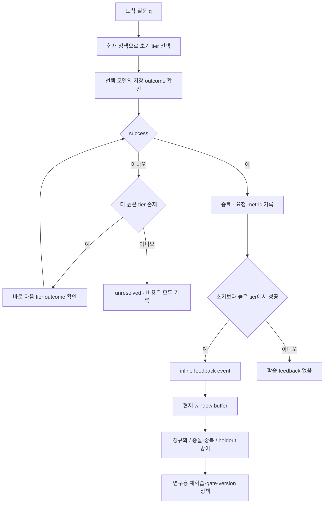

# 에스컬레이션 피드백 재학습의 오프라인 실험

기준일: 2026-09-20. 상태: 실행 설계. 운영 GCP run 제출·승격·설정 변경 없음.

상위 계약: [졸업 프로젝트 연구 전제](graduation-project-experiment-charter.md). 운영 구현의 [지속학습 전략](continual-retraining-strategy.md)을 재사용하되, **연구 데이터 분리와 실험 전용 gate가 추가로 필요하다.**

## 1. 연구 질문

1. 상향 요청 후 성공한 feedback을 학습하면 이후 새로운 질문의 초기 routing이 개선되는가?
2. 현재 cycle + history replay + base rehearsal이 feedback-only보다 기존 능력을 잘 보존하는가?
3. 개선된 호출 비용이 재학습 비용을 언제 상쇄하는가?
4. 질문 분포가 변할 때 적응 속도와 upward-only feedback 편향은 어떻게 달라지는가?

실제 사용자 만족·Claude 성능을 관측하는 실험이 아니다. benchmark의 기존 success를 만족의 대리 신호로 사용하는 **모의 에스컬레이션**이다. feedback은 쉬운 문제에도 생길 수 있지만 finalLabel은 medium/hard만 가능하다는 구조를 명시한다.

## 2. 그대로 재사용할 정책

현행 코드 근거: [strategy](../../../LLM_Router-serving/src/llm_router_serving/retraining/strategy.py), [service](../../../LLM_Router-serving/src/llm_router_serving/retraining/service.py), [materializer](../../../LLM_Router-serving/src/llm_router_serving/retraining/gcs.py), [config](../../../LLM_Router-serving/src/llm_router_serving/config.py).

| 정책 | 확인한 동작 |
|---|---|
| 입력 | `feedback-inline-v1`, event 최소 1개, UTC timestamp, strict tier increase, satisfied/PII 보증 |
| 기본 version mode | `successfulHttpRequest`; 성공 run 수로 진행. 202 응답 수와 다름 |
| minor/major | 마지막 승인 `.0` anchor의 weight로 시작; optimizer/scheduler는 새로 생성 |
| 호출 주기 | 성공 3회마다 major consolidation |
| pristine | 5번째 성공 major cycle마다 pinned pretrained ModernBERT에서 초기화 |
| feedback | 현재 cycle 누적 + compact history replay |
| history replay | final label당 최대 32 event; upward-only에서는 medium/hard 합계 최대 64 |
| base rehearsal | train label당 32행=96, validation label당 16행=48; 합계 144, validation은 gradient 학습에 넣지 않음 |
| 승격 비교 | 직전 성공 모델을 baseline으로 사용; 초기화 anchor와 다를 수 있음 |
| 저장·반영 | candidate→gate→approved→CURRENT; load-before-swap |

### 실제 version 예시

아래는 모든 접수가 성공한 경우다. Bn은 n번째 성공 run에 포함된 신규 feedback batch다.

| 성공 순번 | 새 version | 시작 weight | 현재 cycle |
|---:|---|---|---|
| 1 | 1.1 | 1.0 | B1 |
| 2 | 1.2 | 1.0 | B1+B2 |
| 3 | 2.0 | 1.0 | B1+B2+B3 |
| 4 | 2.1 | 2.0 | B4 |
| 5 | 2.2 | 2.0 | B4+B5 |
| 6 | 3.0 | 2.0 | B4+B5+B6 |
| 15 | 6.0 | pristine pretrained | 해당 cycle + history replay + base rehearsal |

1.2는 1.1을 이어 학습하는 것이 아니다. 6회 성공 실험은 5-major pristine rebase를 검증하지 못한다. pristine도 기존 full train이 아니라 compact dataset을 사용하므로 성능 회복을 전제하지 않는다.

`validatedUniqueBatch`는 승인된 canonical whole-batch digest를 ledger와 비교하는 정책이다. 정책 전환은 다음 성공 major boundary에서 활성화된다. **새 batchId/unique mode가 곧 새로운 학습 정보 n건을 보장하지는 않는다.** 현재 `_reserve_unique_batch()`의 digest 비교만으로 nonempty prepared rows와 merge 후 새로운 정보까지 보장한다고 가정하지 않고 harness가 별도로 검사한다. 기본 성능 실험은 `successfulHttpRequest`로 고정하고 uniqueness/pending activation은 별도 정책 검증으로 둔다.

## 3. 데이터 출처와 partition

피드백의 원천은 RouterBench 및 xRouteBench `llmrouter_generic`의 이미 공개된 질문×모델 outcome이다. RouterArena를 feedback으로 사용하지 않는다. 최초 학습 모델이 이미 본 질문에서 “새 분포 적응”을 주장하지 않는다.

원래 봉인한 RouterBench test/xRouteBench official test는 그대로 남겨 두고, **기존 development pool(train+validation) 안에서 새 continual split**을 초기학습 전에 만든다. split/version이 바뀌므로 기존 통합 manifest를 덮어쓰지 않는다.

| partition | 제안 비중, development pool 내부 | 용도 |
|---|---:|---|
| D_initial_train | 60% | 초기 anchor 학습, base train rehearsal 원천 |
| D_dev | 10% | hyperparameter/step/gate threshold pilot; rehearsal validation subset도 이 안에서 명시 |
| D_gate | 10% | 반복 승격 판정; 최종 독립 성능표로 쓰지 않음 |
| D_stream | 15% | 순차 도착·모의 feedback; 초기 train과 완전 분리 |
| D_retention_test | 5% | 기존 영역 망각, label/source/domain slice의 최종 진단 |

수치는 기본 제안이며 task/class coverage audit 후 실행 전에 동결한다. near-duplicate·동일 원문·cross-source group은 split을 넘지 않게 한다. 최종 독립 test와 겹치는 development row는 제거하고 원 test는 보존한다. 단순 dataset 이름 차이만으로 OOD를 주장하지 않는다.

D_dev에서 뽑은 base validation rehearsal 48행은 validation/모델 선택용이지 훈련 행이 아니다. D_gate와 retention/test는 이 rehearsal에 들어가지 않는다. 초기학습 기준, continual base artifact의 train/validation/test schema와 lineage를 일치시킨다.

### 후보 모델과 label 의미

source마다 D_initial_train에서만 품질–비용 Pareto 기반으로 low/medium/high 대표 **실제 모델 ID 세 개**를 동결한다. 현재 code가 사용한 모델이나 3-group 평균을 관측된 1회 호출 결과인 것처럼 섞지 않는다. 각 source outcome에서 성공 threshold는 기존 metric별 계약을 사용한다.

initial R0의 difficulty는 source pool 전체 solve rate에서 파생될 수 있지만 feedback finalLabel은 **실제로 성공한 상향 action**이다. 두 label 정의가 다를 수 있다. 그 차이 자체가 적응/간섭의 원인이므로 ledger에 `label_origin=benchmark_difficulty|observed_escalation_action`을 보존하고 결과를 분리한다. strict upward만 관측하므로 이것이 모든 후보 중 최소 충분 모델을 증명하지도 않는다.

현재 [feedback 설정](../../ml/config/feedback_retraining_preprocessing.json)은 RouterBench v2 contract를 가리킨다. 통합 RB+xRB 실험은 별도 preprocessing/training/anchor 버전으로 만들고 schema·checksum·label semantics를 harness에서 검증해야 한다. config 문자열이 달라도 런타임이 자동으로 잡아줄 것이라고 가정하지 않는다.

## 4. feedback 생성과 정보 공개

초기 low 실패→medium 실패→high 성공이면 세 호출의 비용을 모두 더한다. high에서 시작해 실패한 질문, 모든 상향 모델이 실패한 질문도 stream의 오류·비용에 남기지만 유효 feedback을 만들지는 않는다. 성공 feedback만 먼저 골라 stream을 구성하지 않는다. 모든 실패를 hard 정답으로 만들지 않는다.

`userSatisfied=true`는 이 simulator에서 benchmark success proxy다. `initialModel/finalModel`에는 공개 candidate 실제 ID를 넣고 Claude 이름을 꾸며 넣지 않는다. public prompt에 PII가 없다는 검토/제거 절차를 수행한 row만 piiRedacted를 true로 만든다.

learner는 공개된 observed feedback fields만 받는다. evaluator가 가진 전체 outcome matrix의 미호출 모델 결과를 추가 label로 넘기지 않는다. 기본 사용자 반응 모델은 실패 시 항상 상향 요청하는 단순화이며, 일부 실패만 feedback으로 이어지는 민감도 실험은 후속으로 분리한다.

별도 ledger에 source/sample/group ID, arrival position, attempted model IDs/quality/cost, feedback reveal time, initial router version, canonical row hash와 accepted/excluded reason을 저장한다. `eventId`는 요청 단위 고유, `batchId`는 run 단위 고유로 만들어 retry와 새 요청을 구별한다.

## 5. 같은 데이터를 제공하는 원인분리 실험

| arm | 업데이트 데이터 | 고정할 것 |
|---|---|---|
| F0 Frozen | 없음 | initial anchor |
| F1 Cycle-only | 현 cycle feedback만 학습; history/base rehearsal의 학습 행 제외 | 같은 anchor/version 규칙과 공통 학습 예산 |
| F2 Replay+rehearsal | 현 cycle + history replay + base rehearsal | F1과 같은 sampler·실제 optimizer step 수 |

F1/F2 모두 동일한 D_dev validation 48행(클래스당 16행)을 제공한다. F1에서 제외하는 것은 base rehearsal의 학습 행이며 검증 데이터가 아니다. 현행 trainer는 비어 있지 않은 validation을 요구한다.

**주 실험 feedback은 frozen initial R0 logging policy에서 한 번 생성하고 모든 arm에 동일 batch로 제공**한다. 각 arm은 같은 다음 window 질문을 먼저 예측·채점한다. 이 결과는 “같은 feedback을 받을 때 재학습 전략의 효과”이며 자연 발생하는 서비스 전체 효과와 구분한다. 공통 feedback 수집 비용은 공통 비용으로 한 번 산정하고 arm별 추론·학습 비용은 따로 보고한다.

### sampler 교란 방지

현행 balanced_effective_batch는 easy/medium/hard가 모두 필요하다. upward-only feedback의 F1에는 easy가 없으므로 운영 sampler 그대로는 실행할 수 없다. 원인분리 F1/F2에는 동일 shuffle sampler와 동일 실제 optimizer step 수를 사용한다. 기존 production balanced sampler를 쓰는 F2-P는 별도 “운영정책 재현”으로 보고, F1 대비 차이를 replay 하나의 효과로 단정하지 않는다.

제안 pilot은 각 업데이트 최대 40 optimizer steps, canonical main은 pilot에서 고른 실제 step 목표(예: 100)를 실행 전에 고정한다. 숫자는 실측 전 제안값이다. 현행 trainer는 epoch로 계산한 step과 상한 중 작은 값을 실행하므로 상한만 같게 설정해서는 충분하지 않다. arm별 학습 행 수에 맞춰 충분한 epoch/반복 횟수를 설정하고 실제 완료 step이 목표와 일치하는지 검사한다. 처리 token, sample 반복수, 실제 step·시간·메모리를 함께 기록한다. 같은 step 수라도 token 길이 등에 따라 실행시간은 달라질 수 있다. F1/F2 combined 차이는 history replay와 base rehearsal를 합친 효과이며 각각의 효과를 따로 주장하려면 base-only/history-only arm이 필요하다.

실제 on-policy 후속 실험은 각 arm의 현재 router가 자기 feedback을 만들게 한다. 이때 같은 arrival trace여도 feedback이 달라지는 것이 정상이다. “학습 데이터가 완전히 같다”는 표현은 쓰지 않는다. cascade 비용·feedback 발생률·적응을 합산한 시스템 실험으로 별도 보고한다.

## 6. 요청 흐름·제출 상한·gate

최소 성능 실험은 D_stream을 **6개의 고정 request window**로 나눈다. stationary와 일반→코드/수학 증가의 단일 shift trace를 미리 만든다. 분포 변화는 source pool 변경과 섞이지 않게 가능한 한 source 내부 domain 비중으로 구성한다.

각 window 끝에 logging policy에서 생긴 유효한 신규 canonical feedback을 도착 순서대로 최대 32행 접수한다. 32는 제안 batch cap이며 API의 최소 1건과 다른 운영 실험값이다. 0행이면 skip, 초과행·제외행은 모두 ledger에 남긴다. 성공 여부에 맞춰 유리한 질문을 추가하거나 계속 실행하지 않는다. window와 submission opportunity가 비교 x축이며 logical version은 각 arm별 annotation이다.

모든 gate가 통과하면 최대 6번 성공하여 3.0에 도달한다. 거부/실패하면 그 version을 억지로 올리지 않고 기존 모델을 유지한다. HTTP 응답 유실에 따른 재전송에는 같은 batchId를 쓰며 새 성공 횟수로 세지 않는다. 현행 service는 해당 batchId의 pipelineRunId가 있으면 기존 실행을 반환하므로, terminal 실패 job을 같은 ID로 새로 실행하는 기능은 아니다. 최소 실험에서는 terminal 실패를 그 window의 실패 결과로 남기며, 별도 재실행을 허용하려면 허용 횟수·새 ID와 원실행의 연결·버전 집계 규칙을 사전에 정의해야 한다. 기본 실험은 6회 기회에서 종료하고 “6성공 미달”도 결과다.

### 연구 gate와 RouterArena 분리

현행 [qualification DAG](../../ml/kubeflow/pipelines/model_qualification.py)는 RouterArena 결과를 매번 gate에 사용한다. 이것을 그대로 사용하면서 RouterArena를 untouched external test라고 주장할 수 없다.

연구용 pipeline은 D_gate 평가를 사용하도록 evaluator schema adapter·evaluation config·metric metadata를 분리해야 한다. D_gate의 macro-F1/hard recall, source/domain regression, 그리고 추가 구현한 outcome quality/cost를 사전등록 규칙으로 검사한다. 현재 evaluator가 모두 제공한다고 가정하지 않는다. 최소로 label gate만 구현했다면 그 한계를 밝힌다. 임계값은 D_dev pilot으로 고르고 동결하며 저장소 smoke gate를 정식 성능 gate로 쓰지 않는다.

현재 minor/major가 같은 gate를 쓰므로 주 실험도 공통 gate를 유지한다. D_gate는 반복 선택 자료이며 마지막 독립 test 점수와 분리한다. 운영 gate를 수정하지 않고 연구용 GCS root/SQLite DB/CURRENT prefix를 사용한다.

### pristine rebase 확장

GPU 없는 정책 검증에서 15성공 sequence, failed/rejected/retry, same batchId/different content, canonical digest duplicate, pending policy activation을 검증할 수 있다. 이는 성능 검증이 아니다.

실제 pristine 효용은 예산이 확보된 뒤 15성공을 포함하는 고정 추가 window 계획으로 평가한다. 6.0 직전 동일 history에서 approved-anchor 유지와 pristine 초기화를 비교해야 rebase 자체를 분리할 수 있다. 실패 때문에 15성공에 도달하지 않으면 미검증으로 남긴다. compact 데이터만으로 pretrained에서 재시작할 때 급격한 망각이 생길 가능성도 결과로 기록한다.

## 7. 무엇으로 평가할 것인가

| 평가 데이터/시점 | 지표·용도 |
|---|---|
| D_stream 각 요청, 업데이트 이전 | initial selected-model quality, escalation 후 resolved rate, 누적 호출비용, depth, unresolved |
| D_stream shift 이후 | 회복까지 요청·feedback·update 수, 성능곡선 면적; 회복 미달도 보고 |
| D_gate | candidate 승격/거부만; 최종 일반화 주장 금지 |
| D_retention_test | 초기 대비 기존 영역 macro-F1/quality, easy→high 비중·비용; snapshot 추론은 동결 후 일괄 공개 |
| RouterBench test | held-out routing quality/cost와 difficulty alignment |
| xRouteBench 공식 test | source별 routing quality/cost와 difficulty alignment |
| RouterArena aligned/unseen/full | 최종 동결 snapshot의 외부 난이도 정렬·OOD 진단; feedback/선정에 사용 금지 |

cached 모델 답변의 기록 가격은 모의 비용, 실제 CPU/GPU 실행은 실험 비용이다. F2의 재학습 비용을 빼고 비용 절감을 주장하지 않는다. 운영으로 환산할 때는 관측 구간의 전체 추론·승격 실패 학습·성공 학습·저장 비용을 합산하고, future 요청당 절감이 안정적일 때만 손익분기 요청 수를 추정한다.

가능한 원인 분석은 upward-only로 easy 학습행이 없는지, replay가 어떤 라벨/도메인을 보존하는지, base-label과 final-action이 충돌하는지, anchor 재시작이 같은 cycle 내 drift를 줄이는지다. label 증가 자체를 품질 개선으로 간주하지 않는다.

동일 query/group paired comparison과 window/block bootstrap을 사용하고, 시계열 업데이트를 독립 표본처럼 취급하지 않는다. 최소 canonical trace 뒤 finalist를 사전 고정한 다른 순서 seed로 재검증한다.

## 8. 저비용 실행과 보존

주 통계 실험은 로컬/Colab에서 공통 preprocessing/training/package/gate core를 호출한다. 같은 정책을 사용한다고 곧 GCP production E2E를 검증한 것은 아니다. 실제 Vertex 한 번의 통합 smoke가 필요하다면 별도 작업과 비용 확인 후 수행한다. 이 문서 작성으로 GPU run을 시작하지 않는다.

초기 학습 1개를 모든 F-arm이 공유하고, 업데이트 step cap·batch cap·제출 기회를 고정한다. 요청마다 모델을 재학습하지 않는다. 6기회×F1/F2 두 trainable arm이 기본 크기이며, 두 trace를 모두 실행하면 각각 별도 비용이 든다. pilot 결과에서 실제 예산을 계산한다.

split manifest/checksum, triplet, stream order, feedback ledger, 데이터 수락/제외 사유, version/anchor/policy/seed, gate 결과, 모든 비용과 snapshot prediction을 보존한다. production retention은 current/previous/anchor 밖의 모델과 과거 derived artifact를 정리하므로 연구용 결과는 별도 prefix에 보존해야 한다.

코드 연결: [feedback preprocessing](../../ml/src/llm_router_labeling/training/feedback_retraining_preprocessing.py), [unique digest](../../ml/src/llm_router_labeling/training/feedback_retraining_cli.py), [학습 sampler](../../ml/src/llm_router_labeling/training/modernbert_training.py), [재학습 DAG](../../ml/kubeflow/pipelines/modernbert_retraining.py). 이 설계에는 아직 구현해야 할 harness/adapter가 포함되어 있으며 실행 완료로 표시하지 않는다.
