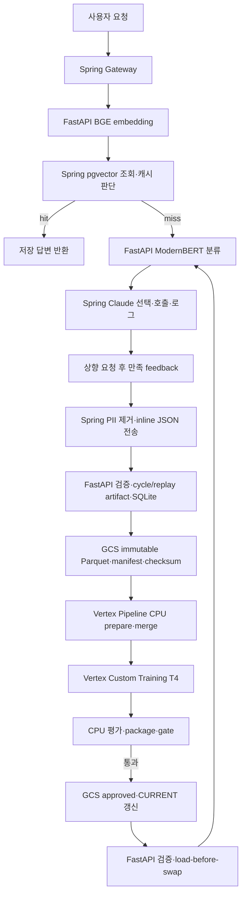

# 피드백 재학습 파이프라인과 실험

기준일: 2026-09-20. 이 문서는 **현재 구현된 운영 계약**과 **최종 연구 실험에서 적용할 조건**을 구분한다. 문서 통합은 운영 설정·GCS·배포 모델을 변경하지 않는다. 전체 연구 전제는 [ML 최종 명세](README.md), 데이터는 [데이터와 전처리](data-and-preprocessing.md), 공통 평가는 [평가](evaluation.md)를 따른다.

## 1. 범위와 실행 구조

지속 재학습·자동 승격·FastAPI 적재의 대상은 ModernBERT다. 표현/모델·목표함수·논문 라우터 비교는 Colab에서 오프라인으로 실행하며 비교 모델 전부를 운영 pipeline에 올리지 않는다. ModernBERT 초기학습도 Colab에서 수행한다. **GCP GPU는 feedback 재학습에 사용하고, KFP v2 IR은 관리형 Vertex AI Pipelines에서 실행한다. GKE와 자체 설치 Kubeflow는 사용하지 않는다.**



| 경계 | 책임 |
|---|---|
| Spring | 공개 API, cache 조회·threshold·hit/miss, Claude API 호출, 실제 만족 수집, PII 제거, event 선택·전송, timeout/fallback |
| FastAPI serving | BGE·선택적 reranker·ModernBERT 추론, inline 검증, GCS feedback 생성, 비동기 Vertex 제출, 상태 API, 승인 모델 적재 |
| ML pipeline | canonical 전처리·holdout 보호, 재학습, 평가·gate, package·승격·rollback 도구, 실험 계보 |
| GCS | versioned 데이터·config·IR·model·평가·관측 artifact와 control ledger |

Spring은 학습용 Parquet·manifest·GCS URI를 만들지 않고 재학습용 GCS 권한을 갖지 않는다. Pipeline은 Spring DB를 직접 읽지 않는다. cache는 [독립 실험](semantic-cache.md)이며 학습 DAG에 넣지 않는다. 위 순서는 합의한 시스템 경계이며 Spring 서비스 전체의 현재 통합 완료를 의미하지 않는다.

## 2. 내부 API와 인증 계약

실제 schema는 serving의 [schemas.py](../../../LLM_Router-serving/src/llm_router_serving/schemas.py), endpoint·인증은 [main.py](../../../LLM_Router-serving/src/llm_router_serving/main.py)가 소유한다.

| API | 목적·핵심 계약 |
|---|---|
| `POST /router/embed` | `{message}` → `embedding`, `dim`, `modelVersion`; BGE 기본 1,024차원·512 token |
| `POST /router/rerank` | query와 조회된 후보를 받아 점수만 반환; hit/miss는 Spring이 결정; 기본 비활성 |
| `POST /router/classify` | `{message}` → `tier`, `model`, `confidence`, `modelVersion`; tier는 easy/medium/hard, model은 haiku/sonnet/opus의 논리 이름 |
| `GET /health` | embedding과 router readiness; 선택적 reranker는 전체 readiness 조건에 포함하지 않음 |
| `POST /escalate` | `feedback-inline-v1` 접수, 비동기 재학습 제출; `202`는 완료·승격을 뜻하지 않음 |
| `GET /retraining-runs/{batchId}` | 단계, 학습 진행, 필터링 수, gate·terminal 결과, serving 활성화 상태 |
| `GET /router/model/current` | desired approved와 실제 serving 모델 및 이전 known-good 구분 |
| `GET/PUT /developer/retraining/version-policy` | 개발자 전용 version trigger 변경; feature flag와 별도 token 필요 |

운영 환경은 `LLM_ROUTER_INTERNAL_API_TOKEN`을 설정하고 `Authorization: Bearer …`로 호출한다. token 미설정은 코드상 인증을 생략하는 로컬 개발 동작이다. 개발자 API는 `LLM_ROUTER_ENABLE_DEVELOPER_API`와 `LLM_ROUTER_DEVELOPER_API_TOKEN`을 분리하며 Spring credential로 관리하지 않는다. Secret 값과 service-account JSON key를 문서·image·Git에 기록하지 않는다.

JSON의 알 수 없는 필드는 거부한다. timestamp는 UTC ISO 8601, 추적은 `X-Request-ID`, 오류 분기는 안정적인 `code`를 사용한다. `/health`는 inference readiness이지 GCS/Vertex 연결이나 재학습 가능성의 증명이 아니다. 실제 Claude 버전 ID와 온라인 fallback은 Spring 환경 설정·로그에 기록하며 이 연구 문서가 외부 모델 ID를 영구 고정하지 않는다.

## 3. Feedback 입력과 정규화

입력 envelope는 `batchId`, `schemaVersion`, `requestedAt`, `events`다. events는 **최소 1건**이며 별도의 `eventCount`, `manifestUri`, `eventsUri`를 HTTP payload에 보내지 않는다. event 필드는 다음과 같다.

```text
eventId, requestId, question,
initialLabel, initialModel, finalLabel, finalModel,
userSatisfied, escalationCount, createdAt,
routerModelVersion, piiRedacted
```

현재 [feedback config](../../ml/config/feedback_retraining_preprocessing.json)와 [전처리](../../ml/src/llm_router_labeling/training/feedback_retraining_preprocessing.py)의 계약은 다음과 같다.

1. `finalLabel > initialLabel`, `escalationCount >= 1`, `userSatisfied=true`, `piiRedacted=true`를 요구한다. PII boolean을 검사하는 것만으로 원문의 PII 부재가 자동 검증되는 것은 아니다. 원문 검토·제거는 별도 절차가 필요하다.
2. FastAPI가 event ID 순으로 정규화하고 `feedback-export-v0.1` manifest, Parquet, SHA-256을 생성한다. 같은 batch ID의 payload 충돌은 거부한다.
3. prepare가 schema·checksum·event 수·필드 의미를 확인한다. 정규화한 같은 질문의 상충 final label은 제외하고, 같은 질문·같은 label 반복은 canonical 한 행으로 병합한다.
4. 반복 feedback의 가중치는 `min(2.0, 1.0 + 0.25 × (반복 수 - 1))`이다. weight·중복·제외 이유를 metadata로 남긴다.
5. base train의 정확히 겹치는 질문은 정책에 따라 교체하고, base validation/test와 겹치는 feedback은 제외한다. 현행 exact-normalized 검사를 전체 near-duplicate 방어와 동일시하지 않는다. 연구 harness는 partition 전체의 중복 그룹을 추가 검사한다.

학습 입력은 `sample_id`, `model_input_text`, `difficulty_label`, `sample_weight`, `split`, `duplicate_group_id`의 canonical schema다. 운영 원문 event 전체를 tokenizer 입력이나 모델 feature로 넘기지 않는다.

## 4. Cycle, replay, 버전 상승

[strategy.py](../../../LLM_Router-serving/src/llm_router_serving/retraining/strategy.py)의 기본 `successfulHttpRequest`는 **pipeline이 성공한 요청 수**로 진행한다. 접수된 event 수나 `202` 횟수가 아니다. cycle은 3성공, pristine rebase는 5번째 성공 major cycle이다.

| 성공 순번 | 새 logical version | 시작 weight | 현재 cycle |
|---:|---|---|---|
| 1 | 1.1 | 승인 1.0 | B1 |
| 2 | 1.2 | 승인 1.0 | B1+B2 |
| 3 | 2.0 | 승인 1.0 | B1+B2+B3 |
| 4 | 2.1 | 승인 2.0 | B4 |
| 5 | 2.2 | 승인 2.0 | B4+B5 |
| 6 | 3.0 | 승인 2.0 | B4+B5+B6 |
| 15 | 6.0 | pinned pretrained ModernBERT | 해당 cycle |

B는 성공 run에 연결된 신규 feedback batch다. `1.2`는 `1.1`을 이어 학습하지 않는다. minor/major는 마지막 승인 `.0` anchor의 **weight만** 사용하고 optimizer·scheduler는 새로 만든다. 승격 비교 baseline은 직전 성공 모델이므로 시작 weight와 다를 수 있다.

| 데이터 구성 | 현재 구현의 상한·의미 |
|---|---|
| 현재 cycle | cycle에 누적된 feedback 전량; canonical 중복·충돌 필터 적용 |
| compact history replay | final label별 stable hash 순 최대 32 event |
| base train rehearsal | 라벨별 32행 = 최대 96행 |
| base validation rehearsal | 라벨별 16행 = 최대 48행; gradient 학습에 넣지 않음 |

Strict upward feedback의 finalLabel에는 easy가 없으므로 history replay의 가능한 상한은 **medium/hard 합계 64행**이다. 일반적인 3 label 자료구조의 96행 상한을 실제 feedback 규모로 쓰지 않는다. pristine도 원본 full train이 아니라 이 compact 구성으로 시작하므로 성능 회복을 전제하지 않는다.

`validatedUniqueBatch`는 canonical **whole-batch digest**를 committed ledger와 비교하는 대체 mode다. 변경 요청은 pending으로 두고 다음 성공 major boundary에서 활성화한다. batch digest가 달라도 일부 질문이 반복될 수 있으며, 현재 digest 예약만으로 merge 후 신규 정보나 비어 있지 않은 학습 행까지 보장하지 않는다. 주 연구는 기본 mode로 고정하고 nonempty·novel row 검사는 별도로 수행한다.

멱등성은 SQLite request fingerprint와 deterministic Vertex job ID를 함께 사용한다. 같은 batchId·같은 payload 재전송은 기존 run을 반환한다. 이미 terminal 실패한 run을 같은 ID로 다시 훈련시키는 기능이 아니다. 실패·거부·취소는 성공 횟수를 올리지 않는다. SQLite와 persistent volume을 보존하며, 유실 후 CURRENT만으로 전체 version 이력을 복구하는 migration은 구현 확인이 필요하다.

## 5. 학습·gate·모델 반영

운영 DAG는 [modernbert_retraining.py](../../ml/kubeflow/pipelines/modernbert_retraining.py)와 [model_qualification.py](../../ml/kubeflow/pipelines/model_qualification.py)에 정의되어 있다.

```text
base + cycle/replay + config import
 → CPU prepare → CPU compact merge
 → Vertex T4 weight-only warm start 또는 pristine 학습
 → CPU 평가 → model-package-v1 조립 → deploy gate
 → immutable candidate 게시 → 자동 approve → CURRENT.json
 → serving 다운로드·checksum·label 계약 검증 → 새 모델 로드 → 교체
```

Gate 통과 후 자동 승인한다. CURRENT 갱신은 GCS generation precondition으로 보호하고, FastAPI는 기본 60초 polling 후 **새 모델이 완전히 로드된 다음** 교체한다. 실패하면 현재 모델을 유지하고 desired와 serving의 불일치를 상태 API로 노출한다. pipeline 성공과 실제 serving 활성화는 별도 상태다.

Package는 model/tokenizer, metadata, label 순서 `easy=0, medium=1, hard=2`, 평가 산출물, 파일별 checksum과 승인 상태를 검증한다. rollback은 보호된 이전 approved package로 pointer를 되돌리는 [publish CLI](../../ml/src/llm_router_labeling/deployment/model_publish_cli.py)를 사용한다. GCS registry는 ML 자산이고 FastAPI의 로컬 model cache는 사본이다.

운영 cleanup은 current·previous known-good·cycle anchor를 보호하고 나머지 model package 및 오래된 derived artifact를 정리한다. **연구 snapshot·prediction은 별도 root에 보존**하여 이 cleanup에 잃지 않도록 한다.

현재 qualification은 RouterArena를 반복 gate에 사용한다. 최종 연구에서 RouterArena를 독립 평가로 남기려면 **D_gate 전용 schema adapter·config·metric metadata를 구현한 연구 pipeline**을 사용해야 한다. 운영 gate를 문서만으로 변경했다고 간주하지 않는다. minor/major gate는 현재 공통이며, 각기 다른 강화 gate는 이번 최소 실험 범위에 넣지 않는다.

## 6. 오프라인 재학습 실험 데이터

목표는 같은 feedback에서 적응·망각·비용의 차이를 확인하는 것이다. 공개 RouterBench와 xRouteBench generic의 이미 기록된 모델 결과를 사용한다. 새 Claude API 호출, RouterArena 학습 편입, 모든 실패를 hard 정답으로 바꾸는 처리는 하지 않는다.

원래 봉인한 RB test와 xRB official test는 유지한다. development pool 안에서 초기 학습 **이전**에 다음 continual split을 새 version으로 만든다. 기존 학습 모델이 D_stream을 본 적 있다면 initial anchor부터 새로 학습한다.

| Partition | 기본 설계 비중 | 용도 |
|---|---:|---|
| D_initial_train | 60% | 초기 anchor, base train rehearsal 원천 |
| D_dev | 10% | step·hyperparameter·gate 설정 pilot, 공통 validation 48행 원천 |
| D_gate | 10% | 반복 승격 판단만 |
| D_stream | 15% | 순차 도착 질문과 observed feedback |
| D_retention_test | 5% | 기존 영역 망각의 최종 진단 |

이 비중은 coverage audit 후 실행 manifest에서 동결할 설계값이다. 동일 원문·near-duplicate·cross-source group이 split을 넘지 않게 하며, test와 겹치는 개발 행을 제거한다. 데이터셋 이름이 다르다는 이유만으로 OOD라고 부르지 않는다.

source마다 D_initial_train만으로 고른 실제 후보 세 개를 고정한다. 단일 공개 모델의 관측 outcome을 사용하며 tier 평균을 한 번의 모델 호출처럼 취급하지 않는다. source pool이 다르면 별도 반복 실험으로 구분한다. 후보 선택·성공 판정은 [데이터 계약](data-and-preprocessing.md)을 따른다.

초기 difficulty label과 feedback의 final action은 의미가 다르다. Ledger에 `label_origin=benchmark_difficulty|observed_escalation_action`을 보존한다. 상향 후 성공은 그 action이 성공했다는 관측일 뿐, 전체 후보 중 최소 충분 모델이라는 증명이 아니다. 현행 feedback config는 RB v2이므로 통합 데이터에는 새 base contract·config·anchor를 명시해야 한다.

## 7. Simulator와 동일 feedback 비교

각 질문에 초기 tier를 선택하고 해당 모델의 기록 outcome만 공개한다. 실패하면 바로 다음 tier로 이동하고 처음 성공하면 멈춘다. 모든 시도의 비용을 합산한다. high 시작 후 실패, 끝까지 실패, feedback이 없는 요청도 전체 metric 분모에 남긴다.

상향 후 성공한 경우만 inline event를 생성한다. `userSatisfied=true`는 benchmark success의 **모의 대리 신호**다. `initialModel/finalModel`에는 실제 공개 후보 ID를 넣는다. 검토·제거 절차를 통과한 질문에만 `piiRedacted=true`를 설정한다. Learner는 관측한 feedback만 받고 evaluator가 가진 미호출 모델 결과는 받지 않는다.

| Arm | 업데이트 학습 행 | 공통 조건 |
|---|---|---|
| F0 Frozen | 없음 | initial anchor 유지 |
| F1 Cycle-only | 해당 cycle feedback | 같은 cycle/anchor/version 규칙 |
| F2 Replay+rehearsal | cycle + history + base train rehearsal | F1과 같은 sampler·실제 optimizer step 수 |

주 실험은 frozen initial R0 logging policy로 feedback을 한 번 만들고 F1/F2에 동일 batch를 제공한다. 모든 arm은 같은 다음 window를 업데이트 전에 예측·채점한다. feedback 수집 비용은 공통 비용, 각 arm의 추론·훈련 비용은 별도로 기록한다. 각 arm이 자신의 feedback을 만드는 on-policy 실험은 같은 arrival trace라도 학습 데이터가 달라지므로 별도의 시스템 확장 실험이다.

F1/F2 모두 D_dev에서 고정한 validation 48행을 사용한다. F1에서 제거하는 것은 **base 학습 행**이다. 현행 `balanced_effective_batch`는 easy/medium/hard 모두가 필요하지만 F1에는 easy가 없으므로, 원인분리 실험은 두 arm 모두 shuffle sampler를 사용한다. F2만 운영 balanced sampler로 바꾸는 F2-P는 별도 운영 재현이다.

Pilot 업데이트는 최대 40 step, 본 실험은 pilot 후 동결한 공통 실제 step 목표를 사용한다(100 step은 실행 전 검토할 예시). 현재 trainer는 epoch 기반 step과 상한 중 작은 값을 실행한다. 따라서 `max_optimizer_steps`만 같게 놓지 않고 행 수별 epoch/반복 횟수를 조정하여 **실제 완료 step 일치**를 검증한다. token 수·반복수·시간·메모리도 기록한다. F1/F2 차이는 history와 base rehearsal의 결합 효과이며 각각의 개별 효과를 주장하지 않는다.

## 8. Window, 제출 기회, gate

최소 실험은 6개의 고정 request window다. stationary trace와 source 내부의 일반→코드/수학 비중 변화 trace를 사전에 정한다. 각각 별도 실행 비용이 들며, shift를 source 후보 모델 변경과 섞지 않는다.

각 window 끝에는 도착 순서대로 유효한 신규 canonical feedback을 최대 32행 제출한다. 이 cap은 API 최소 1건과 다른 **연구 설정값**이다. 0행은 skip, 초과·제외행도 기록한다. 성공할 때까지 질문·window를 추가하지 않는다. 기본 실험의 x축은 제출 기회·요청 수이며 version은 주석이다. 최대 6성공이면 3.0에 도달하고, 실패하면 기존 모델을 유지한다.

D_gate는 label macro-F1/hard recall과 source/domain 회귀를 검사하고, outcome 품질·비용 gate는 adapter 구현 후 포함한다. 임계값은 D_dev pilot으로 선택해 실행 전에 고정한다. smoke 규칙을 정식 성능 gate로 쓰지 않는다. 반복 D_gate 점수는 최종 독립 성능표로 사용하지 않는다.

연구용 DB·GCS root·CURRENT prefix는 운영과 분리한다. HTTP 유실 재전송은 같은 batchId로 처리한다. terminal 실패를 재실행하려면 횟수·새 ID 연결·집계 규칙을 사전등록해야 하며 기본 실험은 해당 window의 실패로 남긴다.

Pristine의 성능 효과는 15성공을 포함하는 별도 확장이다. 같은 history의 approved-anchor 유지와 pristine 초기화를 비교해야 rebase 자체의 효과를 분리할 수 있다. GPU 없는 15성공 정책 시뮬레이션은 버전 로직 검사이며 성능 검증이 아니다.

## 9. 평가·보존·완료 기준

| 대상 | 핵심 지표 |
|---|---|
| D_stream, update 이전 | 초기 선택 품질, 상향 후 resolved rate, unresolved, 호출 depth, 누적 비용 |
| Shift 이후 | 회복까지 요청·feedback·update 수, 성능 곡선; 미회복도 결과 |
| D_retention_test | 초기 대비 품질·macro-F1, easy→high 과잉 상향, 비용 증가 |
| 봉인 RB/xRB test | 후보 선택 품질–비용, difficulty alignment |
| RouterArena | 동결된 최종 snapshot의 외부 인지 난이도 정렬; 학습·gate·선택에 사용하지 않음 |

시계열 update를 독립 표본처럼 취급하지 않는다. 동일 query/group의 paired 비교와 window/block bootstrap을 적용하고 seed·trace 순서를 기록한다. canonical trace 후 finalist를 사전 지정한 다른 순서 seed로 재검증한다. upward-only 편향, base label과 final action의 충돌, domain 이동과 anchor 재시작을 원인 분석한다.

모의 LLM 비용과 실제 CPU/GPU 실험 비용을 분리한다. 성공·실패 훈련비, 추론비, 저장비를 포함하여 총비용과 손익분기 요청 수를 계산한다. 개선을 확인하지 못하거나 손익분기에 도달하지 못한 결과도 남긴다.

각 run은 split·triplet·stream order·feedback ledger·채택/제외 사유·version/anchor/policy·gate·비용·snapshot prediction을 보존한다. 최소 크기는 공유 initial anchor 하나와 `6기회 × F1/F2`이며 데이터가 없는 window는 학습하지 않는다. 실제 실행 절차·현재 미구현 항목·역사적 결과 보존은 [실행과 산출물](execution-and-artifacts.md)을 따른다.
