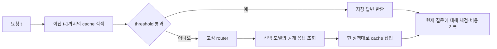

# 임베딩 캐시의 품질·비용 절감 실험

기준일: 2026-09-20. 상태: 실행 설계. 측정값·Claude 호출·캐시 활성화를 수행한 문서가 아니다.

상위 전제: [졸업 프로젝트 실험 계약](graduation-project-experiment-charter.md). 목표는 **어떤 반복 조건에서 캐시가 호출·비용을 줄이고, 그 과정에서 어느 정도의 잘못된 답변 재사용이 생기는지** 확인하는 것이다.

## 1. 고정할 구현과 비교군

현행 serving은 pinned BGE-large-en-v1.5, CLS pooling, L2 정규화, 1024차원, 최대 512 tokens다. Spring이 pgvector 검색과 threshold·hit/miss를 결정한다. FastAPI는 embedding과 선택적 reranker 점수를 계산한다.

| ID | 구성 | 목적 |
|---|---|---|
| C0 | cache off + 고정 router | 기준 |
| C1 | exact cache + 같은 router | 완전 반복의 이득 |
| C2 | BGE semantic cache + 같은 router | 의미적 재사용의 추가 효과 |
| C3 | BGE 후보 검색 + cross-encoder + 같은 router | false reuse 감소와 추가 계산비 비교; 선택 실험 |

C0–C2가 최소 실험이다. C3의 `cross-encoder/quora-distilroberta-base`는 현재 기본 off이며 기존 screening에서 false-hit gate를 통과한 것으로 간주하지 않는다. 최대 후보 수는 런타임 기본 16, threshold는 정확한 reranker modelVersion과 함께 봉인한다. 미로딩/장애 시 miss로 처리한다. 새 실험 결과 없이 운영에서 활성화하지 않는다.

첫 비교는 ModernBERT 하나로 고정한다. 라우팅 방법과 캐시를 동시에 바꾸지 않는다. 최종 확인에서만 선택된 다른 router 하나에도 동일 캐시를 붙인다. BGE+kNN router는 train-label index와 응답 cache를 분리한다.

## 2. 세 종류의 데이터와 주장 범위

### D1. 완전 반복 outcome replay — 비용·답변 품질의 주 결과

- RouterBench/xRouteBench에서 학습·threshold 선택과 겹치지 않는, 모델 응답·score·cost가 존재하는 질문을 사용한다. 적합 row 수와 제외 이유를 기록한다.
- 원질문을 정확히 같은 context/prompt/옵션으로 시간차 재요청한다. 최초 miss 때 그 router가 고른 실제 모델의 기록된 답변을 저장한다.
- 틀린 답변도 실제 정책이 저장한다면 저장한다. test 정답으로 cache 삽입을 허용/거절하지 않는다.
- C0는 매 요청마다 같은 candidate의 기록된 outcome을 재생하고 비용을 부과한다. C1/C2는 hit 때 이전 저장 답을 반환한다. 이는 deterministic recorded-outcome simulator이며 생성의 재호출 변동성까지 측정한 것은 아니다.
- cross-question semantic hit가 생겼을 때는 현재 질문의 정답에 대해 가져온 답변을 다시 채점한다. 객관식 option letter만 같다고 정답을 옮기지 않고 answer text/option 의미를 대응한다. 채점할 수 없는 cross-hit는 unknown으로 남기되 전체 요청 모집단과 비용·호출 집계에서 빼지 않는다. 전체 N 기준 보수적/낙관적 품질 범위와 unknown 비율을 보고하거나, 실행 전에 모든 arm에 동일한 채점 가능 task subset을 고정한다.

### D2. semantic answer reuse — 안전성의 주 결과

제안 규모는 calibration 100개 원질문 group + test 200개 group이다. 각 원질문에 동등 표현 1개와 비동등 hard negative 1개를 사람이 작성하고, 저장된 실제 답변이 각 질문에도 맞는지 검토한다. 약 300 group / 900 질문이며 첫 pilot은 일부 calibration group에서 한다. 표본 규모는 비용·CI 목표를 보고 실행 전 동결한다.

- 원질문과 모든 변형은 같은 group, 같은 split에 둔다. 새로 작성한 변형을 사용해 QQP 노출의 영향을 줄이되 BGE 사전학습 전체의 비오염을 보장한다고 쓰지 않는다.
- `semantic_equivalent`와 `cached_answer_correct_for_target`를 별도로 기록한다. 같은 뜻인데 원답 자체가 틀릴 수 있다.
- 정답 비교·실행 가능한 test를 우선하고, 불명확한 답 재사용은 두 명이 독립 검토 후 불일치를 조정한다. 생성 API·LLM judge를 새로 쓰지 않는다.
- hard negative: 숫자/단위, 부정, 개체, 시간 조건, 출발/도착 순서, 코드 언어, 출력 요구 형식 변경을 포함한다.
- 앞 512 tokens가 같고 뒤 조건만 다른 long-query slice를 별도로 둔다. tokenizer truncation으로 동일하게 보이는 문제를 숨기지 않는다.

새 paraphrase의 **모든 모델 outcome을 원질문에서 복사하지 않는다.** 뜻이 같아도 생성 모델의 실제 답변 성공은 표현에 따라 달라질 수 있다. D2는 기존 답을 재사용해도 되는지를 직접 평가하는 것이며, 새 paraphrase에 모든 모델을 실제 실행한 benchmark가 아니다.

D2의 miss 이후 생성 품질·비용은 기록이 없으면 unknown이다. 완전한 end-to-end simulation이 필요하면 “같은 의미 group이 같은 outcome을 공유한다”는 가정을 명시한 보조 결과로 제한한다. 그 수치를 측정된 실제 서비스 품질로 발표하지 않는다.

D2의 기본 protocol은 원질문에 대해 기록된 실제 답변을 후보 pool에 넣고, 이후 새 변형의 검색·재사용 여부를 평가하는 것이다. 해당 답변이 정답인지는 annotation으로 구분하고 정답만 선별해 저장하지 않는다. 생성 기록이 없는 변형의 miss는 새로운 답을 만들어 삽입하지 않으며, 그 뒤 cache 상태도 그러한 가짜 답변으로 확장하지 않는다. D1의 cold-start 동적 replay와 이 후보-pool 검증을 구분해 보고한다.

### D3. QQP / PAWS — 보조 진단

[PAWS 공식 데이터](https://github.com/google-research-datasets/paws)는 높은 단어 중복에도 의미가 다른 문장쌍을 제공한다. QQP는 질문 중복 판별 자료다. 둘은 답변 재사용의 실제 정답성과 동일하지 않다.

현재 reranker의 [공식 모델 카드](https://huggingface.co/cross-encoder/quora-distilroberta-base)에 QQP 학습 이력이 있으므로 QQP 성능만으로 unseen 일반화를 주장하지 않는다. QQP/PAWS로 duplicate 판별을 진단하고, D2를 실제 answer-reuse 검증으로 둔다. split·라이선스·revision과 원문 재배포 조건을 manifest에 기록한다.

## 3. 시간 순서와 정책



- 모든 arm은 같은 trace·순서·router·비용표를 사용하고 빈 cache에서 시작한다.
- 현재 요청을 검색 전에 index에 넣지 않는다. warm-start 데이터가 필요하면 평가 시작 이전 구간에서만 채우고 그 비용도 따로 제시한다.
- minimum exact normalization은 사전 고정한다. 숫자·단위·부정·대소문자가 의미를 바꾸는 task를 뭉개는 전처리를 하지 않는다.
- 주 실험 cache capacity는 trace의 최대 고유 key 수 이상으로 두고 TTL은 trace 길이보다 길게 해 eviction 효과를 제거한다. capacity/TTL 민감도는 후속으로 분리한다.
- 단일턴, 고정 system prompt, 영어 질문을 주 범위로 한다. 실서비스 multi-turn 적용에는 context·system prompt·사용자 접근 범위가 cache namespace/key에 들어가야 한다.
- 모델/embedding/reranker 버전, query hash, source answer ID, source model/version, insertion time, nearest score와 판정을 기록한다.
- gold answer로 저장 여부를 결정하지 않는다. 재학습·성공 에스컬레이션 후 cache 교체는 별도 통합 실험에서만 켠다.
- pgvector 실제 검색 측정과 in-memory exact cosine 실험을 구분한다. 후자로 DB network/ANN 지연을 측정했다고 쓰지 않는다.

## 4. 최소 실행 매트릭스

| 실험 | 조건 |
|---|---|
| D1 기록 replay | C0/C1/C2 × exact repeat 비중 0/10/30/50% × trace seed 3개 |
| D2 안전성 | C1/C2, 선택적으로 C3; calibration 후 한 번의 test |
| 결합 확인 | 현재 ModernBERT와 비교 winner에 같은 30% repeat trace |
| 시스템 확장 | cache off/on × 재학습 off/on; 같은 arrival trace, 별도 feedback 설계 |

0/10/30/50%는 관측된 서비스 통계가 아니라 반복 민감도 조건이다. repeat fraction은 전체 요청 중 이미 나온 동일 key의 재요청 비중으로 정의한다. 0%에서도 서로 다른 문제 간 semantic false-hit가 생길 수 있으므로 “hit가 0이어야 정상”이라고 가정하지 않는다.

repeat 비중마다 trace manifest를 별도로 만들고 길이를 같게 유지한다. 기본은 domain/difficulty와 repeat assignment를 독립으로 구성하고, hard-heavy 반복은 보조 조건이다. 요청 중복을 늘리면 독립 표본 수가 늘어나는 것은 아니므로 CI는 원질문 group 단위로 계산한다.

후보 수 k∈{1,4,8,16}, cosine/reranker threshold는 calibration에서만 탐색한다. 목표는 예를 들어 **false reuse among hits≤1% 조건에서 hit 최대화**로 사전등록하되, 1%는 운영 보장값이 아니다. test의 95% CI 상한까지 함께 보고 표본이 부족하면 “오류율 1% 이하 입증”이라고 쓰지 않는다. 상관없는 독립 hit 약 300개에서 오류 0이어야 3/n 근사 상한이 약 1%가 되며, 반복 그룹 상관이 있으면 더 많은 group이 필요하다.

조건을 만족하는 threshold가 없으면 semantic cache 실패를 보고하고 exact/miss fallback을 결과로 남긴다. test를 보고 threshold를 다시 맞추지 않는다.

## 5. 지표와 비용

N=전체 요청, H=cache 응답, F=재사용 관계가 틀린 응답, E=실제 오답 cache 응답으로 둔다.

| 지표 | 정의 |
|---|---|
| hit rate | H/N |
| false reuse among hits | F/H; H=0이면 N/A |
| 잘못된 재사용의 전체 영향 | F/N |
| cache answer error | E/H; 올바른 관계이지만 원답이 틀린 경우와 오매칭을 분리 |
| 호출 절감률 | 1 − calls_cache/calls_no_cache |
| 비용 절감률 | 1 − cost_cache/cost_no_cache |
| 답변 품질 변화 | 동일 trace의 Q_cache−Q_no_cache |
| 검색·안전성 | answer-reusable 후보 recall@k, threshold precision |
| 로컬 성능 | embedding/search/rerank/router p50·p95, 메모리, index 크기 |
| 분포 변화 | miss에 남은 domain/difficulty 비중 |

```text
C_no_cache = Σ(router 계산비 + 선택 모델의 기록된 입력·출력 비용)
C_cache = Σ(embedding + 검색 + 필요한 reranker 계산비)
        + Σ_miss(router + 선택 모델 기록 비용 + 삽입비)
        + 저장·상시 운영비 배분
```

위 C0는 캐시 제거의 인과 효과를 보기 위해 불필요한 BGE 호출도 제거한다. 현 서비스가 cache off여도 BGE를 호출하는 경우에는 그 구조를 유지한 별도 C0-deployment도 제시할 수 있다. 두 기준선을 혼용하지 않는다.

비용식의 항목은 실제 수행한 연산에만 적용한다. C1 exact cache는 hash/key lookup·삽입·저장 비용만 있고 BGE/reranker 비용은 없다. C2에는 BGE·검색, C3에는 실제 재채점을 수행한 요청의 reranker 비용을 추가한다.

실험 실행 비용(우리 CPU/GPU 시간)과 모의 생성 비용(공개 모델 outcome 가격)은 분리한다. 기록된 cost/token이 없으면 정규화 단위를 사용하고 달러 절감이라고 표시하지 않는다. token 길이가 다른 요청을 평균 가격 1:3:10으로 일괄 대체하지 않는다. 가격표·currency·시점을 고정한다.

LLM latency 기록이 없으면 로컬 cache/router latency까지만 실측한다. 가정한 생성 시간을 더한 end-to-end latency는 별도 simulation이다. semantic response cache와 Anthropic의 prompt/KV cache는 다른 기능이며 중복 절감으로 더하지 않는다.

embedding/pair score는 실험 계산을 위해 한 번 저장해 재사용해도, 배포 비용 추정에는 요청마다 필요한 계산을 반영한다. BGE+kNN과 결합할 때 실제로 공유하는 embedding은 한 번만 계상하고 standalone routing 비교에는 전체 embedding 비용을 포함한다.

손익분기 설명은 대략 `회피한 생성·라우팅 비용 > 모든 요청에 붙는 캐시 부가비용`이다. 최종 결과는 요청별 합산으로 구한다. 적은 반복율에서 손해가 나면 그대로 보고한다.

## 6. 산출물과 발표

`cache-experiment-v1/` 아래 dataset manifest, reuse annotations, trace별 request log, frozen policy, 단계별 latency, aggregate metrics를 저장한다. 모든 결과는 D1 기록 replay / D2 직접 answer-reuse 판정 / 가정 기반 simulation 중 어느 것인지 표시한다.

발표 그림은 다음 세 개를 우선한다.

1. false reuse율 대 호출 절감: C1/C2/C3, 품질 제약 표시.
2. 반복 비중별 총 비용: embedding·검색·reranker·router·생성 비용 분해.
3. 요청 순서에 따른 누적 비용과 누적 오답: cold start와 손익분기점.

runtime 코드: [serving config](../../../LLM_Router-serving/src/llm_router_serving/config.py), [inference](../../../LLM_Router-serving/src/llm_router_serving/inference.py), [serving 계약](../../../LLM_Router-serving/README.md). 이 문서는 캐시 담당 범위를 ML 학습 DAG로 옮기지 않는다.
