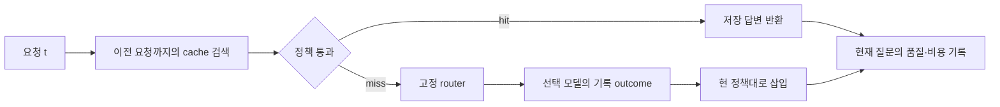

# 최종 임베딩 캐시 실험

기준일: 2026-09-20. 연구 질문은 **어떤 반복 조건에서 캐시가 호출·총비용을 줄이며, 그 과정에서 어떤 답변 재사용 오류가 생기는가?**다. 캐시를 켜면 항상 이득이라는 전제는 두지 않는다. 이 문서는 실행 사양이며 측정 결과나 운영 활성화 기록이 아니다.

연구 범위는 [ML 문서 안내](README.md), 공통 평가·통계는 [평가](evaluation.md), 결합할 feedback 정책은 [재학습](retraining-pipeline.md)을 따른다.

## 1. 고정할 시스템과 비교군

| ID | 구성 | 목적 |
|---|---|---|
| C0 | cache off + 고정 router | 기준 |
| C1 | exact cache + 같은 router | 완전 반복의 이득 |
| C2 | BGE semantic cache + 같은 router | 의미적 재사용의 추가 이득·오류 |
| C3 | BGE 후보 검색 + cross-encoder + 같은 router | 오류 감소 대비 계산비; 선택 확장 |

C0/C1/C2가 최소 실험이다. 첫 실험의 router는 ModernBERT 하나로 고정한다. 라우팅 방법과 캐시를 동시에 바꾸지 않는다. 이후 선택된 다른 router 하나에 같은 cache 정책을 붙여 결합 효과를 확인한다. BGE+kNN router의 train-label 인덱스와 요청별 응답 cache는 별도 상태다.

현재 serving 계약은 `BAAI/bge-large-en-v1.5`, revision `d4aa6901d3a41ba39fb536a557fa166f842b0e09`, CLS pooling, L2 정규화, 1024차원, 최대 512 tokens다. FastAPI는 embedding·선택적 reranker 점수를 제공하고 Spring이 pgvector 검색·threshold·hit/miss·저장을 소유한다. 실제 Spring/DB 연결 구현과 simulator를 구분해 보고한다.

C3 후보 `cross-encoder/quora-distilroberta-base`는 현재 기본 off다. 기존 screening에서 false-hit gate를 통과했다고 간주하지 않는다. 런타임의 최대 후보 수 기본은 16, reranker max length는 512다. model revision과 threshold를 함께 봉인하며, 모델 미로딩·오류이면 miss로 처리한다. 실험 설계만으로 운영 reranker를 켜지 않는다.

## 2. 데이터와 주장 범위

### D1. 완전 반복의 기록 outcome replay

비용·답변 품질의 주 실험이다. RouterBench/xRouteBench의 미학습·미튜닝 holdout 중 실제 모델 응답·점수·비용이 존재하는 질문을 사용한다. score만 있고 응답이 없으면 비용/호출 분석에는 쓸 수 있지만 cross-question answer-reuse 품질을 채점할 수 있는 것처럼 취급하지 않는다. 적합 row 수와 제외 이유를 manifest에 남긴다.

1. 같은 prompt/context/options의 원질문을 시간차로 다시 요청한다.
2. 최초 miss에서는 고정 router가 선택한 실제 후보의 기록된 답변을 반환하고 현 저장 정책대로 삽입한다.
3. 오답도 현 정책이 저장한다면 저장한다. 평가 gold를 보고 저장 여부를 결정하지 않는다.
4. C0는 매번 선택 모델의 기록 outcome을 재생하며 호출·비용을 부과한다. hit는 이전에 저장된 답을 반환한다.
5. 모든 요청의 선택·원답 provenance·정답성·비용을 기록한다. 이는 고정 outcome 시뮬레이터이며 재생성할 때의 답변 변동성을 측정한 것은 아니다.

다른 질문의 답이 semantic hit되면 **현재 질문에 대한 답변으로 재채점**한다. 객관식에서 option letter만 같다고 성공 결과를 옮기지 않고 선택지 의미와 answer text를 대응한다.

채점할 수 없는 cross-hit는 unknown이다. unknown을 방법별로 제외하면 denominator가 달라지므로 전체 N과 호출·비용에서 빼지 않는다. 전체 N 기준으로 unknown을 모두 실패/성공 처리한 보수적·낙관적 품질 범위와 unknown 비율을 보고한다. 또는 실행 전에 모든 arm에 공통으로 적용할 채점 가능 task subset을 고정한다. 잘 나온 결과만 남기는 사후 subset은 사용하지 않는다.

### D2. 의미적 답변 재사용 검증

캐시 안전성의 주 실험이다. 제안 규모는 calibration 100개 원질문 group, test 200개 group이다. 각 group은 원질문 1개, 동등 표현 1개, 비동등 hard negative 1개로 구성하여 약 300 group/900문항을 만든다. 규모는 주석 비용과 CI 목표를 보고 실행 전 봉인한다.

- 원질문과 모든 변형은 같은 group/split에 둔다. 사람이 변형을 작성하고 두 사람이 답변 재사용 적합성을 독립 검토한다. 실행 가능한 정답 비교·unit test를 우선한다.
- `semantic_equivalent`와 `cached_answer_correct_for_target`를 별도로 주석한다. 같은 뜻이어도 원답 자체가 틀릴 수 있다.
- 원질문의 **기록된 실제 답변**을 후보 pool에 넣는다. 정답만 골라 cache를 채우지 않는다. 이후 변형 질문의 검색·선택·재사용을 평가한다.
- 생성 기록이 없는 변형 miss에는 답변을 만들어 삽입하지 않는다. 이후 cache 상태도 가상 답변으로 확장하지 않는다.
- 새 paraphrase의 모든 모델 성공 여부·출력 token·답변을 원질문에서 복사하지 않는다. 새 표현의 생성 품질은 측정하지 않았으므로 unknown이다.
- 두 독립 주석자의 원판정, 불일치 조정, 최종 근거를 저장한다. 새 생성 API나 LLM judge를 필수로 쓰지 않는다.

hard negative는 숫자/단위·부정·개체·시간·출발/도착 순서·코드 언어·출력 형식 변경을 포함한다. 앞 512 tokens는 같고 뒤 조건만 다른 long-query slice도 둔다. 긴 질문이 embedding에서 잘려 같게 보이는 실패를 제외하지 않는다.

D2는 저장된 답변의 재사용 가능성을 직접 측정하며 **모든 변형 질문에 모든 후보 LLM을 실행한 benchmark가 아니다.** 완전 end-to-end 추정을 덧붙일 경우 “같은 의미 group은 같은 생성 outcome을 공유한다”는 가정을 명시한 보조 simulation으로 표시한다. D1의 빈 cache 동적 trace와 D2의 사전 후보-pool 검증을 구분한다.

### D3. 공개 문장쌍 진단

[PAWS](https://github.com/google-research-datasets/paws)는 단어 중복이 높지만 의미가 다른 쌍을 포함하고, QQP는 질문 중복 판별 자료다. 둘의 duplicate 판정은 실제 답변 재사용 정답성과 동일하지 않다. D3는 검색·reranker의 보조 진단이며 D2를 대체하지 않는다.

현재 reranker의 [모델 카드](https://huggingface.co/cross-encoder/quora-distilroberta-base)는 QQP 학습 이력을 명시한다. QQP 점수만으로 unseen 일반화를 주장하지 않는다. 새로 작성한 D2도 BGE의 모든 사전학습 노출을 배제했다는 증거는 아니다. 원본 revision/split/license와 재배포 조건을 manifest에 남긴다.

## 3. 요청 시간 순서와 cache 정책



- D1의 모든 arm은 같은 trace·순서·router·가격표를 사용하고 빈 cache에서 시작한다. 현재 질문을 조회 전에 삽입하지 않는다.
- warm start를 추가하면 평가 시작 이전 데이터만 사용하고 채우기 비용을 분리한다. calibration/test 질문으로 미리 채우지 않는다.
- exact key 정규화 규칙을 고정한다. 숫자·단위·부정·코드 대소문자 등 의미를 바꾸는 변환을 사용하지 않는다.
- 주 실험은 capacity를 최대 고유 key 수 이상, TTL을 trace 기간보다 길게 두어 eviction을 제거한다. capacity/TTL 효과는 별도 민감도 실험이다.
- 기본 범위는 영어 단일턴·고정 system prompt다. multi-turn·사용자별 데이터에서는 대화 context/system prompt/접근 범위가 namespace/key에 포함되어야 한다.
- model/provider prompt version, embedding/reranker version, 출력 요구, source answer/model ID, 삽입 시각을 provenance에 포함한다. 서로 다른 정책 namespace의 답을 섞지 않는다.
- gold를 이용해 저장·삭제하지 않는다. 재학습이나 성공 escalation 뒤 cache 교체는 별도 통합 실험에서만 켠다.
- pgvector 검색과 in-memory exact cosine 실험을 구분한다. 후자를 사용했다면 DB/ANN/network 지연을 측정했다고 쓰지 않는다.

## 4. 최소 실행 매트릭스와 calibration

| 실험 | 조건 |
|---|---|
| D1 | C0/C1/C2 × exact repeat 0/10/30/50% × trace seed 3개 |
| D2 | C1/C2, 선택 C3; calibration 후 봉인 test 한 번 |
| router 결합 확인 | ModernBERT와 선택된 다른 router에 같은 30% repeat trace |
| feedback 결합 확장 | cache off/on × 재학습 off/on; 같은 arrival trace |

repeat fraction은 전체 요청 중 이미 나온 동일 key의 재요청 비율이다. 0/10/30/50%는 **관측 서비스 비율이 아닌 민감도 조건**이다. 0%에서도 cross-question semantic hit가 있으므로 hit 0을 정상값으로 강제하지 않는다.

trace 길이는 조건 간 같게 하고 원질문 집합·반복 배정 규칙·seed를 저장한다. 반복 비중을 바꾸면 고유 요청 수나 sampling이 바뀔 수 있으므로 각 trace의 고유 group/라벨/domain 분포를 보고한다. 기본은 반복 배정과 난이도를 독립으로 만들고 hard-heavy 반복은 별도 조건이다. 같은 repeat 조건에서 arm 간 trace는 완전히 같다.

후보 k∈{1,4,8,16}, cosine/reranker threshold는 calibration에서만 선택한다. 제안 목적은 “hit 중 false reuse≤1%라는 제한 아래 hit 최대화”이며 1%는 검증된 운영 보장값이 아니다. 모델 revision과 threshold를 묶어 동결한다. 조건을 충족하는 값이 없으면 실패와 exact/miss fallback을 보고하며 test를 보고 다시 조절하지 않는다.

실제 test 오류율과 95% CI 상한을 함께 낸다. 독립 hit 약 300건에서 오류 0이어야 `3/n` 근사 상한이 약 1%이며, group 내 상관이 있으면 이 근사만으로 충분하지 않다. 반복 요청 수를 늘려 표본 확신이 커진 것처럼 표시하지 않는다.

## 5. 품질·호출·비용 지표

N=전체 요청, H=cache 답변 수, F=재사용 관계가 틀린 답변 수, E=실제로 오답인 cache 답변 수다. F와 E를 구분한다. 잘못 매칭했지만 우연히 정답일 수 있고, 올바르게 매칭했지만 원답부터 오답일 수 있다.

| 지표 | 정의 |
|---|---|
| hit rate | H/N |
| false reuse among hits | F/H; H=0이면 N/A |
| 전체 요청에 미친 오매칭 | F/N |
| cache answer error | E/H; 원답 오류와 매칭 오류를 분리 |
| 호출 절감률 | 1 − calls_cache/calls_C0 |
| 순비용 절감률 | 1 − total_cost_cache/total_cost_C0 |
| 답변 품질 변화 | 같은 trace의 Q_cache−Q_C0; unknown 범위 포함 |
| 검색 품질 | 재사용 가능 후보 recall@k와 threshold precision |
| 로컬 성능 | embedding/search/rerank/router/전체 p50·p95, 메모리·index 크기 |
| 요청 분포 변화 | miss에 남는 난이도·domain·source 분포 |

정답이 존재하는 평가에서는 answer correctness를 우선한다. 단순 semantic-equivalence만으로 정확한 답변을 반환했다고 판단하지 않는다. D2의 unknown miss 생성 품질은 cache-hit 안전성과 섞지 않는다.

## 6. 실제 연산에 따른 비용 계산

```text
C0 = Σ(router + 선택 모델의 기록된 생성 비용)
C1 = Σ(hash/key lookup) + Σ_miss(router + 생성 + 삽입) + 저장 운영비
C2 = Σ(BGE + vector search) + Σ_miss(router + 생성 + 삽입) + 저장 운영비
C3 = C2 + Σ_실제로 재채점한 요청(reranker)
```

표현식은 각 arm의 실제 경로를 따른다. C2/C3 앞단에 exact shortcut을 추가하면 BGE가 생략되는 조건과 비용도 명시한다. 모든 요청에 수행하지 않은 연산을 일괄 부과하지 않는다.

C0의 주 기준은 cache 제거와 함께 불필요한 BGE 호출도 제거한다. 현 서비스가 cache off에서도 BGE를 부르면 그 구조를 유지한 `C0-deployment`를 별도 제시할 수 있다. 서로 다른 기준선으로 계산한 절감률을 섞지 않는다.

- 실험에 쓴 실제 CPU/GPU·storage 비용과 공개 응답을 재생해 계산한 가상 생성 비용을 분리한다.
- 기록 cost/token이 없으면 정규화 비용을 사용하고 달러 절감으로 표시하지 않는다. 입력·출력 길이를 무시한 평균 1:3:10 가격으로 실제 비용을 대체하지 않는다.
- 서비스 가격을 사용하는 보조 시뮬레이션은 price snapshot/date/currency·과금 옵션을 기록한다. 현재 Claude의 품질은 공개 과거 모델 결과로 대체하지 않는다.
- embedding/pair score를 실험 편의상 미리 계산해도 배포 비용 추정에는 요청마다 필요한 연산을 반영한다.
- BGE+kNN router와 실제 embedding을 공유하면 중복 계상하지 않는다. standalone routing 비교에는 BGE 전체 비용을 포함한다.
- 생성 latency 기록이 없으면 로컬 단계까지만 실측한다. 가정한 LLM 시간을 더한 end-to-end 지연은 별도 simulation이다.
- semantic response cache와 provider의 prompt/KV cache는 다르다. 두 절감을 중복으로 합산하지 않는다.

손익분기는 요청별 누적 비용으로 구한다. 설명용 조건은 `회피한 생성·라우팅 비용 > cache 계산·저장 부가비용`이다. 반복이 적거나 cheap 모델이 충분한 조건에서 cache가 손해이면 그대로 보고한다.

## 7. 통계·산출물·발표

원질문 group 단위의 paired bootstrap으로 arm 차이의 95% CI를 계산한다. trace seed별 변동도 별도로 보고한다. threshold 선택 표본, 테스트 표본, hard-negative 유형과 제외 이유를 저장한다. 수동 주석이 없는 unknown을 gold로 바꾸지 않는다.

```text
cache-experiment-v1/
  dataset-manifest.json
  annotations.parquet
  frozen-policy.json
  traces/<repeat>/<seed>/trace-manifest.json
  traces/<repeat>/<seed>/<arm>/requests.parquet
  traces/<repeat>/<seed>/<arm>/metrics.json
  runtime.json
  figures/
```

요청 log에는 request/group/trace ID, source, context/key hash, hit 여부, candidate IDs/scores, 반환 answer/source model, correctness/unknown, 각 실제 연산 표시·지연·비용, 저장·삭제 이벤트를 둔다. D1 기록 replay / D2 직접 재사용 판정 / 가정 기반 simulation을 결과마다 명시한다. 원문·라이선스·개인정보 보존은 [실행·산출물](execution-and-artifacts.md)의 범위를 따른다.

발표 그림은 다음을 우선한다.

1. false reuse율 대 호출 절감률: 품질 제약과 C1/C2/C3 비교.
2. 반복 비중별 총비용: embedding·검색·reranker·router·생성·저장 분해.
3. 요청 순서에 따른 누적 비용·오답: cold start와 손익분기점.

## 8. 코드와 실행 경계

[serving config](../../../LLM_Router-serving/src/llm_router_serving/config.py), [embedding/reranker inference](../../../LLM_Router-serving/src/llm_router_serving/inference.py), [serving API 계약](../../../LLM_Router-serving/README.md)이 현재 구현 근거다. 본 문서는 cache 검색 책임을 ML 학습 DAG로 옮기지 않는다.

최종 실험에는 공통 trace runner, 현재 질문 기준 answer-reuse scorer, unknown bound, 단계별 측정, frozen policy와 manifest가 필요하다. 현재 serving API가 존재한다는 사실만으로 이 실험 harness가 완성되었다고 표시하지 않는다. 모델 다운로드·유료 API 호출·운영 cache 활성화는 문서 통합 작업에 포함되지 않는다.
