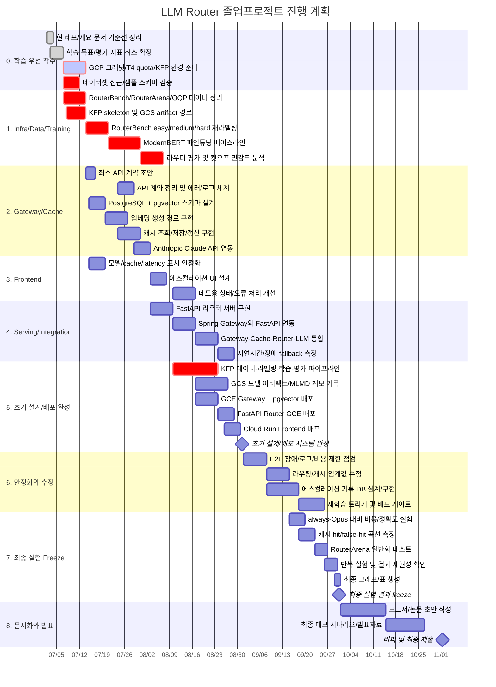

# LLM Router 졸업프로젝트 타임라인

기준일: 2026-07-07

이 타임라인은 `졸업프로젝트 개요.md`의 목표와 현재 레포 상태를 함께 반영한 계획이다. 현재 레포에는 React 채팅 UI, Spring Boot `/api/chat` 흐름, 라우터/캐시/LLM 서비스 stub이 있다. 아직 실제 Claude API 호출, pgvector 시맨틱 캐시, ModernBERT 라우터, FastAPI 라우터 서빙, Kubeflow 학습 파이프라인, 평가 자동화는 구현 전 단계다.

핵심 일정 원칙은 모델 학습과 Kubeflow/GCP 준비를 먼저 critical path로 두고, 2026년 8월 말까지 첫 기획에서 정의한 설계와 배포 가능한 시스템을 완성하는 것이다. 백엔드 API 계약은 통합을 막지 않을 만큼의 최소 초안만 먼저 만들고, 상세 계약은 학습 인프라가 착수된 뒤 Gateway/Cache 구현과 함께 확정한다.

## 전체 간트차트



## 주차별 실행 계획

| 기간 | 목표 | 주요 작업 | 산출물 |
| --- | --- | --- | --- |
| 07/02-07/05 | 범위 정리 | 현재 stub 목록 정리, MVP와 최종 목표 분리, 평가 지표 초안 확정 | 구현 체크리스트, 학습 목표 초안 |
| 07/07-07/14 | 학습 인프라/데이터 최우선 착수 | GCP/T4 quota, KFP skeleton, GCS artifact 경로, RouterBench/RouterArena/QQP 접근·샘플 스키마 검증 | 학습/재학습을 시작할 수 있는 기반 |
| 07/14-07/31 | 모델 학습 베이스라인 | RouterBench 재라벨링, ModernBERT fine-tuning, 초기 평가, 컷오프 민감도 분석 | easy/medium/hard 분류 모델 v0 |
| 07/14-08/03 | Gateway/Cache MVP | 최소 API 계약 초안, pgvector 스키마, 임베딩 생성, cache get/put, Claude API 연동 | 캐시와 실제 LLM 호출이 가능한 backend |
| 08/03-08/24 | 라우터 서빙 통합 | FastAPI 서버, Spring 연동, Gateway-Cache-Router-LLM 통합 | 로컬 통합 시스템 |
| 08/12-08/31 | 초기 설계/배포 완성 | KFP MVP, GCE Gateway, FastAPI Router, Cloud Run Frontend 배포 | 첫 기획 기준 배포 가능한 시스템 |
| 09/01-09/14 | 안정화/수정 | E2E 오류 수정, 로그/비용 제한, 라우팅/캐시 임계값 보정 | 최종 실험 가능한 안정 버전 |
| 09/15-09/30 | 최종 실험 | always-Opus 비교, 캐시 곡선, RouterArena 일반화, 반복 측정, 결과 freeze | 최종 실험 결과 패키지 |
| 10/01-11/01 | 문서화/발표 | 보고서, 발표자료, 데모 시나리오, 예비 시연, 추가 버그 수정 | 최종 제출물 |

## 기능별 작업 분해

### Backend / Gateway

- `LlmService`: stub 응답을 Anthropic API 호출로 교체한다.
- `RouterService`: 현재 항상 `HEAVY`를 반환하므로 FastAPI 라우터 결과를 받아 `haiku`, `sonnet`, `opus`로 매핑한다.
- `CacheService`: 현재 항상 cache miss이므로 pgvector 기반 유사도 검색과 응답 저장을 구현한다.
- `ChatService`: 캐시 hit, 라우팅, LLM 호출, 캐시 저장, latency 측정은 유지하되 실패 fallback과 로그를 추가한다.
- `ChatController`: 기본 채팅 외에 에스컬레이션 API를 추가한다.

### Frontend

- 현재 채팅 UI와 모델 badge는 존재한다.
- 실제 백엔드 오류 메시지, 로딩 상태, latency/cache 표시를 다듬는다.
- 에스컬레이션 버튼을 추가해 "상위 모델로 다시 요청" 흐름을 만든다.
- 데모용으로 캐시 hit 여부와 라우팅 모델이 명확히 보이도록 한다.

### Semantic Cache

- PostgreSQL 테이블: 질문, 답변, embedding, model, created_at, updated_at, hit_count.
- pgvector 인덱스: cosine distance 기준 ANN 검색.
- 임계값 실험: 0.60-0.90 구간에서 hit율과 false-hit율을 측정한다.
- 캐시 갱신: 에스컬레이션으로 더 좋은 답을 얻으면 기존 답변을 갱신한다.

### Router / Model

- RouterBench에서 query 단위 solve rate와 cheapest-correct tier를 계산한다.
- easy/medium/hard 라벨을 만들고 도메인별 stratified split을 적용한다.
- ModernBERT base로 먼저 fine-tuning하고, 시간이 남으면 large를 비교한다.
- RouterArena로 라벨 출처가 다른 데이터에 대한 일반화 성능을 확인한다.

### Kubeflow / Retraining

- 파이프라인 단계: ingest -> relabel -> train -> evaluate -> upload -> deploy gate.
- 에스컬레이션 기록이 N건 이상 누적되면 재학습을 트리거한다.
- 새 모델은 기존 모델 대비 정확도/비용 지표를 통과할 때만 배포한다.
- MLMD로 데이터 버전, 모델 버전, 평가 결과를 추적한다.

## 마일스톤

| 날짜 | 마일스톤 | 성공 기준 |
| --- | --- | --- |
| 2026-07-07 | M0 Training First Kickoff | 모델 학습이 critical path임을 확정하고, API 계약 확정보다 GCP/T4/KFP/데이터셋 준비를 먼저 착수한다. |
| 2026-07-14 | M1 Infra/Data Ready | GCP/T4 quota 신청, KFP skeleton, GCS artifact 경로, 핵심 데이터셋 접근 경로와 샘플 스키마가 정리되어 있다. |
| 2026-07-31 | M2 Router v0 | RouterBench 재라벨링과 ModernBERT 3-class baseline 학습/평가 결과가 있다. |
| 2026-08-03 | M3 Gateway/Cache MVP | pgvector cache와 실제 LLM 호출 경로가 backend에서 동작한다. |
| 2026-08-24 | M4 Local Integrated System | 캐시 miss 시 FastAPI 라우터가 모델을 선택하고 Claude 호출까지 이어진다. |
| 2026-08-31 | M5 Initial Cloud Deployment | 첫 기획의 Gateway, cache, router serving, KFP MVP, cloud deploy가 연결되어 있다. |
| 2026-09-14 | M6 Stabilization Freeze | 최종 실험을 돌릴 수 있을 정도로 장애, 로그, 비용 제한, 임계값을 정리한다. |
| 2026-09-30 | M7 Experiment Results Freeze | 최종 보고서에 들어갈 비용/정확도/cache/latency 결과를 확정한다. |
| 2026-11-01 | M8 Final Submission | 보고서, 발표자료, 코드, 데모 시나리오가 정리되어 있다. |

## Repository 운영 계획

초기 개발은 현재 `LLM_Router` 단일 monorepo에서 시작한다. 7-8월의 핵심 목표는 빠르게 end-to-end를 붙이고 8월 말까지 배포 가능한 데모를 만드는 것이므로, repo를 먼저 쪼개기보다 API 변경, 로컬 실행, 통합 테스트를 한 곳에서 처리하는 편이 실행 비용이 낮다.

초기 권장 디렉터리 구조:

```text
LLM_Router/
  frontend/
  backend/
  router-serving/
  mlops/
  infra/
  docs/
  docker-compose.yml
```

단, 최종 목표 구조는 3개 repo로 열어 둔다. `mlops/`와 `infra/`가 독립 실행·독립 배포 단위로 커지면 아래처럼 분리한다.

| Repo | 역할 | 포함 범위 |
| --- | --- | --- |
| `LLM_Router` | 제품/demo runtime | React 채팅 UI, Spring Gateway, FastAPI router serving, API 계약, 로컬 통합 실행, demo docs |
| `LLM_Router_MLOps` | 학습·평가·실험 | RouterBench 재라벨링, RouterArena/QQP 평가, ModernBERT fine-tuning, KFP pipeline, model artifact upload, 최종 실험 그래프/표 생성 |
| `LLM_Router_Infra` | GCP 배포·운영 | GCE 배포, Cloud Run 배포, GKE/Kubeflow 셋업, GCS/IAM/secret template, budget alert, 운영 runbook |

FastAPI 라우터 서빙은 별도 repo로 빼지 않고 `LLM_Router` 안에 둔다. Spring Gateway와 API 계약을 자주 맞춰야 하고, 8월 말까지 통합 데모를 만드는 것이 더 중요하기 때문이다. 단, Python serving 담당자가 완전히 분리되고 변경 충돌이 커지면 나중에 `LLM_Router_RouterServing`으로 분리할 수 있다.

repo 분리 조건:

- `mlops/`가 독립적으로 학습·평가·그래프 생성을 반복 실행할 정도로 커진다.
- `infra/`에 Terraform, gcloud script, 배포 runbook, 환경별 설정이 실제로 쌓인다.
- runtime 구현 PR과 실험/인프라 PR이 서로 리뷰와 CI를 방해한다.
- 팀원 역할이 runtime, MLOps, infra로 명확히 나뉘어 repo ownership이 필요해진다.

분리 전까지는 GitHub issue의 `area:*` label로 책임 영역을 나누고, 디렉터리별 README와 실행 스크립트를 둬서 repo 내부 경계를 유지한다.

## GitHub 운영 계획

GitHub Project는 컴포넌트별이 아니라 목적별로 2개만 둔다. frontend/backend Project로 나누면 ML, Kubeflow, infra 작업이 Back-end에 묻혀 실험 일정 관리가 흐려진다. 단일 repo로 시작하더라도 이 Project 구조는 유지한다.

| Project | 포함 범위 | 주요 view |
| --- | --- | --- |
| `LLM Router Delivery` | 현재 monorepo와 향후 분리 repo의 구현·배포·문서 issue 전체 | By Milestone, By Area, By Assignee, Blocked |
| `LLM Router Experiments` | 라벨링, 학습, 평가, 반복 실험, 최종 결과 freeze | Experiment Pipeline, Metrics, Results Freeze |

모든 issue는 하나의 milestone에 연결한다. Project는 진행 상태를 보는 보드이고, milestone은 마감 단위로만 쓴다. repo를 분리하기 전에는 `LLM_Router`의 milestone만 사용하고, 나중에 repo를 분리하면 세 repo에 같은 milestone 이름을 만들어서 Project view에서 한 일정으로 묶어 본다.

추천 Project status:

- Backlog
- Ready
- In Progress
- Blocked
- Review
- Done

추천 issue label:

- `area:frontend`
- `area:gateway`
- `area:cache`
- `area:router-serving`
- `area:ml-training`
- `area:kubeflow`
- `area:infra`
- `area:evaluation`
- `area:docs`
- `priority:p0`
- `priority:p1`
- `priority:p2`

## 우선순위

1. 모델 학습이 가장 오래 걸리는 축이므로 GCP/T4 quota, KFP skeleton, GCS artifact 경로, 데이터셋 접근·샘플 검증을 API 계약 확정보다 먼저 처리한다.
2. API 계약은 오늘 완전 확정하지 않고, Gateway/Cache 구현을 시작할 수 있는 최소 초안만 7월 14일 주에 만든다.
3. ModernBERT 라우터는 base 모델로 먼저 실험해 결과를 만들고, large 비교는 여유가 있을 때 진행한다.
4. pgvector 캐시와 Claude API 연동은 모델 학습 베이스라인과 병렬로 진행한다.
5. 첫 기획에서 정의한 설계와 배포 시스템은 8월 31일까지 완성한다.
6. 9월 초중순에는 새 기능을 크게 늘리기보다 안정화, 수정, 임계값 보정에 집중한다.
7. 최종 실험은 9월 30일에 freeze하고, 10월부터는 결과를 바꾸기보다 문서화와 재현성 정리에 집중한다.
8. 최종 보고서에는 비용 절감만이 아니라 false-hit, 과소 라우팅, 에스컬레이션율을 함께 제시한다.

## 주요 리스크와 대응

| 리스크 | 영향 | 대응 |
| --- | --- | --- |
| T4 quota 승인 지연 | ModernBERT 학습 지연 | 7월 첫 주 신청, 로컬/Colab/CPU 소형 샘플 실험 병행 |
| Claude API 비용 증가 | 실험 축소 가능성 | Batch, 샘플링, 예산 알림, always-Opus 실험 규모 제한 |
| RouterBench 라벨 편향 | 라우터 성능 과대평가 | RouterArena와 도메인별 결과를 별도 보고 |
| 캐시 false-hit | 잘못된 답변 재사용 | 임계값 곡선과 수동 검수 샘플을 함께 제시 |
| Kubeflow 구축 지연 | 재학습 루프 미완성 | KFP MVP 범위를 데이터-학습-평가-업로드로 제한 후 확장 |
| 에스컬레이션 라벨 노이즈 | 상위 모델 편향 | 동일 질문군 반복 기준, 가중치 조정, 배포 게이트 적용 |
