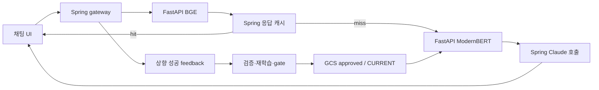

# 졸업 프로젝트 개요

기준일: 2026-09-20. ML의 세부 실험·데이터·정책은 [ML 최종 실험 문서](ml/README.md)를 따른다. 이 문서는 프로젝트의 목적과 서비스 책임 경계만 설명한다.

> 어떤 조건에서 임베딩 캐시와 에스컬레이션 피드백 학습을 결합한 라우팅 시스템이 더 나은 비용–품질 균형을 만드는가?

## 서비스 흐름

1. 사용자가 질문하면 Spring gateway가 FastAPI의 BGE 임베딩을 받아 응답 캐시를 검색한다.
2. 재사용 조건을 만족하는 항목이 있으면 저장된 답변을 반환한다. 의미가 비슷하다는 사실만으로 답변도 적합하다고 가정하지 않는다.
3. cache miss이면 FastAPI의 ModernBERT가 질문을 easy/medium/hard로 분류한다. Spring이 서비스의 Haiku/Sonnet/Opus에 연결하고 답변을 저장한다.
4. 사용자가 더 높은 모델로 요청해 만족한 경우 상향 경로와 결과를 feedback으로 수집한다. 최종 성공 tier는 관측된 경로의 결과이며 절대적인 최소 충분 tier를 증명하지 않는다.
5. 유효 feedback을 정규화·검증한 뒤 재학습한다. gate를 통과한 package가 GCS에 게시되면 FastAPI가 검증 후 모델을 교체한다.

## 책임 경계

| 구성 | 책임 |
|---|---|
| React UI | 질문·응답과 상향 요청의 사용자 경험 |
| Spring gateway | 대화·인증·응답 캐시·Claude 호출·feedback 수집 |
| FastAPI serving | 임베딩, 난이도 분류, inline feedback 접수, pipeline 제출·상태, 승인 모델 적재 |
| LLM_Router의 ML 코드 | 데이터·학습·평가·package·승격·게시 계약 |
| GCS / Vertex | 운영 feedback 재학습의 저장소와 관리형 실행 |

이는 시스템 역할의 정의다. 각 기능의 구현·배포 확인 범위는 [실행·산출물 관리](ml/execution-and-artifacts.md)에 기록하며 설계도를 배포 완료 증거로 사용하지 않는다.

## 학습과 평가

Claude는 서비스에서 사용하는 대상이다. 새로운 Claude 응답을 대량 생성해 학습하지 않고, RouterBench+xRouteBench의 공개 모델 결과로 비교한다. 모든 방법이 공통 원천·split·후보·평가 조건을 사용한다.

- **학습 목표 비교:** 같은 ModernBERT에서 3단계 분류, 후보별 성공 예측, pairwise를 비교한다.
- **표현·모델 비교:** 같은 난이도 목표에서 TF-IDF, frozen BGE+kNN, ModernBERT를 비교한다.
- **논문 라우터:** 동일한 세 후보로 RouterDC부터 재학습해 비교한다.
- **외부 평가:** RouterArena는 인지 수준 기반 난이도와의 정렬을 확인한다. 답변 품질·비용은 공개 outcome이 있는 동일 후보 집합에서 평가한다.
- **인지 분석:** 독립 주석과 통제 문항으로 라벨·모델 출력이 인지적 요구와 얼마나 정렬되는지 검사한다.
- **재학습:** 고정 요청 흐름에서 adaptation, 망각, 전체 호출·학습 비용을 평가한다.
- **캐시:** 캐시 없음/exact/semantic을 비교하며 절감과 잘못된 답변 재사용을 함께 측정한다.

특정 절감 배수·실서비스 반복률·성능 우위를 사전에 확정하지 않는다. QQP/PAWS의 중복 라벨도 실제 답변 재사용 정답과 구분한다.

## 실행 환경

초기학습과 모델 비교는 Colab에서 수행한다. 운영 ModernBERT feedback 재학습은 KFP SDK로 작성한 관리형 Vertex AI Pipelines의 CPU 단계와 Vertex AI Custom Training GPU를 사용한다. GKE와 자체 KFP control plane은 사용하지 않는다.

서비스 모델 ID, cloud 자원, runtime/image digest, 실제 비용은 해당 실행의 manifest와 확인 시각에 기록한다. 최신 사양과 가격을 여러 개요 문서에 복사하지 않는다. 과거 일정·비용 가정·v2 중심 설계는 Git `fa09cb8`에서 확인할 수 있다.
