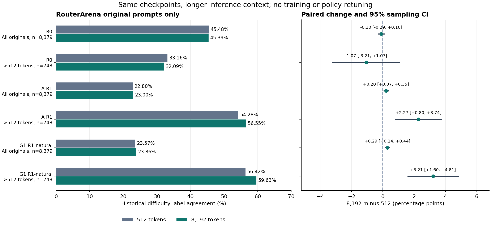

# R0·R1 추론 길이 512 → 8,192 검증

2026-09-25. 기존 가중치를 그대로 사용한 추론 비교이며 추가 학습은 하지 않았다. 학습 당시 최대 길이 512와 이번 추론 최대 길이를 구분한다. A R1과 최종 추천 후보 G1 R1-natural은 별개 체크포인트로 평가했다.

**판단: 이번 결과만으로 R0·R1의 운영 설정을 8,192로 전환하지 않는다.** 8,192 추론 자체는 실행됐지만 R0의 장문 라벨 정확도가 소폭 하락했고, 실제 후보 결과를 가진 긴 질문의 수가 적다. 실제 FastAPI VM의 자원·응답 시간 검증도 완료되지 않았다. 이는 재학습이 반드시 필요하다는 판정이 아니다. 기존 코드·모델 설정과 GCS 운영 포인터는 유지한다.

## 외부 난이도 라벨 진단

RouterArena 원문 8,379개 중 512토큰 초과는 748개다. 별도 변형 412개를 원문과 독립 표본으로 더하지 않았다. R1의 수치는 후보 선택을 easy/medium/hard 슬롯에 대응시킨 라벨 일치율이며 실제 LLM 답변 성공률이 아니다.

| 체크포인트 | 범위 | 라벨 일치율 512 → 8,192 | 변화량 및 95% CI (pp) | 선택 변경 |
|---|---|---:|---:|---:|
| R0 | 원문 전체 | 45.483% → 45.387% | -0.095 [-0.286, +0.095] | 108 |
| R0 | 원문 장문 | 33.155% → 32.086% | -1.070 [-3.209, +1.070] | 108 |
| A R1 | 원문 전체 | 22.795% → 22.998% | +0.203 [+0.072, +0.346] | 36 |
| A R1 | 원문 장문 | 54.278% → 56.551% | +2.273 [+0.802, +3.743] | 36 |
| G1 R1-natural | 원문 전체 | 23.571% → 23.857% | +0.286 [+0.143, +0.442] | 38 |
| G1 R1-natural | 원문 장문 | 56.417% → 59.626% | +3.209 [+1.604, +4.813] | 38 |

R0 장문 하락의 신뢰구간은 0을 포함한다. 따라서 확실한 성능 악화라고 단정할 수는 없지만, 장문 품질을 유지하거나 높였다고 입증한 결과도 아니다. 신뢰구간은 같은 샘플을 짝지은 bootstrap 결과로, 학습 seed 변동이나 여러 부분집합 동시 검정까지 포괄하지 않는다.

## 내부 검증과 실제 후보 결과

R0의 D_dev 3,581개, RouterBench test 3,473개, xRouteBench test 3,729개 정확도는 각각 60.542%, 57.357%, 66.130%로 두 길이에서 같다. xRouteBench에서는 한 문항의 선택이 바뀌었지만 양쪽 모두 난이도 라벨을 맞히지 못해 정확도에는 드러나지 않는다.

R1은 기존 비용 정책을 고정한 실제 후보 선택을 평가했다. 아래 quality는 기록된 후보 품질의 출처별 평균을 다시 평균한 값이며, Arena 라벨 정확도와 비교할 수 없다. 상대 비용은 출처별로 정규화했으며 달러 비용이 아니다.

| 체크포인트 | 데이터 | N / 장문 N | 후보 quality 512 → 8,192 | 상대 비용 512 → 8,192 | 선택 변경 |
|---|---|---:|---:|---:|---:|
| A R1 | validation | 3581 / 10 | 0.767683 → 0.767683 | 0.476904 → 0.474088 | 1 |
| A R1 | test_routerbench | 3473 / 7 | 0.787100 → 0.787100 | 0.489174 → 0.489174 | 0 |
| A R1 | test_xroutebench | 3729 / 23 | 0.791182 → 0.791182 | 0.537229 → 0.537993 | 1 |
| G1 R1-natural | g1_calibration | 2275 / 10 | 0.757790 → 0.757790 | 0.428741 → 0.429315 | 1 |
| G1 R1-natural | g1_selection | 2314 / 8 | 0.751785 → 0.751785 | 0.426774 → 0.426774 | 0 |
| G1 R1-natural | g1_task_holdout | 1807 / 0 | 0.652622 → 0.652622 | 0.412801 → 0.412801 | 0 |

G1 task holdout에는 512토큰 초과 문항이 없다. 점수가 같아도 장문 일반화를 검증한 것은 아니다. A R1의 xRouteBench test 상대 비용은 기존 .50 예산 초과가 소폭 커졌다. 평가 결과를 보고 λ나 임계값을 다시 조정하지 않았다.

[R1 세부 결과·장문 및 출처별 분석](r1/report/R1_LENGTH_REPORT.md)

**모델별 해석:** R0는 이번 자료에서 8,192 전환의 이점을 확인하지 못했다. G1 R1-natural은 원문 장문 라벨 일치율이 +3.209pp 개선됐고 95% CI는 [+1.604, +4.813]pp여서 후속 서비스 검증의 후보로 타당하다. 다만 calibration·selection의 실제 후보 결과 장문은 합계 18개이며 품질 개선은 관측되지 않았다. 변형 평가와 8,192 초과 소표본의 하락도 상세 보고서에 남겼다.

## 재현·실행 범위

- 개인 Colab Pro T4에서 동일 가중치·토크나이저·입력 전처리·정책으로 모든 행을 다시 추론했다.
- GPU 환경은 PyTorch 2.5.1+cu124, Transformers 4.48.3, float32, eager attention이다.
- 원문 입력이 8,192를 초과하는 8건은 새 조건에서도 잘린다. 무제한 길이를 검증한 것은 아니다.
- 기존 평가셋을 재사용한 진단이다. 새로운 독립 test나 서비스 Claude 후보 pool 평가가 아니다.
- PC 재시작으로 임시 파일이 소실되어 원격 완료 산출물을 다시 회수했다. 원본 점수의 manifest·SHA를 검사하고 집계기를 복구했다.

| 체크포인트 | Arena 8,791행 실행 시간 512 → 8,192 | GPU 최대 allocated 메모리 512 → 8,192 |
|---|---:|---:|
| R0 | 165.70 → 292.99초 | 0.824 → 7.253 GiB |
| A R1 | 173.32 → 296.16초 | 0.727 → 7.253 GiB |
| G1 R1-natural | 172.93 → 296.60초 | 0.727 → 7.253 GiB |

위 시간은 평가 배치 전체 시간이고 FastAPI 단일 요청의 지연이나 p95가 아니다. GPU allocated 메모리를 운영 CPU 메모리 요구량으로 해석하지 않는다. 실제 VM은 GCP 재인증 문제로 측정하지 못했으며, 별도 Colab CPU probe가 있더라도 운영 통과 근거를 대신하지 않는다.

보조 CPU probe는 R0·G1 R1-natural 두 프로세스 모두 종료 코드 0이었고, 감시한 peak RSS는 각각 약 2.28·2.30 GiB였다. import·모델 적재·warmup·두 길이 실행을 합한 시간은 130.01·124.55초다. **이 값을 요청 응답 시간으로 해석하지 않는다.** 개별 길이의 시간·backend 기록 파일은 후속 Colab 접근 오류로 회수하지 못했다. [회수한 supervisor 기록](runtime/cpu-supervisor-recovered.json)만 보존하며 CPU 지연 통과를 주장하지 않는다.

## 다음 적용 조건

실제 서비스 후보 결과를 가진 장문 검증 표본과 사전에 합의한 허용 오차·비용 한도로 품질을 판단하고, 운영 VM과 같은 backend·자원·동시 요청 조건에서 지연과 메모리를 확인한다. 통과하면 과거 training_max_length=512는 보존하고 새 패키지의 inference max_length=8192를 별도로 기록한다. 후보·기준 모델의 gate 평가도 같은 길이를 사용하고, 새 버전으로 배포·되돌리기를 검증해야 한다. 현재 512를 하드코딩한 계약을 환경 변수 하나만 바꾸어 우회하지 않는다.

## 원본

- [평가 전 고정한 판단 규칙](PROTOCOL.md)
- [R0 상세 집계](r0/scores/r0-comparison.json)
- [A R1 상세 집계](r1/a-analysis/analysis.json)
- [G1 R1-natural 상세 집계](r1/g1-analysis/analysis.json)
- 각 scores 폴더의 512/8192 parquet, manifest.json, _SUCCESS가 추론 원본이다.
