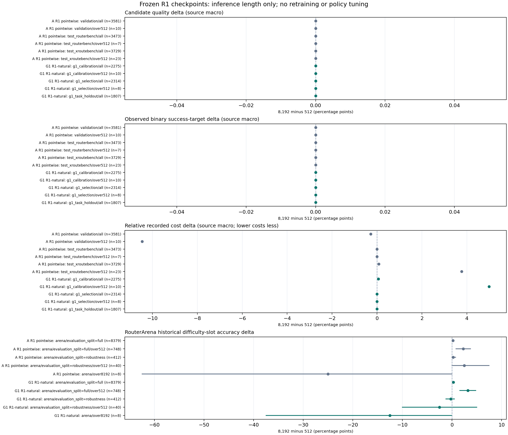

# R1 동일 checkpoint의 입력 길이 검증

512 토큰으로 학습한 기존 가중치를 그대로 두고, 동일한 실행 환경에서 추론 최대 길이만 512 → 8,192로 바꾼 진단이다. 임계값·비용 정책을 다시 맞추거나 추가 학습하지 않았다.

A R1 pointwise는 초기 비교 모델이고, G1 R1-natural은 이후 실제 채택을 추천한 별개의 모델이다. 서로 대체해서 해석하지 않는다.

- quality: 기존 후보 모델 결과에 기록된 연속 품질 점수의 출처별 평균을 다시 평균한 값.
- success: 실제 관측 후보의 기존 이진 성공 target 평균. quality와 서로 다른 지표다.
- RouterArena 정확도: 역사적 easy/medium/hard 라벨과 라우팅 슬롯의 일치율이다. 실제 서비스 모델의 성공률·비용으로 해석할 수 없다.
- 변화량은 8,192 − 512이며, 신뢰구간은 같은 샘플의 paired cluster bootstrap 95% 구간이다. 학습 seed 불확실성·다중 비교·새 독립 평가를 포함하지 않는다.

## A R1 pointwise

모델 SHA256: `b49696de6904cb647cd03671cfdfb8901728fc59a8e568fba1b0be141e5326d3`

검증 원본: [analysis.json](/Users/yoocheolmin/workspace/school/LLM_Router/experiments/results/context-length-qualification-20260925/r1/a-analysis/analysis.json)

실행환경: torch 2.5.1+cu124, transformers 4.48.3, cuda, eager, float32.
가중치·config·tokenizer 관련 3파일·training_config의 6파일 SHA가 기존 모델과 모두 일치한다.
추론 영향 파일과 분리한 metadata-only 차이: _SUCCESS, artifact_manifest.json, metrics.json.

| 평가 데이터 | 전체 추론 시간 512→8192 (s) | CUDA peak allocated 512→8192 (GiB) |
|---|---:|---:|
| arena | 173.32→296.16 | 0.727→7.253 |
| validation | 48.26→48.70 | 0.727→0.804 |
| test_routerbench | 46.00→46.62 | 0.727→0.854 |
| test_xroutebench | 44.33→46.06 | 0.727→1.139 |

시간은 전체 데이터셋의 batch 평가 실행 시간이며 API 요청 지연이 아니다. 장문은 batch=1로 실행했다. CUDA 메모리는 이 평가 환경 수치로, 서비스 CPU/RAM 측정이나 배포 적합성 판정을 대신하지 않는다.

### arena

| 데이터·범위 | N | 긴 입력 N | 정책 품질/정확도 512→8192 (%) | Δ (pp), 95% CI | 라우팅 변경 | hard→low 수 512→8192 |
|---|---:|---:|---:|---:|---:|---:|
| arena/evaluation_split=full | 8379 | 748 | 22.795→22.998 | 0.203 [0.072, 0.346] | 36 | 83→81 |
| arena/evaluation_split=full/over512 | 748 | 748 | 54.278→56.551 | 2.273 [0.802, 3.743] | 36 | 7→5 |
| arena/evaluation_split=robustness | 412 | 40 | 25.243→25.485 | 0.243 [0.000, 0.728] | 1 | 3→3 |
| arena/evaluation_split=robustness/over512 | 40 | 40 | 50.000→52.500 | 2.500 [0.000, 7.500] | 1 | 0→0 |
| arena/over8192 | 8 | 8 | 100.000→75.000 | -25.000 [-62.500, 0.000] | 2 | 0→0 |

**arena 재현 확인:** 과거 512와 이번 512의 라우팅 변경 0건, 최대 logit 차이 0.00034588575. 이 차이는 길이 변경 효과와 분리했다.
512 이하 입력의 양쪽 최대 logit 차이 4.8875809e-06; 전체 8791건 중 >512 788건, >8192 8건.

사전 선언한 자동 통과 보류 조건:

- over8192: observed primary quality deterioration

### validation

| 데이터·범위 | N | 긴 입력 N | 정책 품질/정확도 512→8192 (%) | Δ (pp), 95% CI | 라우팅 변경 | hard→low 수 512→8192 |
|---|---:|---:|---:|---:|---:|---:|
| validation/all | 3581 | 10 | 76.768→76.768 | 0.000 [0.000, 0.000] | 1 | 69→69 |
| validation/over512 | 10 | 10 | 60.000→60.000 | 0.000 [0.000, 0.000] | 1 | 0→0 |

**validation 재현 확인:** 과거 512와 이번 512의 라우팅 변경 0건, 최대 logit 차이 0.00014257431. 이 차이는 길이 변경 효과와 분리했다.
512 이하 입력의 양쪽 최대 logit 차이 3.3378601e-06; 전체 3581건 중 >512 10건, >8192 0건.

| 출처 (전체) | quality 512→8192 | success 512→8192 | relative cost 512→8192 |
|---|---:|---:|---:|
| routerbench | 0.795996→0.795996 | 0.797245→0.797245 | 0.494171→0.494171 |
| xroutebench | 0.739370→0.739370 | 0.721133→0.721133 | 0.459636→0.454005 |

비용은 각 출처 내 high/low 기준에 대해 정규화했다. 서로 다른 출처의 절대 비용을 합쳐 달러 비용으로 계산하지 않았다.

### test_routerbench

| 데이터·범위 | N | 긴 입력 N | 정책 품질/정확도 512→8192 (%) | Δ (pp), 95% CI | 라우팅 변경 | hard→low 수 512→8192 |
|---|---:|---:|---:|---:|---:|---:|
| test_routerbench/all | 3473 | 7 | 78.710→78.710 | 0.000 [0.000, 0.000] | 0 | 2→2 |
| test_routerbench/over512 | 7 | 7 | 71.429→71.429 | 0.000 [0.000, 0.000] | 0 | 0→0 |

**test_routerbench 재현 확인:** 과거 512와 이번 512의 라우팅 변경 0건, 최대 logit 차이 0.00042557716. 이 차이는 길이 변경 효과와 분리했다.
512 이하 입력의 양쪽 최대 logit 차이 0; 전체 3473건 중 >512 7건, >8192 0건.

| 출처 (전체) | quality 512→8192 | success 512→8192 | relative cost 512→8192 |
|---|---:|---:|---:|
| routerbench | 0.787100→0.787100 | 0.786640→0.786640 | 0.489174→0.489174 |

비용은 각 출처 내 high/low 기준에 대해 정규화했다. 서로 다른 출처의 절대 비용을 합쳐 달러 비용으로 계산하지 않았다.

### test_xroutebench

| 데이터·범위 | N | 긴 입력 N | 정책 품질/정확도 512→8192 (%) | Δ (pp), 95% CI | 라우팅 변경 | hard→low 수 512→8192 |
|---|---:|---:|---:|---:|---:|---:|
| test_xroutebench/all | 3729 | 23 | 79.118→79.118 | 0.000 [0.000, 0.000] | 1 | 162→162 |
| test_xroutebench/over512 | 23 | 23 | 43.478→43.478 | 0.000 [0.000, 0.000] | 1 | 1→1 |

**test_xroutebench 재현 확인:** 과거 512와 이번 512의 라우팅 변경 0건, 최대 logit 차이 0.00067687035. 이 차이는 길이 변경 효과와 분리했다.
512 이하 입력의 양쪽 최대 logit 차이 1.1920929e-06; 전체 3729건 중 >512 23건, >8192 0건.

| 출처 (전체) | quality 512→8192 | success 512→8192 | relative cost 512→8192 |
|---|---:|---:|---:|
| xroutebench | 0.791182→0.791182 | 0.788147→0.788147 | 0.537229→0.537993 |

비용은 각 출처 내 high/low 기준에 대해 정규화했다. 서로 다른 출처의 절대 비용을 합쳐 달러 비용으로 계산하지 않았다.

사전 선언한 자동 통과 보류 조건:

- all: worsened default budget violation: xroutebench
- over512: worsened default budget violation: xroutebench

세부 범위에서 관측된 악화 신호(탐색적 다중 비교이며 작은 범위는 결론 보류):

| 세부 범위 | N | primary Δ (pp), 95% CI | 보류 조건 |
|---|---:|---:|---|
| category=math | 500 | 0.000 [0.000, 0.000] | worsened default budget violation: xroutebench |
| category=math/over512 | 4 | 0.000 [0.000, 0.000] | worsened default budget violation: xroutebench |

## G1 R1-natural

모델 SHA256: `fd6c31a8c0eb1590ff5d670e5e046fb0c3c10ba3c4046a53ede49518b7a6d7f7`

검증 원본: [analysis.json](/Users/yoocheolmin/workspace/school/LLM_Router/experiments/results/context-length-qualification-20260925/r1/g1-analysis/analysis.json)

실행환경: torch 2.5.1+cu124, transformers 4.48.3, cuda, eager, float32.
가중치·config·tokenizer 관련 3파일·training_config의 6파일 SHA가 기존 모델과 모두 일치한다.
추론 영향 파일과 분리한 metadata-only 차이: 없음.

| 평가 데이터 | 전체 추론 시간 512→8192 (s) | CUDA peak allocated 512→8192 (GiB) |
|---|---:|---:|
| arena | 172.93→296.60 | 0.727→7.253 |
| g1_calibration | 31.08→32.38 | 0.727→0.757 |
| g1_selection | 32.78→33.03 | 0.727→0.771 |
| g1_task_holdout | 16.89→16.31 | 0.654→0.654 |

시간은 전체 데이터셋의 batch 평가 실행 시간이며 API 요청 지연이 아니다. 장문은 batch=1로 실행했다. CUDA 메모리는 이 평가 환경 수치로, 서비스 CPU/RAM 측정이나 배포 적합성 판정을 대신하지 않는다.

### arena

| 데이터·범위 | N | 긴 입력 N | 정책 품질/정확도 512→8192 (%) | Δ (pp), 95% CI | 라우팅 변경 | hard→low 수 512→8192 |
|---|---:|---:|---:|---:|---:|---:|
| arena/evaluation_split=full | 8379 | 748 | 23.571→23.857 | 0.286 [0.143, 0.442] | 38 | 95→92 |
| arena/evaluation_split=full/over512 | 748 | 748 | 56.417→59.626 | 3.209 [1.604, 4.813] | 38 | 3→0 |
| arena/evaluation_split=robustness | 412 | 40 | 24.272→24.029 | -0.243 [-1.214, 0.485] | 3 | 4→4 |
| arena/evaluation_split=robustness/over512 | 40 | 40 | 47.500→45.000 | -2.500 [-10.000, 5.000] | 3 | 0→0 |
| arena/over8192 | 8 | 8 | 100.000→87.500 | -12.500 [-37.500, 0.000] | 1 | 0→0 |

**arena 재현 확인:** 과거 512와 이번 512의 라우팅 변경 0건, 최대 logit 차이 0.00062143803. 이 차이는 길이 변경 효과와 분리했다.
512 이하 입력의 양쪽 최대 logit 차이 1.2874603e-05; 전체 8791건 중 >512 788건, >8192 8건.

사전 선언한 자동 통과 보류 조건:

- evaluation_split=robustness: observed primary quality deterioration
- evaluation_split=robustness/over512: observed primary quality deterioration
- over8192: observed primary quality deterioration

세부 범위에서 관측된 악화 신호(탐색적 다중 비교이며 작은 범위는 결론 보류):

| 세부 범위 | N | primary Δ (pp), 95% CI | 보류 조건 |
|---|---:|---:|---|
| arena_source_dataset=ChessInstruct_mcq | 84 | -2.381 [-5.952, 0.000] | observed primary quality deterioration |
| arena_source_dataset=ChessInstruct_mcq/over512 | 67 | -2.985 [-7.463, 0.000] | observed primary quality deterioration |

### g1_calibration

| 데이터·범위 | N | 긴 입력 N | 정책 품질/정확도 512→8192 (%) | Δ (pp), 95% CI | 라우팅 변경 | hard→low 수 512→8192 |
|---|---:|---:|---:|---:|---:|---:|
| g1_calibration/all | 2275 | 10 | 75.779→75.779 | 0.000 [0.000, 0.000] | 1 | 34→34 |
| g1_calibration/over512 | 10 | 10 | 37.500→37.500 | 0.000 [0.000, 0.000] | 1 | 0→0 |

**g1_calibration 재현 확인:** 과거 512와 이번 512의 라우팅 변경 0건, 최대 logit 차이 0.0019370317. 이 차이는 길이 변경 효과와 분리했다.
512 이하 입력의 양쪽 최대 logit 차이 7.1525574e-07; 전체 2275건 중 >512 10건, >8192 0건.

| 출처 (전체) | quality 512→8192 | success 512→8192 | relative cost 512→8192 |
|---|---:|---:|---:|
| routerbench | 0.784912→0.784912 | 0.792934→0.792934 | 0.458461→0.459609 |
| xroutebench | 0.730668→0.730668 | 0.708861→0.708861 | 0.399021→0.399021 |

비용은 각 출처 내 high/low 기준에 대해 정규화했다. 서로 다른 출처의 절대 비용을 합쳐 달러 비용으로 계산하지 않았다.

세부 범위에서 관측된 악화 신호(탐색적 다중 비교이며 작은 범위는 결론 보류):

| 세부 범위 | N | primary Δ (pp), 95% CI | 보류 조건 |
|---|---:|---:|---|
| category=knowledge | 897 | 0.000 [0.000, 0.000] | worsened default budget violation: routerbench |

### g1_selection

| 데이터·범위 | N | 긴 입력 N | 정책 품질/정확도 512→8192 (%) | Δ (pp), 95% CI | 라우팅 변경 | hard→low 수 512→8192 |
|---|---:|---:|---:|---:|---:|---:|
| g1_selection/all | 2314 | 8 | 75.179→75.179 | 0.000 [0.000, 0.000] | 0 | 33→33 |
| g1_selection/over512 | 8 | 8 | 83.333→83.333 | 0.000 [0.000, 0.000] | 0 | 0→0 |

**g1_selection 재현 확인:** 과거 512와 이번 512의 라우팅 변경 0건, 최대 logit 차이 0.0012593269. 이 차이는 길이 변경 효과와 분리했다.
512 이하 입력의 양쪽 최대 logit 차이 0; 전체 2314건 중 >512 8건, >8192 0건.

| 출처 (전체) | quality 512→8192 | success 512→8192 | relative cost 512→8192 |
|---|---:|---:|---:|
| routerbench | 0.768155→0.768155 | 0.770388→0.770388 | 0.445639→0.445639 |
| xroutebench | 0.735415→0.735415 | 0.700787→0.700787 | 0.407909→0.407909 |

비용은 각 출처 내 high/low 기준에 대해 정규화했다. 서로 다른 출처의 절대 비용을 합쳐 달러 비용으로 계산하지 않았다.

### g1_task_holdout

| 데이터·범위 | N | 긴 입력 N | 정책 품질/정확도 512→8192 (%) | Δ (pp), 95% CI | 라우팅 변경 | hard→low 수 512→8192 |
|---|---:|---:|---:|---:|---:|---:|
| g1_task_holdout/all | 1807 | 0 | 65.262→65.262 | 0.000 [0.000, 0.000] | 0 | 3→3 |

**g1_task_holdout 재현 확인:** 과거 512와 이번 512의 라우팅 변경 0건, 최대 logit 차이 0.00069451332. 이 차이는 길이 변경 효과와 분리했다.
512 이하 입력의 양쪽 최대 logit 차이 0; 전체 1807건 중 >512 0건, >8192 0건.

| 출처 (전체) | quality 512→8192 | success 512→8192 | relative cost 512→8192 |
|---|---:|---:|---:|
| routerbench | 0.800512→0.800512 | 0.800512→0.800512 | 0.173356→0.173356 |
| xroutebench | 0.504732→0.504732 | 0.504732→0.504732 | 0.652245→0.652245 |

비용은 각 출처 내 high/low 기준에 대해 정규화했다. 서로 다른 출처의 절대 비용을 합쳐 달러 비용으로 계산하지 않았다.

## 해석 한계

- G1 task holdout에는 >512 입력이 0개다. 결과가 같아도 긴 입력 품질을 검증한 근거가 아니다.
- 긴 후보 결과 평가의 표본이 작거나 CI가 넓으면 결론은 보류다. 개선된 point estimate만으로 일반화 성공을 선언하지 않는다.
- RouterArena full과 robustness는 원본·변형 관계가 있다. 둘을 독립 평가 건수로 더하지 않는다.
- 기존 v1/학습 설정과 과거 결과는 바꾸지 않았다. 이 보고서는 배포 승인 또는 실제 서비스 후보 pool 검증을 대체하지 않는다.
- 실제 서버와 맞는 장치·attention backend·메모리·지연 검증은 별도로 필요하다.

