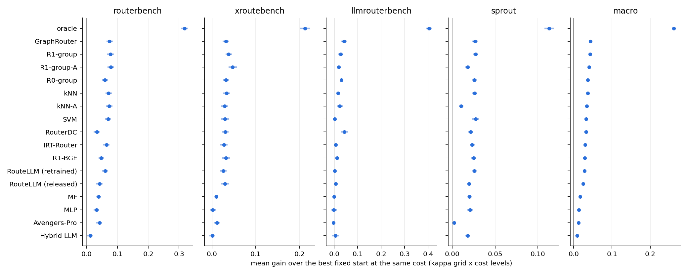
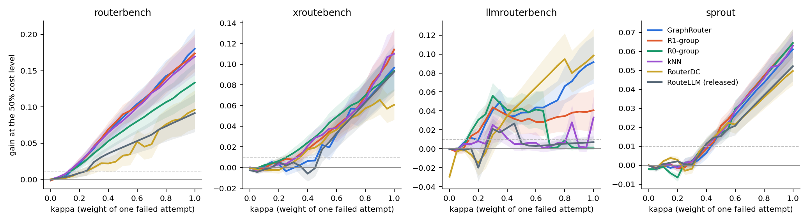
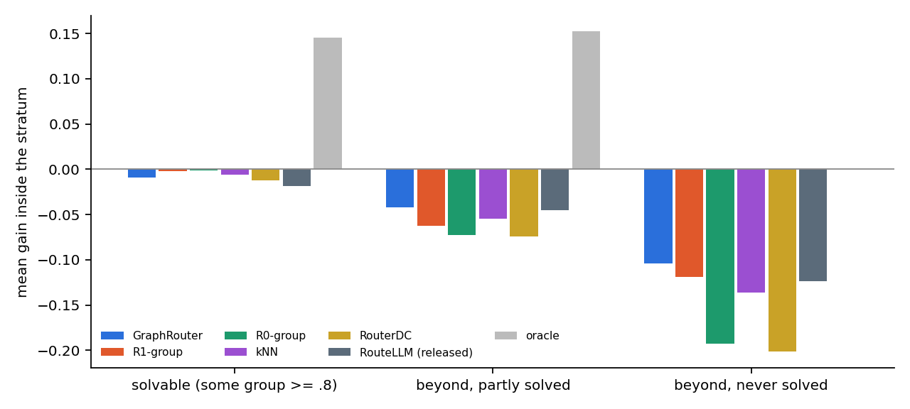
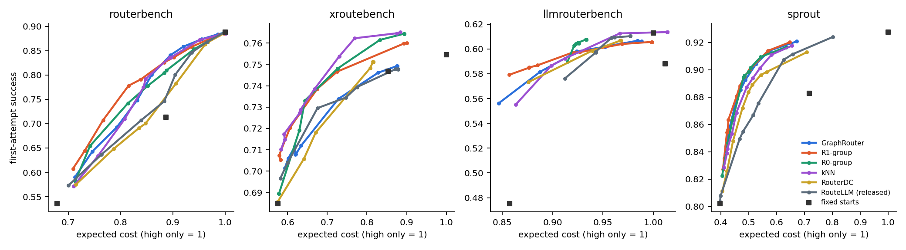
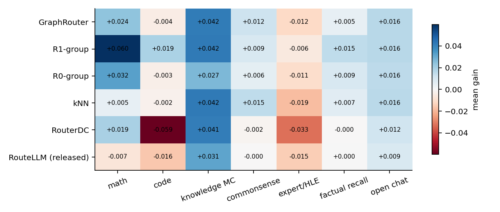

# EV-10 통합 라우터 비교 · RT-08 — 보고서 초안

작성일: 2026-10-18. **초안이다.** 09_seeds(H5 seed 반복)와 08a(라우팅 지연)가 끝나면 해당 절을 채운다.
숫자의 원본: [결과 표](report/results.md)(10_report가 08 출력에서 그대로 옮김), [lock 보고서](lock-report.md), [데이터 구성](data-composition.md). 계획과 사전 판정 규칙: [최종 실험 계획서](../../../docs/ml/ROUTER_FINAL_EXPERIMENT_PLAN.md).

## 1. 요약

- **라우터는 test에서도 같은 비용의 고정 시작 단계보다 낫지만, 차이는 작다.** 원천 4개 평균 이득은 1위 GraphRouter +.044 [+.039, +.048], 2위 R1-집단 +.043, 3위 R1-집단-A +.041이며 셋은 서로 구분되지 않는다. 같은 데이터를 아는 oracle은 +.262다.
- **이득은 "실패 한 번의 무게" κ가 클 때만 생긴다.** κ = 0에서는 어떤 라우터도 "모두 low부터 시작"을 이기지 못한다(H7). 비용 50% 수준에서 상위 라우터가 이기기 시작하는 κ\*는 RouterBench .10~.15, xRouteBench·SPROUT .30~.50이다.
- **이득의 대부분은 "가망 없는 문항"을 알아보는 데서 나온다.** 어느 집단도 .8에 못 미치는 문항(beyond)을 따로 보면, 층 안에서는 모든 라우터의 이득이 0 이하다(solvable 층 −.019~−.001, 운영 R0만 +.017). 풀리는 문항 안에서 난이도를 가르는 능력은 아직 고정 시작을 넘지 못한다.
- **우리 라우터의 위치:** R1-집단은 공동 1위권이고, 운영 R0(v1)는 A 분할에서 최상위권과 같다(RouterBench +.076, xRouteBench +.040). 논문 라우터 중에서는 GraphRouter(공식 구조, 부분 차용)가 같은 수준이고, kNN은 5위다.
- **채점 오류(RT-08):** v2로 다시 학습한 R0가 운영 R0(v1)보다 낫다는 근거는 없다. 차이가 작고 κ마다 부호가 바뀐다.

## 2. 무엇을 했나

| 항목 | 내용 |
|---|---|
| 단계 | 원천마다 가격대가 비슷한 모델 집단 3개(low/medium/high). 집단을 부르면 그 집단 모델 하나를 무작위로 부른 것처럼 집단 풀 확률로 성공하고, 실패하면 다음 단계로 올라간다 |
| 비용 | Claude 가격 1:3:5(.2/.6/1.0). 민감도: 집단 평균 데이터 가격, 길이 반영(입력 + 5 × 출력 토큰) |
| 데이터 | 학습 34,573행(원천 4개, 원천마다 같은 비중), test 17,662행. 영어가 아닌 문항 246건과 문서 제공형(SQuAD·BoolQ) 100건은 평가에서 뺐다 |
| 라우터 | 우리 4개(R0-집단, R1-집단, R1-집단-A, R1-BGE), 논문 라우터 12개 설정 계열, 참고: 운영 R0, oracle |
| 선택 | 모든 설정·보정·λ를 dev에서만 정해 lock에 고정한 뒤 test를 한 번 열었다 |
| 판정 | 같은 비용의 고정 시작(혼합 포함)과 비교한 이득, κ\*, 질문 묶음 단위 paired bootstrap 10,000회 |

## 3. 결과

### 3.1. 평균 이득

- 상위권(GraphRouter, R1-집단, R1-집단-A)이 원천 평균 +.041~+.044로 모여 있다. 그 아래 R0-집단·kNN +.037, SVM·RouterDC +.032, IRT·R1-BGE·RouteLLM 재학습본 +.029~+.030, RouteLLM 공개본 +.024. MF·MLP·Avengers-Pro·Hybrid LLM은 +.009~+.017로 거의 이득이 없다.
- **LLMRouterBench:** dev에서 +.18까지 나왔던 GraphRouter·RouterDC의 이득이 test에서는 +.04 수준이었다. lock 보고서 4절에서 예상한 불안정(고정 시작 비용이 low .97과 high 1.0으로 거의 같음)이 그대로 드러났다.
- **민감도:** 집단 평균 가격(단계 간 가격 차이가 17~88배)에서는 모든 이득이 +.02 이하로 줄었다. 길이 반영에서는 유지되거나 커졌다(kNN +.070, SVM +.059, R0-집단 +.058). 순위는 비용 가정에 따라 바뀐다.

### 3.2. κ에 따른 이득

이득은 κ에 거의 비례해 커진다. 라우터의 가치는 "틀릴 문제를 처음부터 높은 단계로 보내 실패를 줄이는 것"이고, 실패가 공짜(κ = 0)이면 모두 low부터 시작이 최선이다. 해석: 실패 한 번을 Opus 1회 비용의 10~50% 이상 손해로 보는 서비스에서만 라우터가 이득이다.

### 3.3. 풀리는 정도별 층

| 원천 | solvable | 일부만 풀림 | 아무도 못 품 |
|---|---:|---:|---:|
| RouterBench | 3,135 | 139 | 171 |
| xRouteBench | 2,724 | 621 | 284 |
| LLMRouterBench | 2,461 | 563 | 673 |
| SPROUT | 6,347 | 497 | 47 |

층 안에서 비교하면 모든 라우터의 이득이 0 이하다. 원천 전체의 이득은 층 사이를 구분하는 데서 나온다(가망 없는 문항은 처음부터 high, 쉬운 문항은 low). oracle은 solvable 층에서 +.145이므로, 풀리는 문항 안의 난이도 구분에는 개선 여지가 크다.

### 3.4. τ 규칙(확실히 풀 수 있는 가장 싼 단계)

같은 비용에서 라우터의 첫 시도 성공은 고정 시작보다 높다. 필요 단계 정확도(solvable 층)는 R0-집단이 R1-집단보다 RouterBench −.030, xRouteBench −.349, SPROUT −.023 낮고 LLMRouterBench에서 +.038 높다. xRouteBench의 큰 차이는 R0-집단의 보정 확률이 low 단계에서 .8을 거의 넘지 못해 대부분 medium에서 시작하기 때문이다.

### 3.5. 과제 유형

(원천 합계, 문항 수 가중, 기술 통계.) 지식 객관식(+.04 안팎)과 수학(R1-집단 +.060)에서 이득이 크고, 전문가 과학·난제(HLE·GPQA)에서는 대부분 음수다.

## 4. 사전 가설 판정

| 가설 | 판정 | 근거 |
|---|---|---|
| H1 정체 | 대체로 맞음 | 상위 3개가 구분되지 않고 차이가 작다. kNN은 원천 평균 5위(원천별 3~7위) |
| H2 분류형 ≈ 확률형 | 아님 | solvable 층 필요 단계 정확도 차이가 ±.02를 넘는다(xRouteBench −.349). 첫 시도 성공은 4개 중 3개 원천에서 ±.02 안 |
| H3 IRT 난이도 해석 | 부분적으로 맞음 | 필요 단계와 양의 상관(.13~.46). Bloom 라벨과는 .17로, RouterBench·LLMRouterBench와 비슷하게 약함 |
| H4 RouteLLM 재학습 > 공개본 | 아님 | RouterBench의 큰 κ에서만 앞섬 |
| H5 새 세대 데이터 | 아님(seed 42, 경계) | R1-집단 − R1-집단-A가 LLMRouterBench·SPROUT에서 +.009로 기준(+.01)에 걸림 → 09_seeds로 seed 17·73 추가 중 |
| H6 채점 강건성 | 맞음 | A test 순위 Kendall τ RouterBench .92, xRouteBench .70 |
| H7 작은 κ에서 못 이김 | 맞음 | κ < .1에서는 거의 이기지 못한다 |
| RT-08 | 실질적 영향 근거 없음(혼재) | 두 기준·두 원천 모두 차이가 작고 부호가 바뀐다 |

## 5. 한계와 남은 일

- **Claude에서 잰 것이 아니다.** 단계는 데이터 속 모델 집단이고, Claude 3단계의 경계는 검증되지 않았다(EV-09를 Claude 경계 보정으로 재정의할지는 팀원과 협의).
- **안 풀리는 문항이 결과를 지배한다.** R0-집단의 라벨 규칙은 모두 0인 문항을 low로 둔다. 라벨을 고친 R0-집단(B안)은 결과를 본 뒤 판단하기로 했다.
- **학습 데이터의 문서 제공형 472건**은 그대로 두었다(평가에서만 제외).
- **길이 반영 민감도의 설정**은 계획서 2.3의 점검 목록대로 나중에 검토한다.
- **남은 실행:** 09_seeds(H5), 08a(라우팅 지연, 효용이 ±.01 안일 때만 순서에 반영).
