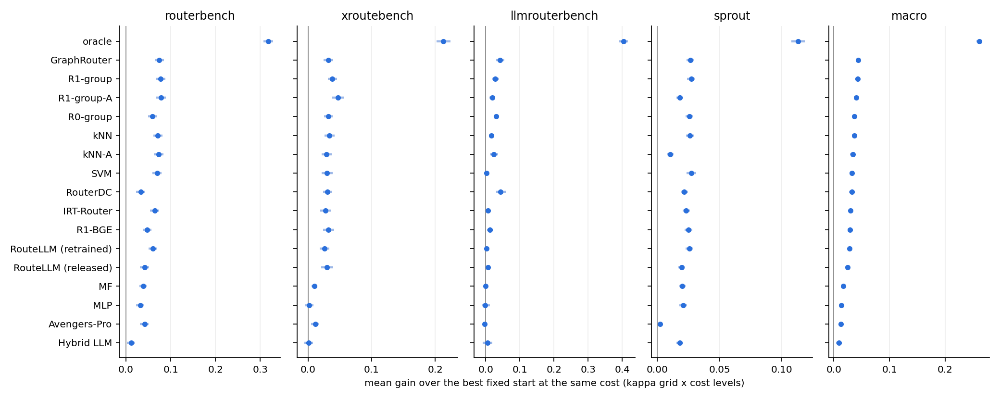
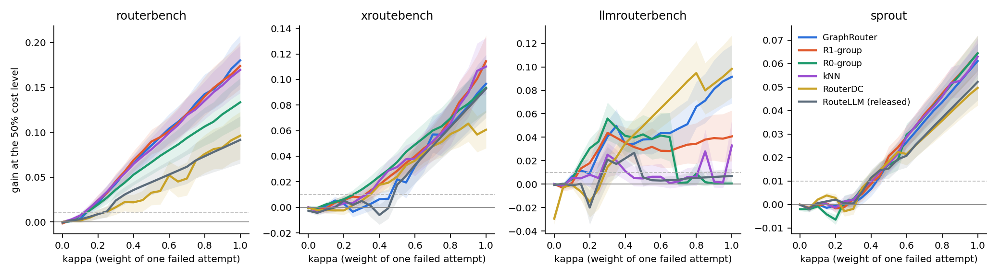
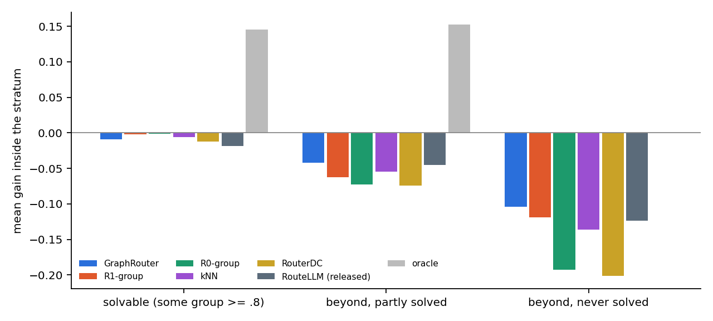
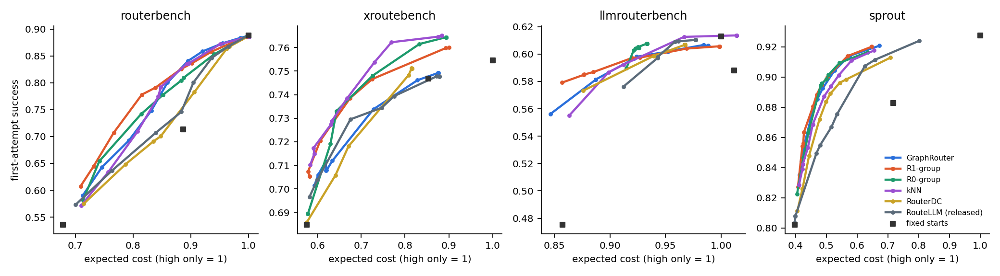
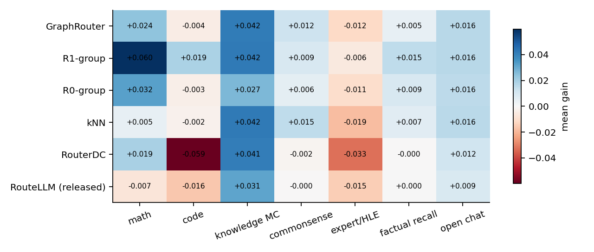

# EV-10 결과 표 (10_report가 만든 파일)

08 test: 평가 행 {'llmrouterbench': 3697, 'routerbench': 3445, 'sprout': 6891, 'xroutebench': 3629}, bootstrap 10000회. 이 파일의 숫자는 모두 08·09·08a 출력에서 그대로 옮겼다(`manifest.json`에 입력 SHA).

## 1. 평균 이득 (갈래 ①, 상향 고려 규칙, κ 21개 × 비용 수준 3개 평균)

| 방법 | routerbench | xroutebench | llmrouterbench | sprout | macro | macro_group_price | macro_length |
|---|---:|---:|---:|---:|---:|---:|---:|
| oracle | +0.318 | +0.213 | +0.403 | +0.113 | +0.262 | +0.201 | +0.262 |
| GraphRouter | +0.075 | +0.032 | +0.041 | +0.027 | +0.044 | +0.016 | +0.044 |
| R1-group | +0.077 | +0.038 | +0.028 | +0.027 | +0.043 | +0.019 | +0.046 |
| R1-group-A | +0.079 | +0.047 | +0.019 | +0.018 | +0.041 | +0.012 | +0.038 |
| R0-group | +0.060 | +0.032 | +0.031 | +0.026 | +0.037 | +0.015 | +0.058 |
| kNN | +0.071 | +0.033 | +0.016 | +0.026 | +0.037 | +0.017 | +0.070 |
| kNN-A | +0.073 | +0.029 | +0.023 | +0.010 | +0.034 | +0.008 | +0.018 |
| SVM | +0.070 | +0.030 | +0.002 | +0.027 | +0.032 | +0.007 | +0.059 |
| RouterDC | +0.033 | +0.030 | +0.044 | +0.022 | +0.032 | +0.005 | +0.012 |
| IRT-Router | +0.064 | +0.027 | +0.006 | +0.023 | +0.030 | +0.010 | +0.046 |
| R1-BGE | +0.048 | +0.032 | +0.012 | +0.025 | +0.029 | +0.011 | +0.032 |
| RouteLLM (retrained) | +0.060 | +0.026 | +0.002 | +0.026 | +0.029 | +0.012 | +0.032 |
| RouteLLM (released) | +0.041 | +0.030 | +0.006 | +0.020 | +0.024 | +0.008 | +0.033 |
| MF | +0.039 | +0.010 | -0.000 | +0.020 | +0.017 | -0.001 | +0.010 |
| MLP | +0.032 | +0.002 | -0.002 | +0.021 | +0.013 | -0.002 | +0.027 |
| Avengers-Pro | +0.041 | +0.011 | -0.004 | +0.002 | +0.013 | +0.003 | +0.007 |
| Hybrid LLM | +0.012 | +0.001 | +0.005 | +0.018 | +0.009 | +0.002 | +0.005 |
| R0 operational | +0.076 | +0.040 | – | – | – | – | – |

원천 4개 평균의 95% 구간:

| method | mean_gain | lo | hi |
|---|---:|---:|---:|
| oracle | +0.262 | +0.256 | +0.267 |
| GraphRouter | +0.044 | +0.039 | +0.048 |
| R1-group | +0.043 | +0.038 | +0.047 |
| R1-group-A | +0.041 | +0.036 | +0.045 |
| R0-group | +0.037 | +0.033 | +0.041 |
| kNN | +0.037 | +0.033 | +0.041 |
| kNN-A | +0.034 | +0.029 | +0.039 |
| SVM | +0.032 | +0.028 | +0.036 |
| RouterDC | +0.032 | +0.028 | +0.037 |
| IRT-Router | +0.030 | +0.027 | +0.034 |
| R1-BGE | +0.029 | +0.025 | +0.033 |
| RouteLLM (retrained) | +0.029 | +0.025 | +0.032 |
| RouteLLM (released) | +0.024 | +0.021 | +0.028 |
| MF | +0.017 | +0.015 | +0.020 |
| MLP | +0.013 | +0.009 | +0.018 |
| Avengers-Pro | +0.013 | +0.010 | +0.016 |
| Hybrid LLM | +0.009 | +0.004 | +0.013 |

## 2. κ\* (비용 50% 수준, 이득 > .01이고 구간 하한 > 0인 가장 작은 κ)

| method | llmrouterbench | routerbench | sprout | xroutebench |
|---|---:|---:|---:|---:|
| Avengers-Pro | – | 0.25 | – | 0.65 |
| GraphRouter | 0.15 | 0.15 | 0.45 | 0.50 |
| Hybrid LLM | – | 0.40 | 0.55 | – |
| IRT-Router | 0.65 | 0.15 | 0.45 | 0.40 |
| kNN | 0.30 | 0.15 | 0.45 | 0.35 |
| kNN-A | 0.55 | 0.15 | 0.65 | 0.45 |
| MF | – | 0.25 | 0.45 | 0.35 |
| MLP | 0.30 | 0.25 | 0.35 | 0.80 |
| oracle | 0.05 | 0.05 | 0.05 | 0.05 |
| R0-group | 0.15 | 0.15 | 0.40 | 0.30 |
| R0 operational | – | 0.15 | – | 0.30 |
| R1-BGE | 0.80 | 0.15 | 0.45 | 0.45 |
| R1-group | 0.15 | 0.15 | 0.45 | 0.35 |
| R1-group-A | 0.35 | 0.10 | 0.50 | 0.35 |
| RouteLLM (released) | 0.30 | 0.25 | 0.40 | 0.50 |
| RouteLLM (retrained) | 0.20 | 0.15 | 0.45 | 0.35 |
| RouterDC | 0.35 | 0.25 | 0.40 | 0.35 |
| SVM | 0.90 | 0.15 | 0.35 | 0.50 |

## 3. 고정 시작 단계 (test)

| source | start | resolved | fails | cost | first |
|---|---|---:|---:|---:|---:|
| routerbench | low | +0.933 | +0.731 | +0.679 | +0.536 |
| routerbench | medium | +0.919 | +0.368 | +0.887 | +0.713 |
| routerbench | high | +0.888 | +0.112 | +1.000 | +0.888 |
| xroutebench | low | +0.862 | +0.640 | +0.576 | +0.685 |
| xroutebench | medium | +0.840 | +0.413 | +0.853 | +0.747 |
| xroutebench | high | +0.754 | +0.246 | +1.000 | +0.754 |
| llmrouterbench | low | +0.746 | +1.122 | +0.857 | +0.475 |
| llmrouterbench | medium | +0.716 | +0.696 | +1.012 | +0.588 |
| llmrouterbench | high | +0.613 | +0.387 | +1.000 | +0.613 |
| sprout | low | +0.965 | +0.310 | +0.396 | +0.802 |
| sprout | medium | +0.956 | +0.162 | +0.717 | +0.883 |
| sprout | high | +0.928 | +0.072 | +1.000 | +0.928 |

## 4. 풀리는 정도별 층

| source | beyond_partial | beyond_zero | solvable |
|---|---:|---:|---:|
| llmrouterbench | 563 | 673 | 2461 |
| routerbench | 139 | 171 | 3135 |
| sprout | 497 | 47 | 6347 |
| xroutebench | 621 | 284 | 2724 |

| method | beyond_partial | beyond_zero | solvable |
|---|---:|---:|---:|
| Avengers-Pro | -0.088 | -0.207 | -0.019 |
| GraphRouter | -0.042 | -0.104 | -0.009 |
| Hybrid LLM | -0.098 | -0.304 | -0.019 |
| IRT-Router | -0.050 | -0.128 | -0.010 |
| kNN | -0.055 | -0.137 | -0.006 |
| kNN-A | -0.073 | -0.167 | -0.014 |
| MF | -0.076 | -0.225 | -0.011 |
| MLP | -0.095 | -0.263 | -0.010 |
| oracle | +0.152 | +0.000 | +0.145 |
| R0-group | -0.073 | -0.192 | -0.001 |
| R0 operational | -0.086 | -0.208 | +0.017 |
| R1-BGE | -0.058 | -0.146 | -0.010 |
| R1-group | -0.063 | -0.119 | -0.002 |
| R1-group-A | -0.052 | -0.109 | -0.009 |
| RouteLLM (released) | -0.045 | -0.124 | -0.018 |
| RouteLLM (retrained) | -0.064 | -0.159 | -0.007 |
| RouterDC | -0.074 | -0.202 | -0.012 |
| SVM | -0.060 | -0.130 | -0.007 |

## 5. 갈래 ② (τ = .8)

필요 단계 정확도(solvable 층):

| method | llmrouterbench | routerbench | sprout | xroutebench |
|---|---:|---:|---:|---:|
| Avengers-Pro | 0.104 | 0.330 | 0.700 | 0.425 |
| GraphRouter | 0.274 | 0.347 | 0.712 | 0.477 |
| Hybrid LLM | 0.097 | 0.285 | 0.651 | 0.156 |
| IRT-Router | 0.168 | 0.337 | 0.679 | 0.583 |
| kNN | 0.187 | 0.351 | 0.685 | 0.481 |
| kNN-A | 0.089 | 0.351 | 0.623 | 0.454 |
| MF | 0.228 | 0.298 | 0.693 | 0.303 |
| MLP | 0.224 | 0.285 | 0.681 | 0.367 |
| oracle | 1.000 | 1.000 | 1.000 | 1.000 |
| R0-group | 0.295 | 0.318 | 0.703 | 0.251 |
| R0 operational | – | 0.361 | – | 0.565 |
| R1-BGE | 0.207 | 0.326 | 0.652 | 0.400 |
| R1-group | 0.257 | 0.347 | 0.726 | 0.601 |
| R1-group-A | 0.121 | 0.365 | 0.654 | 0.591 |
| RouteLLM (released) | 0.128 | 0.304 | 0.627 | 0.390 |
| RouteLLM (retrained) | 0.186 | 0.311 | 0.676 | 0.392 |
| RouterDC | 0.157 | 0.295 | 0.670 | 0.242 |
| SVM | 0.237 | 0.355 | 0.693 | 0.461 |

첫 시도 성공:

| method | llmrouterbench | routerbench | sprout | xroutebench |
|---|---:|---:|---:|---:|
| Avengers-Pro | 0.611 | 0.866 | 0.824 | 0.713 |
| GraphRouter | 0.602 | 0.858 | 0.893 | 0.734 |
| Hybrid LLM | 0.612 | 0.888 | 0.876 | 0.754 |
| IRT-Router | 0.609 | 0.863 | 0.892 | 0.732 |
| kNN | 0.614 | 0.836 | 0.894 | 0.754 |
| kNN-A | 0.612 | 0.853 | 0.860 | 0.748 |
| MF | 0.604 | 0.879 | 0.886 | 0.736 |
| MLP | 0.599 | 0.884 | 0.884 | 0.742 |
| oracle | 0.739 | 0.930 | 0.940 | 0.838 |
| R0-group | 0.608 | 0.853 | 0.899 | 0.762 |
| R0 operational | – | 0.847 | – | 0.735 |
| R1-BGE | 0.608 | 0.869 | 0.894 | 0.747 |
| R1-group | 0.604 | 0.836 | 0.895 | 0.739 |
| R1-group-A | 0.610 | 0.845 | 0.879 | 0.738 |
| RouteLLM (released) | 0.610 | 0.867 | 0.875 | 0.739 |
| RouteLLM (retrained) | 0.604 | 0.862 | 0.903 | 0.750 |
| RouterDC | 0.607 | 0.867 | 0.889 | 0.751 |
| SVM | 0.605 | 0.840 | 0.889 | 0.740 |

## 6. 과제 유형별 평균 이득 (원천 합계, 문항 수 가중, 기술 통계)

| method | 수학 | 코드 | 지식 객관식 | 상식·추론 | 전문가 과학·난제 | 사실 회상 | 열린 대화·지시 |
|---|---:|---:|---:|---:|---:|---:|---:|
| Avengers-Pro | +0.014 | -0.026 | +0.009 | -0.005 | -0.041 | -0.002 | -0.005 |
| GraphRouter | +0.024 | -0.004 | +0.042 | +0.012 | -0.012 | +0.005 | +0.016 |
| Hybrid LLM | -0.022 | -0.041 | +0.000 | -0.005 | -0.095 | -0.035 | +0.009 |
| IRT-Router | +0.002 | -0.002 | +0.038 | +0.007 | -0.011 | +0.002 | +0.013 |
| kNN | +0.005 | -0.002 | +0.042 | +0.015 | -0.019 | +0.007 | +0.016 |
| kNN-A | -0.008 | +0.012 | +0.045 | +0.013 | -0.105 | -0.001 | +0.002 |
| MF | -0.025 | -0.070 | +0.023 | +0.005 | -0.008 | +0.001 | +0.010 |
| MLP | -0.006 | -0.026 | +0.015 | -0.004 | -0.055 | -0.009 | +0.013 |
| oracle | +0.309 | +0.236 | +0.269 | +0.167 | +0.093 | +0.235 | +0.118 |
| R0-group | +0.032 | -0.003 | +0.027 | +0.006 | -0.011 | +0.009 | +0.016 |
| R0 operational | +0.050 | -0.037 | +0.058 | +0.008 | – | – | – |
| R1-BGE | +0.014 | -0.001 | +0.018 | +0.006 | -0.013 | +0.001 | +0.015 |
| R1-group | +0.060 | +0.019 | +0.042 | +0.009 | -0.006 | +0.015 | +0.016 |
| R1-group-A | +0.060 | +0.010 | +0.050 | +0.009 | -0.030 | -0.001 | +0.008 |
| RouteLLM (released) | -0.007 | -0.016 | +0.031 | -0.000 | -0.015 | +0.000 | +0.009 |
| RouteLLM (retrained) | +0.014 | -0.025 | +0.042 | +0.001 | -0.011 | -0.001 | +0.016 |
| RouterDC | +0.019 | -0.059 | +0.041 | -0.002 | -0.033 | -0.000 | +0.012 |
| SVM | +0.010 | -0.005 | +0.042 | +0.006 | -0.013 | -0.005 | +0.016 |

## 7. 가설 판정 (08 `hypotheses.json`)

- **H1:** 원천 평균 1위 GraphRouter, kNN 5위, 1위와 구분되지 않는 방법 비율 13%. 원천별 1위: routerbench R1-group-A, xroutebench R1-group-A, llmrouterbench RouterDC, sprout SVM
- **H2(solvable 층 정확도, 첫 시도 성공; R0-집단 − R1-집단):** routerbench -0.030 / +0.017; xroutebench -0.349 / +0.023; llmrouterbench +0.038 / +0.004; sprout -0.023 / +0.004
- **H3(IRT 난이도 Spearman):** routerbench 0.129 [0.096, 0.161]; xroutebench 0.256 [0.227, 0.285]; llmrouterbench 0.156 [0.125, 0.188]; sprout 0.464 [0.446, 0.481]; routerarena_bloom 0.170 [0.146, 0.193]
- **H4(재학습 − 공개본, 50% 수준 모든 κ에서 > .01):** routerbench 아님, xroutebench 아님, llmrouterbench 아님, sprout 아님
- **H5 r1_group_vs_r1_group_a (seed 42):** routerbench -0.001, xroutebench -0.009, llmrouterbench +0.009, sprout +0.009 → 아님
- **H5 knn_vs_knn_a (seed 42):** routerbench -0.002, xroutebench +0.004, llmrouterbench -0.007, sprout +0.016 → 아님
- **H5 R1 (seed 42·17·73 평균, 09):** routerbench -0.001 [-0.005, +0.003], xroutebench -0.002 [-0.007, +0.002], llmrouterbench +0.004 [-0.008, +0.015], sprout +0.012 [+0.010, +0.014] → 아님
- **H6(v1·v2 순위 Kendall τ):** routerbench 0.92, xroutebench 0.70
- **H7:** κ\*가 없는(어떤 κ에서도 못 이기는) 라우터·원천·수준 비율 8.3%
- **RT-08:** group/routerbench mixed; group/xroutebench mixed; representative/routerbench mixed; representative/xroutebench mixed

RouterArena: R0-집단 예측과 Bloom 라벨 일치 45.5%, Spearman 0.181 (Context가 붙은 1603건 제외).

## 8. 라우팅 지연 (08a)

| router | stage | median_ms | p95_ms | mean_ms | setting | note | device |
|---|---|---:|---:|---:|---|---|---|
| bge_encoder | encoder | 783.1 | 2388.1 | 1080.7 | None | None | cpu |
| decision_rule | decision | 0.4 | 0.8 | 0.5 | None | None | cpu |
| knn | body | 159.5 | 232.1 | 173.3 | n_neighbors=40 | None | cpu |
| knn | total_with_bge | 952.3 | 2556.4 | 1254.5 | n_neighbors=40 | None | cpu |
| knn | added_given_bge | 159.9 | 232.6 | 173.8 | n_neighbors=40 | None | cpu |
| knn_a | body | 101.5 | 157.7 | 109.2 | n_neighbors=50 | None | cpu |
| knn_a | total_with_bge | 893.3 | 2488.6 | 1190.3 | n_neighbors=50 | None | cpu |
| knn_a | added_given_bge | 102.0 | 158.5 | 109.7 | n_neighbors=50 | None | cpu |
| mlp | body | 0.6 | 0.8 | 0.6 | hidden_layer_sizes=100-100 | None | cpu |
| mlp | total_with_bge | 784.4 | 2389.1 | 1081.8 | hidden_layer_sizes=100-100 | None | cpu |
| mlp | added_given_bge | 1.0 | 1.4 | 1.1 | hidden_layer_sizes=100-100 | None | cpu |
| svm | body | 0.3 | 0.4 | 0.3 | default | None | cpu |
| svm | total_with_bge | 784.0 | 2388.8 | 1081.5 | default | None | cpu |
| svm | added_given_bge | 0.7 | 1.1 | 0.8 | default | None | cpu |
| mf | body | 0.2 | 0.2 | 0.2 | epochs=5 | None | cpu |
| mf | total_with_bge | 783.8 | 2388.7 | 1081.3 | epochs=5 | None | cpu |
| mf | added_given_bge | 0.6 | 1.0 | 0.7 | epochs=5 | None | cpu |
| hybrid_llm | body | 0.2 | 0.2 | 0.2 | router_mode=probabilistic | None | cpu |
| hybrid_llm | total_with_bge | 783.8 | 2388.7 | 1081.3 | router_mode=probabilistic | None | cpu |
| hybrid_llm | added_given_bge | 0.6 | 1.0 | 0.6 | router_mode=probabilistic | None | cpu |
| irt_router | body | 0.3 | 0.4 | 0.3 | lamda=0.0 | None | cpu |
| irt_router | total_with_bge | 784.0 | 2388.8 | 1081.4 | lamda=0.0 | None | cpu |
| irt_router | added_given_bge | 0.7 | 1.1 | 0.8 | lamda=0.0 | None | cpu |
| avengers_pro | body | 0.4 | 0.5 | 0.4 | n_clusters=25,performance_weight=0.45 | None | cpu |
| avengers_pro | total_with_bge | 784.0 | 2388.9 | 1081.5 | n_clusters=25,performance_weight=0.45 | None | cpu |
| avengers_pro | added_given_bge | 0.8 | 1.2 | 0.9 | n_clusters=25,performance_weight=0.45 | None | cpu |
| r1_bge | body | 0.4 | 0.4 | 0.4 | hidden=1024,epochs=20,source_weight=on | None | cpu |
| r1_bge | total_with_bge | 784.0 | 2388.9 | 1081.5 | hidden=1024,epochs=20,source_weight=on | None | cpu |
| r1_bge | added_given_bge | 0.8 | 1.2 | 0.9 | hidden=1024,epochs=20,source_weight=on | None | cpu |
| graphrouter | body | 96.2 | 315.6 | 107.4 | impl=official,label=success,epochs=1000,checkpoint=last | None | cpu |
| graphrouter | total_with_bge | 920.4 | 2524.0 | 1188.6 | impl=official,label=success,epochs=1000,checkpoint=last | None | cpu |
| graphrouter | added_given_bge | 96.7 | 316.1 | 107.9 | impl=official,label=success,epochs=1000,checkpoint=last | None | cpu |
| r0_group | total | 253.2 | 1238.5 | 400.8 | default | trained weights, 512 tokens | cpu |
| r1_group | total | 254.9 | 1306.5 | 412.1 | default | trained weights, 512 tokens | cpu |
| r1_group_a | total | 244.8 | 1389.7 | 411.9 | default | trained weights, 512 tokens | cpu |
| rt08 | total | 263.9 | 1104.5 | 418.2 | default | trained weights, 512 tokens | cpu |
| r0_operational_8192 | total | 278.9 | 1070.3 | 439.6 | default | RT-08 weights (same architecture), 8192 tokens | cpu |
| routellm_released | total | 203.6 | 890.7 | 305.4 | default | released weights | cpu |
| routellm_retrained | total | 193.7 | 806.6 | 309.7 | checkpoint=best_dev_loss | same architecture as the retrained model (XLM-R base, 3 classes) | cpu |
| routerdc | total | 417.5 | 1647.8 | 603.5 | config=llmrouter,checkpoint=final | same architecture as the trained RouterDC (mDeBERTa-v3-base + 3 tier embeddings) | cpu |
