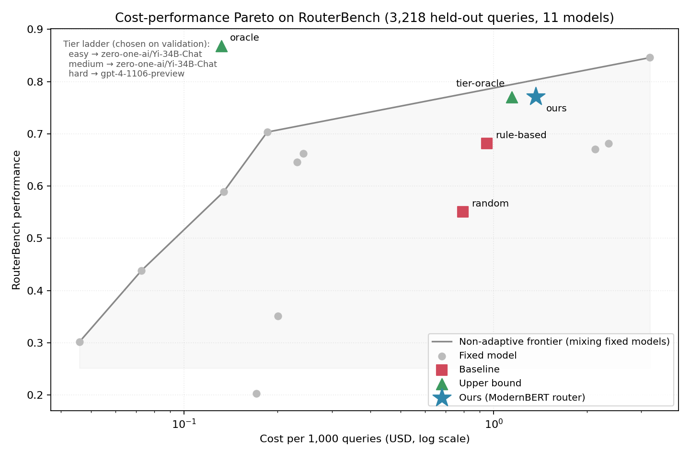

# 기존 기법 대비 비용-성능 파레토 (RouterBench)

평가일: 2026-08-30
데이터: RouterBench 0-shot, 11개 모델 × 36,497 질의
평가 대상: 라우터 학습셋의 **held-out test split 에서 1,000건 층화 표본**

2026-08-03 미팅의 "토큰을 아끼는 기법이 이미 여럿인데 그 대비 성능을 비교하라"는
지적에 대한 답이다. **LLM 을 한 번도 호출하지 않았다.** RouterBench 에 11개 모델의
성능과 비용이 이미 들어 있어 정책 함수만 갈아끼워 계산했다.

## 1. 결론

우리 라우터는 비적응 프런티어 **위에 있다(+0.0101)**. 무작위와 규칙 기반은 아래다.

| 정책 | 성능 | 비용($/1k질의) | 프런티어 대비 |
|---|---:|---:|---:|
| random | 0.5625 | 0.7529 | **−0.1770** |
| rule-based (길이) | 0.6863 | 1.0342 | **−0.0661** |
| **ours (ModernBERT)** | **0.7780** | **1.3744** | **+0.0101** |



## 2. 왜 "비적응 프런티어"가 기준인가

개별 모델 점만 찍어 비교하면 중요한 사실이 가려진다. **고정 모델 두 개를 확률적으로
섞기만 해도 비용-성능 곡선이 공짜로 나온다.** 라우터는 그 선을 넘어야만 값어치가 있다.

Always-Opus 대비 절감률만 보고하면 "우리 라우터가 좋다"가 아니라 "싼 모델이 싸다"를
보여주게 된다. 실제로 무작위 라우팅도 Always-gpt-4 보다는 싸다 — 그런데 프런티어
기준으로는 0.177 아래다.

```
프런티어 꼭짓점: mistral-7b → WizardLM-13B → Yi-34B → gpt-4
```

## 3. 방법론

**3단 사다리는 validation 에서 골랐다.** 운영에서는 easy/medium/hard 를
Haiku/Sonnet/Opus 로 보내지만 RouterBench 에는 그 모델들이 없어 대응 사다리가 필요하다.
조합을 다 돌려보고 test 에서 가장 좋은 것을 고르면 그 숫자는 과적합이므로,
**validation 1,000건에서 고르고 test 1,000건에서 보고**했다.

```
ours 사다리        : easy→Yi-34B    medium→Yi-34B       hard→gpt-4
완벽 분류기 사다리   : easy→Yi-34B    medium→gpt-3.5      hard→gpt-4

validation 격차 +0.0283  →  test 격차 +0.0101
```

validation 에서 test 로 격차가 절반 이하로 줄었다. 이것이 선택 편향의 크기이며,
사다리를 test 에서 골랐다면 +0.0148 로 보고했을 것이다.

**기준선도 같은 1,000건에서 다시 계산했다.** 우리 라우터를 표본에서 재고 기준선을
전량에서 재면 비교가 성립하지 않는다.

## 4. 상한선 분석 — 어디까지 갈 수 있나

| | 성능 | 비용($/1k) | 프런티어 대비 |
|---|---:|---:|---:|
| ours (현재 분류기, 일치율 48%) | 0.7780 | 1.3744 | +0.0101 |
| 완벽한 **난이도** 분류기 | 0.7796 | 1.1712 | **+0.0210** |
| oracle — 사다리의 **모델 3개** 안에서 질의별 최적 | 0.8790 | 0.2788 | **+0.1612** |
| oracle — 모델 11개 전부 | 0.8624 | 0.1117 | +0.3266 |

읽는 법이 중요하다.

**분류 정확도를 올리는 것은 값어치가 있다.** 48% → 100% 로 가면 격차가 2배가 된다
(+0.0101 → +0.0210). 다만 효과가 성능이 아니라 **비용**으로 나타난다 —
성능은 0.7780 → 0.7796 으로 거의 그대로인데 비용이 15% 내려간다. 분류가 정확해지면
쉬운 질문을 비싼 모델로 잘못 보내는 낭비가 줄기 때문이다.

**그런데 완벽해져도 +0.0210 에서 멈춘다.** 같은 모델 3개를 쓰면서 질의별로 최적 모델을
고르면 +0.1612 까지 간다. **모델을 늘리지 않고도 +0.14 가 남아 있다.**

11모델 oracle(+0.3266)은 참고용이다. 우리 운영에는 Claude 모델이 3개뿐이라 도달할 수
없는 값이며, 이것을 목표로 제시하면 안 된다.

## 5. 천장의 원인 — 라벨이 배포 모델과 다른 기준으로 만들어졌다

`minimum-sufficient-tier` 라는 이름대로 이 라벨은 "충분한 가장 낮은 티어"다.
개념적으로는 우리가 원하는 것과 같다. 그런데 **실제 값이 다르다.**

사다리 3개 모델 기준으로 "이 질문을 맞히는 가장 싼 모델"을 직접 계산해 비교했다.

```
                 실제로 충분한 티어
difficulty_label  easy   medium   hard
  easy           6806      744   1686
  medium         4033      846   2945
  hard           3447      974   3723

일치율 45.1%
```

**`hard` 로 라벨된 질문의 42%(3,447건)를 가장 싼 티어인 Yi-34B 가 이미 맞힌다.**
라벨을 믿고 gpt-4 로 보내면 17배를 더 내고 같은 답을 받는다.

어긋난 이유가 둘이다.

**(1) 라벨은 11개 모델 기준으로 만들어졌다.** "tier" 는 RouterBench 11개 모델을
3그룹으로 묶은 것이다. 우리 사다리의 `easy` 자리에 있는 Yi-34B 는 그 11개 중
상위권(전체 정확도 0.6475)이다. "11개 기준 hard" 가 "우리 3개 기준 hard" 를 뜻하지 않는다.

**(2) 학습셋이 밸런싱됐다.**

```
difficulty_label   easy 37%  medium 31%  hard 32%   ← 학습 편의로 균형을 맞춤
충분한 티어(실제)   easy 57%  medium 10%  hard 33%   ← 자연 분포
```

medium 이 실제로는 10% 뿐인데 학습셋에서는 31% 로 부풀려져 있다. 클래스 균형을 맞추느라
배포 최적 라벨에서 더 멀어졌다.

## 6. 제안 — 라벨을 배포 모델 기준으로 다시 뽑는다

모델 구조도, 3-class 분류라는 형태도 그대로다. **전처리에서 라벨 컬럼만 바꾼다.**

```
현재: difficulty_label  = 11개 모델을 3그룹으로 묶은 난이도 티어
제안: sufficient_tier   = {Haiku, Sonnet, Opus} 중 이 질문을 맞히는 가장 싼 것
```

티어를 늘리거나 모델을 추가하는 것보다 훨씬 싼 변경이며, 천장이 +0.021 에서
+0.161 로 올라간다.

**다만 두 가지를 장담할 수 없다.**

- **새 라벨이 더 예측하기 어려울 수 있다.** `sufficient_tier` 는 "싼 모델이 맞혔나"로
  정해지는데, 객관식에서 찍어서 맞은 경우도 easy 가 된다. 예측 불가능한 잡음이므로
  난이도 라벨보다 학습이 어려울 수 있다.
- **+0.1612 는 완벽하게 맞혔을 때의 값이다.** 실제 도달 가능한 값은 재학습해서 재봐야 한다.

즉 확인된 것은 **"천장이 올라간다"** 까지이고, **"실제로 거기 도달한다"** 는 아니다.

## 7. 한계

- **표본 1,000건.** test split 전량은 3,218건이다. 표본 오차 약 ±1.5%p 이므로
  +0.0101 은 통계적으로 견고하다고 말하기 어렵다. 발표 전 전량으로 다시 돌리는 것을 권한다.
- **RouterBench 는 객관식·상식 문제에 치우쳐 있다.** hellaswag 10,042건,
  grade-school-math 7,450건이 36,497건 중 절반 가까이다. 개방형 질문에서 라우터가
  easy 로 붕괴하는 현상(별도 실측, `PLAN.md` §5-0)은 이 데이터로는 드러나지 않는다.
- **여기서 잰 것은 우리 서비스가 아니다.** 우리 *분류기*를 RouterBench 모델들에
  이식했을 때의 성능이다. Claude 모델도, 캐시도 들어가 있지 않다. 그건 별도 실험(A)이며
  실제 Claude 호출이 필요하다.
- **RouteLLM 비교는 아직 없다.** 공개 체크포인트를 그대로 쓰면 학습 도메인이 달라
  (Chatbot Arena 선호 vs RouterBench solve rate) 불리하게 나오는데, 그건 방법의
  차이가 아니라 데이터의 차이다. 같은 RouterBench 라벨로 재학습해야 공정하다.

## 8. 재현

```bash
python experiments/fetch_router_predictions.py --split validation --limit 1000
python experiments/fetch_router_predictions.py --split test --limit 1000
python experiments/pareto_baselines.py
```

`fetch_router_predictions.py` 는 `/router/classify` 만 호출한다. Claude 비용 0원.
4~6장의 상한선·라벨 분석 원본 출력은 `label_analysis.txt` 에 있다.
