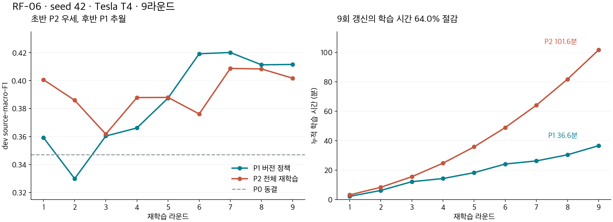

# RF-06 버전 정책 효능 분석

분석일: 2026-10-20. 대상: Drive `MyDrive/LLM_Router/version-policy/runs/run001`.

**이번 실험은 버전 정책이 반복 재학습의 계산량을 줄일 수 있다는 근거를 제공한다. 9회 갱신 후 source-macro-F1의 비열등성 기준을 만족하면서 순수 학습 시간을 64.0%, optimizer step을 62.3% 줄였다. 다만 초기 적응 속도·전체 정확도·서비스 비용·최종 해결률까지 개선한 결과는 아니다. 망각 억제의 독립적인 인과 효과도 이 비교만으로는 입증하지 못한다.**

## 1. 위치와 검증 범위

- Memorize의 RF-06 기록으로 설계와 Drive 위치를 확인했다. 해당 기록은 실행 전 상태였지만 Drive에는 P1·P2의 seed 42, 각각 9라운드와 비교 결과가 완성되어 있다.
- 설계: 저장소 `.worktrees/rf06/docs/ml/VERSION_POLICY_EFFICIENCY_EXPERIMENT.md`.
- 실행 코드: `.worktrees/rf06/ml/notebooks/version_policy/`. Drive에 올라간 소스 ZIP의 SHA-256은 `420c6228e3508448ae336936dd64cb48fdcf347060154e0d1b2693cd9762b2dc`이며, 분석에 사용한 로컬 정책·비교 코드와 일치했다.
- 결과 원본: Drive의 `compare/results.json`, `compare/tables/`, `compare/REPORT-draft.md`, 각 arm의 `receipt.json`·예측 parquet.
- 학습·검증·test 입력은 로컬 `ml/artifacts/version-policy-v1/data/` 사본을 사용했다. 봉인 계획이 가리키는 manifest 및 파일 해시와 일치했다.
- 파일 해시 64개를 확인하고, 18개 학습 기록의 데이터 구성·행 수·optimizer step 및 기준 가중치 해시 연결을 검증했다. 모델 가중치 파일 자체는 다운로드하거나 다시 해시하지 않았다.
- 원시 test 예측에서 F1과 질문 그룹 단위 paired bootstrap 2,000회 신뢰구간을 재계산해 기존 결과와 일치함을 확인했다.
- pool/dev/test 사이 sample ID, group ID, 공백을 정규화한 완전 동일 입력문 중복은 모두 0이었다. 이는 의미상 유사 문항까지 부재함을 뜻하지 않는다.

검증 상세는 `audit.json`, 재계산 코드는 `reanalyze.py`, 원본 비교 묶음은 `original-results-for-review.zip`에 있다. 새 모델 학습이나 운영 설정 변경은 하지 않았다.

## 2. 실험이 실제로 비교한 것

| 조건 | 시작 가중치 | 매회 학습 데이터 |
|---|---|---|
| P0 동결 | M0 | 재학습 없음 |
| P1 버전 정책 | 마지막 `.0` 기준 모델 | 현재 주기 batch 전부 + 이전 주기 replay 라벨별 32행 + 초기 데이터 복습 라벨별 32행 |
| P2 전체 재학습 | 매번 M0 | 초기 데이터 전체 + 지금까지의 모든 batch |

P1의 1.1·1.2·2.0은 모두 M0에서 시작한다. 2.1·2.2·3.0은 2.0에서, 3.1·3.2·4.0은 3.0에서 시작한다. optimizer와 scheduler는 매번 새로 만든다. P2 역시 사전학습 ModernBERT부터 다시 학습하는 것이 아니라 이미 초기 학습한 M0부터 시작한다.

- 공통 모델: ModernBERT-base, 512토큰, 3 epoch, 학습률 2e-5, 유효 batch 32. 두 arm 모두 Tesla T4 실행 기록이 있다.
- 데이터 풀 35,017행, dev 7,591행, test 17,662행. 4개 출처: RouterBench, xRouteBench, LLMRouterBench, SPROUT.
- M0는 pilot 크기 1k·2k·4k·8k·16k 중 규칙으로 선택한 1k 모델이며 실제 초기 학습 행은 999개다. 충분히 학습된 현재 운영 모델을 그대로 쓴 실험이 아니다.
- probe 19,233행을 9개 window로 나누고, **고정 M0의 오답**에 reserve 문항을 보충해 easy/medium/hard 비율을 풀 전체 비율에 맞췄다. 실제 추가 batch는 16,043행이다.
- 두 arm은 같은 batch를 받는다. 따라서 각 arm이 자신의 예측에 따라 서로 다른 피드백을 받는 효과는 배제했다. 이는 학습 방식 비교에는 장점이지만 실제 운영 피드백의 재현은 아니다.
- 주 지표 source-macro-F1은 각 데이터 출처 안에서 3개 난이도의 F1을 평균한 후, 4개 출처 점수를 동등하게 평균한다. 다수인 easy나 큰 데이터셋이 평가를 지배하지 않도록 한 지표다.
- 사전 비열등 기준: 최종 test의 P1−P2에 대한 95% 신뢰구간 하한이 −0.01보다 커야 한다.

## 3. 주 결과: 최종 분류 지표를 유지하며 반복 학습 계산 절감

| 지표 | P0 동결 | P1 버전 정책 | P2 전체 재학습 |
|---|---:|---:|---:|
| 최종 test source-macro-F1 | 0.34425 | **0.41804** | 0.40688 |
| 9회 누적 학습 시간 | — | **36.59분** | 101.57분 |
| 누적 optimizer step | 0 | **3,138** | 8,319 |
| 처리 샘플 수(반복 포함) | 0 | 100,200 | 265,863 |
| 처리 토큰 수(패딩 제외) | 0 | 10,127,718 | 26,863,947 |

P1−P2는 **+0.01117, 95% CI [+0.00258, +0.01988]**이다. 비열등 기준 −0.01을 충분히 넘으며, 이번 seed에서의 문항 재표집 구간은 0도 넘는다. 다만 “+0.01을 초과하는 우위”를 확정하려면 하한도 +0.01보다 커야 하므로 그 강한 기준은 충족하지 않는다. 신뢰구간은 학습 seed 변동을 포함하지 않는다.

P1−P0는 +0.07380 [0.06248, 0.08413], P2−P0는 +0.06263 [0.05155, 0.07332]로, 두 방식 모두 학습 효과가 있어야 한다는 사전 전제도 통과했다.

학습 시간 기준 P2/P1은 **2.776배**, step 기준 **2.651배**, 토큰 기준 **2.653배**다. 시간 절감과 계산량 절감이 함께 나타나므로 일시적인 GPU 속도 차이만으로 생긴 결과라고 보기는 어렵다. 단, 시간은 순수 학습 루프 실측이며 평가·모델 로딩·저장·Drive 전송·Colab 대기를 포함한 총 실행시간이나 청구 비용은 아니다. 공통 pilot 학습 시간 34.93분도 제외했다.

절감 원인은 학습 데이터 수에서 직접 확인된다. 마지막 round에서 P1은 5,717행, P2는 17,042행을 학습했다. P1은 새 주기로 넘어갈 때 과거 데이터를 제한된 replay로 압축하고 가중치에 반영된 정보를 이어받는다. P2는 매번 전체 이력을 다시 처리한다.

## 4. 초기 개선과 최종 결과를 구분해야 한다

P1은 1~5라운드 dev에서 P2보다 낮았고 6~9라운드에서는 높았다. 2라운드의 P1은 0.32994로 동결 M0의 0.34706보다도 낮았다. 따라서 “모든 갱신에서 품질을 유지한다”는 표현은 성립하지 않는다.

| 과정 지표 | P1 | P2 | 해석 |
|---|---:|---:|---|
| 다음 window 평가 F1 평균(2~9) | 0.37332 | **0.38338** | 학습 도중 도착한 문항의 평균 성능은 P2가 약 0.0101 높음 |
| dev 목표 0.39174 최초 도달 round | 6 | **1** | P2가 먼저 목표에 도달 |
| 위 목표까지 누적 학습 시간 | 24.15분 | **3.19분** | 목표 최초 도달 비용도 P2가 낮음 |

dev 목표는 사전 정의된 규칙인 “P2 마지막 dev − 0.01”로 계산했다. 첫 도달은 이후 모든 라운드에서 그 수준을 유지했다는 뜻이 아니며, P2 역시 이후 흔들린다. 조기 종료 전략을 별도로 검증한 결과도 아니다.

초반 차이에는 P1의 초기 데이터 복습이 96행인 반면 P2는 999행 전부를 쓰는 점 등이 영향을 주었을 가능성이 있다. 후반 추월을 가중치 누적의 효과로 해석할 여지는 있지만, 이 원인을 분리한 대조군이 없어 인과관계로 확정할 수 없다.

## 5. 분류 균형 개선과 서비스 효용 개선은 다르다

| 최종 test 지표 | P0 | P1 | P2 | P1−P2 |
|---|---:|---:|---:|---:|
| 난이도 정확도 | 60.28% | 58.73% | **61.14%** | −2.41%p |
| easy 재현율 | 88.14% | 77.00% | **83.36%** | −6.36%p |
| medium 재현율 | 18.89% | **33.63%** | 31.11% | +2.52%p |
| hard 재현율 | 8.85% | **21.54%** | 15.05% | +6.49%p |
| 첫 시도 해결률 | 69.44% | **72.59%** | 71.45% | +1.14%p |
| 최종 해결률 | 88.64% | 87.49% | **88.10%** | −0.61%p |
| 예상 호출 수/질문 | 1.432 | **1.341** | 1.387 | −0.047 |
| 정규화 예상 호출 비용/질문 | 0.61434 | 0.64397 | **0.62975** | +2.26% |

P1은 easy 선택을 줄이고 medium·hard를 더 많이 선택한다. test에서 easy 선택 비중은 P2의 74.48%에서 P1의 66.97%로 내려갔고, hard 선택은 6.92%에서 10.98%로 늘었다. hard 재현율이 개선되는 동시에 easy를 높게 분류하는 오류도 증가했다. 따라서 F1 상승과 전체 정확도 하락은 모순이 아니다.

서비스 지표는 난이도 예측을 시작 단계로 사용하고, 기존 모델 집단 성공확률과 1:3:5 상대 비용, 실패 시 상향·단계별 독립 성공 가정으로 계산한 **오프라인 기대값**이다. 새 Claude 호출로 측정한 실서비스 결과가 아니다. 높은 단계부터 시작하면 첫 시도 성공과 호출 수에는 유리할 수 있지만 더 비싼 호출을 하고 낮은 단계의 해결 기회를 건너뛰므로 최종 해결률은 떨어질 수 있다.

그러므로 이번 실험의 64% 절감은 **라우터 재학습 비용**이다. LLM 서비스 호출 비용 절감으로 표현해서는 안 된다. 비용·최종 해결률 차이에는 별도의 신뢰구간을 계산하지 않았으므로 표는 기술 통계로 해석한다.

## 6. 출처별 결과와 망각 해석

| 출처 | P0 | P1 | P2 | P1−P2 |
|---|---:|---:|---:|---:|
| LLMRouterBench | 0.32053 | 0.37013 | 0.35929 | +0.01084 |
| RouterBench | **0.38673** | 0.37511 | 0.36536 | +0.00975 |
| SPROUT | 0.35316 | 0.53144 | 0.51924 | +0.01220 |
| xRouteBench | 0.31656 | 0.39549 | 0.38360 | +0.01188 |

P1의 P2 대비 최종 이득은 네 출처에서 모두 같은 방향이다. 한 출처만 좋아져 전체 평균이 상승한 현상은 아니다. 그러나 RouterBench에서는 P1·P2 모두 초기 M0보다 낮다. “모든 기존 능력을 보존했다”거나 “망각을 방지했다”고 주장할 수 없다.

이 실험에는 직전 모델에서 매번 신규 데이터만 학습하는 비교군이나, 기준점·replay·초기 복습을 하나씩 제거한 비교군이 없다. 따라서 버전 정책 묶음의 전체 재학습 대비 효율은 평가했지만, `.0` 기준점 자체가 망각을 줄이는 효과나 3회 주기·라벨별 32행이 최적이라는 사실은 평가하지 않았다.

## 7. 설계상 강점과 해석 범위

강점은 사전에 정한 비열등 기준, 두 arm에 동일한 batch를 공급하는 구성, 중복 그룹 단위 분할과 재표집, 최종 test 비교, 실제 optimizer step·학습 시간 계측이다. 봉인 계획·입력·라운드별 예측의 해시가 맞고 재계산도 일치하므로, 현재 보고된 주 결과는 저장된 실행 증거와 부합한다.

남은 범위는 다음과 같다.

1. **단일 seed 42.** 문항 bootstrap은 학습 seed에 따른 변동을 대신하지 못한다. 현재 결과는 사전 비열등 경계에 걸리지 않아 추가 seed를 반드시 실행해야 하는 조건은 아니지만, 정책의 일반적 우위를 강하게 주장하려면 반복 학습이 필요하다.
2. **선택 대조군 P2-eq 미실행.** 계산량을 맞춰도 P1이 좋은지, 적게 학습한 정규화 효과인지, 기준점과 replay가 핵심인지 분리할 수 없다. P2-eq만으로도 모든 구성 요소의 효과가 분리되는 것은 아니다.
3. **초기 데이터가 적고 같은 분포인 상황.** 초기 학습이 충분한 운영 1.0, 분포 이동, arm별 실시간 피드백에 곧바로 일반화할 수 없다. 이전 상향 피드백 실험의 실패를 반박하는 실험도 아니다. 이번 batch는 양방향 오답과 라벨 비율 보충으로 구성했다.
4. **9회 갱신까지만 확인.** 15번째 성공의 pristine rebase, quality gate, validatedUniqueBatch, 장기 망각과 장애 복구는 평가하지 않았다.
5. **test는 RF-06 전용으로 처음 공개된 자료가 아니다.** EV-10에서 이미 열었던 평가 집합이며, 이번 결과를 보고 설정을 바꿀 근거로 사용해서는 안 된다.
6. **계획의 표본 수 설명과 실제 크기가 다르다.** 계획은 pilot 16,000행 범위 안에서 stream을 정하려 했으나, dev에서 추정한 오답·보충률보다 실제 probe의 batch 요구량이 컸다. 예상 추가 15,000행(예약분 고려 후 약 14,645행) 대신 실제 추가 16,043행이 되었고, 초기 999행을 합치면 17,042행으로 pilot 최대를 약 6.5% 넘었다. 두 arm에 같은 batch가 제공돼 비교가 무효가 되는 문제는 아니지만, “pilot에서 측정한 범위 안에서만 실행했다”는 설명은 수정해야 한다. 이는 결과 해석상 주의점이며 이번 분석에서 설정이나 결과를 사후 변경하지 않았다.

## 8. 보고서에 사용할 수 있는 문장

> 초기 학습 데이터가 제한된 동일 분포 조건에서, 9회 갱신한 버전 정책은 매번 초기 모델 M0에서 누적 데이터 전체를 재학습한 방식 대비 최종 source-macro-F1의 비열등 기준을 충족했다(차이 +0.0112, 질문 그룹 paired bootstrap 95% CI [0.0026, 0.0199]). 누적 optimizer step은 62.3%, Tesla T4 순수 학습 시간은 64.0% 감소했다. 다만 seed 42의 결과이며 초기 적응 속도와 서비스 비용·최종 해결률의 개선까지 의미하지 않는다.

추가 검증의 우선순위는 같은 계산량의 P2-eq, seed 반복, 직전 모델 연속 학습·replay 제거 비교다. 첫 번째는 계산 예산을 맞춘 성능을, 두 번째는 학습 안정성을, 세 번째는 기준점·복습의 개별 기여를 확인하는 데 목적이 있다. 추가 실험은 이번 분석에서 실행하지 않았다.
