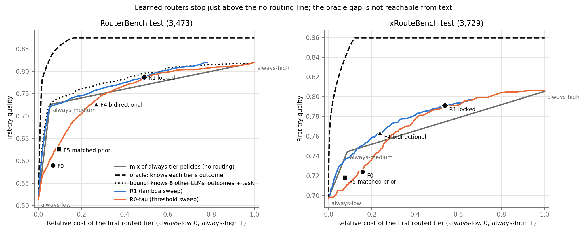
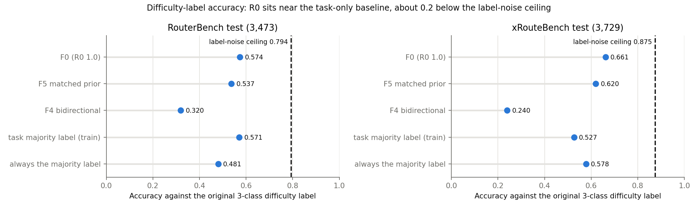
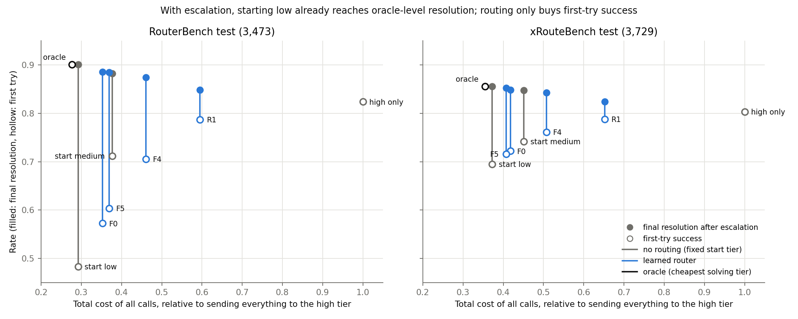

# 라우팅 성능이 멈추는 경계 — 2026-10-13

R0 계열 재학습(F1~F5)과 R1 모두 초기 R0나 단순 기준선을 크게 넘지 못했다. 이 분석은 **성능이 어디서 멈추는지**와 **그 경계가 무엇 때문인지**를 봉인 test 7,202문항(RouterBench 3,473 + xRouteBench 3,729, v1 채점)에서 그림으로 보인다. 새 학습·추론은 없다. 기존 test 점수(R0·R1 8192 logits), F0·F4·F5 최종 예측, train만으로 맞춘 보정을 다시 집계했다. 곡선은 test에서 얻을 수 있는 범위를 **기술**한 것이며, 모델·문턱·λ를 고르는 데 쓰지 않는다.

## 1. 결론

1. **라우팅 품질은 "라우팅하지 않는 선" 바로 위에서 멈춘다.** 같은 비용에서 고정 단계들을 섞어 쓰는 선(혼합선)보다 R1은 최대 +.036(RouterBench)·+.017(xRouteBench) 높다. 과제 이름만 보는 표 조회(+.033)와 정답 난이도 라벨을 그대로 준 경우(+.036)도 같은 높이다.
2. **그 경계는 텍스트로 얻을 수 있는 정보의 한계다.** 같은 문항을 다른 LLM 8개가 맞혔는지까지 알려 줘도 +.052에 그친다(RouterBench). 문항별 oracle(+.199/+.113)과의 큰 차이는 질문 내용으로 예측할 수 없는 "모델별 우연한 성공·실패"다.
3. **난이도 라벨 정확도는 과제 기준선 근처에서 멈춘다.** RouterBench에서 R0(.574)는 과제별 최빈 라벨(.571)과 같다. 라벨 자체의 흔들림을 고려한 이론 상한(.794, xRouteBench .875)보다 약 .2 낮다. 이 .2는 라벨 잡음으로 설명되지 않고, 텍스트만으로 풀이율을 알아내지 못하는 몫(정보 부족 또는 모델 한계)이다.
4. **상향(escalation)을 허용하면 "싸게 시작"이 이미 oracle 수준의 최종 해결률을 낸다.** low부터 시작해 실패하면 올리는 방식이 최종 해결률 .901(RouterBench)·.856(xRouteBench)로 oracle과 같고, 비용도 oracle의 1.05배 수준이다. 학습한 라우터는 최종 해결률을 올리지 못하고 **첫 시도 성공률을 비용과 바꿀 뿐**이다.

## 2. 첫 시도 품질의 경계



| 같은 비용에서 혼합선 대비 최대 이득 | RouterBench | xRouteBench |
|---|---:|---:|
| oracle: 각 단계의 결과를 미리 앎 | +.199 | +.113 |
| 다른 LLM 8개의 정답 여부 + 과제(train 보정) | +.052 | (원천 데이터 연결 불가) |
| R1 성공 logit, λ 변화 | +.036 | +.017 |
| 정답 난이도 라벨 + train 보정 | +.036 | +.012 |
| 과제 이름 + train 보정 | +.033 | .000 |
| R0-τ (누적 확률 문턱) | +.020 | +.016 |

| 상대 비용 .3 이하에서 가장 높은 첫 시도 품질 | RouterBench | xRouteBench |
|---|---:|---:|
| oracle | .875 | .859 |
| 다른 LLM 8개 + 과제 | .773 | – |
| R1 | .761 | .773 |
| 과제 이름 | .751 | .729 |
| 정답 난이도 라벨 | .747 | .754 |
| R0-τ | .745 | .762 |

- 정답 난이도 라벨을 알아도 R1과 같은 높이라는 점이 중요하다. **R0가 난이도를 완벽히 맞혀도 라우팅 품질은 R1 수준에서 멈춘다.**
- 운영 R0(F0)는 RouterBench에서 혼합선보다 −.138 낮다. 같은 점수로 문턱만 바꾼 R0-τ 곡선은 상대 비용 .3 이상에서 혼합선을 넘으므로(최대 +.020), F0의 손해는 대부분 고정 연결 규칙(easy→low…) 때문이다.

## 3. 난이도 라벨 정확도의 경계



| 원래 3단계 라벨 정확도 | RouterBench | xRouteBench |
|---|---:|---:|
| 라벨 잡음 상한(진짜 풀이율을 아는 예측기) | .794 | .875 |
| F0 (운영 R0 1.0) | .574 | .661 |
| 과제별 최빈 라벨(train) | .571 | .527 |
| F5 | .537 | .620 |
| 항상 최빈 라벨 | .481 | .578 |
| F4 | .320 | .240 |

라벨 잡음 상한은 문항의 진짜 풀이율 p를 안다고 해도 관측 라벨을 맞힐 수 있는 최대 정확도다. 풀이율 분포를 train에서 Beta(a, b)로 맞추고(RouterBench a=1.85·b=1.15, xRouteBench a=.69·b=.52), 모델 11개·18개가 그 확률로 독립적으로 푼다고 가정해 계산했다. 실제 모델은 실력이 서로 달라 라벨이 이보다 덜 흔들리므로, 이 값은 상한의 **보수적 추정**이다.

## 4. 실제 해결률과 비용



| RouterBench | 첫 시도 성공 | 최종 해결 | 평균 호출 | 총 비용(high만 대비) | 첫 시도 혼합선 대비 |
|---|---:|---:|---:|---:|---:|
| low부터 시작 | .483 | **.901** | 1.74 | **.292** | 0 |
| medium부터 시작 | .712 | .882 | 1.29 | .377 | 0 |
| high만 | .824 | .824 | 1.00 | 1.000 | 0 |
| F0 (운영 R0 1.0) | .572 | .885 | 1.48 | .352 | −.138 |
| F5 | .603 | .885 | 1.45 | .369 | −.105 |
| F4 | .705 | .874 | 1.31 | .461 | −.020 |
| R1 (잠긴 정책) | .787 | .849 | 1.10 | .595 | +.018 |
| oracle (처음부터 풀 수 있는 가장 싼 단계) | .901 | .901 | 1.20 | .277 | +.133 |

| xRouteBench | 첫 시도 성공 | 최종 해결 | 평균 호출 | 총 비용(high만 대비) | 첫 시도 혼합선 대비 |
|---|---:|---:|---:|---:|---:|
| low부터 시작 | .695 | **.856** | 1.53 | **.372** | 0 |
| medium부터 시작 | .741 | .848 | 1.26 | .451 | 0 |
| high만 | .803 | .803 | 1.00 | 1.000 | 0 |
| F0 | .722 | .848 | 1.30 | .418 | −.025 |
| F5 | .716 | .852 | 1.35 | .407 | −.021 |
| F4 | .761 | .842 | 1.19 | .507 | +.009 |
| R1 (잠긴 정책) | .788 | .824 | 1.14 | .652 | +.017 |
| oracle | .856 | .856 | 1.29 | .355 | +.112 |

- **최종 해결률은 늦게 시작할수록 떨어진다.** low에서 시작하면 세 모델 중 하나만 풀어도 해결되지만, 높은 단계에서 시작하면 그 아래 단계의 기회가 사라진다. 그래서 어떤 라우터도 "low부터"의 최종 해결률을 넘지 못한다.
- 라우터가 사는 것은 **첫 시도 성공**이다. RouterBench에서 F0는 low부터보다 첫 시도 +.089에 비용 +.060을 쓰고, medium부터 시작하는 것보다 비용은 .025 싸지만 첫 시도가 .140 낮다.
- 따라서 서비스의 비용 대비 품질은 "최종 해결률"이 아니라 **첫 시도 실패 한 번의 비용(지연·불만·이탈)**을 얼마로 보느냐에 달려 있다. 그 값이 작으면 라우터 없이 싸게 시작하는 것이 최선이고, 크면 첫 시도 성공을 올리는 라우터(R1류)가 의미를 가진다.

## 5. 한계

- v1 채점 기준이다. v1의 채점 오류(특히 RouterBench GSM8K)가 비싼 모델의 실패를 부풀려, high만 쓸 때의 품질과 "늦게 시작"의 해결률을 실제보다 낮게 만든다(채점 점검 보고서 참조).
- 시뮬레이션은 사용자가 실패할 때마다 끝까지 상향한다고 가정한다.
- "다른 LLM 8개" 경계는 RouterBench만 계산했다. xRouteBench 원천 기록과 데이터셋 ID를 연결하지 않았다.
- 곡선은 test에서의 범위를 보인 것이며, 그 위의 점을 정책으로 고르면 test를 보고 고르는 것이 된다.

## 6. 재현

```bash
python experiments/results/routing-ceiling-20261013/ceiling_analysis.py \
  --test <retraining-effect-f4 kit>/inputs/test.parquet \
  --train ml/artifacts/routing-objective-continual-v1/dataset/train.parquet \
  --scores-root experiments/results/context-length-qualification-20260925 \
  --f4-run <Drive>/LLM_Router/retraining-effect-f4/runs/retraining-effect-v3-f4-run001 \
  --f5-run <Drive>/LLM_Router/retraining-effect-f5/runs/retraining-effect-v4-f5-run001 \
  --routerbench-raw ml/data/raw --output-dir experiments/results/routing-ceiling-20261013
python experiments/results/routing-ceiling-20261013/plot_ceiling.py experiments/results/routing-ceiling-20261013
```

산출물: [curves.csv](curves.csv)(곡선 점), [curve-summary.csv](curve-summary.csv), [methods-resolution-cost.csv](methods-resolution-cost.csv), [label-accuracy-ceiling.csv](label-accuracy-ceiling.csv), [notes.json](notes.json).
