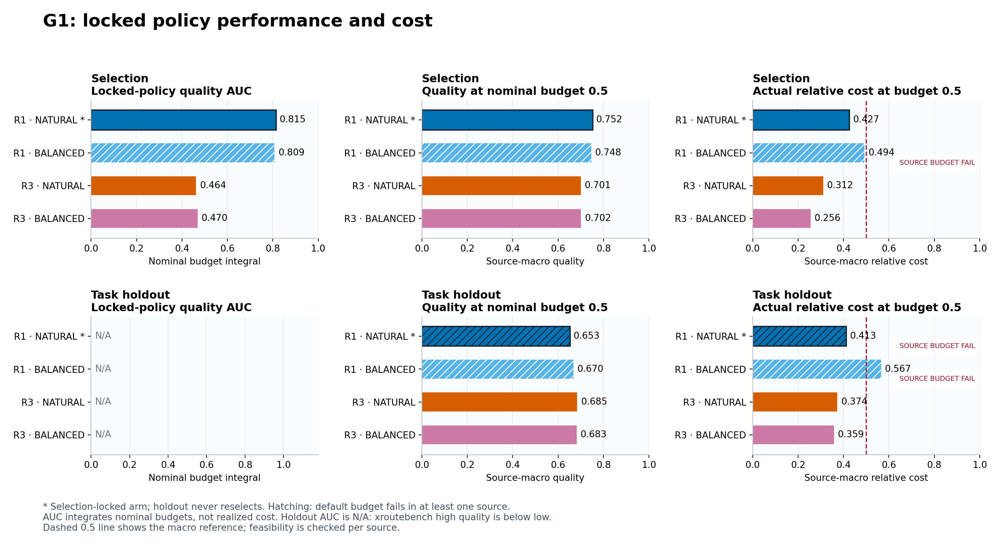
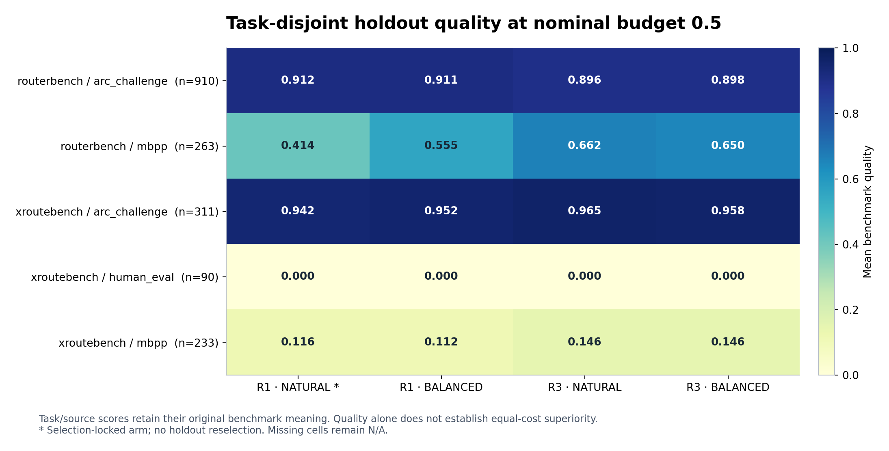
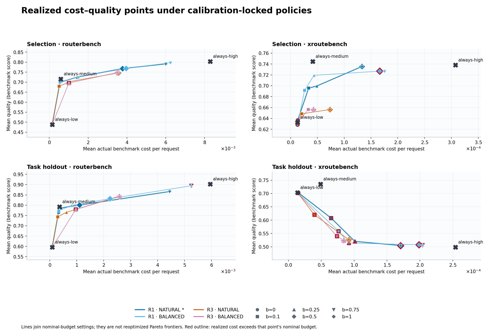
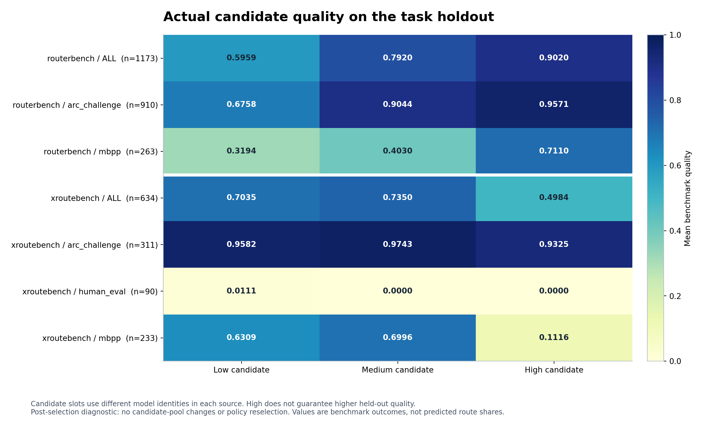
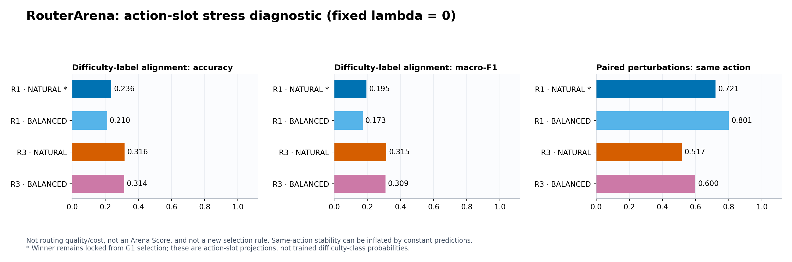

# G1 R1·R3 학습 및 일반화 평가 분석 보고서

작성일: 2026-09-25 · 실험: `routing-generalization-v1` · seed 42 · 네 arm 각각 2,007 optimizer steps

## 1. 결론부터

**선정용 데이터에서는 R1-natural이 선택됐지만, 미관측 과제에서 비용 기준을 실패했습니다. 이번 결과로 운영 라우터에 바로 탑재할 방법을 확정하지 않는 것이 타당합니다.** R3는 미관측 과제에서 더 좋은 품질·비용 조합을 보였으므로 후속 비교 가치가 있습니다. 그러나 네 방법 모두 xRouteBench에서 단순 단일후보 기준선보다 불리하며, 같은 holdout을 보고 R3로 승자를 바꾸지는 않습니다.

| 판단 대상 | 확인된 결과 | 판단 |
|---|---|---|
| 사전 규칙에 따른 연구 후보 | Selection AUC R1-natural 0.8147; 모든 출처 기본 예산 통과 | **R1-natural 선정 유지** |
| 미관측 과제의 비용 준수 | R1-natural의 xRouteBench 상대비용 0.6522 > 0.5 | **운영 채택 근거 부족** |
| R3의 일반화 가능성 | Holdout 품질 R3-natural 0.6850, R1-natural 0.6526; R3 두 방법 비용 통과 | 후속 확인 실험 대상, 사후 재선정 아님 |
| 간단한 기준선 대비 이득 | xRouteBench에서 always-medium이 네 방법보다 품질이 높고 비용도 낮음 | 질문별 라우터의 추가 이득을 입증하지 못함 |
| RouterArena | 8,379개 원문 + 412개 변형 쌍, 네 모델 평가 | action-slot의 난이도 라벨 일치 진단; 실제 라우팅 품질·비용 아님 |
| 현재 변경 범위 | 분석 보고서·그래프·단일 문서 | Spring/FastAPI·운영 모델·GCS CURRENT 변경 없음 |

`high`라는 이름은 학습 데이터에서 고정한 후보 슬롯입니다. 새로운 질문에서도 항상 가장 좋은 모델이라는 뜻은 아닙니다. 이번 holdout에서 그 가정이 깨졌습니다.

## 2. 무엇을 비교했나

| 방법 | 학습 목표 | 학습 분포 | 확인하려는 점 |
|---|---|---|---|
| R1-natural | 후보별 관측 성공/실패를 독립 BCE로 학습 | 원래 분포, 가중치 1 | 새 데이터 설계에서의 R1 기준 |
| R1-balanced | 동일한 R1 목표 | 출처×과제 loss 가중치 조정 | 적은 과제에 더 큰 학습 비중을 주면 좋아지는가 |
| R3-natural | 비용을 반영한 최선 후보 CE에 효용 차이 가중 | 원래 분포 | 성공 예측보다 비용을 고려한 선택 학습이 유리한가 |
| R3-balanced | 동일한 R3 목표 | 출처×과제 loss 가중치 조정 | 목표와 학습 분포를 함께 바꾼 효과 |

R3 구현은 `utility-gap-weighted-ce-v1`이며 직접적인 기대 regret 최소화와 동일한 알고리즘이라고 주장하지 않습니다. R1→R3는 목표와 target을 함께 바꾸므로 차이를 비용 항 하나의 효과로 해석하지 않습니다. Natural/balanced의 질문·후보·행 순서는 같고 loss weight만 다릅니다(평균 1, 최대 3).

네 모델은 동일한 pinned ModernBERT-base에서 새로 학습했습니다. 입력 길이 512, seed 42, 학습 batch 8×gradient accumulation 4, fp16, 2,007 steps를 공유합니다. Checkpoint 복구는 같은 실험의 재개이며 독립 반복 실험이 아닙니다. 최종 평가와 Arena 추론은 T4, float32, eager attention, batch 16으로 실행했습니다.

| 출처 | low 후보 | medium 후보 | high 후보 |
|---|---|---|---|
| RouterBench | Mistral-7B-Chat | Yi-34B-Chat | GPT-4-1106-preview |
| xRouteBench | GPT-OSS-20B | GPT-OSS-120B | Llama-4-Maverick |

이 공개 후보들의 결과를 서비스의 Haiku/Sonnet/Opus 성공 확률로 옮겨 해석할 수 없습니다.

## 3. 데이터와 평가 순서

| 역할 | 문항 수 | 사용 방법 |
|---|---:|---|
| Train | 18,591 | 가중치 학습, 후보 pool·비용·기준선 결정 |
| Calibration | 2,275 | 출처별 비용 정책 λ 결정 |
| Selection | 2,314 | 고정 λ를 적용하여 arm 선정 |
| Task holdout | 1,807 | 선정과 정책을 고정한 뒤 미관측 과제 평가 |

합계 24,987개는 기존 초기 train+dev를 재분할한 것입니다. 새로운 benchmark를 학습에 추가한 실험은 아닙니다. 이번 완료 범위는 이 G1의 calibration·selection·task holdout과 추가 Arena 진단입니다. 기존 원본 test·gate·feedback stream·망각 평가를 새로 실행한 것은 아닙니다. ARC-Challenge·MBPP·HumanEval을 task 단위로 보류했고 역할 간 duplicate group 교차는 0입니다. 이전 모델과 프로젝트 설계가 원천 데이터·taxonomy에 노출된 이력은 있으므로, 프로젝트 전체 관점의 완전 미노출 외부 시험으로 부르지 않습니다.

Calibration → selection lock → holdout 순서를 지켰습니다. 학습 bundle에는 holdout이 없었고 lock 검증 후 전달했습니다. CPU에서 느리게 수행하던 부분 추론은 T4에서 네 모델을 같은 조건으로 다시 평가한 뒤 중단했습니다. 이 보고서의 holdout 수치는 **완료·봉인된 T4 결과만** 사용합니다.

선정 지표는 출처별 고정 정책 품질을 명목 비용 예산 `[0, .1, .25, .5, .75, 1]`에 걸쳐 요약한 AUC입니다. 실제 비용 곡선을 재최적화한 면적이 아닙니다. 기본 예산 0.5를 모든 출처에서 만족한 방법 중 AUC 최대를 선택합니다. AUC는 품질을 low–high 차이로 정규화하고 [0,1]로 자르므로 원 품질과 예산 초과 여부를 함께 봐야 합니다.

¹ 표의 기본 품질·상대비용은 두 출처의 평균을 동등 가중한 값입니다. 전체 문항의 단순 평균이 아닙니다. 상대비용 0.5는 low–high 평균비용 간격의 중간이며 high 절대가격의 50%라는 뜻이 아닙니다. ² 실제비용은 원천 benchmark에 저장된 비용 척도이며 현재 서비스 청구액이 아닙니다.

## 4. Selection: R1-natural 선정

| 방법 | 고정 정책 AUC | 기본 품질¹ | 기본 상대비용¹ | 모든 출처 예산 ≤0.5 |
| --- | --- | --- | --- | --- |
| r1-natural | 0.8147 | 0.7518 | 0.4268 | 통과 |
| r1-balanced | 0.8094 | 0.7478 | 0.4939 | **실패** |
| r3-natural | 0.4637 | 0.7013 | 0.3121 | 통과 |
| r3-balanced | 0.4702 | 0.7020 | 0.2564 | 통과 |

R1-balanced는 평균 상대비용이 0.4939여도 xRouteBench에서 0.5198로 기준을 초과해 제외됐습니다. R1-natural의 AUC 자체도 더 높아, 비용 조건만으로 순위가 뒤집힌 것은 아닙니다. R3는 더 저렴하지만 이 단계에서는 품질을 더 많이 잃었습니다.

| 출처 | n | 방법 | 품질 | 실제 평균비용² | 상대비용 | 고정 λ | 예산 |
| --- | --- | --- | --- | --- | --- | --- | --- |
| routerbench | 2060 | r1-natural | 0.7682 | 0.003777985 | 0.4456 | 0.100 | 통과 |
| routerbench | 2060 | r1-balanced | 0.7686 | 0.003959606 | 0.4679 | 0.100 | 통과 |
| routerbench | 2060 | r3-natural | 0.7464 | 0.003560250 | 0.4189 | 0.000 | 통과 |
| routerbench | 2060 | r3-balanced | 0.7479 | 0.003498991 | 0.4114 | 0.010 | 통과 |
| xroutebench | 254 | r1-natural | 0.7354 | 0.000133079 | 0.4079 | 0.010 | 통과 |
| xroutebench | 254 | r1-balanced | 0.7269 | 0.000166045 | 0.5198 | 0.003 | **초과** |
| xroutebench | 254 | r3-natural | 0.6562 | 0.000073363 | 0.2052 | 0.000 | 통과 |
| xroutebench | 254 | r3-balanced | 0.6561 | 0.000042765 | 0.1014 | 0.010 | 통과 |

### 간단한 기준선과 비교

| 출처 | 기준선 | 품질 | 실제 평균비용² |
| --- | --- | --- | --- |
| routerbench | always-high | 0.8036 | 0.008293398 |
| routerbench | always-low | 0.4882 | 0.000148136 |
| routerbench | always-medium | 0.7158 | 0.000593195 |
| routerbench | train_best_single_within_source_pool | 0.8036 | 0.008293398 |
| routerbench | train_source_task_with_source_fallback | 0.8036 | 0.008293398 |
| xroutebench | always-high | 0.7380 | 0.000307533 |
| xroutebench | always-low | 0.6326 | 0.000012892 |
| xroutebench | always-medium | 0.7447 | 0.000041376 |
| xroutebench | train_best_single_within_source_pool | 0.7380 | 0.000307533 |
| xroutebench | train_source_task_with_source_fallback | 0.7616 | 0.000133246 |

RouterBench에서 R1-natural은 always-high 대비 평균 품질이 약 0.0354 낮지만 비용은 약 54.45% 줄였습니다. 이는 품질과 비용의 교환관계입니다. xRouteBench에서는 always-medium의 품질 0.7447·비용 0.000041376이 네 라우터의 기본 운영점 모두를 지배합니다. Train의 task 기준선도 R1-natural과 거의 같은 비용에서 품질이 더 높습니다. 따라서 연구 비교군 내 승리만으로 라우터 자체의 경제적 이득을 주장할 수 없습니다.

## 5. Task holdout: 일반화와 비용 기준 실패

| 방법 | 고정 정책 AUC | 기본 품질¹ | 기본 상대비용¹ | 모든 출처 예산 ≤0.5 |
| --- | --- | --- | --- | --- |
| r1-natural | N/A | 0.6526 | 0.4128 | **실패** |
| r1-balanced | N/A | 0.6695 | 0.5672 | **실패** |
| r3-natural | N/A | 0.6850 | 0.3743 | 통과 |
| r3-balanced | N/A | 0.6830 | 0.3593 | 통과 |

**네 방법의 source-macro AUC는 모두 N/A입니다.** xRouteBench에서 high 후보 품질 0.4984가 low의 0.7035보다 낮아 정규화 분모가 음수가 됐기 때문입니다. 평가 실패나 누락을 0점으로 표시한 것이 아닙니다. 후보 순서를 바꾸거나 해당 출처를 빼고 평균하지 않았습니다.

| 출처 | n | 방법 | 품질 | 실제 평균비용² | 상대비용 | 고정 λ | 예산 |
| --- | --- | --- | --- | --- | --- | --- | --- |
| routerbench | 1173 | r1-natural | 0.8005 | 0.001105606 | 0.1734 | 0.100 | 통과 |
| routerbench | 1173 | r1-balanced | 0.8312 | 0.002232423 | 0.3654 | 0.100 | 통과 |
| routerbench | 1173 | r3-natural | 0.8431 | 0.002572909 | 0.4235 | 0.000 | 통과 |
| routerbench | 1173 | r3-balanced | 0.8423 | 0.002584550 | 0.4255 | 0.010 | 통과 |
| xroutebench | 634 | r1-natural | 0.5047 | 0.000170596 | 0.6522 | 0.010 | **초과** |
| xroutebench | 634 | r1-balanced | 0.5079 | 0.000198671 | 0.7690 | 0.003 | **초과** |
| xroutebench | 634 | r3-natural | 0.5268 | 0.000091927 | 0.3251 | 0.000 | 통과 |
| xroutebench | 634 | r3-balanced | 0.5237 | 0.000084270 | 0.2932 | 0.010 | 통과 |

R1-natural은 RouterBench에서 상대비용 0.1734로 저렴하지만 xRouteBench에서는 0.6522로 예산을 초과합니다. Macro 0.4128만 보면 통과처럼 보이므로 출처별 검사가 필수입니다. R1-balanced의 xRouteBench 상대비용은 0.7690까지 높아졌습니다. R3 두 방식은 두 출처 모두 기준을 지켰습니다.



### 미관측 과제별 품질

| 출처 | 과제 | n | r1-natural | r1-balanced | r3-natural | r3-balanced |
| --- | --- | --- | --- | --- | --- | --- |
| routerbench | arc_challenge | 910 | 0.9121 | 0.9110 | 0.8956 | 0.8978 |
| routerbench | mbpp | 263 | 0.4144 | 0.5551 | 0.6616 | 0.6502 |
| xroutebench | arc_challenge | 311 | 0.9421 | 0.9518 | 0.9646 | 0.9582 |
| xroutebench | human_eval | 90 | 0.0000 | 0.0000 | 0.0000 | 0.0000 |
| xroutebench | mbpp | 233 | 0.1159 | 0.1116 | 0.1459 | 0.1459 |

RouterBench MBPP에서 R3-natural의 품질은 0.6616으로 R1-natural의 0.4144보다 높지만, 같은 과제의 실제 비용도 0.0077032 대 0.0012958로 더 높습니다. 이를 같은 비용에서의 순수 품질 향상으로 읽으면 안 됩니다. xRouteBench MBPP에서는 R3도 약 0.1459에 머물고, 단일 medium 후보 0.6996보다 크게 낮습니다.



### Holdout의 기준선

| 출처 | 기준선 | 품질 | 실제 평균비용² |
| --- | --- | --- | --- |
| routerbench | always-high | 0.9020 | 0.005955200 |
| routerbench | always-low | 0.5959 | 0.000088596 |
| routerbench | always-medium | 0.7920 | 0.000361271 |
| routerbench | train_best_single_within_source_pool | 0.9020 | 0.005955200 |
| routerbench | train_source_task_with_source_fallback | 0.9020 | 0.005955200 |
| xroutebench | always-high | 0.4984 | 0.000254219 |
| xroutebench | always-low | 0.7035 | 0.000013754 |
| xroutebench | always-medium | 0.7350 | 0.000048862 |
| xroutebench | train_best_single_within_source_pool | 0.4984 | 0.000254219 |
| xroutebench | train_source_task_with_source_fallback | 0.4984 | 0.000254219 |

Holdout에서도 xRouteBench always-medium(품질 0.7350, 비용 0.000048862)은 네 방법의 기본 정책보다 품질이 높고 비용이 낮습니다. 가장 저렴한 always-low(품질 0.7035, 비용 0.000013754)도 네 방법 모두를 지배합니다. Train의 source/task 기준선이 같아진 경우는 학습에서 못 본 과제가 source 기준선으로 fallback한 정상 동작입니다. Oracle은 결과를 미리 아는 상한이므로 운영 가능한 기준선으로 취급하지 않습니다.



### 왜 xRouteBench의 high가 역전됐나

MBPP에서 low/medium/high 품질은 0.6309/0.6996/0.1116입니다. 전체 high−low 하락분의 약 **93.08%**가 이 과제에서 나왔습니다. ARC에서도 high가 low·medium보다 낮습니다. Task를 동등하게 가중해도 역전은 유지되므로 구성비만의 착시가 아닙니다.

HumanEval 90개에서 low는 1개 성공, medium/high는 0개 성공이며 결측은 없습니다. 원천 응답·채점기·실행 실패·출력 형식 조건을 감사할 필요가 있습니다. 현재 집계만으로 데이터 오류나 실제 모델 능력 부재를 단정하지 않았고, 나쁜 결과라는 이유로 해당 과제를 제외하지 않았습니다.



집계 원본: [후보 품질·비용·결측 분석](evidence/holdout-pool-analysis.json).

## 6. 학습 분포와 목표의 효과

Selection:

| 변화(뒤−앞) | AUC 차이 | 품질 차이 | 상대비용 차이 |
| --- | --- | --- | --- |
| R1의 balancing | -0.005362 | -0.004027 | +0.067093 |
| R3의 balancing | +0.006513 | +0.000673 | -0.055686 |
| natural의 R1→R3 | -0.351086 | -0.050474 | -0.114702 |
| balanced의 R1→R3 | -0.339211 | -0.045774 | -0.237480 |

Holdout:

| 변화(뒤−앞) | AUC 차이 | 품질 차이 | 상대비용 차이 |
| --- | --- | --- | --- |
| R1의 balancing | N/A | +0.016923 | +0.154413 |
| R3의 balancing | N/A | -0.002004 | -0.014930 |
| natural의 R1→R3 | N/A | +0.032354 | -0.038523 |
| balanced의 R1→R3 | N/A | +0.013428 | -0.207865 |

Balanced가 항상 낫다는 증거는 없습니다. R1 balancing은 selection에서 품질을 낮추고 비용을 높였고, holdout에서는 품질 상승과 더 큰 비용 증가를 동반했습니다. R3 balancing은 selection에서 작은 평균 품질 개선·비용 감소가 있었으나 holdout에서는 평균 품질이 조금 낮아졌습니다. Seed 1회이므로 작은 차이에 통계적 유의성이나 반복 안정성을 부여하지 않습니다. 이번 평가기는 신뢰구간을 산출하지 않았습니다.

## 7. RouterArena: 별도 스트레스 진단

원문 8,379개와 같은 질문에서 만든 변형 412쌍을 평가했습니다. 변형을 독립 문항처럼 더해 표본 수를 부풀리지 않습니다. 기존 prepared 입력·overlap 감사·helper의 SHA를 확인하고, G1의 모든 역할이 기존 감사 범위와 동일한 질문임을 검증했습니다.

G1의 출처별 후보 응답·비용이 Arena에는 없으므로 출처별 λ 정책을 임의로 옮기지 않았습니다. **λ=0의 action-slot argmax를 easy/medium/hard로 투영**했습니다. 따라서 아래 값은 난이도 라벨과의 일치 진단이며 실제 후보 선택의 정답률, Claude 성능, 비용 절감률, 공식 Arena Score가 아닙니다.

| 방법 | 원문 n | 라벨 일치율 | Macro-F1 | 균형 일치율 | 변형 쌍 동일 선택률 |
| --- | --- | --- | --- | --- | --- |
| r1-natural | 8379 | 0.2357 | 0.1953 | 0.3162 | 0.7209 |
| r1-balanced | 8379 | 0.2104 | 0.1726 | 0.2835 | 0.8010 |
| r3-natural | 8379 | 0.3158 | 0.3149 | 0.3403 | 0.5170 |
| r3-balanced | 8379 | 0.3135 | 0.3094 | 0.3210 | 0.5995 |

단순 always-easy 라벨 기준선의 일치율은 47.49%로 네 방법 모두보다 높습니다. 다만 이는 라벨 분포에 의존하는 상수 기준선이고, 이 진단의 Macro-F1 최대는 `r3-natural`입니다. 이는 잠긴 `r1-natural`을 교체하는 선정 근거가 아닙니다. R3-natural의 Macro-F1은 0.3149로 R1-natural의 0.1953보다 높지만, 변형 쌍 동일 선택률은 0.5170으로 R1-natural의 0.7209보다 낮습니다. R3-natural의 균형 일치율도 0.3403이며 quadratic kappa는 0.0530에 그칩니다. 난이도와 강하게 일치하는 일반적 규칙을 학습했다고 주장하기에는 근거가 약합니다. 질문 변형에서 같은 답을 고른 비율이 높아도 그 선택의 품질이 높다는 뜻은 아닙니다. 성능 표만으로 출처를 학습했는지 난이도 자체를 학습했는지의 인과관계를 증명할 수 없습니다.



512-token 제한으로 원문 748개(8.93%)가 잘렸으며 네 모델에 같은 조건을 적용했습니다. 카테고리·domain별 세부 수치와 confusion matrix는 [Arena 원본 요약](arena-stress/results/summary.json)에 보존했습니다. Medium 선택 비율을 별도 분석하는 내용은 포함하지 않았습니다.

## 8. 재학습 파이프라인에 대한 판단과 다음 순서

1. **지금 바로 운영 모델을 교체하지 않습니다.** R1-natural은 연구 선정 결과로 유지하지만 holdout 예산 실패·단일후보 기준선 열세가 있어 배포 우월성을 충족하지 못했습니다. R3도 같은 xRouteBench 기준선 문제를 해결하지 못했습니다.
2. **xRouteBench 코딩 과제의 원천 채점 조건을 먼저 감사합니다.** 원천 결과를 확인해 정상적인 낮은 성능인지 형식/실행 문제인지 구분합니다. 수정이 필요하면 데이터·평가 버전을 올리고 이번 결과는 원본대로 보존합니다.
3. **다음 비교는 새 독립 평가 계약으로 합니다.** R0와 R1, 일반화에서 가능성이 보인 R3를 같은 데이터·후보·학습 예산·새 holdout으로 비교하고 여러 seed의 불확실성을 측정합니다. Source/task 고정 선택 기준선과 비용 준수 검사를 반드시 포함합니다. 이번 holdout에 맞춰 λ를 수정한 값을 새 독립 성능으로 보고하지 않습니다.
4. **서비스 후보 pool의 관측 데이터를 마련합니다.** R1은 후보별 실제 성공/실패와 관측 mask, R3는 품질·비용 관측이 필요합니다. 관측하지 않은 후보를 실패로 채우지 않습니다. 공개 benchmark의 low/medium/high를 Claude 모델에 이름만 대응시키지 않습니다.
5. **방식 확정 후 main 기반의 분리 브랜치로 구현합니다.** 사용자 계획대로 R0와 채택 방식의 Spring/FastAPI 변경을 각각 격리하고 Spring 담당자용 API·DTO·설정·행동 변경 목록을 남깁니다. 새 모델·정책의 승격/rollback과 실제 비용 조건을 검증한 뒤 탑재합니다.

기존 A의 R0/R1/R2에서는 R1이 당시 기준에서 선정됐습니다. 그러나 A와 G1은 분할·후보 pool·비용·지표 정의가 달라 점수 차이를 개선률로 계산할 수 없습니다. G1에는 같은 조건의 R0/R2가 없으므로 R0~R3 전체의 최종 우승을 입증한 실험도 아닙니다. 기존 결과: [A 분석](../routing-objectives-continual-v1-A-20260924/ANALYSIS.md).

## 9. 검증·보존·재현

- 네 arm의 동일 run plan, 2,007-step 완료 manifest 및 원격 모델·점수 파일 SHA를 검증했습니다.
- 로컬 독립 재계산으로 calibration 정책·selection 지표 1,504개가 원본과 정확히 일치했습니다. Holdout도 저장 logits와 봉인 데이터에서 다시 계산했습니다.
- Holdout·Arena의 선택·평가 lock을 확인했고, holdout/Arena에서 arm 또는 λ를 다시 고르지 않았습니다.
- 모델·checkpoint는 기존 개인 Drive의 R1/R3 세션 폴더에 보존됩니다. 최종 평가 archive는 별도 새 Drive 폴더에 쓰고 재읽기 SHA를 확인했습니다.
- 이 평가 실행은 개인 Colab Pro 계정의 계산 자원을 사용했습니다. 완료 후 CPU·T4 세션을 모두 종료했고 활성 0개·0 CU/h·잔액 181.73 CU를 확인했습니다. 운영 GCP 프로젝트의 GPU job이나 GCS CURRENT 변경은 없었습니다.
- Markdown·PNG·SVG 및 수치 원본을 이 폴더에 함께 보존했습니다. 이번 작업에서 커밋·푸시·Spring/FastAPI 수정은 하지 않았습니다.

선정 재계산: [검증 기록](evidence/selection-recalculation.json) · Holdout 재계산: [검증 기록](evidence/holdout-recalculation.json) · Arena 재계산: [검증 기록](evidence/arena-recalculation.json)

| 원본 | SHA-256 |
| --- | --- |
| selection-lock/manifest.json | c6fad17c23390305d62769e30f213c8381db620679c949ac6a80bd3695ee75f3 |
| holdout-scores/manifest.json | f97a2c7003930c6866446ebb6d1d5453f654973ab99a6d8855a5b4f3ec4898b7 |
| holdout-report/manifest.json | 8fdc1e03c28063761b3235e7dd6b1c4a4d06461faf59f131cc398b07762e3582 |
| arena-stress/results/manifest.json | f6eed290d4981880e0bbf4d152da945cc97549f22f9b703da048eba29f2a4e43 |

Drive 보존 위치(MyDrive 기준): `LLM_Router/routing-generalization-v1-20260925/evaluation-final-1790317240`

Archive SHA-256: `ff3c72721881f7dbec6ec75ad47c7ecf8b03998413354675c7625ef8487448f0` · 95,344,820 bytes. [보존 영수증](archive-receipt.json)

그림 재생성:

```bash
MPLCONFIGDIR=/private/tmp/g1-mpl-cache .venv/bin/python \
  ml/scripts/render-generalization-report.py \
  --results-dir experiments/results/routing-generalization-v1-20260925
```

### 부록: 모든 명목 예산의 위반 지점

| 평가 | 방법 | 출처 | 명목 예산 | 실제 상대비용 |
| --- | --- | --- | --- | --- |
| Selection | r1-natural | xroutebench | 0.0000 | 0.001583 |
| Selection | r1-balanced | xroutebench | 0.0000 | 0.000901 |
| Selection | r1-balanced | xroutebench | 0.5000 | 0.519797 |
| Selection | r3-balanced | routerbench | 0.1000 | 0.105520 |
| Selection | r3-balanced | xroutebench | 0.0000 | 0.000644 |
| Holdout | r1-natural | xroutebench | 0.0000 | 0.004873 |
| Holdout | r1-natural | xroutebench | 0.1000 | 0.213827 |
| Holdout | r1-natural | xroutebench | 0.2500 | 0.362973 |
| Holdout | r1-natural | xroutebench | 0.5000 | 0.652245 |
| Holdout | r1-balanced | routerbench | 0.7500 | 0.879795 |
| Holdout | r1-balanced | xroutebench | 0.1000 | 0.260848 |
| Holdout | r1-balanced | xroutebench | 0.2500 | 0.325222 |
| Holdout | r1-balanced | xroutebench | 0.5000 | 0.768998 |
| Holdout | r1-balanced | xroutebench | 0.7500 | 0.790939 |
| Holdout | r3-natural | xroutebench | 0.1000 | 0.107482 |
| Holdout | r3-natural | xroutebench | 0.2500 | 0.325089 |
| Holdout | r3-balanced | routerbench | 0.1000 | 0.149392 |
| Holdout | r3-balanced | xroutebench | 0.0000 | 0.002151 |
| Holdout | r3-balanced | xroutebench | 0.1000 | 0.250766 |
| Holdout | r3-balanced | xroutebench | 0.2500 | 0.293245 |

기본 0.5 예산의 통과가 모든 예산에서의 통과를 뜻하지 않습니다. 위반 지점도 정해진 AUC 계산에 남겨 두고 별도로 공개했습니다.

### 용어

| 용어 | 쉬운 의미 |
|---|---|
| Arm | 비교하는 학습 방법 하나 |
| Split / Partition | 데이터에서 학습·보정·선정·시험 역할을 나눈 묶음 |
| Manifest | 파일 목록·조건·SHA가 담긴 실험의 확인서 |
| SHA-256 | 파일 내용이 바뀌었는지 확인하는 지문 |
| Selection lock | 시험을 보기 전에 고정한 방법과 비용 정책 |
| λ | 후보를 고를 때 비용에 주는 감점 강도 |
| Source macro | 두 데이터 출처의 평균을 같은 비중으로 합친 값 |
| Baseline | 복잡한 학습 없이 비교할 수 있는 기준 방법 |
| N/A AUC | 정규화 조건이 성립하지 않아 계산할 수 없음; 0점과 다름 |
