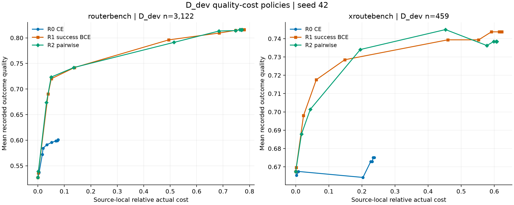
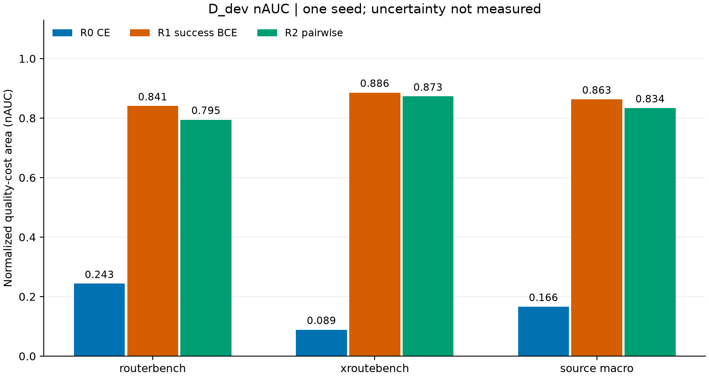

# R0/R1/R2 통합 A 비교 보고서

D_dev source-macro 비용–품질 nAUC의 validation lock 선정 방법은 **R1 success BCE**다. 이 보고서는 로컬의 봉인된 검증 파일과 lock을 대조한 결과이며 운영 승인·활성화 증거가 아니다.

- 범위: `routing-objectives-continual-v1-A`, seed `42`, canonical 세 방법. B·RouterDC·추가 seed 반복은 포함하지 않는다.
- validation lock SHA-256: `ddae362cb6e826376383427933deae22bab1061390709be8f781345caa608e5f`
- 파일 checksum, 공통 데이터·학습 계약, 동일 validation 행·outcome, source-macro 계산, locked policy 및 승자·동률 규칙 일치 확인.
- model weight는 이 renderer에서 다시 로드하거나 검증하지 않는다. 모델 크기는 봉인 manifest의 기록값이다.

## 1. 비교와 선정

| 방법 | seed | train / D_dev 행 | 실제 step | RB nAUC | xRB nAUC | source macro nAUC |
|---|---:|---:|---:|---:|---:|---:|
| R0 CE | 42 | 21,406 / 3,581 | 2,007 | 0.243388 | 0.088843 | **0.166115** |
| R1 success BCE | 42 | 21,406 / 3,581 | 2,007 | 0.840588 | 0.885770 | **0.863179** |
| R2 pairwise | 42 | 21,406 / 3,581 | 2,007 | 0.794743 | 0.873005 | **0.833874** |

| 공통 실행 조건 | 봉인된 값 |
|---|---|
| backbone / revision | `answerdotai/ModernBERT-base` / `8949b909ec900327062f0ebf497f51aef5e6f0c8` |
| max length / epochs | 512 / 3 |
| batch / accumulation / learning rate | 8 / 4 / 2e-05 |
| sampler / precision | `shuffle` / `fp16` |
| runtime | `modernbert-runtime-cu124-v1` |
| outcome dataset | `routing-outcomes-continual-v1-A` |
| outcome manifest SHA-256 | `28cbc342c510fee7589151f99cdfe440281bfbe6288abd749eac9fd52f4c0b19` |
| validation data SHA-256 | `aa9d973fcf886c7465fbf9e06701984d099cd74a5eabf508cc610845613edef8` |

각 source의 실제 후보 pool에서 always-low/high를 기준으로 비용·품질을 정규화하고 고정 budget grid의 clipped 회복 품질을 적분한 nAUC다. 두 source의 nAUC를 같은 비중으로 평균하며 전체 행 가중 평균과 구분한다. 곡선은 D_dev에서 관측한 정책 점을 연결한 것이며 test frontier가 아니다.

| source | D_dev 지원 행 | 실제 pool 해석 |
|---|---:|---|
| routerbench | 3,122 | 해당 source의 고정 low/medium/high 후보; 다른 source·현재 Claude와 동일 모델로 취급하지 않음 |
| xroutebench | 459 | 해당 source의 고정 low/medium/high 후보; 다른 source·현재 Claude와 동일 모델로 취급하지 않음 |

## 2. 동결한 budget별 품질·비용

| 방법 | source | budget | λ | 관측 품질 | 평균 기록 비용 | 상대 실제 비용 | budget 초과 |
|---|---|---:|---:|---:|---:|---:|---|
| R0 CE | routerbench | 0.00 | 30.000000 | 0.527178 | 0.00014199 | 0.000000 | 아니오 |
| R0 CE | routerbench | 0.10 | 0.000000 | 0.600993 | 0.00074718 | 0.076359 | 아니오 |
| R0 CE | routerbench | 0.25 | 0.000000 | 0.600993 | 0.00074718 | 0.076359 | 아니오 |
| R0 CE | routerbench | 0.50 | 0.000000 | 0.600993 | 0.00074718 | 0.076359 | 아니오 |
| R0 CE | routerbench | 0.75 | 0.000000 | 0.600993 | 0.00074718 | 0.076359 | 아니오 |
| R0 CE | routerbench | 1.00 | 0.000000 | 0.600993 | 0.00074718 | 0.076359 | 아니오 |
| R0 CE | xroutebench | 0.00 | 10.000000 | 0.667474 | 0.00001433 | 0.000000 | 아니오 |
| R0 CE | xroutebench | 0.10 | 10.000000 | 0.667474 | 0.00001433 | 0.000000 | 아니오 |
| R0 CE | xroutebench | 0.25 | 0.003000 | 0.675099 | 0.00011824 | 0.234265 | 아니오 |
| R0 CE | xroutebench | 0.50 | 0.003000 | 0.675099 | 0.00011824 | 0.234265 | 아니오 |
| R0 CE | xroutebench | 0.75 | 0.003000 | 0.675099 | 0.00011824 | 0.234265 | 아니오 |
| R0 CE | xroutebench | 1.00 | 0.003000 | 0.675099 | 0.00011824 | 0.234265 | 아니오 |
| R1 success BCE | routerbench | 0.00 | 30.000000 | 0.527178 | 0.00014199 | 0.000000 | 아니오 |
| R1 success BCE | routerbench | 0.10 | 1.000000 | 0.720083 | 0.00054258 | 0.050545 | 아니오 |
| R1 success BCE | routerbench | 0.25 | 0.300000 | 0.742008 | 0.00123968 | 0.138502 | 아니오 |
| R1 success BCE | routerbench | 0.50 | 0.100000 | 0.795996 | 0.00405852 | 0.494171 | 아니오 |
| R1 success BCE | routerbench | 0.75 | 0.010000 | 0.814734 | 0.00606738 | 0.747639 | 아니오 |
| R1 success BCE | routerbench | 1.00 | 0.000000 | 0.816176 | 0.00632003 | 0.779518 | 아니오 |
| R1 success BCE | xroutebench | 0.00 | 10.000000 | 0.667474 | 0.00001433 | 0.000000 | 아니오 |
| R1 success BCE | xroutebench | 0.10 | 0.300000 | 0.717583 | 0.00004192 | 0.062217 | 아니오 |
| R1 success BCE | xroutebench | 0.25 | 0.100000 | 0.728476 | 0.00008002 | 0.148112 | 아니오 |
| R1 success BCE | xroutebench | 0.50 | 0.030000 | 0.739370 | 0.00021821 | 0.459636 | 아니오 |
| R1 success BCE | xroutebench | 0.75 | 0.003000 | 0.743727 | 0.00027663 | 0.591356 | 아니오 |
| R1 success BCE | xroutebench | 1.00 | 0.003000 | 0.743727 | 0.00027663 | 0.591356 | 아니오 |
| R2 pairwise | routerbench | 0.00 | 100.000000 | 0.527178 | 0.00014199 | 0.000000 | 아니오 |
| R2 pairwise | routerbench | 0.10 | 3.000000 | 0.723350 | 0.00053860 | 0.050041 | 아니오 |
| R2 pairwise | routerbench | 0.25 | 1.000000 | 0.742008 | 0.00121852 | 0.135831 | 아니오 |
| R2 pairwise | routerbench | 0.50 | 1.000000 | 0.742008 | 0.00121852 | 0.135831 | 아니오 |
| R2 pairwise | routerbench | 0.75 | 0.030000 | 0.814254 | 0.00606325 | 0.747119 | 아니오 |
| R2 pairwise | routerbench | 1.00 | 0.000000 | 0.816095 | 0.00625594 | 0.771432 | 아니오 |
| R2 pairwise | xroutebench | 0.00 | 10.000000 | 0.667474 | 0.00001433 | 0.000000 | 아니오 |
| R2 pairwise | xroutebench | 0.10 | 1.000000 | 0.701395 | 0.00003389 | 0.044102 | 아니오 |
| R2 pairwise | xroutebench | 0.25 | 0.300000 | 0.734075 | 0.00010092 | 0.195213 | 아니오 |
| R2 pairwise | xroutebench | 0.50 | 0.100000 | 0.744968 | 0.00021512 | 0.452686 | 아니오 |
| R2 pairwise | xroutebench | 0.75 | 0.100000 | 0.744968 | 0.00021512 | 0.452686 | 아니오 |
| R2 pairwise | xroutebench | 1.00 | 0.100000 | 0.744968 | 0.00021512 | 0.452686 | 아니오 |

표의 품질·비용은 lock의 source별 λ를 저장된 질문별 logits·outcome에 다시 적용한 값이다. 단위는 원천 actual_cost 단위이며 이 보고서는 달러·현재 Claude 절감률로 변환하지 않는다. budget에 가능한 정책이 없으면 가장 낮은 비용의 정책도 목표를 초과할 수 있으며 그 사실을 그대로 표시한다.

## 3. 시간·크기와 출력 의미

| 방법 | 학습 device | 기록된 train 시간(s) | batch-1 forward p95(ms) | latency 표본 수 | 모델 artifact(MiB) |
|---|---|---:|---:|---:|---:|
| R0 CE | `cuda` | 6,653.12 | 39.494 | 59 | 574.16 |
| R1 success BCE | `cuda` | 2,959.33 | 37.788 | 59 | 574.16 |
| R2 pairwise | `cuda` | 2,987.15 | 49.019 | 59 | 574.16 |

학습 시간은 trainer가 기록한 wall time이다. 체크포인트에 저장된 학습 시간은 이어받을 수 있지만 유실·재실행으로 소모한 계산, 실패·복구·전송 및 전체 GPU 과금 시간을 모두 합산한 값은 아니다. p95는 warmup 뒤 batch-1 model forward 측정이며 tokenizer·서버·네트워크 지연을 포함하지 않는다. 미기록 시간·사용량은 추정해 채우지 않는다.

| 방법 | 학습 목표·출력 의미 |
|---|---|
| R0 CE | T1 easy/medium/hard 분류; score는 class softmax. 난이도 정확도와 LLM 성공률은 다름 |
| R1 success BCE | 실제 후보별 success를 독립 sigmoid로 예측. 세 값의 합이 1일 필요 없음 |
| R2 pairwise | 관측 quality 차이에 따른 후보 상대 score. class probability/confidence가 아님 |

## 4. 관측·해석·한계

- 관측: R1 success BCE의 source-macro nAUC와 R0 CE의 차이는 `+0.697064`다.
  같은 비교의 source별 차이: routerbench `+0.597200`, xroutebench `+0.796927`. source macro 개선이 모든 source의 개선을 뜻하지는 않는다.
- 관측: R1 success BCE의 source-macro nAUC와 R2 pairwise의 차이는 `+0.029305`다.
  같은 비교의 source별 차이: routerbench `+0.045845`, xroutebench `+0.012765`. source macro 개선이 모든 source의 개선을 뜻하지는 않는다.
- 선정은 nAUC 내림차순, 정확한 동률이면 default-budget validation 평균 비용·batch-1 p95·고정 method ID 순서와 일치한다. 단일 seed의 측정상 순위이며 통계적 우월성 또는 미래 서비스 성능 보장이 아니다.
- 결과만으로 label 압축·학습 신호·분포가 차이를 일으켰다고 인과적으로 확정하지 않는다. 원인 설명은 별도 통제 실험이 필요한 가설이다.
- seed 반복·paired group bootstrap CI는 이 입력에서 제공되지 않았으므로 미측정이다. 단일 seed의 표준편차 0을 안정성 근거로 쓰지 않는다.
- sealed test·D_gate·D_stream·D_retention_test·RouterArena 결과는 이 보고서 입력에 없으며 미측정이다. 0점이나 통과로 표시하지 않는다.
- 공개 outcome replay와 현재 Claude 서비스의 실제 응답 품질·사용량·가격을 구분한다. R1/R2 채택은 score·mapping·관측 가능한 feedback target/loss·gate 인수가 필요하다.

## 5. 보관·게시·활성화

| 상태 | 이 보고서의 근거 |
|---|---|
| GCS 모델 package 게시 | 외부 run 기록은 미완료로 표시 |
| CURRENT 갱신 | 외부 run 기록은 미완료로 표시 |
| 서버 활성화 | 외부 run 기록은 미완료로 표시 |
| 개인 Drive 보존 검증 | 외부 run 기록은 완료로 표시; 이 명령은 원격 상태를 독립 확인하지 않음 |

후보 학습 파일의 GCS 백업, 운영 package 게시, CURRENT 변경, 실제 serving 활성화는 서로 다른 단계다. validation lock의 승자가 정해져도 이 명령은 승인·게시·활성화하지 않는다.

## 6. 재현 근거

| 방법 | run manifest SHA-256 |
|---|---|
| R0 CE | `9aa168e45409ff72ac8c2eb1bdb45a4ebb32078df6bba113fe2f73e9ea0fa2c7` |
| R1 success BCE | `bd5fdc7bd2cbd0826123637bc41571abebe46e9fc1525c72e4619bf2146422ea` |
| R2 pairwise | `fc98abb00cacaedf2ecce22906bdea4de0766ed7e9a08837c8e614b4040602a0` |

입력 파일별 hash와 생성기 hash, machine-readable budget 집계는 `report.json`에 보존한다. 실제 model weight의 원격 보존과 추론 호환성은 별도 인수 절차로 확인한다.
